# The Equipoise Handbook

**From zero to a full technical understanding of the Equipoise project**

> Equipoise is a research prototype built for a college AIML mini-project. It is **not for
> clinical use**. Data: DRCR Retina Network, Protocol T (attribution in §4.11).

This handbook is one long file on purpose, so you can search it (Ctrl + F) and print it. It
explains what the code in this repository *actually does*. Every result number is followed
by its source in square brackets, for example `[reports/tables/m6_policy_values.csv]`.
"Not computed" means the code never produced that number. "UNVERIFIED" means we could not
check a reference.

## Table of contents

*Part A: The big picture*

- [00. How to use this handbook](#00-how-to-use-this-handbook)
- [01. Equipoise on one page](#01-equipoise-on-one-page)
- [02. The medical story](#02-the-medical-story)
- [03. The central idea: causation and counterfactuals](#03-the-central-idea-causation-and-counterfactuals)
- [04. The data](#04-the-data)

*Part B: Foundations from scratch*

- [05. Machine learning from zero](#05-machine-learning-from-zero)
- [06. The maths you need](#06-the-maths-you-need)
- [07. The Python toolbox](#07-the-python-toolbox)

*Part C: The pipeline, module by module*

- [08. M0 Data integration](#08-m0-data-integration)
- [09. M1 Preprocessing](#09-m1-preprocessing)
- [10. M2 EDA and statistical inference](#10-m2-eda-and-statistical-inference)
- [11. M3 Patient representation](#11-m3-patient-representation)
- [12. M4 Feature search](#12-m4-feature-search)
- [13. M5 Outcome models](#13-m5-outcome-models)
- [14. M6 Counterfactual engine (the core)](#14-m6-counterfactual-engine-the-core)
- [15. M7 Longitudinal analysis](#15-m7-longitudinal-analysis)
- [16. M8 Decision layer](#16-m8-decision-layer)
- [17. M9 Explainability and fairness](#17-m9-explainability-and-fairness)
- [18. M10 OCT screening (optional module)](#18-m10-oct-screening-optional-module)
- [19. M11 Engineering and MLOps](#19-m11-engineering-and-mlops)

*Part D: How it's built and how it runs*

- [20. How the project was built](#20-how-the-project-was-built)
- [21. Repository tour](#21-repository-tour)
- [22. Life of one prediction](#22-life-of-one-prediction)
- [23. The app, screen by screen](#23-the-app-screen-by-screen)
- [24. Running everything: a checklist from a fresh laptop](#24-running-everything-a-checklist-from-a-fresh-laptop)

*Part E: Results and honesty*

- [25. All results in one place](#25-all-results-in-one-place)
- [26. Key findings, ranked](#26-key-findings-ranked)
- [27. Limitations, ethics and safety](#27-limitations-ethics-and-safety)
- [28. Appendix: issues found while reading the code](#28-appendix-issues-found-while-reading-the-code)

*Part F: Report and viva pack*

- [29. Report source pack](#29-report-source-pack)
- [30. Literature survey and references](#30-literature-survey-and-references)
- [31. Viva question bank](#31-viva-question-bank)
- [32. Glossary](#32-glossary)
- [33. Concept index](#33-concept-index)

---

## 00. How to use this handbook

### 0.1 Who this is for

You are third-year computer engineering students. You know school maths (algebra,
graphs, a little probability) and basic Python syntax (variables, loops, functions, lists,
dictionaries). You do **not** need to know any machine learning, statistics, eye medicine or
MLOps. Every term is defined the first time it appears. If a word is used before it is
explained, that is a bug in this handbook; please note it.

### 0.2 Three reading paths

Pick the path that matches the time you have.

**The 1-hour path (enough to give a demo)**

| Order | Read | Why |
|---|---|---|
| 1 | §01 Equipoise on one page | What the project is and what it found |
| 2 | §03.1 to §03.6 | The core idea: why a randomized trial lets us ask "what if" |
| 3 | §23 The app, screen by screen | What you will click during the demo |
| 4 | §26 Key findings | The five sentences you must be able to say |
| 5 | `docs/DEMO_SCRIPT.md` | The 3-minute demo script already in the repo |

**The 1-day path (enough for the viva)**

Everything in the 1-hour path, then:

| Order | Read | Why |
|---|---|---|
| 6 | §02 The medical story | You will be asked "what is DME?" and "what is a letter score?" |
| 7 | §04 The data | Where the numbers come from and what each column means |
| 8 | §05 Machine learning from zero | The words every examiner uses |
| 9 | §14 M6 Counterfactual engine | The heart of the project |
| 10 | §16 M8 Decision layer | Cost, Newton–Raphson, fuzzy logic, rules |
| 11 | §22 Life of one prediction | How one patient flows through the code |
| 12 | §25, §27 | All results and the honest limitations |
| 13 | §31 Viva question bank | Practise answering out loud |

**The full path**

Read §00 to §33 in order. Part B (§05–§07) gives you the foundations; Part C (§08–§19)
walks through each module; Part D explains how the system is built and run; Part E collects
the results; Part F is your report and viva pack.

### 0.3 How each concept is explained: the concept card

Every concept in the handbook gets a **concept card** with the same six parts. Learn this
shape once and every card becomes easy to scan.

> **### Concept name**
>
> **In plain words**: 3–6 sentences and an everyday analogy. No jargon.
>
> **Technically**: the precise definition, the formula, what every symbol means, and the
> assumptions.
>
> **Tiny worked example**: small numbers you can check by hand.
>
> **In Equipoise**: the file and function where it is used, why we chose it over the
> alternatives, its config values, and what it produced (numbers with sources).
>
> **Common confusions**: 1–3 mistakes people often make.
>
> **Viva questions**: 2–3 likely questions with short model answers.

Formulas are written like $y = mx + c$ and are always followed by a "where" sentence that
explains each symbol. Code excerpts are short (at most 15 lines) and explained line by line.

Two other boxes appear in the module chapters:

- **Plan vs reality**: where the code differs from the README, a docstring or the original
  plan. Always trust the code; these notes tell you what to say if an examiner reads the
  README.
- **Run it yourself**: a command that works on the synthetic (fake) data, what you should
  see, and where the output appears.

### 0.4 Conventions

| Convention | Meaning |
|---|---|
| `eq/` | Short for `src/equipoise/`, the Python package |
| `file.py:function` | The function inside that file, e.g. `eq/decision/fuzzy.py:build` |
| `[reports/tables/x.csv]` | Source of the number just before it |
| `X_`, `Y_`, `M_` | Column prefixes: baseline features, outcomes, bookkeeping (§04.4) |
| Afl / Bev / Ran | Aflibercept / Bevacizumab / Ranibizumab, always in this order |
| "letters" | ETDRS letters, the unit of vision in the trial (§02.5) |
| "real data" | The DRCR Protocol T download in `data/` (never committed to git) |
| "synthetic data" | The fake tables in `data/synthetic/`, used by tests and the "Run it yourself" boxes |

### 0.5 Who could own which part (suggested team split)

The team size and names are not recorded in the repo (README §12 has placeholders), so
this split uses Members A to D. Change it to fit your team. Each member should be able to
explain their modules in the viva **and** everyone should be able to explain §01, §03 and
the M6 headline result, because examiners ask those of anyone.

| Member | Owns (chapters) | Report sections they draft | Demo duty |
|---|---|---|---|
| **A: Data and statistics** | §02, §04, §08 M0, §09 M1, §10 M2 | Introduction, Dataset Used, 7.1 | About the trial page, replication table |
| **B: Classical ML** | §05, §11 M3, §12 M4, §13 M5 | Literature survey (classical part), 7.2, 7.3 | M4 convergence plot, M5 model comparison |
| **C: Causal core** | §03, §14 M6, §17 M9 | Motivation, 7.4, Results and Discussion | "Get a suggestion" wizard, Behind the model |
| **D: Decisions and engineering** | §15 M7, §16 M8, §18 M10, §19 M11, §20–§24 | Flow diagram, Tech stack, Version control, Experiment tracking, AutoML/MLOps, Deployment, 7.5, 7.6 | MLflow UI, Docker, API docs page, Progress check |

### 0.6 What the repository looks like at the time of writing

- The project was built in 19 git commits between 9 and 10 October 2026 [`git log`]. §20
  reconstructs the timeline.
- The real DRCR data, the trained models (`models/`) and the OCT image subset are present
  on the machine this handbook was written on, so every result below comes from real-data
  runs unless it is labelled *synthetic*.
- The handbook did not change any project code. Helper scripts live in `scripts/handbook/`.

---

## 01. Equipoise on one page

### 1.1 In plain words (for a non-engineer)

People with diabetes can get **swelling at the centre of the retina**, the thin layer at the
back of the eye that senses light. This is called **diabetic macular edema (DME)**. It blurs
the part of vision you use to read and recognise faces.

DME is treated with injections into the eye, usually about once a month at first. There are
three common drugs. One (**Avastin**, bevacizumab) costs a small fraction of the other two
(**Eylea**, aflibercept and **Lucentis**, ranibizumab). In India most patients pay for
treatment themselves, so the question in the clinic is real: *is the expensive drug worth it
for this particular patient?*

A large American study called **Protocol T** gave 660 patients one of the three drugs **by
lottery** and followed them for two years. Because a lottery decided who got which drug,
any difference in results between the three groups was caused by the drugs, not by the kind
of patients who chose them.

**Equipoise** is an app that learns from that study. You enter one patient's details (age,
vision, retinal thickness, blood sugar and so on). The app estimates how much vision that
patient would gain in one year with *each* drug, how many injections each would need, how
likely extra laser treatment is, and what each would cost. It then says plainly either
"one drug is clearly better for this patient" or "**no clear winner**: the cheapest drug is a
reasonable choice". The word *equipoise* means exactly that: a balance, where no option is
clearly better.

**What we found.** We could reproduce the study's published results almost exactly. But
when we asked the computer to pick a drug *for each individual patient*, the honest answer
was "no clear winner" for every patient we tested. 660 patients is not enough to tell
apart small person-to-person differences. The app says so openly, and it always shows the
study's own simple rule alongside: patients who start with poorer vision (20/50 or worse)
gained more with Eylea.

### 1.2 Technically

**Problem.** Estimate, for one patient with centre-involved DME, the **conditional average
treatment effect (CATE)** of aflibercept and of ranibizumab versus bevacizumab on the change
in ETDRS visual acuity at 52 weeks, together with injection burden, rescue-laser probability
and cost, and turn these estimates into a cost-aware, explained recommendation. Each of these
terms is explained in §02 and §03.

**Data.** DRCR Retina Network Protocol T: a randomized trial with 660 patients
(aflibercept 224, bevacizumab 218, ranibizumab 218) [`config/default.yaml: trial.arm_sizes`].
It was integrated from the raw DRCR tables into a 660 × 47 analysis table
[`scripts/handbook/column_table.py` on `data/protocolT_analysis.csv`] and a 14,149-row
visit table covering 660 patients [`data/protocolT_visits.csv`, counted for this handbook].
There is a fixed 80/20 train/test split, stratified by arm, with seed 42
[`config/default.yaml: split, seed`].

**Method.**

1. Preprocessing in an sklearn `ColumnTransformer` that is fitted on training folds only (M1).
2. Trial replication and inference (M2).
3. Exploratory representation: PCA via SVD, clustering, Apriori (M3).
4. Feature-subset search with six metaheuristics (M4).
5. Supervised outcome models (M5).
6. A counterfactual engine (M6). It compares S-, T-, X- and DR-learners, a causal forest,
   a three-head TARNet and an AutoGluon T-learner. The final learner is chosen with a
   **semi-synthetic benchmark** (scored by PEHE) and checked with **inverse-probability-weighted
   policy values** on held-out patients.
7. Longitudinal analysis: interpolation, finite differences, ARIMA, HMM with Viterbi, and
   an early-response model (M7).
8. A decision layer (M8): a cost model, a Newton–Raphson break-even price, a fuzzy
   recommendation strength and a forward-chaining expert system.
9. SHAP explanations and subgroup checks (M9).
10. An optional OCT-image screening demo on a separate dataset (M10).
11. MLOps (M11): DVC, MLflow, pytest, GitHub Actions CI, FastAPI, Streamlit, Docker and
    Evidently.

**Main findings (real data).**

- **Replication.** Mean 1-year letters gained, Afl / Bev / Ran:
  - our table: 13.3 / 9.4 / 11.2;
  - published: 13.3 / 9.7 / 11.2;
  - baseline vision below 69 letters: our table 19.1 / 11.8 / 14.2, published
    18.9 / 11.8 / 14.2.

  [`reports/tables/m2_replication_vs_published.csv`]
- **Chosen effect model.** The causal forest (`CausalForestDML`) was chosen. Its worst-case
  semi-synthetic PEHE was 2.80 letters. The flexible learners did much worse: TARNet 5.28,
  X-learner (GB) 6.09, T-learner (GB) 7.54, DR-learner (GB) 9.36
  [`reports/tables/m6_learner_selection.csv`].
- **Policy values.** For held-out patients (n = 126 complete cases), the IPW policy values in
  letters gained, with 95% bootstrap intervals, were:
  - treat everyone with bevacizumab: 11.7 (8.1–17.1);
  - treat everyone with aflibercept: 14.9 (9.65–20.7);
  - the published "< 69 letters → aflibercept" rule: 15.7 (10.8–21.7);
  - the model's choice: 14.9 (9.86–21.0).

  All the intervals overlap [`reports/tables/m6_policy_values.csv`].
- **No clear winner for anyone.** All 132 held-out patients are "no clear winner" (equipoise)
  at MCID 5 letters, and also at 3 letters. MCID, the smallest difference that matters to a
  patient, is defined in §03.8.
  - The median estimated aflibercept benefit is 3.1 letters, with a range of 0.719 to 6.21
    [`reports/tables/m8_heldout_no_clear_winner.csv`].
  - The largest probability that the benefit exceeds 5 letters is 0.52
    [`reports/tables/m8_heldout_no_clear_winner.csv`].
- **Rediscovery.** The model's estimated aflibercept benefit is larger when baseline vision
  is below 69 letters: 3.76 vs 2.59 letters on held-out patients. But baseline vision is not
  the top driver of the estimated effect; central retinal thickness is
  [`reports/tables/m6_rediscovery.csv`].
- **Early response.** Adding vision at weeks 4, 8 and 12 lowers the week-52 test RMSE from
  9.47 to 8.21 letters [`reports/tables/m7_early_response.csv`].

### 1.3 The pipeline in one picture

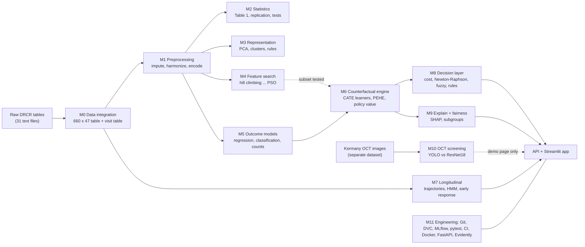

The repository also has a generated version of this picture:

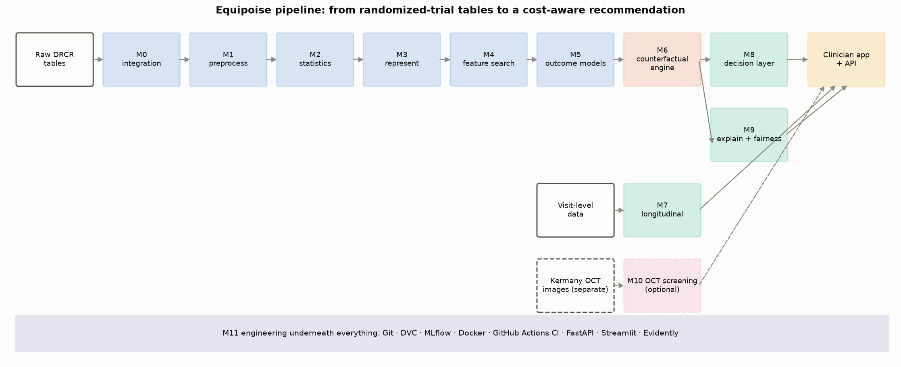

*Figure 1.1: Module flow diagram drawn by `eq/report/diagrams.py:flow_diagram`
[`reports/figures/flow_diagram.png`]. M10 is dashed because it is optional and uses a
different dataset.*

### 1.4 What the app gives a clinician

For one patient, `eq/decision/recommend.py:recommend` returns:

| Output | Per drug? | Comes from |
|---|---|---|
| Estimated letters gained at 1 year, with an interval | yes | M6 effect model + per-arm outcome models (§14) |
| Estimated injections in year 1 | yes | M6 bundle's per-arm count models (§14) |
| Probability of rescue laser in year 1 | yes | M6 bundle's per-arm laser models (§14) |
| Expected cost and cost per extra letter | yes | M8 cost model (§16) |
| Break-even price | for the costlier drugs | M8 Newton–Raphson (§16) |
| Recommendation strength 0–100 | for the costlier drugs | M8 fuzzy system (§16) |
| Reasoning trace (which rules fired) | once | M8 expert system (§16) |
| Why the model thinks so (SHAP factors) | Eylea vs Avastin | M9 (§17) |

The prices in `config/costs.yaml` are deliberately left empty (`null`), with the note "TEAM:
fill with current Indian prices and cite the source". Until the team fills them in, the code
uses clearly labelled **DEMO** relative units: Avastin 1, Lucentis 5, Eylea 10
[`config/costs.yaml: demo`]. The app hides every cost sentence while DEMO prices are in use
(`app/presenters.py:prices_set`, `tests/test_presenters.py:test_costs_hidden_while_prices_are_demo`).

### 1.5 One-line answers to the first three viva questions

- **What is it?** A cost-aware, explainable assistant that estimates each anti-VEGF drug's
  one-year benefit *for one DME patient*, learned from a randomized trial.
- **Why a randomized trial?** Because random assignment removes confounding, so differences
  between arms are causal (§03).
- **What did you find?** We replicated the trial's published results. Per-patient
  differences beyond the published baseline-vision subgroup are too weak to estimate
  reliably from 660 patients, so the honest output for every held-out patient was "no clear
  winner" (§14, §26).

---

## 02. The medical story

This chapter explains the medicine you need, from "what is diabetes" to "why does the price of
one injection matter in an Indian clinic". No numbers here are model results; the counts
and medians come from the trial data and are cited.

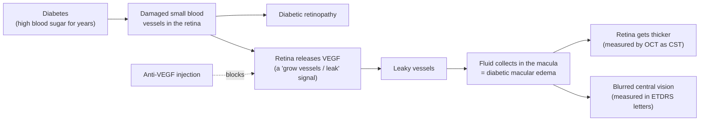

### 2.1 Diabetes in two minutes

**In plain words.** Your body turns food into sugar (glucose) and uses insulin, a hormone,
to move that sugar from the blood into cells. In **diabetes** this does not work properly,
so blood sugar stays high. Over many years, high sugar damages the walls of small blood
vessels, especially in the eyes, kidneys and nerves.

- **Type 1 diabetes**: the body makes little or no insulin. It usually starts young, and
  patients always need insulin.
- **Type 2 diabetes**: the body makes insulin but responds poorly to it. It is far more
  common, and is treated with tablets, sometimes insulin.

In Protocol T, 90.5% of patients had type 2 diabetes and 68.3% used insulin
[`scripts/handbook/column_table.py` on real data: `X_diabetes_type`, `X_insulin`].

**HbA1c** ("haemoglobin A-one-c") is a blood test that shows the *average* blood sugar over
the last two to three months, as a percentage. Higher means worse control. The median
baseline HbA1c in the trial was 7.7% (IQR 6.8 to 9) [`column_table.py`: `X_hba1c`]. IQR
(inter-quartile range) means the middle half of patients lay between these two values; it is
defined properly in §06.

**Other health measures in the data.** The data also records:

- blood pressure: systolic (the top number) and diastolic (the bottom number), in mmHg;
- BMI (body-mass index = weight ÷ height², a rough measure of body fat);
- kidney damage, measured by the **urine albumin-to-creatinine ratio (UACR)**;
- heart attack, coronary artery disease and stroke history.

These matter because the same vessel damage happens all over the body.

### 2.2 The eye, the retina and the macula

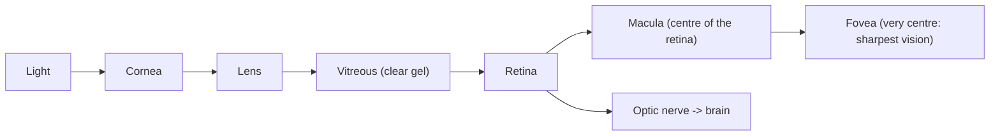

- **Retina**: the thin, light-sensitive layer lining the back of the eye, like the sensor in
  a camera.
- **Macula**: the small central area of the retina, about the size of a pencil tip. It gives
  sharp, detailed, central vision (reading, faces).
- **Fovea**: the tiny pit at the centre of the macula with the sharpest vision.
- **Lens**: the clear lens behind the pupil. When it clouds over (a cataract) it is replaced
  by an artificial lens. An eye with an artificial lens is **pseudophakic**
  (`X_pseudophakic`; 24.4% of study eyes [`column_table.py`]).
- **Intra-ocular pressure (IOP)**: the fluid pressure inside the eye, in mmHg (`X_iop`).
- **Right eye = OD** (*oculus dexter*), **left eye = OS** (*oculus sinister*). DRCR tables
  store many eye measurements as OD/OS column pairs.

### 2.3 Diabetic retinopathy and diabetic macular edema

**Diabetic retinopathy (DR)** is damage to the retina's small blood vessels caused by
diabetes. Doctors grade it by severity:

| Stage | What it means | In our data (`X_dr_severity_clinical` levels) |
|---|---|---|
| Microaneurysms only | tiny bulges in vessel walls | "Microaneurysms only" |
| Mild / moderate NPDR | non-proliferative DR: leaks and small bleeds | "Mild/moderate NPDR" (most common, 51.2% [`column_table.py`]) |
| Severe NPDR | many bleeds, vessels starved of blood | "Severe NPDR" |
| PDR | proliferative DR: fragile new vessels grow | "PDR and/or prior scatter" |

The trial's **reading centre** (a central lab of graders) also graded fundus photographs on
the ETDRS scale, recoded 1–10 in `X_dr_severity_rc` (median 5 [`column_table.py`]).

**Diabetic macular edema (DME)** is swelling of the macula caused by fluid leaking from damaged
vessels. "Centre-involved" DME means the swelling reaches the fovea. That is the kind
Protocol T studied [`data/raw/TReadMe.docx`; protocol §1.3]. DME blurs central vision, and it
is the condition Equipoise is about.

**Laser treatments you will see in the columns.**

- **Focal / grid laser**: small laser spots near leaking vessels in the macula. This was the
  standard DME treatment before injections. In Protocol T it was a **rescue** treatment:
  "focal/grid laser will be initiated at or after the 24 week visit" if edema persisted and
  had stopped improving [protocol §4.3.2]. Outcome columns: `Y_laser_yr1`, `Y_laser_any`.
- **Panretinal photocoagulation (PRP)**, also called scatter laser: many laser spots in the
  outer retina, used for proliferative DR (`X_prior_prp`).

### 2.4 OCT and retinal thickness (CST)

**In plain words.** An **OCT** (optical coherence tomography) machine is like an ultrasound
that uses light instead of sound. In a few seconds it takes a cross-section picture of the
retina (a **B-scan**) and measures how thick each layer is. A swollen macula is thicker, so
thickness is a direct, objective measure of DME.

**Technically.** The machine averages the retinal thickness over a 1 mm circle centred on the
fovea. That average is called **central subfield thickness (CST)** and is measured in
micrometres (µm; 1 µm = one-thousandth of a millimetre). Protocol T required "OCT CSF ≥ 250 µm
on Zeiss Stratus or the equivalent on spectral domain OCT" [protocol §1.3 B]. In our data
`X_cst_um` has median 431 µm (IQR 358.5 to 527) [`column_table.py`].

**OCT machines differ.** Three machines were used at baseline:

| Machine | Type | Patients at baseline | Raw mean CST (µm) |
|---|---|---|---|
| Zeiss Stratus | time-domain (older) | 26 | 433 |
| Zeiss Cirrus | spectral-domain | 322 | 453 |
| Heidelberg Spectralis | spectral-domain | 303 | 467 |

[`reports/tables/m1_cst_harmonization.csv`]

Spectral-domain machines measure from a deeper boundary at the back of the retina, so the
same eye reads **thicker** on Cirrus and Spectralis than on Stratus [`eq/preprocess/harmonize.py`
docstring]. A Bressler et al. paper (JAMA Ophthalmology 2014;132(9):1113–22,
doi:10.1001/jamaophthalmol.2014.1698, verified on PubMed) gives equations for converting
between machines. Our config uses median offsets of +43 µm (Cirrus) and +67 µm (Spectralis)
versus Stratus [`config/default.yaml: preprocess.cst.offset_um`]. We could not check these two
offset values against the paper's full text, so treat them as **UNVERIFIED against the source
table**. §09 shows how M1 handles this problem with a within-machine z-score.

**Reading-centre quality.** The DRCR reading centre also marked some CST grades as
"Unacceptable", for example when the scan missed the fovea. At baseline this applies to 137
patients. In addition, 26 patients switched machine between baseline and week 52
[`reports/tables/m1_cst_quality.csv`]. The primary analysis keeps CST as recorded, as the
trial did; a sensitivity analysis treats flagged values as missing (§09).

### 2.5 Measuring vision: Snellen, ETDRS letters and "lines"

**Snellen fractions.** The familiar eye chart shows rows of shrinking letters. "20/50" means
"what you read at 20 feet, a person with normal vision could read at 50 feet". The bigger the
bottom number, the worse the vision. In metres, the same scale is written 6/15. Normal vision
is 20/20 (6/6).

**ETDRS letter score.** Research trials use a more precise chart, the ETDRS chart. It has 5
letters per row, and each row is a fixed step smaller. The score is the **number of letters
read correctly**, from 0 to 100; about 85 letters ≈ 20/20. Because every letter counts, the
score is a proper number you can average and subtract. This is why the trial's outcome is
"change in letters".

**Lines.** One row (one "line") of the chart has 5 letters, so "gained 2 lines" means about 10
letters. The app shows results in lines (`config/default.yaml: ui.letters_per_line = 5`,
rounded to half lines, `ui.lines_step = 0.5`).

#### Concept card: the Snellen-to-letters conversion used in the app

**In plain words.** Doctors in India record vision as Snellen fractions (often 6/x). The model
works in ETDRS letters. So the app needs a formula to turn "20/50" into a letter score, a bit
like converting °F to °C.

**Technically.** The app uses

$$\text{letters} \approx 85 + 50\,\log_{10}\!\left(\frac{20}{d}\right)$$

where $d$ is the Snellen denominator in feet (the "50" in 20/50), 85 is the letter score
for 20/20, and the factor 50 comes from the chart design: each line is a 0.1 step in
log-units of visual angle and holds 5 letters, so one log-unit equals 50 letters. The
result is rounded and clamped to the trial's range of 24–78 letters
(`app/presenters.py:snellen_to_letters`).

**Tiny worked example.** For 20/50: $20/50 = 0.4$, $\log_{10} 0.4 = -0.398$,
$50 \times -0.398 = -19.9$, and $85 - 19.9 = 65.1 \to 65$ letters.

The table below was computed by running `snellen_to_letters` on each value for this handbook.

| Snellen (feet) | Metric | Letters (app) | Unclamped formula |
|---|---|---|---|
| 20/32 | 6/9.5 | 75 | 74.8 |
| 20/40 | 6/12 | 70 | 69.9 |
| 20/50 | 6/15 | 65 | 65.1 |
| 20/63 | 6/19 | 60 | 60.1 |
| 20/80 | 6/24 | 55 | 54.9 |
| 20/100 | 6/30 | 50 | 50.1 |
| 20/125 | 6/38 | 45 | 45.2 |
| 20/160 | 6/48 | 40 | 39.8 |
| 20/200 | 6/60 | 35 | 35.0 |
| 20/250 | 6/75 | 30 | 30.2 |
| 20/320 | 6/95 | 25 | 24.8 |

[metric equivalents from `config/default.yaml: ui.snellen`]

**In Equipoise.** The patient form's vision dropdown lists these 11 chart lines
(`config/default.yaml: ui.snellen`). It also offers an "exact score" input
(`app/views/suggest.py:vision_field`). Results such as "about 1.5 lines" use
`app/presenters.py:letters_to_lines`.

**Common confusions.**
- The trial's subgroup boundary is **69 letters**, which the papers call "20/50 or worse"
  (below 69). The formula maps 20/40 to 70 and 20/50 to 65, so 69 sits just below the 20/40
  line. Do not expect the boundary to land exactly on a chart line.
- A *gain* of 5 letters is one line, whatever the starting vision.

**Viva questions.**
- *Why not use Snellen directly as the model input?* Snellen is a fraction on a ratio scale.
  Averaging or subtracting fractions is not meaningful. Letters are on a log scale where
  equal steps mean equal changes in visual angle, so differences and means make sense.
- *What does a letter score of 69 mean?* About 20/40 on the chart (70 letters by the
  formula). Protocol T split patients at < 69 versus ≥ 69 letters.

**Baseline vision in the trial.** The eligibility range was 24–78 letters ("approximate Snellen
equivalent 20/32 to 20/320") [protocol §1.3 B; `config/default.yaml: trial.va_eligibility_letters`].
The median baseline score was 69 letters (IQR 59 to 73). 329 of 660 patients (49.8%) were below
69 letters [`column_table.py`: `X_va_letters`, `X_va_below_69`].

### 2.6 Anti-VEGF drugs

**VEGF** (vascular endothelial growth factor) is a signalling protein. Body tissue releases it
when it is short of oxygen, as a message saying "grow new blood vessels". In diabetic eyes the
damaged retina releases too much VEGF. This makes vessels leaky (causing DME) and makes
fragile new vessels grow (causing PDR).

An **anti-VEGF drug** is a protein that grabs VEGF molecules so they cannot deliver their
message. It is injected directly into the vitreous gel of the eye (an **intravitreal
injection**), using a fine needle under local anaesthetic drops. The effect wears off over
weeks, so injections are repeated.

| Generic name | Brand | What the molecule is | Dose in Protocol T |
|---|---|---|---|
| Aflibercept | Eylea | a "fusion protein": parts of the body's own VEGF receptors joined to an antibody tail, acting as a decoy ("VEGF trap") | 2.0 mg |
| Bevacizumab | Avastin | a full-size antibody, originally approved for cancer | 1.25 mg |
| Ranibizumab | Lucentis | a fragment of an antibody, related to bevacizumab and designed for the eye | 0.3 mg |

[doses: protocol §1.3 C and §4.3]

**Key words.**

- **Brand vs generic name.** "Avastin" is the brand. "Bevacizumab" is the molecule (the
  generic name). The code always uses generic names; the app shows brands first, because
  that is what patients hear (`app/presenters.py:brand`).
- **Off-label use.** Bevacizumab was approved for cancer, not for the eye. Using it in the
  eye is "off-label": allowed and common, but outside the official approval. In the US the
  trial's bevacizumab was "compounded from a vial approved for metastatic colon cancer"
  [protocol §1.1.7], which means split into small eye doses by a pharmacy.
- **Biosimilar.** A near-copy of a biological drug made by another company after the patent
  ends. It is not called "generic" because large proteins cannot be copied exactly.
  Ranibizumab biosimilars exist (README §1 mentions "Lucentis (+ biosimilars)").
- **Dose caveat.** Protocol T used 0.3 mg ranibizumab, a US dose. README §11 notes that India
  commonly uses 0.5 mg. Our ranibizumab results therefore describe the 0.3 mg dose.

**How often were injections given?** Every eye got an injection at baseline and then every 4
weeks while it was improving or getting worse on OCT or vision. When an eye was stable, the
protocol deferred the injection:

- if CST < 250 µm and vision was 20/20 or better, the injection was deferred;
- otherwise (still thick, or vision worse than 20/20), the eye was still injected before
  week 24, and from week 24 onwards the injection was deferred.

[protocol §4.3.1] This is why the number of injections differs between patients and between
drugs.

**Injection burden.** Each injection means a clinic visit, a procedure and a small risk. The
median number of study-eye injections before the 1-year visit was 9 for aflibercept and 10 for
both bevacizumab and ranibizumab (matching the published 9 / 10 / 10). Over two years it was
15 / 16 / 15 [`reports/tables/m2_replication_vs_published.csv`].

### 2.7 Why cost matters, especially in India

The trial protocol itself explains the economic motivation, using US prices. It estimates a
single dose of:

- 2 mg aflibercept at "approximately $1,850";
- 0.3 mg ranibizumab at "approximately $1,200";
- compounded 1.25 mg bevacizumab at "approximately $50-$100"

[protocol §1.1.7, `data/raw/Anti-VEGF Comparison Protocol v5 0.pdf`]. With about 9–10
injections in year 1, the gap multiplies.

In India, most eye care is paid for out of pocket, so this gap decides whether a family can
afford a full course of treatment at all. Stopping treatment early often costs more vision
than choosing the cheaper drug.

**What the repository does and does not contain.**

- It contains **no Indian prices**. `config/costs.yaml` holds `null` for every price, with
  the instruction "TEAM: fill with current Indian prices and cite the source".
- Until the team fills these in, every cost number is in DEMO relative units (Avastin 1,
  Lucentis 5, Eylea 10, laser session 2) [`config/costs.yaml: demo`], and the app shows a
  warning.
- Indian rupee prices are therefore **not computed** in this project. To fill them in,
  collect current prices from hospital pharmacies or official price lists, cite each one
  with a URL and access date (`costs.yaml: sources`), and rerun
  `python -m equipoise decision`.
- The app formats money the Indian way, for example "₹45,500", "₹1.2 lakh" or "₹2.5 crore"
  (`app/presenters.py:format_inr`). 1 lakh = 100,000 and 1 crore = 10,000,000.

#### Concept card: injection burden and treatment cost

**In plain words.** Treating DME is not one injection; it is a course of many injections over
months. The real cost to a patient is price per injection × number of injections, plus any
laser sessions. A drug that needs fewer injections can partly make up for a higher price.

**Technically.** For drug $a$, the expected year-1 cost used in M8 is

$$C_a = \hat{n}_a \cdot p_a + \hat{\pi}_a \cdot p_{\text{laser}}$$

where $\hat{n}_a$ is the predicted number of injections in year 1 under drug $a$, $p_a$ is the
price per injection, $\hat{\pi}_a$ is the predicted probability of needing rescue laser, and
$p_{\text{laser}}$ is the price of one laser session (`eq/decision/cost.py:expected_cost`).
This assumes at most one laser session in year 1, a simplification that §16 discusses.

**Tiny worked example (DEMO units, made-up predictions).** Suppose a patient is predicted
to need 9 Eylea injections with a 0.37 chance of laser, and 10 Avastin injections with a
0.56 chance of laser.

- Eylea: $9 \times 10 + 0.37 \times 2 = 90.74$ units.
- Avastin: $10 \times 1 + 0.56 \times 2 = 11.12$ units.

The predictions here are invented for the example. The prices are the DEMO set.

**In Equipoise.** The real per-patient predictions come from the M6 bundle's count and
laser models (§14). The cost sentences are hidden in the app while prices are DEMO (§23).

**Common confusions.**
- "Cost per letter" is not cost ÷ letters. It is the **extra** cost ÷ **extra** letters
  compared with bevacizumab (an incremental ratio, §16).
- DEMO units are not rupees. They only keep the ratios plausible for testing.

**Viva questions.**
- *Where do your prices come from?* Nowhere yet, by design. Prices must be filled in with a
  cited source. Until then the code uses labelled relative units and the app hides costs.
- *Why include laser in the cost?* Rescue laser is a real extra cost that differed between
  arms in year 1 (published 37% / 56% / 46% for Afl / Bev / Ran
  [`config/replication_targets.yaml`]).

### 2.8 Check yourself

1. **What does CST measure, and why must we care which OCT machine measured it?**
   It is the average retinal thickness in the central 1 mm, in µm. Spectral-domain machines
   (Cirrus, Spectralis) read thicker than time-domain Stratus. Raw values from different
   machines are therefore not directly comparable: the raw mean was 433 / 453 / 467 µm for
   Stratus / Cirrus / Spectralis [`m1_cst_harmonization.csv`].
2. **A patient reads 20/80. About how many ETDRS letters is that, and which Protocol T
   subgroup are they in?** $85 + 50 \log_{10}(20/80) = 85 - 30.1 \approx 55$ letters. That is
   below 69, so they are in the "20/50 or worse" subgroup, where aflibercept gained more on
   average.
3. **Why is bevacizumab so much cheaper?** It is an antibody made for cancer and sold in large
   vials. Eye doses are split from one vial (off-label, compounded), while aflibercept and
   ranibizumab are made and priced as eye drugs. The protocol quotes about $50–100 versus
   $1,200–1,850 per dose in the US [protocol §1.1.7].

---

## 03. The central idea: causation and counterfactuals

This is the most important chapter. If you understand it, you can defend the whole project.
The core question of Equipoise is not "what will happen to this patient?" (prediction). It is
"**what would happen to this patient under drug A compared with drug B?**" (causation). Those
are different questions, and the difference is the whole point.

The examples in §3.1–§3.6 use **made-up numbers for teaching**. Real numbers start in §3.7
and are cited.

### 3.1 Correlation is not causation

#### Concept card: correlation vs causation

**In plain words.** Two things are *correlated* when they tend to go up and down together.
One thing *causes* another when changing the first one would change the second.

During the monsoon in Mumbai, umbrella sales and traffic jams rise together. They are
correlated. But banning umbrellas would not clear the roads, because both are caused by
rain. Correlation tells you "these move together". Causation tells you "if I push this
lever, that one moves".

**Technically.** Correlation describes the joint distribution of two variables, for example
the Pearson correlation $r$ (defined in §06). A causal effect describes what happens under an
**intervention**: setting a variable to a value and seeing how the outcome changes. Written
with the "do" notation, we compare $E[Y \mid do(T = a)]$ with $E[Y \mid do(T = b)]$, where:

- $E[\cdot]$ means "average over people";
- $Y$ is the outcome;
- $T$ is the treatment;
- $do(T = a)$ means "force everyone to take $a$".

This is not the same as $E[Y \mid T = a]$, which means "average over the people who *happened*
to take $a$".

**Tiny worked example.** A school notices that students who attend extra coaching score 15
marks lower on average. Does coaching hurt? No: weaker students are *sent* to coaching. The
comparison mixes "effect of coaching" with "who gets coaching".

**In Equipoise.** README §2 makes exactly this argument about hospital records. A model
trained on ordinary records "learns correlations, not effects". This is why the project uses
a randomized trial.

**Common confusions.**
- A strong correlation is not stronger evidence of causation. Rain and umbrellas are almost
  perfectly correlated.
- "The model predicts well" does not mean "the model understands causes". Prediction can
  rely purely on correlations.

**Viva questions.**
- *Give an example of correlation without causation from your own domain.* In hospital
  data, patients given Eylea might have *worse* outcomes, simply because doctors choose
  Eylea for worse eyes. The drug looks harmful through correlation alone.
- *How do you get causation from data?* By an experiment where the treatment is assigned
  by chance (randomization). Otherwise you need strong assumptions about every factor that
  influenced the choice.

### 3.2 Confounding: why hospital data can mislead

#### Concept card: confounding and confounders

**In plain words.** A **confounder** is something that affects both *which treatment a
person gets* and *how they do*. Because it pushes on both, it creates a fake link (or hides
a real one) between treatment and outcome. Rain was the confounder in the umbrella example.

**Technically.** A variable $C$ confounds the effect of $T$ on $Y$ if $C$ causes $T$ and $C$
causes $Y$ (a "backdoor path" $T \leftarrow C \rightarrow Y$). If $C$ is not accounted for,
$E[Y \mid T=a] - E[Y \mid T=b]$ is biased: it mixes the effect of $T$ with the effect of $C$.

**Tiny worked example (made-up hospital records).** Imagine a hospital where doctors give
Eylea mostly to patients with poor starting vision, and Avastin mostly to patients with good
starting vision. Suppose Eylea truly adds 3 letters for everyone, but poor-vision eyes gain
less in this hospital for other reasons.

| Starting vision | Drug | Patients | Average letters gained |
|---|---|---|---|
| Poor | Eylea | 80 | 8 |
| Poor | Avastin | 20 | 5 |
| Good | Eylea | 20 | 15 |
| Good | Avastin | 80 | 12 |

- Within each row group Eylea is 3 letters better: $8 - 5 = 3$ and $15 - 12 = 3$.
- Now ignore starting vision. Eylea's average is $(80 \times 8 + 20 \times 15)/100 = 9.4$.
  Avastin's is $(20 \times 5 + 80 \times 12)/100 = 10.6$.
- **Eylea looks 1.2 letters worse**, even though it is 3 letters better for everyone.

The confounder (starting vision) has reversed the answer. This reversal is called
**Simpson's paradox**.

**In Equipoise.** `eq/report/diagrams.py:causal_dag` draws the assumed causal diagram
(Figure 3.1). In Protocol T no arrow enters "treatment" from patient characteristics,
because a random draw chose the drug.

**Common confusions.**
- Adjusting for the confounders you *measured* is not enough if there are others you did
  not measure (for example, a doctor's private impression of how motivated the patient is).
- A variable caused *by* the treatment, such as the number of injections, is not a
  confounder. Adjusting for it can create bias.

**Viva questions.**
- *What is a confounder?* A variable that influences both the treatment choice and the
  outcome, for example disease severity.
- *Why don't you need to adjust for confounders in Protocol T?* Randomization made
  treatment independent of every patient characteristic, measured or not.

### 3.3 What randomization does

#### Concept card: randomization and the randomized controlled trial (RCT)

**In plain words.** In a randomized trial a lottery decides who gets which treatment. The
lottery does not know anything about the patient, so on average the groups end up alike in
every way: age, vision, blood sugar, even things nobody measured. Any difference in results
must then come from the treatment. It is like splitting a class into teams by a coin toss:
neither team can be "the clever team" except by small chance.

**Technically.** Randomization makes the treatment $T$ statistically independent of the
potential outcomes (§3.4) and of all covariates $X$:

$$\{Y(a)\}_a \perp T$$

where $\perp$ means "is independent of" and $\{Y(a)\}_a$ means "the outcomes the person would
have under each treatment $a$". Then

$$E[Y \mid T=a] = E[Y(a)]$$

so the simple difference of group averages is an unbiased estimate of the average causal
effect. Randomization also fixes the **propensity score**, the probability of getting each
treatment. It is known by design, not estimated.

**Tiny worked example.** Toss a fair coin for 100 patients, of whom 50 have poor vision.
On average 25 poor-vision patients land in each arm. Exact balance is not guaranteed in one
trial (you might get 27 vs 23), which is why trials report a "Table 1" checking balance
(§10).

**In Equipoise.**
- Protocol T randomized 660 patients to aflibercept 224, bevacizumab 218 and ranibizumab 218
  [`config/default.yaml: trial.arm_sizes`].
- The project never fits a model to estimate propensities. It uses the known proportions,
  $224/660 \approx 0.339$ and $218/660 \approx 0.330$ for the other two arms
  (`eq/causal/data.py:known_propensities`, `KnownPropensity`). CLAUDE.md lists this as a
  non-negotiable rule.
- M2 checks balance with Table 1 (§10).

**Common confusions.**
- Randomization balances groups *on average*, not exactly.
- Randomization justifies comparing *arms*. It does not by itself tell you about
  *individuals*. That is the next problem.

**Viva questions.**
- *What would go wrong if you estimated propensities with logistic regression here?* You
  would add noise for no reason. The true probabilities are known constants. An estimated
  propensity model could also overfit chance imbalances.
- *Is the trial perfectly balanced?* No. Table 1 shows small chance differences. That is
  expected, and it is why the replication uses confidence intervals and tests (§10).

### 3.4 Potential outcomes and counterfactuals

#### Concept card: potential outcomes $Y(a)$

**In plain words.** Before a patient is treated, imagine three "parallel futures", one per
drug. In each future the patient's vision changes by some amount. These three numbers are the
patient's **potential outcomes**. After treatment we get to see only one of them, the future
that actually happened. The others are **counterfactuals**: "what would have happened if…".

**Technically.** For patient $i$ and treatment $a \in \{\text{Bev}, \text{Afl}, \text{Ran}\}$,
$Y_i(a)$ is the outcome (letters gained at week 52) that patient $i$ would have if given $a$.
The **observed** outcome is

$$Y_i = Y_i(T_i)$$

where $T_i$ is the drug patient $i$ actually received. This rule is called *consistency*.
Two further assumptions are made:

- **SUTVA** (stable unit treatment value assumption): one patient's drug does not change
  another patient's outcome, and each drug means one well-defined treatment.
- **Positivity**: every patient had a non-zero chance of each drug. This holds by
  randomization (≈ 0.33 each).

**Tiny worked example: the six-patient table.** This table is a "god's-eye view" that no real
dataset has. The numbers are made up. The same six patients return in §14 to explain the S-,
T-, X- and DR-learners.

| Patient | Baseline vision (letters) | $Y(\text{Bev})$ | $Y(\text{Afl})$ | True effect $Y(\text{Afl}) - Y(\text{Bev})$ |
|---|---|---|---|---|
| P1 | 50 | 10 | 18 | +8 |
| P2 | 55 | 12 | 19 | +7 |
| P3 | 60 | 9 | 14 | +5 |
| P4 | 70 | 8 | 9 | +1 |
| P5 | 72 | 7 | 7 | 0 |
| P6 | 75 | 6 | 7 | +1 |

**In Equipoise.**
- The synthetic data generator writes exactly such a god's-eye table,
  `data/synthetic/protocolT_truth.csv`, with columns `mu_Bevacizumab`, `mu_Aflibercept`,
  `mu_Ranibizumab` and `tau_*` (`scripts/make_synthetic_data.py:potential_outcomes`).
- Tests can therefore check whether a method recovers the planted truth.
- TARNet explicitly outputs one predicted potential outcome per drug
  (`eq/causal/tarnet.py:TARNetLearner.potential_outcomes`).

**Common confusions.**
- A counterfactual is not "a prediction of the future". It is the outcome under the
  treatment the patient did *not* get, which can never be observed for them.
- Potential outcomes exist *before* treatment. Treatment only reveals one of them.

**Viva questions.**
- *What is a counterfactual in your project?* For a patient who got Avastin, their week-52
  vision change *had they received* Eylea.
- *Which assumptions do you need?* Consistency, SUTVA and positivity. Ignorability (no
  confounding) is guaranteed by randomization.

### 3.5 The fundamental problem of causal inference

#### Concept card: the fundamental problem

**In plain words.** You can never see both futures for the same person. If P1 got Avastin, we
see their Avastin result and nothing else. Their Eylea result is lost forever. So a
person's individual drug effect can never be measured directly, only estimated.

**Technically.** For each $i$ we observe only one entry of $(Y_i(\text{Bev}), Y_i(\text{Afl}),
Y_i(\text{Ran}))$. The individual effect $Y_i(\text{Afl}) - Y_i(\text{Bev})$ always contains one
missing term. Causal inference is therefore a **missing-data problem** in which at least
two-thirds of the potential-outcome table is missing by design.

**Tiny worked example.** What the trial actually lets us see of the six-patient table:

| Patient | Drug received | $Y(\text{Bev})$ | $Y(\text{Afl})$ | Individual effect |
|---|---|---|---|---|
| P1 | Afl | ? | 18 | ? |
| P2 | Bev | 12 | ? | ? |
| P3 | Afl | ? | 14 | ? |
| P4 | Bev | 8 | ? | ? |
| P5 | Afl | ? | 7 | ? |
| P6 | Bev | 6 | ? | ? |

Every individual effect is a "?".

**In Equipoise.** This is why ordinary accuracy cannot score the core model (README §8). M6
uses three indirect checks instead (§14):

1. A **semi-synthetic benchmark**: real patient features, simulated outcomes with a known
   effect, scored by PEHE.
2. **Policy values** estimated by inverse probability weighting.
3. **Rediscovery** of the published subgroup.

**Common confusions.**
- "Just use the test set": the test set has the same problem. Every test patient also has
  only one observed outcome.
- Matching each patient to a similar patient in the other arm is an *estimate* with its own
  assumptions, not an observation.

**Viva questions.**
- *How do you evaluate predictions you can never observe?* With semi-synthetic data where we
  plant the truth, with policy value (which only needs observed outcomes and known
  propensities), and by checking that the model recovers a known published finding (§14).
- *Isn't an individual effect then meaningless?* No. It is well defined but unobservable.
  We estimate its conditional average (the CATE) instead (§3.6).

### 3.6 Average vs individual effects: ATE, CATE and ITE

#### Concept card: ATE, CATE and ITE

**In plain words.**
- The **average treatment effect (ATE)** answers "on average across all patients, how much
  better is Eylea than Avastin?".
- The **conditional average treatment effect (CATE)** answers "on average across patients
  *like this one*, how much better is it?".
- The **individual treatment effect (ITE)** is the effect for one exact person. We can never
  observe it, and in practice the CATE is our best estimate of it.

A shoe shop can tell you the *average* foot size (ATE), the average size for 20-year-old men
(CATE), but not your size without measuring you (ITE). And for drug effects, measuring you
is impossible.

**Technically.**

$$\text{ITE}_i = Y_i(\text{Afl}) - Y_i(\text{Bev})$$

$$\text{ATE} = E[Y(\text{Afl}) - Y(\text{Bev})]$$

$$\text{CATE}(x) = \tau(x) = E[Y(\text{Afl}) - Y(\text{Bev}) \mid X = x]$$

where $X$ is the vector of baseline features (age, vision, CST, …) and $x$ is one particular
patient's values. **Heterogeneity** means $\tau(x)$ changes with $x$. A feature that changes
the effect is an **effect modifier**.

**Tiny worked example** (six-patient table, §3.4):

- ATE $= (8+7+5+1+0+1)/6 = 22/6 \approx 3.67$ letters.
- CATE for "baseline < 69 letters" (P1–P3) $= (8+7+5)/3 \approx 6.67$.
- CATE for "≥ 69" (P4–P6) $= (1+0+1)/3 \approx 0.67$.

So baseline vision is an effect modifier here.

**In Equipoise.** The real trial shows the same pattern as the toy example: the published
1-year gains were 18.9 / 11.8 / 14.2 letters below 69, but 8.0 / 7.5 / 8.3 at 69 or above
[`config/replication_targets.yaml`; verified against Wells et al., NEJM 2015, PubMed
25692915]. M6 estimates $\tau(x)$ with many learners and outputs two numbers per patient:

- aflibercept − bevacizumab;
- ranibizumab − bevacizumab.

Bevacizumab is the **reference arm** because it is the cheapest
(`config/default.yaml: trial.reference_arm`).

**Common confusions.**
- CATE is still an *average*, over people who share $x$. Two people with identical $x$ can
  still respond differently.
- A small ATE does not mean no one benefits. A large ATE does not mean everyone benefits.

**Viva questions.**
- *What does your model estimate: ATE, CATE or ITE?* The CATE $\tau(x)$ for each comparison
  drug versus bevacizumab, used as an estimate of the patient's individual benefit.
- *Why bevacizumab as reference?* It is the cheapest option. The decision is always "is
  paying more worth it compared with the cheapest choice?".

### 3.7 How the trial lets us estimate these effects

1. **Estimating the ATE.** Because of randomization, the difference of arm means estimates
   the ATE. On complete cases, aflibercept − bevacizumab = 3.95 letters (95% CI 1.85 to
   6.06), and ranibizumab − bevacizumab = 1.82 (−0.293 to 3.93)
   [`reports/tables/m1_missing_strategies.csv`, complete-case rows].
2. **Estimating the CATE.** Within any group defined by baseline features, randomization
   still holds. So a model that learns how the outcome depends on $x$ *within each arm* can
   estimate $\tau(x)$. This is what the CATE learners in M6 do. Their difficulty is
   statistical, not conceptual: with about 220 patients per arm, the noise in letter changes
   is large compared with the true differences.
3. **The honest limit.** The training split has 490 patients with a week-52 outcome
   [`reports/tables/m7_early_response.csv`, `n_train`]. The semi-synthetic benchmark holds
   out a quarter of them for scoring (`causal.semi_synthetic.eval_fraction: 0.25`), which
   leaves about 370 for fitting. That matches the "~370 fitting patients" in CLAUDE.md. The
   noise in individual letter changes is large: the residual SD of the bevacizumab outcome
   model is 12.1 letters [`reports/tables/m6_semisynthetic_setup.csv`]. These numbers are
   enough to see the published baseline-vision pattern, but not to pin down finer
   per-patient differences (§14, §26).

The DAG below is the project's written-down causal assumption.

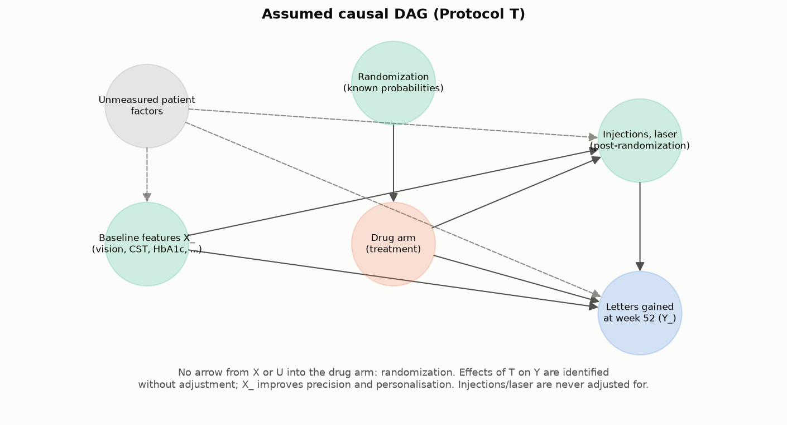

*Figure 3.1: Assumed causal diagram (`eq/report/diagrams.py:causal_dag`)
[`reports/figures/m11_causal_dag.png`]. Randomization means no arrow enters the treatment
node from the patient's characteristics. Injection counts and laser are consequences of the
treatment, so they are never used as inputs.*

### 3.8 Clinical equipoise, MCID, and how the app decides "no clear winner"

#### Concept card: clinical equipoise

**In plain words.** A doctor is in **equipoise** between two treatments when, honestly, they do
not know which is better for this patient. The evidence is balanced. In medical ethics,
equipoise is what makes a randomized trial acceptable: you may toss a coin only between
options you genuinely cannot rank. Equipoise (the app) uses the word for one patient: if no
costlier drug is clearly, meaningfully better for *this* patient, the patient is "in
equipoise", and the cheapest drug is a reasonable choice.

**Technically.** The app calls patient $i$ "in equipoise" for drug $a$ when the lower end of
the 95% interval of the estimated benefit is below the MCID:

$$\text{equipoise}_a \iff L_a(x_i) < \text{MCID}$$

where:

- $L_a(x_i)$ is the 2.5th percentile of the bootstrap distribution of the estimated effect of
  drug $a$ versus bevacizumab (`eq/causal/bundle.py:ModelBundle.predict`, `effect_low`);
- MCID = 5 letters (`config/default.yaml: effects.mcid_letters`).

A **clear benefit** needs the *whole* 95% interval at or above 5 letters (`eq/decision/expert.py:default_rules`,
rules `clear-benefit-*` and `equipoise-*`). If both costlier drugs are in equipoise, the
rule `all-equipoise` fires and the recommendation is bevacizumab. MCID 3 is reported as a
sensitivity analysis (`effects.mcid_sensitivity_letters: [3]`).

**MCID** (minimal clinically important difference) is the smallest change a patient would
notice and care about. Here it is 5 letters, one chart line (config comment: "minimal
clinically important difference = one chart line").

**Tiny worked example.** Suppose the model estimates Eylea gives +3.1 letters over Avastin,
with a 95% interval from 0.9 to 5.4.

- Lower end 0.9 < 5, so this is equipoise: no clear winner.
- The benefit would need its interval to be, say, 5.2 to 9.0 to count as "clear".

**In Equipoise (real held-out results).**
- For all 132 held-out patients, the best costlier drug was aflibercept, and none had a
  clear winner at MCID 5 or at MCID 3.
- The median estimated benefit was 3.1 letters, and the median interval width was 4.47
  letters.
- The largest lower bound of any patient's interval was 2.41 letters, well below 5
  [`reports/tables/m8_heldout_no_clear_winner.csv`].

§14 explains why this is a valid, defensible result rather than a broken model.

**Common confusions.**
- "No clear winner" does not mean "the drugs are equal". It means the data cannot show a
  meaningful difference *for this patient* with enough confidence.
- The rule is deliberately strict: it needs the *whole* interval above 5 letters, not just
  the point estimate. A looser rule (point estimate > 5) would recommend Eylea more often
  and be wrong more often.

**Viva questions.**
- *Why does the app always say "no clear winner"?* Because the per-patient intervals are wide
  (median width 4.47 letters on held-out patients), and the estimated benefits are modest
  (median 3.1 letters). No patient's interval lies entirely above 5 letters
  [`m8_heldout_no_clear_winner.csv`]. With 660 patients, that is the honest answer.
- *Why is MCID 5 letters?* One chart line is the conventional smallest change that matters
  to patients. We also report 3 letters as a sensitivity check, and the conclusion does not
  change.
- *Isn't the app useless then?* No. It still shows the estimated size of the benefit, the
  injection and laser differences, and the published < 69-letter rule. Once real prices are
  entered, it also shows the cost trade-off and break-even price. Saying "the evidence does
  not separate these drugs for this patient" is itself useful and stops over-treatment.

### 3.9 Why this is not "just prediction"

| | Prediction (M5) | Causal estimation (M6) |
|---|---|---|
| Question | What letters will this patient gain on the drug they get? | How many *more* letters would this patient gain on Eylea than on Avastin? |
| Target | Observed $Y$ | Difference of potential outcomes $Y(a) - Y(b)$, never observed |
| Scored by | RMSE / AUC on test data | Semi-synthetic PEHE, policy value, rediscovery |
| Safe on hospital data? | Yes, for prediction | No; it needs randomization or strong assumptions |
| Useful for choosing a drug? | Not directly | Yes, that is its purpose |

A model can predict outcomes well and still be useless for choosing a drug. For example, the
M5 models predict week-52 letters with test R² about 0.23 [`reports/tables/m5_regression_comparison.csv`].
Most of that accuracy comes from baseline vision, which affects the outcome under *every*
drug and so says nothing about *which* drug to choose.

### 3.10 Check yourself

1. **In the six-patient table, what is the CATE of aflibercept for patients with baseline
   vision ≥ 69? Why can't a real trial compute this table directly?**
   It is $(1 + 0 + 1)/3 \approx 0.67$ letters. A real trial sees only one of $Y(\text{Bev})$ and
   $Y(\text{Afl})$ per patient, so each row's effect is unobserved. The CATE must be estimated
   from *different* patients in each arm.
2. **Why are Protocol T's propensity scores known, and what are they?** The drug was assigned
   by randomization, so the probability of each arm is fixed by design. The code uses the
   arm proportions 224/660 ≈ 0.339 for aflibercept and 218/660 ≈ 0.330 for each of the
   other two (`eq/causal/data.py:known_propensities`).
3. **An estimated benefit of 4.5 letters with a 95% interval of 1.0 to 8.0: clear benefit or
   equipoise at MCID 5? At MCID 3?** Equipoise at both. The lower end, 1.0, is below 5 and
   also below 3. A clear benefit at MCID 3 would need the lower end to be at least 3.

---

## 04. The data

This chapter describes every dataset the project touches. We cover:

- where the data comes from;
- how its 31 raw tables become two clean tables;
- what every column means;
- which columns may be used as model inputs;
- the fake (synthetic) copy used for testing;
- the separate OCT image dataset;
- the caveats you must mention in the report.

### 4.1 Protocol T: the trial

| Item | Detail | Source |
|---|---|---|
| Full title | "A Comparative Effectiveness Study of Intravitreal Aflibercept, Bevacizumab and Ranibizumab for Diabetic Macular Edema" | `data/raw/TReadMe.docx` |
| Run by | DRCR Retina Network (formerly the Diabetic Retinopathy Clinical Research Network); data coordinated by the Jaeb Center for Health Research | ReadMe; NEJM author list |
| Design | "Randomized, multi-center clinical trial" | protocol §1.3 A |
| Patients | 660, one study eye each | ReadMe; `config/default.yaml: trial.n_patients` |
| Sites | 88 according to the DRCR ReadMe and README §7.1; **89** according to the NEJM abstract. We report this mismatch rather than pick one | ReadMe; PubMed 25692915 |
| Enrollment years | 2012–2013 (README §7.1); not checked against another source | README |
| Key eligibility | age ≥ 18; type 1 or 2 diabetes; centre-involved DME (CST ≥ 250 µm on Stratus or SD equivalent); vision 78 to 24 letters (≈ 20/32 to 20/320); no anti-VEGF in the past 12 months; at most 25% of eyes with any prior anti-VEGF | protocol §1.3 B |
| Arms | aflibercept 2.0 mg (224), bevacizumab 1.25 mg (218), ranibizumab 0.3 mg (218) | protocol §1.3 C; `config/default.yaml` |
| Planned size | "660 study eyes (220 eyes per group)" | protocol §1.3 D |
| Study-eye choice | if both eyes eligible, an eye never treated with anti-VEGF is preferred; otherwise the investigator and patient choose before randomization | protocol §1.3 C |
| Visits | every 4 weeks up to 1 year; then every 4–16 weeks depending on stability; visits at 1 and 2 years for everyone | protocol §1.3 F |
| Injections | at baseline, then given or deferred by a fixed rule (§2.6) | protocol §4.3.1 |
| Rescue laser | focal/grid laser from week 24 if edema persisted and was not improving | protocol §4.3.2 |
| Primary outcome | change in visual acuity (letters) at 1 year | protocol §1.3 E, §7.2.1 |
| Primary analysis plan | three pairwise comparisons by ANCOVA adjusted for baseline vision, Hochberg correction, intention-to-treat, multiple imputation for missing outcomes | protocol §7.2.1 |
| Key secondary outcomes | number of injections; laser; 2- and 3-line gains/losses; change in CST; and others | protocol §7.2.2 |
| Follow-up | 2 years | protocol §1.3 E |

**Published results (verified on PubMed).**

- **1 year** (Wells et al., *N Engl J Med* 2015;372(13):1193–203, doi:10.1056/NEJMoa1414264,
  PMID 25692915):
  - Mean gains of 13.3 / 9.7 / 11.2 letters (Afl / Bev / Ran).
  - The aflibercept advantage was "driven by the eyes with worse visual acuity at baseline
    (P<0.001 for interaction)".
  - Below 69 letters: 18.9 / 11.8 / 14.2. At 69–78 letters: 8.0 / 7.5 / 8.3.
- **2 years** (Wells et al., *Ophthalmology* 2016;123(6):1351–9,
  doi:10.1016/j.ophtha.2016.02.022, PMID 26935357):
  - Mean gains of 12.8 / 10.0 / 12.3 letters.
  - Median injections over 2 years 15 / 16 / 15.
  - Focal/grid laser in 41% / 64% / 52% of eyes.

These published values are stored in `config/replication_targets.yaml`, and §10 compares them
with our recomputation.

### 4.2 The DRCR download

The public dataset (https://public.jaeb.org/drcrnet) unzips into:

- `Data Tables - Text files/`: 31 pipe-separated (`|`) text tables;
- `Case Report Forms/`: the paper forms (PDF) that site staff filled in. They are useful to
  learn what a column means;
- the protocol PDF and `TReadMe.docx` (terms of use, table list, visit linking).

In this repo they live under `data/raw/`, which is never committed (DRCR terms;
`.gitignore`). DVC tracks them through `data/raw.dvc` (§19).

**"One row per form".** Each table holds the contents of one paper form. A table filled once
per patient (such as the baseline history) has one row per patient. A table filled at every
visit (such as the vision test) has one row per patient *per visit*. A table filled per event
(such as adverse events or injections) has one row per event. The ReadMe's descriptions say
exactly this, for example "one record per patient per visit".

**Every table, and how the project uses it.** Rows = file lines minus the header line,
counted for this handbook.

| Table | Rows | What it holds (DRCR ReadMe / form) | Used by | Role |
|---|---|---|---|---|
| `TTrtGroupUnmasked` | 660 | randomized arm and randomized eye (`RandEye`) | M0 | identifiers / treatment |
| `PtRoster` | 660 | patient roster, age at enrollment | M0 | `X_age` |
| `TPtRoster` | 660 | patient status (completed / dropped) | M0 | `M_final_status` |
| `THxBaseline` | 660 | baseline ocular and medical history | M0 | sex, race, ethnicity, diabetes, insulin, prior eye treatments |
| `TLab` | 660 | baseline HbA1c | M0 | `X_hba1c` |
| `TRandExamQuestions` | 660 | baseline exam questions: smoking, height, weight, conditions | M0 | BMI, smoker, hypertension, MI, CAD, stroke, renal |
| `TBloodPressure` | 4,251 | blood pressure per visit (3 readings) | M0 (baseline rows only) | `X_sbp`, `X_dbp` |
| `TUrine` | 1,773 | urine albumin/creatinine per visit | M0 (baseline only) | `X_log_uacr` |
| `TOcularExamBaseline` | 660 | baseline eye exam (lens, DR severity) | M0 | `X_pseudophakic`, `X_dr_severity_clinical` |
| `TIOP` | 14,149 | eye pressure per visit | M0 (baseline only) | `X_iop` |
| `RCPhotoGradingResult` | 1,814 | reading-centre photo grades | M0 (baseline only) | `X_dr_severity_rc` |
| `TVAReVATest` | 14,149 | ETDRS letters per eye per visit | M0, visit table | baseline vision, fellow-eye vision, week-52/104 change, all visit vision |
| `RCOCTGradingResult` | 14,218 | reading-centre OCT grades (CST, machine, fluid, ERM) | M0, visit table, CST quality | `X_cst_um`, `X_oct_machine`, `X_subretinal_fluid`, `X_epiretinal_membrane`, CST change |
| `TVisitInfo` | 15,413 | visit dates (days from enrollment) | M0, visit table | week-52 cut-off date; `days_from_rand` |
| `TIntraInj` | 13,076 | one row per injection | M0, visit table | `Y_n_inj_yr1`, `Y_n_inj_total`, `injected` |
| `TLaserTrt` | 693 | one row per laser treatment | M0, visit table | `Y_laser_yr1`, `Y_laser_any`, `laser` |
| `TOCT` | 14,149 | site OCT form per visit | not used (the reading-centre grades are used instead) | n/a |
| `TPhoto` | 1,841 | fundus photo form | not used | n/a |
| `TRandomization` | 660 | randomization form | not used | n/a |
| `TBaselineMiscEligCk` | 660 | eligibility checks | not used | n/a |
| `TPreExistingCondition` | 4,985 | pre-existing conditions list | not used | n/a |
| `TNonProtStudyEyeTrt` | 71 | non-protocol treatments of the study eye | not used | n/a |
| `TAdvEvent` | 6,992 | adverse events | **banned** | post-randomization |
| `TMedication` | 14,115 | medications | **banned** | post-randomization |
| `TMedUpFU` | 13,986 | follow-up medical update | **banned** | post-randomization |
| `TFUExamQuestions` | 13,489 | follow-up exam questions | **banned** | post-randomization |
| `TOcularExamFU` | 13,489 | follow-up eye exam | **banned** | post-randomization |
| `TVisitComp` | 13,986 | visit completion | **banned** | post-randomization |
| `TNonStudyEyeInj` | 3,750 | injections in the other eye | **banned** | post-randomization |
| `TStudyProcedure` | 140 | procedures on the study eye | **banned** | post-randomization |
| `TPostRandPtFinalStatus` | 95 | final status form after randomization | **banned** | post-randomization |

The "banned" list is `eq/features.py:POST_RANDOMIZATION_TABLES`, and
`tests/test_leakage.py:test_package_never_reads_post_randomization_tables` fails if any package
code names one of them. The ReadMe also mentions a `TInjCounterProtocol` table, which is not in
this download (31 files present).

### 4.3 How the tables join

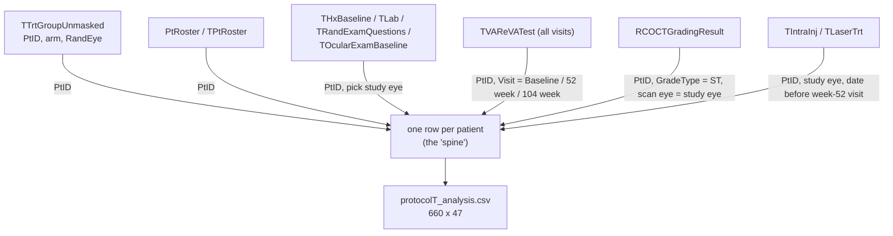

**Key ideas.**

- **`PtID`** is the patient identifier in every table. It is the **primary key** of
  one-row-per-patient tables and the **join key** everywhere. A *join* (pandas `merge`)
  lines up rows of two tables that share a key value.
- **Study eye.** Each patient has exactly one randomized eye, `RandEye` ∈ {OD, OS}. Many
  tables store eye measurements as column pairs such as `EtdrsOD` / `EtdrsOS`.
  `scripts/build_protocolT_table.py:pick_eye` picks the study-eye value:

  ```python
  def pick_eye(df, eye, stem):
      """Columns come in OD (right) / OS (left) pairs; return the study-eye value."""
      return np.where(eye == "OD", df[f"{stem}OD"], df[f"{stem}OS"])
  ```

  `np.where(condition, a, b)` takes `a` where the condition is true and `b` elsewhere. So for a
  patient whose study eye is OD it returns `EtdrsOD`, otherwise `EtdrsOS`. The fellow eye
  (`X_fellow_va_letters`) is the other one of the pair.
- **Dates are relative.** To protect privacy, DRCR replaced calendar dates with "days from
  enrollment" (for example `VisitDtDaysFromEnroll`, `InjectDtDaysFromEnroll`). In Protocol T,
  enrollment is the day of randomization, so day 0 = randomization
  (`build_protocolT_visits.py` docstring).
- **Visit labels.** Visits are named "Baseline", "4 week", …, "52 week", "Post 52 week",
  "104 week" and so on. One visit's forms share a `ParentLoginVisitID`. Treatment forms link
  to it through `ParentLoginVisitIDTrt` [ReadMe §2]. The visit table uses this exact key
  rather than nearest dates.
- **Grade type.** The reading-centre OCT table has several grades per scan. The build keeps
  `GradeType == "ST"` (the standard grade) and the scan of the study eye.

### 4.4 Column roles and the no-leakage rule

The analysis table's column names start with a prefix that says what the column may be used
for.

| Prefix | Meaning | Rule |
|---|---|---|
| `pt_id`, `study_eye` | identifiers | never model inputs |
| `treatment` | randomized arm | used only as the treatment variable, never as an ordinary feature (`allow_treatment=True`) |
| `X_` | **baseline features**: measured at or before randomization | the **only** model inputs |
| `Y_` | **outcomes**: measured after randomization | targets only, never inputs |
| `M_` | **bookkeeping**: missing-data flags, final status | never inputs |
| `E_` | early-response features (vision at weeks 4/8/12) | allowed only inside M7's early-response model (§15) |

**Data leakage** means information that would not be available at prediction time sneaks
into the model's inputs. For example, if `Y_n_inj_yr1` (injections in year 1) were an input,
the model would "know" how the eye responded. It would look brilliant on test data and be
useless for a new patient at the first visit. Two pieces of code enforce the rule:

- `eq/features.py:assert_no_leakage` raises `LeakageError` if any non-`X_` column reaches a
  feature matrix.
- `eq/preprocess/encode.py:build_preprocessor` drops every column not explicitly listed.

Both are tested in `tests/test_leakage.py` and `tests/test_preprocess.py` (§05 uses this as
the leakage example).

### 4.5 The analysis table: every column

`data/protocolT_analysis.csv` has 660 rows (one per patient) and 47 columns. The table below
was **generated** by `scripts/handbook/column_table.py` from the schema
(`eq/data/schema.py:ANALYSIS_COLUMNS`) and the real data. Only aggregates are shown:

- the count of missing values;
- the median and IQR for numbers (IQR = middle 50%, §06);
- the share of 1s for yes/no columns;
- the most common level for categories.

"Allowed range" is what `eq/data/schema.py:validate_analysis` enforces. A value outside it
makes the pipeline stop with a `SchemaError`.

Source for every number in this table:
[`python scripts/handbook/column_table.py` on `data/protocolT_analysis.csv`].

| Column | Plain meaning | Role | Stored type | Unit / levels | Allowed range | Missing | Typical value (aggregate) |
|---|---|---|---|---|---|---|---|
| `pt_id` | DRCR patient ID | identifier | int64 |  | >= 1 | 0 | (identifier, not summarised) |
| `treatment` | Randomized arm | identifier | str | Aflibercept / Bevacizumab / Ranibizumab |  | 0 | most common: Aflibercept (33.9%) |
| `study_eye` | Randomized eye (OD right / OS left) | identifier | str | OD / OS |  | 0 | most common: OS (50.2%) |
| `X_age` | Age at enrollment (years) | X_ feature | int64 | years | 18 to 100 | 0 | median 60 (IQR 54 to 67) |
| `X_bmi` | Body-mass index (kg/m^2) | X_ feature | float64 | kg/m^2 | 12 to 80 | 62 | median 32.41 (IQR 28.06 to 37.49) |
| `X_cad` | Coronary artery disease | X_ feature | int64 | 0 = no, 1 = yes | 0 to 1 | 0 | 86 of 660 = 1 (13.0%) |
| `X_cst_um` | Central subfield thickness, machine units (um) | X_ feature | float64 | um | 150 to 1200 | 9 | median 431 (IQR 358.5 to 527) |
| `X_dbp` | Diastolic blood pressure (mmHg) | X_ feature | float64 | mmHg | 30 to 150 | 0 | median 82.67 (IQR 74.67 to 90.33) |
| `X_diabetes_duration_yrs` | Diabetes duration (years) | X_ feature | int64 | years | 0 to 90 | 0 | median 16 (IQR 10 to 22.25) |
| `X_diabetes_type` | Diabetes type | X_ feature | str | Type 2 / Type 1 / Uncertain |  | 0 | most common: Type 2 (90.5%) |
| `X_dr_severity_clinical` | Clinical DR severity | X_ feature | str | Microaneurysms only / Mild/moderate NPDR / Severe NPDR / PDR and/or prior scatter |  | 2 | most common: Mild/moderate NPDR (51.2%) |
| `X_dr_severity_rc` | Reading-centre DR severity (ETDRS recoded 1-10) | X_ feature | float64 | ETDRS recoded 1-10 | 1 to 10 | 10 | median 5 (IQR 3 to 6) |
| `X_epiretinal_membrane` | Epiretinal membrane on OCT | X_ feature | float64 | 0 = no, 1 = yes | 0 to 1 | 1 | 409 of 659 = 1 (62.1%) |
| `X_fellow_va_letters` | Fellow-eye visual acuity (letters) | X_ feature | float64 | letters | 0 to 100 | 0 | median 75.5 (IQR 65 to 83) |
| `X_female` | Female sex | X_ feature | int64 | 0 = no, 1 = yes | 0 to 1 | 0 | 307 of 660 = 1 (46.5%) |
| `X_hba1c` | HbA1c (%) | X_ feature | float64 | % | 3 to 20 | 6 | median 7.7 (IQR 6.8 to 9) |
| `X_hispanic` | Hispanic or Latino | X_ feature | int64 | 0 = no, 1 = yes | 0 to 1 | 0 | 103 of 660 = 1 (15.6%) |
| `X_hypertension` | Hypertension | X_ feature | int64 | 0 = no, 1 = yes | 0 to 1 | 0 | 535 of 660 = 1 (81.1%) |
| `X_insulin` | Uses insulin | X_ feature | int64 | 0 = no, 1 = yes | 0 to 1 | 0 | 451 of 660 = 1 (68.3%) |
| `X_iop` | Intra-ocular pressure (mmHg) | X_ feature | float64 | mmHg | 0 to 60 | 0 | median 15 (IQR 13 to 18) |
| `X_log_uacr` | log(1 + urine albumin/creatinine ratio) | X_ feature | float64 | 1 + urine albumin/creatinine ratio | 0 to 15 | 26 | median 4.305 (IQR 2.8 to 6.573) |
| `X_oct_machine` | OCT machine used at baseline | X_ feature | str | Zeiss Stratus / Zeiss Cirrus / Heidelberg Spectralis |  | 1 | most common: Zeiss Cirrus (48.9%) |
| `X_prior_antivegf` | Prior anti-VEGF for DME in study eye | X_ feature | int64 | 0 = no, 1 = yes | 0 to 1 | 0 | 84 of 660 = 1 (12.7%) |
| `X_prior_dme_trt` | Any prior DME treatment in study eye | X_ feature | int64 | 0 = no, 1 = yes | 0 to 1 | 0 | 272 of 660 = 1 (41.2%) |
| `X_prior_focal_laser` | Prior focal/grid laser in study eye | X_ feature | int64 | 0 = no, 1 = yes | 0 to 1 | 0 | 244 of 660 = 1 (37.0%) |
| `X_prior_mi` | Prior myocardial infarction | X_ feature | int64 | 0 = no, 1 = yes | 0 to 1 | 0 | 43 of 660 = 1 (6.5%) |
| `X_prior_prp` | Prior panretinal photocoagulation in study eye | X_ feature | int64 | 0 = no, 1 = yes | 0 to 1 | 0 | 107 of 660 = 1 (16.2%) |
| `X_prior_stroke` | Prior stroke | X_ feature | int64 | 0 = no, 1 = yes | 0 to 1 | 0 | 31 of 660 = 1 (4.7%) |
| `X_pseudophakic` | Pseudophakic study eye | X_ feature | int64 | 0 = no, 1 = yes | 0 to 1 | 0 | 161 of 660 = 1 (24.4%) |
| `X_race` | Race | X_ feature | str | White / Black/African American / Asian / More than one race / Native Hawaiian/Other Pacific Islander / American Indian/Alaskan Native |  | 24 | most common: White (79.9%) |
| `X_renal_disease` | Renal disease | X_ feature | int64 | 0 = no, 1 = yes | 0 to 1 | 0 | 80 of 660 = 1 (12.1%) |
| `X_sbp` | Systolic blood pressure (mmHg) | X_ feature | float64 | mmHg | 60 to 250 | 0 | median 138.3 (IQR 123.7 to 154.7) |
| `X_smoker_current` | Current smoker | X_ feature | int64 | 0 = no, 1 = yes | 0 to 1 | 0 | 48 of 660 = 1 (7.3%) |
| `X_subretinal_fluid` | Subretinal fluid in centre subfield | X_ feature | float64 | 0 = no, 1 = yes | 0 to 1 | 1 | 207 of 659 = 1 (31.4%) |
| `X_va_below_69` | Baseline vision 20/50 or worse (< 69 letters) | X_ feature | int64 | 0 = no, 1 = yes | 0 to 1 | 0 | 329 of 660 = 1 (49.8%) |
| `X_va_letters` | Baseline study-eye visual acuity (letters) | X_ feature | float64 | letters | 24 to 78 | 0 | median 69 (IQR 59 to 73) |
| `Y_cst_change_wk104` | CST change at 2 years (um) | Y_ outcome | float64 | um | -1000 to 600 | 107 | median -119 (IQR -209 to -54) |
| `Y_cst_change_wk52` | CST change at 1 year (um) | Y_ outcome | float64 | um | -1000 to 600 | 56 | median -106 (IQR -197.2 to -51.75) |
| `Y_laser_any` | Rescue laser at any time | Y_ outcome | int64 | 0 = no, 1 = yes | 0 to 1 | 0 | 335 of 660 = 1 (50.8%) |
| `Y_laser_yr1` | Rescue laser before the 1-year visit | Y_ outcome | int64 | 0 = no, 1 = yes | 0 to 1 | 0 | 295 of 660 = 1 (44.7%) |
| `Y_n_inj_total` | Study-eye injections over 2 years | Y_ outcome | int64 |  | 0 to 30 | 0 | median 14 (IQR 10 to 18) |
| `Y_n_inj_yr1` | Study-eye injections before 1-year visit | Y_ outcome | int64 |  | 0 to 14 | 0 | median 9 (IQR 8 to 11) |
| `Y_va_change_wk104` | Vision change at 2 years (letters) | Y_ outcome | float64 | letters | -100 to 100 | 96 | median 12 (IQR 5 to 18) |
| `Y_va_change_wk52` | Vision change at 1 year (letters), primary outcome | Y_ outcome | float64 |  | -100 to 100 | 44 | median 11 (IQR 5 to 17) |
| `M_final_status` | Final study status | M_ bookkeeping | str | Completed / DropPostOutcome / DropPreOutcome |  | 0 | most common: Completed (85.6%) |
| `M_has_wk104` | Has 2-year vision | M_ bookkeeping | int64 | 0 = no, 1 = yes | 0 to 1 | 0 | 564 of 660 = 1 (85.5%) |
| `M_has_wk52` | Has 1-year vision | M_ bookkeeping | int64 | 0 = no, 1 = yes | 0 to 1 | 0 | 616 of 660 = 1 (93.3%) |

**How some columns are derived** (`scripts/build_protocolT_table.py:main`):

| Column | Derivation |
|---|---|
| `X_bmi` | `703 × weight / height²`, because the form records pounds and inches. Values outside 12–80 are set to missing |
| `X_diabetes_duration_yrs` | age at enrollment − age at diabetes diagnosis, clipped at 0 ("<1" → 0; "90 or older" → 90) |
| `X_hba1c` | the `HgbA1c` field, or `HbA1cLabVal` when the first is blank |
| `X_sbp`, `X_dbp` | mean of the three baseline readings |
| `X_log_uacr` | $\log(1 + \text{UACR})$ at baseline. The "+1" (`np.log1p`) keeps a zero ratio finite |
| `X_dr_severity_rc` | reading-centre recoded ETDRS level, with 90 ("ungradable") set to missing |
| `X_va_below_69` | 1 if `X_va_letters < 69`: the published "20/50 or worse" subgroup |
| `Y_va_change_wk52` | study-eye letters at the "52 week" visit − baseline letters |
| `Y_cst_change_wk52` | reading-centre CST at week 52 − baseline CST (in each machine's own units) |
| `Y_n_inj_yr1` | study-eye injections actually given (`InjNotDone` blank) **before** the patient's 52-week visit day. 364 days is used if that visit is missing |
| `Y_laser_yr1` | 1 if any study-eye laser was done before that same day |
| `M_has_wk52` | 1 if `Y_va_change_wk52` is present |

The build script checks itself before saving. It asserts 660 unique patients, the arm sizes
224/218/218, and all baseline vision within 24–78 letters.

**Missing values in brief.**

- 44 patients (6.67%) have no week-52 vision. By arm that is 16 aflibercept, 14
  bevacizumab and 14 ranibizumab.
- Among the features, BMI has the most gaps: 62 missing, 9.39%.

[`reports/tables/m1_missingness.csv`]. §09 explains how each gap is handled.

### 4.6 The visit table

**What it is.** `data/protocolT_visits.csv` is a **long** table: one row per patient per
completed study visit, study eye only. A *wide* table has one row per patient with many
columns, like the analysis table. A *long* table has many rows per patient with a few
columns, which suits time series. It has 14,149 rows covering all 660 patients. The median
patient has 23 visit rows (range 1 to 38) [`data/protocolT_visits.csv`, counted for this
handbook].

| Column | Meaning |
|---|---|
| `pt_id`, `treatment` | patient and arm |
| `days_from_rand` | visit day (0 = randomization) |
| `visit_label` | DRCR visit name |
| `va_letters` | study-eye ETDRS letters (`TVAReVATest`) |
| `cst_um`, `oct_machine` | reading-centre CST and machine (`RCOCTGradingResult`, grade ST), when a scan was graded |
| `injected` | 1 if a study-eye injection was given at this visit |
| `laser` | 1 if study-eye laser was given at this visit |

**How it is built** (`scripts/build_protocolT_visits.py`):

1. The **spine** is `TVAReVATest`. Every completed protocol visit has exactly one row there.
   Missed visits and the optional 2–3-day post-injection safety visits have none.
2. OCT grades, injections and laser are attached by the exact visit key
   (`ParentLoginVisitID`).
3. As a sanity check, OCT dates must lie within 14 days of the visit date, and treatment
   dates within 28 days after it (`config/default.yaml: visits.oct_window_days`,
   `treatment_window_days`). Otherwise the build fails.
4. The week-52 vision change derived from this table is cross-checked against the analysis
   table, and the build fails if any patient differs by more than 0.5 letters
   (`visits.cross_check_tolerance_letters`).

**Cross-check result.** `eq/data/crosscheck.py:cross_check` re-derives all eight outcomes from
the visit table. It found **zero** mismatches for every outcome. For example, it compared
616 patients for `Y_va_change_wk52` and all 660 for `Y_n_inj_yr1`
[`reports/tables/m0_visits_crosscheck.csv`].

**What it is for.** M7 (§15) uses it for trajectories, interpolation, time series, the HMM and
the early-response model. It is the only place where vision after baseline is used as an input,
and only in the early-response model.

**Visit counts.** The most common labels are:

| Label | Rows |
|---|---|
| "Post 52 week" (year-2 visits other than week 104) | 4,780 |
| "Baseline" | 660 |
| "4 week" | 651 |
| "52 week" | 616 |
| "104 week" | 565 |

[`data/protocolT_visits.csv`, counted for this handbook]

### 4.7 The CST quality table

`data/protocolT_cst_quality.csv` (`scripts/build_cst_quality.py`) has one row per patient and
**only `M_` columns**:

| Column | Meaning | Patients flagged |
|---|---|---|
| `M_cst_flag_baseline` | baseline central-subfield grade rated "Unacceptable" | 137 |
| `M_cst_flag_wk52` | week-52 grade "Unacceptable" | 156 |
| `M_cst_flag_wk104` | week-104 grade "Unacceptable" | 8 |
| `M_oct_switch_wk52` | different OCT machine at week 52 than at baseline | 26 |

[`reports/tables/m1_cst_quality.csv`]

The primary analysis keeps these values, as the trial did (`preprocess.cst.quality_policy:
keep`). With the sensitivity setting `missing`:

- baseline CST is available for 522 patients instead of 651;
- week-52 CST change is available for 359 instead of 604.

[`m1_cst_quality.csv`]

### 4.8 Synthetic data

**Why it exists.**

1. The DRCR terms forbid redistributing the data, so the repository and its CI cannot
   contain it.
2. The tests need data with **exactly** the same columns and types.
3. Because we invent it, we know the **true** treatment effect, so tests can check that
   methods recover it.

**How it is generated** (`scripts/make_synthetic_data.py`; settings in
`config/default.yaml: synthetic`):

1. **Patients.** It creates 660 fake patients with seed 42, assigned to arms in the trial's
   224:218:218 proportions (`arm_assignment`).
2. **Baseline features.** These are drawn from hand-set, plausible ranges, for example race
   probabilities, and a CST offset of +50 / +70 µm for Cirrus / Spectralis. The script's
   comment says these are "NOT estimated from real data". The laser probabilities do equal
   the *published* 37/56/46% aggregates.
3. **Bevacizumab outcome.** Noise-free week-52 letters under bevacizumab follow
   $\mu_0 = 9.0 + 0.35\,(65 - \text{VA}) - 0.08\,(\text{age} - 62)$, so worse baseline vision
   gains more.
4. **Planted treatment effects** (relative to bevacizumab):
   - aflibercept adds **7.0** letters if `X_va_below_69 = 1` and **0.5** otherwise;
   - ranibizumab adds **2.0** for everyone (`synthetic.effect_*`).

   The noise SD is **9.0** letters (`synthetic.outcome_noise_sd`).
5. **Visits and outcomes.** A visit table is simulated (4-weekly visits, injections, laser,
   dropout). The `Y_` and `M_` columns are then derived from it in the same way as the real
   build, so the two synthetic tables agree exactly.
6. **Ground truth.** The noise-free potential outcomes are written to
   `data/synthetic/protocolT_truth.csv`.

**What you see when you run it.** In the committed synthetic table, the arm means of
week-52 letters are 14.76 / 9.52 / 11.28 (Afl / Bev / Ran), with 622 patients having a
week-52 value [synthetic data, `data/synthetic/protocolT_analysis.csv`, computed for this
handbook]. These are **synthetic** numbers. Never report them as trial results
(`data/synthetic/README.md`).

> **Run it yourself (synthetic data).**
>
> ```bash
> python scripts/make_synthetic_data.py
> python -m equipoise validate --synthetic
> python scripts/handbook/column_table.py --synthetic
> ```
>
> The second command should print:
>
> ```
> analysis table OK: 660 rows x 47 columns
> arms: {'Aflibercept': 224, 'Bevacizumab': 218, 'Ranibizumab': 218}
> visit table OK: 16833 rows, 660 patients
> ```
>
> The third prints the same column table as §4.5, computed on the fake data. Checked for this
> handbook on the committed synthetic files.

### 4.9 The Kermany OCT image dataset (M10 only)

| Item | Detail | Source |
|---|---|---|
| Paper | Kermany et al., "Identifying Medical Diagnoses and Treatable Diseases by Image-Based Deep Learning", *Cell* 2018;172(5):1122–1131.e9, doi:10.1016/j.cell.2018.02.010 (verified on PubMed, PMID 29474911) | PubMed |
| Where we get it | Kaggle dataset `paultimothymooney/kermany2018`, folder `OCT2017 /` | `config/default.yaml: vision` |
| Classes | CNV, DME, DRUSEN, NORMAL | `vision.classes` |
| Our subset | 1,000 images per class from the official training split; all images of the official test split | `vision.per_class_train`, `use_official_test` |
| Our splits | train 3,097 images (1,233 patients); validation 903 (309 patients); test 968 (242 per class, 609 patients) | `reports/tables/m10_dataset_summary.csv` |
| Patient overlap between our splits | checked to be zero (validation drawn by patient with `GroupShuffleSplit`) | `reports/tables/m10_patient_overlap.csv`; §18 |
| How it is downloaded | `scripts/download_oct_subset.py` reads only the needed files from the ~11.6 GB zip using HTTP range requests | script docstring |

**Important.** These images are **not linked to Protocol T patients**. They come from different
people, a different country and a different time. M10 is a stand-alone screening demo
("is this scan DME?"), never an input to the treatment model. Every M10 output says so
(`eq/vision/infer.py:NOT_PROTOCOL_T`).

### 4.10 Data caveats you must mention

1. **Missing week-52 vision.** 44 of 660 patients (6.67%) [`m1_missingness.csv`]. The
   published analysis used multiple imputation. M1 compares three strategies and gets
   similar answers: aflibercept − bevacizumab = 3.95 (complete case), 4.01 (kNN) and 3.83
   (MICE, m = 20) letters [`reports/tables/m1_missing_strategies.csv`]. Models in M5/M6 use
   complete cases.
2. **OCT units.** `X_cst_um` is in each machine's own units, and machines differ (§2.4). M1
   harmonizes it within the preprocessing pipeline. Always keep `X_oct_machine` next to
   `X_cst_um`.
3. **Ranibizumab dose.** 0.3 mg in the trial; India commonly uses 0.5 mg (README §11).
4. **Population.** US patients. White 79.9%, Hispanic 15.6% [`column_table.py`]. Results may
   not transfer directly to Indian patients.
5. **"Ungradable" coded as "no".** The build script's `yes()` helper maps everything except
   "Yes" to 0. So for `X_epiretinal_membrane` and `X_subretinal_fluid`, a baseline grade of
   "Ungradable" or blank becomes 0 ("absent"), not missing. In the raw baseline grades this
   affects:
   - 12 epiretinal-membrane values (7 blank + 5 "Ungradable");
   - 10 subretinal-fluid values (6 blank + 4 "Ungradable").

   [raw `RCOCTGradingResult.txt`, baseline ST grades, counted for this handbook]. This is
   listed in §28 (Issues found). It was not fixed, because CLAUDE.md freezes the M0 script.
6. **Sites.** 88 (DRCR ReadMe) versus 89 (NEJM abstract) (§4.1).
7. **Demo prices.** No real prices in the repo (§2.7).

### 4.11 Required DRCR attribution

The DRCR terms of use require this exact text in any publication, presentation or
communication. Put it in your report (Dataset section and References) and on your slides:

> The source of the data is the DRCR Retina Network (FAIN UG1EY014231). Protocol T: A
> Comparative Effectiveness Study of Intravitreal Aflibercept, Bevacizumab and Ranibizumab for
> Diabetic Macular Edema [Data file]. Retrieved from https://public.jaeb.org/drcrnet. The
> analyses content and conclusions presented herein are solely the responsibility of the
> authors and have not been reviewed or approved by the DRCR Retina Network.

[README §13; `scripts/build_protocolT_table.py` docstring; DRCR `TReadMe.docx` example
wording.] The app and API also carry it (`eq/serving/service.py:ATTRIBUTION`).

### 4.12 Check yourself

1. **Why is `Y_n_inj_yr1` not allowed as a model input, even though it is known for every
   patient in the table?** It is measured *after* randomization and depends on how the eye
   responded to the drug. A new patient at their first visit would not have it. Using it would
   be data leakage, which `eq/features.py:assert_no_leakage` blocks.
2. **What does "one row per form" mean, and why does the build script filter
   `Visit == "Baseline"` before merging `TBloodPressure`?** Each raw table stores one row per
   filled form. Blood pressure was measured at many visits, giving several rows per patient.
   Filtering to the baseline visit gives one pre-randomization row per patient. That row is
   both joinable one-to-one and leakage-free.
3. **What is planted in the synthetic data, and why is that useful?** Aflibercept adds 7.0
   letters below 69 baseline letters and 0.5 otherwise; ranibizumab adds 2.0; the noise SD
   is 9.0 [`config/default.yaml: synthetic`]. Because the true effects are known (and saved in
   `protocolT_truth.csv`), tests can check that a method recovers them. Real data can never
   show us the true effect.

---

## 05. Machine learning from zero

Part B builds the foundations. This chapter explains what "machine learning" means, using the
Equipoise data as the running example. Chapter 06 gives the maths, and chapter 07 the Python
libraries. Each concept here is used again in the module chapters, which point back to the
card.

### 5.1 Data, rows, columns, features and target

#### Concept card: dataset, sample, feature, target

**In plain words.** A **dataset** is a table. Each **row** is one thing we learned about; in
Equipoise, one row is one patient. Each **column** is one fact about that thing (age, vision,
retinal thickness…).

- The columns we use to make a guess are **features**, also called inputs or predictors.
- The column we want to guess is the **target**, also called the label, output or outcome.

Think of a teacher guessing a student's final exam mark (the target) from attendance and
unit-test marks (the features).

**Technically.** A dataset is a set of $n$ pairs $(x_i, y_i)$, $i = 1, \dots, n$, where:

- $x_i \in \mathbb{R}^p$ is the **feature vector** of sample $i$ (a list of $p$ numbers);
- $y_i$ is its target.

Stacking all feature vectors gives the **design matrix** $X$, which has $n$ rows and $p$
columns ($n \times p$). Features can be:

- **numeric**: continuous (CST in µm) or integer (age);
- **binary** (0/1);
- **categorical**: either **nominal** (no order: race, OCT machine) or **ordinal** (ordered:
  DR severity).

**Tiny worked example.**

| Patient | Age | Baseline letters | CST (µm) | Target: letters gained |
|---|---|---|---|---|
| A | 58 | 60 | 450 | 14 |
| B | 66 | 72 | 380 | 6 |

Here $n = 2$, $p = 3$, $x_A = (58, 60, 450)$ and $y_A = 14$. (Made-up patients.)

**In Equipoise.**
- The analysis table has $n = 660$ rows.
- The `X_` columns are the features: 33 baseline columns, listed in §4.5.
- The primary target is `Y_va_change_wk52`. Other targets are injections (a count), laser
  (yes/no) and "gained ≥ 15 letters" (yes/no, M5).

**Common confusions.**
- "Feature" in ML means an *input column*, not a feature of the software.
- An identifier column such as `pt_id` is not a feature. It is just a name tag and must
  never be used as an input.

**Viva questions.**
- *What are your features and target?* The 33 `X_` baseline columns; target
  `Y_va_change_wk52` (ETDRS letters at 1 year minus baseline), plus secondary targets in M5.
- *Is `treatment` a feature?* It is the treatment variable. Outcome models (M5) take it as
  an input so they know which drug the patient got. Causal learners (M6) treat it
  specially, as the thing whose effect we estimate (§14).

### 5.2 Model, parameters, training, loss and prediction

#### Concept card: model and parameters

**In plain words.** A **model** is a formula with adjustable knobs. **Training** means turning
the knobs until the formula's guesses match the known answers in the data as closely as
possible. **Prediction** means using the tuned formula on a new row whose answer we don't
know. A recipe ("add $a$ spoons of sugar per cup") is a model; the number $a$ is its
parameter; tasting and adjusting is training.

**Technically.** A model is a function $f_\theta(x)$ with **parameters** $\theta$. Training
chooses

$$\hat\theta = \arg\min_\theta \frac{1}{n}\sum_{i=1}^n L\big(y_i, f_\theta(x_i)\big)$$

where:

- $L$ is the **loss function** (how bad one guess is);
- $\arg\min$ means "the $\theta$ that makes this smallest";
- the average of the losses is the **training loss** or empirical risk.

The prediction for a new $x$ is $\hat y = f_{\hat\theta}(x)$.

**Tiny worked example.** Model $\hat y = a \cdot (70 - \text{VA})$, one parameter $a$, with
squared-error loss $L = (y - \hat y)^2$. Data: (VA 60, gain 14) and (VA 72, gain 6).

| $a$ | Guesses | Squared errors | Average loss |
|---|---|---|---|
| 1.0 | 10, −2 | 16, 64 | 40 |
| 1.4 | 14, −2.8 | 0, 77.4 | 38.7 |

So $a = 1.4$ fits better. A computer searches over $a$ automatically, for example with
calculus (§06) or gradient descent (§14).

**In Equipoise.** Every model in M5 and M6 is trained this way. Examples:

- OLS minimizes squared error (`eq/supervised/scratch.py:normal_equations`).
- Logistic regression maximizes likelihood (`IRLSLogisticRegression`).
- TARNet minimizes mean squared error by gradient descent (`eq/causal/tarnet.py:train_tarnet`).

**Common confusions.**
- Parameters are learned *from data*. Hyperparameters are chosen *by us* (§5.7).
- A low training loss does not mean a good model (§5.4).

**Viva questions.**
- *What is a loss function? Name the ones you used.* A score for how wrong a prediction is.
  We used squared error (regression, TARNet), log-loss/likelihood (logistic regression),
  Poisson deviance (injection counts) and cross-entropy (OCT images in M10).
- *Difference between training and prediction?* Training fits parameters on known
  outcomes. Prediction applies the fitted model to new inputs.

### 5.3 Generalization and the train / validation / test split

#### Concept card: generalization, train/validation/test, held-out set

**In plain words.** We don't care how well a model remembers patients it has already seen. We
care how well it does on **new** patients. That ability is **generalization**. To measure it
honestly we hide some patients from the model (a **test set**) and only look at them at the
very end, like an exam paper kept sealed until exam day.

**Technically.** The data is split into:

- **Training set**: used to fit parameters.
- **Validation set** (or cross-validation folds, §5.5): used to compare models and choose
  hyperparameters.
- **Test set** (held-out set): used **once**, at the end, to estimate performance on new data.

If the test set influences any choice, its score becomes optimistic and is no longer an
honest estimate.

**Tiny worked example.** With 10 patients you might train on 6, validate on 2 and test on 2.
Fit three candidate models on the 6, keep the one with the lowest error on the 2 validation
patients, and report its error on the 2 test patients. Never go back and change anything
after seeing the test error.

**In Equipoise.**
- One fixed held-out test set holds 20% of patients, stratified by arm, drawn with seed 42
  (`eq/data/splits.py:make_split`; `config/default.yaml: split`).
- That gives 528 training patients and 132 test patients [`data/splits.json`]:
  - training: 179 aflibercept / 174 bevacizumab / 175 ranibizumab;
  - test: 45 / 44 / 43 [computed from `data/splits.json` for this handbook].
- With a week-52 outcome, 490 training and 126 test patients remain [same computation;
  matches `n_train`/`n_test` in `reports/tables/m7_early_response.csv`].
- The patient IDs are saved, so every stage uses the same split. `eq/data/splits.py:get_split`
  refuses to run if the saved split no longer matches the data or config.
- CLAUDE.md: "touched only for final reporting … **Never tune on the test set**."

**Common confusions.**
- "Validation" and "test" are not the same thing. Validation is for choosing; test is for
  reporting.
- A bigger test set gives a more precise estimate but leaves less data for training. With
  660 patients, 20% (132) is a common compromise.

**Viva questions.**
- *How did you make sure you did not overfit to the test set?* All model selection used
  5-fold cross-validation inside the 528 training patients. The test set was scored once
  per model for reporting, and the code never chooses anything from it. For the causal
  model, selection used only semi-synthetic PEHE (§14).
- *Why split by patient ID?* Each patient is one row, so splitting rows is splitting
  patients. Saving the IDs makes the split identical across all stages and runs.

### 5.4 Overfitting, underfitting and the bias–variance trade-off

#### Concept card: overfitting and underfitting

**In plain words.**
- **Underfitting** is a model too simple to capture the pattern, like predicting every
  student's mark as the class average.
- **Overfitting** is a model so flexible that it memorizes the noise in the training data,
  like a student who memorizes last year's answers and fails when the questions change.
  It looks perfect in training and disappoints on new data.

**Technically.** The expected squared prediction error at a point splits into three parts:

$$E[(y - \hat f(x))^2] = \underbrace{(E[\hat f(x)] - f(x))^2}_{\text{bias}^2} + \underbrace{\mathrm{Var}[\hat f(x)]}_{\text{variance}} + \underbrace{\sigma^2}_{\text{noise}}$$

where:

- $f$ is the true function;
- $\hat f$ is the fitted model, which changes from one training sample to another;
- $\sigma^2$ is the noise variance that no model can remove.

Simple models have high bias and low variance. Flexible models have low bias and high
variance. The best model balances the two. **Regularization** (§13) deliberately adds a
little bias to cut variance a lot.

**Tiny worked example.** Fit 5 noisy points:

- A straight line misses the curve's bend: underfit, high bias.
- A degree-4 polynomial passes exactly through all 5 points: zero training error, but it
  swings wildly between them: overfit, high variance.

§15 shows exactly this with Lagrange interpolation through 12 visit points.

**In Equipoise.** M5 shows the trade-off on real data. Cross-validated RMSE (lower is better)
for week-52 letters:

| Model | Kind | CV RMSE |
|---|---|---|
| Lasso | regularized linear | 9.390 |
| Ridge | regularized linear | 9.425 |
| Plain OLS | linear | 9.559 |
| Random forest | flexible | 9.714 |
| Gradient boosting | flexible | 9.898 |
| Single decision tree | flexible | 10.483 |

[`reports/tables/m5_regression_comparison.csv`]

With about 490 patients and noisy outcomes, the more flexible models overfit. The same
lesson returns in M6, where flexible CATE learners "find" heterogeneity that is not there
(§14).

**Common confusions.**
- More features or a fancier model does not always help. On small, noisy data it often hurts.
- Overfitting is detected by comparing training error with *validation* error, not by looking
  at training error alone.

**Viva questions.**
- *Which of your models overfit and how do you know?* The single tree and gradient boosting.
  They have the worst CV RMSE (10.48 and 9.90) despite being the most flexible
  [`m5_regression_comparison.csv`].
- *What is the bias–variance trade-off?* Error = bias² + variance + noise. Simpler models
  err by being systematically off (bias). Flexible models err by being unstable from sample
  to sample (variance).

### 5.5 Cross-validation and stratification

#### Concept card: k-fold cross-validation

**In plain words.** One validation split is a small, lucky-or-unlucky sample. **k-fold
cross-validation** cuts the training data into $k$ equal parts (folds). Each part takes one
turn as the validation set while the model trains on the others. Averaging the $k$ scores
gives a steadier estimate, like averaging five unit tests instead of trusting one.

**Technically.** Partition the training indices into folds $F_1, \dots, F_k$. For each $j$,
fit on all folds except $F_j$ and compute the error $e_j$ on $F_j$. The CV estimate is

$$\bar e = \frac{1}{k}\sum_{j=1}^k e_j$$

often reported with its standard deviation across folds. **Stratified** k-fold keeps the
proportion of a chosen variable (here, the treatment arm) the same in every fold.

**Tiny worked example.** With 10 patients and $k = 5$, each fold holds 2 patients. Five fits
give errors 9, 11, 10, 8, 12, so the CV error is $50/5 = 10$.

**In Equipoise.**
- `eq/data/splits.py:cv_folds` uses sklearn `StratifiedKFold(n_splits=5, shuffle=True,
  random_state=seed)` on the 528 training patients, stratified by arm
  (`config/default.yaml: cv.n_folds: 5`).
- M5's tables report "mean ± SD" over the 5 folds, for example Lasso CV RMSE 9.390 ± 0.865
  [`m5_regression_comparison.csv`].

**Common confusions.**
- Preprocessing (imputation, scaling) must be **refitted inside each fold**. Otherwise the
  validation fold leaks into training (§5.6). Using sklearn `Pipeline` guarantees this (§07).
- CV estimates how well *the method* performs. The final model is then refitted on all
  training data.

**Viva questions.**
- *Why stratify the folds by arm?* So every fold keeps the trial's roughly 1:1:1 arm balance.
  Otherwise a fold with few bevacizumab patients would make models that use `treatment`
  unstable.
- *What is cross-fitting?* A close relative used in causal ML: each patient's nuisance
  predictions come from a model fitted on the other folds (§14).

### 5.6 Data leakage

#### Concept card: data leakage

**In plain words.** **Leakage** is when the model gets information during training that it
would not have when used for real, like a student seeing the answer key before an exam. The
scores look excellent, and real use fails.

**Technically.** There are two common forms:

1. **Target or feature leakage**: an input contains information about the target that is not
   available at prediction time, for example post-treatment measurements.
2. **Train–test contamination**: statistics computed on the test or validation data are
   used in training, for example fitting a scaler or imputer on all rows before splitting.

**Tiny worked example.**
- **Contamination.** You standardize CST using the mean of all 660 patients, then split.
  The training data now "knows" the test patients' average. The effect is small here but
  real.
- **Target leakage.** You use "number of injections in year 1" to predict letters gained.
  Eyes that improved fast got fewer injections, so the model looks clever, but at the first
  visit that number is unknown.

**In Equipoise: this project's leakage rules (CLAUDE.md, enforced in code).**

| Rule | Where enforced |
|---|---|
| Only `X_` columns are model inputs; `Y_`, `M_` and identifiers never | `eq/features.py:assert_no_leakage`, `baseline_feature_matrix`; `tests/test_leakage.py` |
| Post-randomization raw tables are never features | `eq/features.py:POST_RANDOMIZATION_TABLES`; `test_package_never_reads_post_randomization_tables` |
| The single exception, early vision (weeks 4/8/12), lives only in M7's early-response module | `eq/longitudinal/early_response.py`; `tests/test_longitudinal.py:test_only_early_response_module_uses_early_vision` |
| Every preprocessing step is fitted on training folds only | `eq/preprocess/encode.py:build_preprocessor` inside a `Pipeline`; `tests/test_preprocess.py:test_imputer_fitted_on_train_only` |
| Never tune on the test set | `eq/data/splits.py`; selection by CV / semi-synthetic results only |
| The API accepts baseline features only (unknown fields rejected) | `eq/serving/schemas.py:PatientFeatures`; `tests/test_api.py:test_patient_schema_rejects_non_baseline_fields` |

`test_imputer_fitted_on_train_only` is a neat check. It "poisons" the test rows with extreme
values and confirms that the transformed *training* rows do not change.

**Common confusions.**
- Leakage is not only about the target column. Any "future" information counts, including
  the date a patient dropped out.
- Trial-level inference (M2, the M1 missing-data comparison) intentionally uses all 660
  patients. That is not leakage, because nothing is being predicted. It estimates trial
  quantities, as the published analysis did (CLAUDE.md).

**Viva questions.**
- *How did you prevent leakage?* Column prefixes plus a gate function (`assert_no_leakage`)
  that every feature matrix passes through, a banned-table list, preprocessing inside sklearn
  pipelines fitted per fold, and tests for each.
- *Why is using week-4 vision allowed in M7?* It answers a different question, asked at a
  later time point: "how is a patient on treatment doing?" At week 12 the early visits are
  known. It is kept in its own module and never feeds the drug-choice model.

### 5.7 Hyperparameters vs parameters

#### Concept card: hyperparameter

**In plain words.** **Parameters** are what the model learns (the slope of a line).
**Hyperparameters** are settings we choose *before* learning that control how it learns
(how deep a tree may grow, how strongly to penalize large coefficients, the learning rate).
In a cooking analogy, parameters are the amounts the recipe learns; hyperparameters are the
oven temperature and cooking time you set.

**Technically.** Hyperparameters $\lambda$ define the model family or training procedure. They
are chosen by minimizing validation (CV) error:

$$\hat\lambda = \arg\min_\lambda \text{CV-error}(\lambda)$$

The search methods are grid search, random search, Bayesian optimization (Optuna TPE) or
metaheuristics (PSO), all covered in §14.

**Tiny worked example.** Ridge regression with penalty $\alpha \in \{0.1, 1, 10\}$ gives CV
RMSE 9.6, 9.4 and 9.5, so choose $\alpha = 1$ (made-up numbers).

**In Equipoise.** Hyperparameters live in `config/default.yaml`, never hard-coded in code
(CLAUDE.md). For example:

- `supervised.random_forest: {n_estimators: 300, min_samples_leaf: 10, max_features: 0.33}`;
- `supervised.ridge_alphas: [0.01, 0.1, 1, 10, 100, 1000]` (searched by `RidgeCV`);
- `causal.tarnet.learning_rates`.

M6 tunes its gradient-boosting base learner with grid vs Optuna vs PSO and records the
winner. The chosen settings were learning rate 0.0118, max depth 1, min_samples_leaf 23 and
343 trees [`reports/tables/m6_chosen_model.csv`].

**Common confusions.**
- Choosing hyperparameters on the test set is leakage (§5.6).
- "Number of epochs" is a hyperparameter. Early stopping chooses it from validation loss
  (§14).

**Viva questions.**
- *Give three hyperparameters from your project and how they were set.* Ridge α (by
  `RidgeCV` over the configured grid); the GB base-learner settings (by Optuna/PSO/grid on
  5-fold CV); TARNet's learning rate per optimizer (fixed in config).

### 5.8 Random seeds and reproducibility

#### Concept card: random seed

**In plain words.** Computers make "random" numbers with a formula that starts from a number
called the **seed**. The same seed gives the same sequence of "random" numbers every time.
Fixing the seed makes a random split, a random forest or a neural-network start come out
identical on every run and every laptop, so anyone can reproduce your numbers.

**Technically.** A pseudo-random number generator (PRNG) produces a deterministic sequence
from its state, and the seed sets the initial state. Each library has its own generator:
Python's `random`, NumPy's global generator and `np.random.Generator` objects, PyTorch,
sklearn's `random_state` argument and Optuna's sampler `seed`. Each must be seeded.

**Tiny worked example.**

```python
import numpy as np
np.random.default_rng(42).integers(0, 10, 3)   # always the same three numbers
np.random.default_rng(42).integers(0, 10, 3)   # identical again
np.random.default_rng(7).integers(0, 10, 3)    # different numbers
```

**In Equipoise.** `seed: 42` (`config/default.yaml`).
`eq/reproducibility.py:seed_everything(seed)` is called at the start of every CLI stage
(`eq/cli.py:run_stage`). It does the following:

- seeds Python's `random`, NumPy's global generator and PyTorch (CPU and GPU);
- switches on `torch.use_deterministic_algorithms(True, warn_only=True)`;
- sets the `PYTHONHASHSEED` environment variable.

sklearn and Optuna get the seed explicitly, through `random_state=cfg.seed` and
`TPESampler(seed=…)`. M4 runs each search algorithm with three seeds
(`search.seed_offsets: [0, 1, 2]`) to show how results vary.

**Common confusions.**
- A fixed seed makes results *repeatable*, not *correct*. Results can still depend on the
  seed. That is why M4 reports several seeds, and M6 repeats the semi-synthetic benchmark
  10 times.
- Setting `PYTHONHASHSEED` *inside* an already-running Python process does not change that
  process's string hashing. It only affects child processes (listed in §28 as a minor
  issue).

**Viva questions.**
- *How do you make your results reproducible?* One seed in config, passed to every library;
  a fixed, saved train/test split; pinned requirements; DVC to version the data and pipeline;
  MLflow to record parameters, code version and data hash (§19).

### 5.9 Types of machine learning, and where "causal ML" fits

| Type | Learns from | Example in general | In Equipoise |
|---|---|---|---|
| **Supervised** | inputs with known target values | spam detection | M5 outcome models; M6 base learners; M10 image classifiers |
| **Unsupervised** | inputs only, no targets | grouping customers | M3 PCA, k-means, Ward, DBSCAN, Apriori; M1 outlier detection; M7 trajectory clusters and HMM |
| **Semi-supervised** | a few labelled + many unlabelled rows | labelling photos | **not used** |
| **Reinforcement** | rewards from actions over time | game-playing agents | **not used** (M8's "agent" is a rule-based decision agent, not RL, §16) |
| **Causal ML** | data where the treatment was randomized or its assignment is understood | estimating a drug's effect per patient | **M6, the core of the project** |

**Causal ML** borrows supervised learners (trees, boosting, neural networks) but aims at a
*different target*, the treatment effect $\tau(x)$, which is never observed (§3.5). It
therefore needs special designs (meta-learners, causal forests, TARNet) and special
evaluation (semi-synthetic PEHE, policy value).

### 5.10 The typical ML workflow, mapped to our pipeline

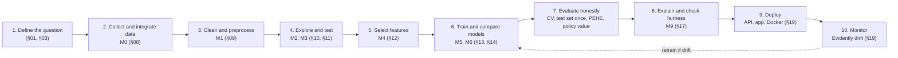

Engineering support runs underneath every step (M11): git, DVC, MLflow, tests and CI.

### 5.11 Check yourself

1. **Your gradient-boosting model has training RMSE 4 and CV RMSE 10; Ridge has 9.2 and 9.4.
   Which overfits, and which do you prefer?** Gradient boosting overfits: there is a big
   gap between training and validation error. Prefer Ridge, which has the lower validation
   error and a small gap.
2. **A teammate standardizes all 660 patients' features, then makes the 80/20 split. What is
   wrong, and how does the project avoid it?** The scaler's mean and SD include test
   patients, a train–test contamination leak. The project puts `StandardScaler` inside
   `build_preprocessor`, which sits in a `Pipeline` and is fitted on training folds only.
3. **Is choosing the causal forest because it had the best IPW policy value on the test set
   allowed?** No. That would be tuning on the test set. The project chose it by semi-synthetic
   PEHE computed on training patients only (`causal.selection`). Test policy values are
   reported, never used to choose (§14).

---

## 06. The maths you need

This chapter covers only the maths the project uses, each piece with a tiny example you can do
by hand. Skip a section if you already know it, but read the "In Equipoise" line so you know
where it reappears. The five parts are linear algebra (§6.1), statistics (§6.2), probability
(§6.3), calculus (§6.4) and inference (§6.5).

### 6.1 Linear algebra

#### Concept card: vectors, matrices and tensors

**In plain words.** A **vector** is a list of numbers: one patient's features. A **matrix** is
a table of numbers, rows × columns: all patients' features. A **tensor** is the same idea
with more directions, for example a stack of tables. One table per patient (weeks ×
measures) stacked for all patients is a 3-D tensor.

**Technically.**
- A vector $v \in \mathbb{R}^p$ has $p$ entries.
- A matrix $A \in \mathbb{R}^{n \times p}$ has $n$ rows and $p$ columns; $A_{ij}$ is the
  entry in row $i$, column $j$.
- A tensor of order 3 has entries $T_{ijk}$.
- The **transpose** $A^\top$ swaps rows and columns: $(A^\top)_{ij} = A_{ji}$.

**Tiny worked example.** $A = \begin{pmatrix}1 & 2\\ 3 & 4\\ 5 & 6\end{pmatrix}$ is
$3 \times 2$, and $A^\top = \begin{pmatrix}1 & 3 & 5\\ 2 & 4 & 6\end{pmatrix}$ is $2 \times 3$.

**In Equipoise.**
- The design matrix after preprocessing is a NumPy matrix.
- `eq/longitudinal/tensor.py:TrajectoryTensor` stores `values[i, t, m]`: patient $i$, week
  $t$, measure $m$ (vision or CST). It is a 3-D tensor on a weekly grid (§15).
- PyTorch calls every array a "tensor" (§14).

**Common confusions.** "Tensor" in deep learning just means "n-dimensional array". It does not
need the physics meaning.

**Viva questions.** *Where do you use a 3-D tensor?* In M7: patients × weekly grid × {vision,
CST}, built by interpolating each patient's visits (`build_tensor`).

#### Concept card: matrix multiplication, inverse, determinant and rank

**In plain words.**
- **Multiplying** a matrix by a vector combines the vector's entries with weights: each
  output is a weighted sum. That is exactly what a linear model does: prediction = weights ×
  features.
- The **inverse** of a matrix undoes it, like division undoes multiplication.
- The **determinant** is one number that says whether the inverse exists. Zero means no
  inverse.
- The **rank** counts how many columns carry genuinely new information.

**Technically.**
- **Product.** $(AB)_{ij} = \sum_k A_{ik}B_{kj}$. This needs (columns of $A$) = (rows of
  $B$).
- **Inverse.** $A^{-1}A = I$, where $I$ is the identity matrix (1s on the diagonal).
- **2×2 determinant.** $\det\begin{pmatrix}a & b\\ c & d\end{pmatrix} = ad - bc$. The inverse
  is $\frac{1}{ad - bc}\begin{pmatrix}d & -b\\ -c & a\end{pmatrix}$.
- **Rank.** The number of linearly independent columns. A square matrix is invertible
  exactly when it has full rank (determinant ≠ 0).
- **Condition number.** For a symmetric positive-definite matrix this is the ratio of its
  largest to smallest eigenvalue (§6.1, next card). It measures how much rounding errors
  are amplified when solving with the matrix.

**Tiny worked example.** $A = \begin{pmatrix}2 & 1\\ 1 & 2\end{pmatrix}$:
$\det A = 4 - 1 = 3$ and $A^{-1} = \tfrac13\begin{pmatrix}2 & -1\\ -1 & 2\end{pmatrix}$.
Check: $A A^{-1} = \tfrac13\begin{pmatrix}4-1 & -2+2\\ 2-2 & -1+4\end{pmatrix} = I$.

By contrast, $B = \begin{pmatrix}1 & 2\\ 2 & 4\end{pmatrix}$ has $\det = 4 - 4 = 0$: the
second column is twice the first, so the rank is 1 and there is no inverse.

**In Equipoise.**
- **OLS via the normal equations.** OLS solves $(X^\top X)\beta = X^\top y$
  (`eq/supervised/scratch.py:normal_equations`). It uses `numpy.linalg.solve`, which
  solves the system directly instead of computing $(X^\top X)^{-1}$; that is faster and
  more accurate.
- **Real-data check.** On the real data the matrix $X^\top X$ (39 coefficients, 490
  patients) has condition number 502. Our coefficients match sklearn's to within
  4.62 × 10⁻¹⁴ [`reports/tables/m5_scratch_checks.csv`].
- **Rank and one-hot encoding.** If every category of a nominal feature gets its own 0/1
  column *and* the model has an intercept, the columns add up to the intercept column. The
  rank drops and $X^\top X$ has no inverse; this is the **dummy-variable trap**.
  `build_preprocessor(full_rank=True)` therefore drops one dummy per feature (§09).
- **Ridge.** The closed-form Ridge in M4 solves $(X^\top X + \alpha I)\beta = X^\top y$
  (`eq/search/objective.py:ridge_fit_predict`). Adding $\alpha I$ always makes the matrix
  invertible.

**Common confusions.** "Divide by a matrix" is not an operation; you multiply by the inverse,
or better, solve the linear system.

**Viva questions.**
- *Why not compute $(X^\top X)^{-1}$ explicitly?* It is slower and amplifies rounding errors
  when the matrix is badly conditioned. `solve` uses a stable factorization.
- *What is the dummy-variable trap?* A full set of one-hot columns plus an intercept is
  linearly dependent (rank deficient), so OLS has no unique solution. Drop one category.

#### Concept card: eigenvalues and eigenvectors

**In plain words.** Most vectors change direction when a matrix multiplies them. Some special
directions only get **stretched** or shrunk. These are the **eigenvectors**, and the
stretch factor is the **eigenvalue**. For a data cloud's covariance matrix, the eigenvectors
are the cloud's natural axes, and the eigenvalues tell how spread out the cloud is along each
axis.

**Technically.** $Av = \lambda v$ with $v \neq 0$, where:

- $v$ is an eigenvector;
- $\lambda$ is its eigenvalue.

The eigenvalues are the roots of $\det(A - \lambda I) = 0$. A symmetric matrix has real
eigenvalues and perpendicular (orthogonal) eigenvectors.

**Tiny worked example.** For $A = \begin{pmatrix}2 & 1\\ 1 & 2\end{pmatrix}$:

$$\det(A - \lambda I) = (2-\lambda)^2 - 1 = 0 \implies \lambda = 3 \text{ or } 1$$

- For $\lambda = 3$: $v = (1, 1)/\sqrt2$. Check: $A(1,1) = (3, 3) = 3(1,1)$.
- For $\lambda = 1$: $v = (1, -1)/\sqrt2$.

**In Equipoise.** PCA's principal directions are the eigenvectors of the covariance matrix of
the standardized features, and the explained variances are its eigenvalues (§11). The code
gets them from the SVD instead (next card).

**Common confusions.** Eigenvectors are only defined up to sign (and length). $v$ and $-v$ are
the same direction. That is why `svd_pca` fixes signs so its results match sklearn's.

**Viva questions.** *How are eigenvalues related to PCA?* The eigenvalues of the covariance
matrix are the variances along the principal components. Their share of the total is the
"explained variance ratio" in the scree plot.

#### Concept card: singular value decomposition (SVD)

**In plain words.** The SVD breaks *any* data matrix into three simple pieces: a rotation, a
stretch, and another rotation. It finds the directions in which the data varies most and how
much it varies along each. It is the engine inside PCA.

**Technically.** For any $X \in \mathbb{R}^{n\times p}$:

$$X = U S V^\top$$

where:

- $U$ ($n \times r$) has orthonormal columns: the patient-side directions;
- $S$ is diagonal with **singular values** $s_1 \ge s_2 \ge \dots \ge 0$;
- $V$ ($p \times r$) has orthonormal columns: the feature-side directions.

If $X$ is centred (column means subtracted), the covariance matrix is
$\frac{1}{n-1}X^\top X = V \frac{S^2}{n-1} V^\top$. So the columns of $V$ are the principal
directions, the variances are $s_k^2/(n-1)$, and the PCA scores are $US$.

**Tiny worked example.** Three centred points $(-1,-1), (0,0), (1,1)$ all lie on the line
$y = x$.
- $X^\top X = \begin{pmatrix}2 & 2\\ 2 & 2\end{pmatrix}$, with eigenvalues 4 and 0.
- So the singular values are $s_1 = 2$ and $s_2 = 0$, and the first direction is
  $(1,1)/\sqrt2$.
- The variance along it is $s_1^2/(n-1) = 4/2 = 2$. All variance lies on one axis: one
  component explains 100%.

**In Equipoise.**
- `eq/represent/pca.py:svd_pca` computes PCA with `numpy.linalg.svd` on the centred,
  standardized training features.
- `compare_with_sklearn` checks it against `sklearn.decomposition.PCA`
  [`reports/tables/m3_svd_vs_sklearn.csv`, §11].

**Common confusions.** SVD works for any rectangular matrix. Eigendecomposition needs a square
one. For the covariance matrix the two agree.

**Viva questions.** *Why compute PCA via SVD instead of eigen-decomposing the covariance
matrix?* SVD works directly on $X$, never forms $X^\top X$ (which squares the condition
number), and is numerically more stable.

### 6.2 Descriptive statistics and distributions

#### Concept card: mean, median, variance, standard deviation, IQR and skew

**In plain words.**
- **Mean**: the average.
- **Median**: the middle value when sorted. Extreme values don't drag it.
- **Variance** and **standard deviation (SD)**: how spread out values are around the mean.
  The SD is in the same units as the data.
- **Quartiles** cut sorted data into four equal groups. The **IQR** is the distance between
  the first quartile (Q1, 25%) and the third quartile (Q3, 75%): the range of the middle
  half.
- **Skew**: lopsidedness. Right-skewed data has a long tail of large values, like incomes.

**Technically.** For values $x_1, \dots, x_n$:

- Mean $\bar x = \frac1n\sum x_i$.
- Sample variance $s^2 = \frac{1}{n-1}\sum (x_i - \bar x)^2$. Dividing by $n-1$ instead of
  $n$ is **Bessel's correction**: it makes $s^2$ unbiased.
- SD $s = \sqrt{s^2}$.
- IQR $= Q_3 - Q_1$.
- Skewness $= \frac{1}{n}\sum\left(\frac{x_i - \bar x}{s}\right)^3$, approximately. pandas
  uses an adjusted version.

**Tiny worked example.** Injections: 6, 8, 9, 10, 22.
- Mean $= 55/5 = 11$; median $= 9$. The 22 pulls the mean up.
- Deviations from the mean: −5, −3, −2, −1, 11. Their squares sum to
  $25+9+4+1+121 = 160$.
- $s^2 = 160/4 = 40$, so $s \approx 6.32$.
- Q1 = 8 and Q3 = 10, so IQR = 2. The skew is positive.

**In Equipoise.**
- **Table 1.** Table 1 shows mean ± SD for roughly symmetric features and median [IQR] for
  skewed ones (|skew| > 1, `config/default.yaml: stats.skew_threshold: 1.0`;
  `eq/stats/table1.py:table1`).
- **Skewed features.** On the training split, HbA1c has skew 1.0 and BMI 1.14 [computed for
  this handbook]. That is why `preprocess.log_features: [X_hba1c, X_bmi]` are
  log-transformed (§09).
- **Injection counts.** These are summarized by median and IQR because counts are skewed:
  year-1 median 9 / 10 / 10 [`m2_replication_vs_published.csv`].

**Common confusions.**
- The SD is not the "average error". It is the root of the average *squared* deviation.
- IQR describes the data's spread. A confidence interval (§6.5) describes the uncertainty of
  an *estimate*. They are different things.

**Viva questions.** *When do you report median [IQR] instead of mean ± SD?* When the
distribution is skewed (|skew| > 1 in our config). Medians resist extreme values.

#### Concept card: probability distributions (normal, t, chi-square, F, Poisson)

**In plain words.** A **distribution** describes how likely each value is. The project meets
five:

| Distribution | Shape and use | Where in Equipoise |
|---|---|---|
| **Normal** (Gaussian) | bell curve; sums of many small effects; measurement noise | outcome noise in synthetic data (SD 9), HMM emissions (§15), semi-synthetic noise |
| **Student's t** | like the normal but with fatter tails, used when the SD is estimated from a small sample | confidence intervals for means; t-tests (M2) |
| **Chi-square ($\chi^2$)** | sum of squared standard normals; tests counts in tables | chi-square tests on categorical features and laser rates (M2) |
| **F** | ratio of two variances | ANOVA, F-test for variances, comparing nested regressions (M2) |
| **Poisson** | counts of events in a fixed time (0, 1, 2, …) | injection counts (M5 Poisson GLM) |

**Technically.**
- **Normal.** Density $\frac{1}{\sigma\sqrt{2\pi}}e^{-(x-\mu)^2/(2\sigma^2)}$, where $\mu$ is
  the mean and $\sigma$ the SD. About 95% of values lie within $\mu \pm 1.96\sigma$.
- **t.** $t_\nu$ with $\nu$ degrees of freedom tends to the normal as $\nu \to \infty$.
- **Chi-square.** $\chi^2_k = \sum_{j=1}^k Z_j^2$ with $Z_j$ standard normal.
- **F.** $F_{d_1,d_2} = \frac{\chi^2_{d_1}/d_1}{\chi^2_{d_2}/d_2}$.
- **Poisson.** $P(N = k) = e^{-\lambda}\lambda^k/k!$, whose mean and variance both equal
  $\lambda$.

**Tiny worked example.** If injections are Poisson with $\lambda = 9$, then
$P(N = 9) = e^{-9}9^9/9! \approx 0.132$. The variance should also be 9. If the observed
variance is much bigger, the data is **overdispersed**, and M5 checks this
[`reports/tables/m5_count_dispersion.csv`, §13].

**In Equipoise.** `scipy.stats` supplies these distributions (`t.ppf`, `f.cdf`,
`chi2_contingency`, …) in `eq/stats/*.py`.

**Common confusions.** A test needing "normality" usually means normality of the *residuals* or
of the *mean* (by the central limit theorem, §6.5), not of every raw value.

**Viva questions.** *Why a t distribution for the CI of mean letters gained?* The population SD
is unknown and is estimated from the sample. The t accounts for that extra uncertainty.

#### Concept card: correlation (Pearson)

**In plain words.** **Correlation** measures how closely two numbers move together in a
straight-line way, on a scale from −1 (perfectly opposite) through 0 (no linear link) to +1
(perfectly together).

**Technically.**

$$r = \frac{\sum (x_i - \bar x)(y_i - \bar y)}{\sqrt{\sum (x_i-\bar x)^2}\sqrt{\sum (y_i-\bar y)^2}}$$

where $\bar x$ and $\bar y$ are the means. The numerator is $(n-1)$ times the
**covariance**. $r^2$ is the share of the variance of $y$ explained by a straight line in
$x$.

**Tiny worked example.** $x = (1, 2, 3)$ and $y = (2, 4, 7)$:
- Deviations: $x$ gives −1, 0, 1; $y$ gives $-2.33, -0.33, 2.67$.
- Numerator $= 2.33 + 0 + 2.67 = 5$.
- Denominator $= \sqrt{2}\cdot\sqrt{5.44+0.11+7.11} = 1.414 \times 3.559 = 5.03$.
- So $r \approx 0.99$.

**In Equipoise.** M2 reports a correlation matrix and heatmap
[`reports/tables/m2_correlation_matrix.csv`]. It also reports a **partial** correlation
between baseline vision and letters gained after removing CST's influence: $r = -0.419$
[`reports/metrics/m2_stats.json: partial_r_va_gain`]. The negative sign means worse starting
vision goes with larger gains (§10).

**Common confusions.** $r = 0$ means no *linear* link; a U-shaped relation can have $r = 0$.
And correlation is not causation (§3.1).

**Viva questions.** *What is partial correlation?* The correlation between two variables after
regressing out a third from both. It answers "is there a link beyond what the third variable
explains?"

### 6.3 Probability

#### Concept card: conditional probability, Bayes' rule and likelihood

**In plain words.**
- **Conditional probability** is the probability of A *given that* B is known.
- **Bayes' rule** turns "probability of the evidence given the cause" into "probability of
  the cause given the evidence".
- **Likelihood** asks how well some parameter values explain the data we saw. Training a
  model by **maximum likelihood** picks the values that make the observed data most
  probable.

**Technically.**
- Conditional probability: $P(A \mid B) = \frac{P(A \cap B)}{P(B)}$.
- Bayes' rule: $P(A \mid B) = \frac{P(B \mid A)\,P(A)}{P(B)}$, where $P(A)$ is the **prior**
  and $P(A \mid B)$ the **posterior**.
- Likelihood of parameters $\theta$ given independent data:
  $\mathcal{L}(\theta) = \prod_i p(y_i \mid x_i, \theta)$. In practice we maximize the
  **log-likelihood** $\sum_i \log p(y_i \mid x_i,\theta)$, because sums are easier than
  products.

**Tiny worked example.** Say 50% of patients start below 69 letters. Among them, 40% gain ≥ 15
letters; among the others, 15% do. If a patient gained ≥ 15 letters, what is the chance they
started below 69?

$$P(\text{below} \mid \text{gain}) = \frac{0.4 \times 0.5}{0.4\times0.5 + 0.15\times0.5} = \frac{0.20}{0.275} \approx 0.73$$

(Made-up rates.)

**In Equipoise.**
- **Naive Bayes** classifiers (M5) apply Bayes' rule with a "features independent given
  the class" assumption (§13).
- **Logistic regression** and the **Poisson GLM** are fitted by maximum likelihood (§13).
- **HMM** training maximizes the likelihood of the visit sequences, and the forward
  algorithm computes it (§15).
- **AIC** chooses ARIMA orders (§15): $\text{AIC} = 2k - 2\log\hat{\mathcal L}$, where $k$
  is the number of parameters and $\hat{\mathcal L}$ the maximized likelihood. Lower is
  better. It rewards fit but charges for every extra parameter.

**Common confusions.** The likelihood is not a probability distribution over $\theta$. It is a
function of $\theta$ for fixed data.

**Viva questions.**
- *What is AIC and why use it?* A model score: $2k - 2\log\hat{\mathcal L}$. It balances
  goodness of fit against complexity. We pick the ARIMA order with the lowest AIC.
- *Where is Bayes' rule in your project?* In the Naive Bayes classifiers, and conceptually
  in the HMM, which computes the probability of hidden states given observed visits.

### 6.4 Calculus

#### Concept card: derivative, gradient and chain rule

**In plain words.**
- The **derivative** is the slope: how fast the output changes when you nudge the input.
- With many inputs, the **gradient** collects all the slopes into one arrow that points
  uphill. Walking the opposite way (downhill) reduces the loss. That is **gradient
  descent**, the way neural networks learn.
- The **chain rule** tells you the slope of a function inside a function. **Backpropagation**
  is the chain rule applied layer by layer.

**Technically.**
- Derivative: $f'(x) = \lim_{h\to0}\frac{f(x+h)-f(x)}{h}$.
- Gradient: $\nabla f = (\partial f/\partial x_1, \dots, \partial f/\partial x_p)$.
- Chain rule: if $y = g(u)$ and $u = h(x)$, then $\frac{dy}{dx} = g'(u)\,h'(x)$.
- Gradient descent: $\theta \leftarrow \theta - \eta\,\nabla_\theta L$, where $\eta$ is the
  **learning rate**.

**Tiny worked example.**
- **Gradient descent.** Take $L(w) = (w - 3)^2$, so $L'(w) = 2(w-3)$. Start at $w = 0$ with
  $\eta = 0.25$. Step 1: $w = 0 - 0.25 \times 2(0-3) = 1.5$. Step 2:
  $w = 1.5 - 0.25 \times 2(1.5 - 3) = 2.25$. The steps head towards the minimum at 3.
- **Chain rule.** For $y = (2x+1)^2$, $dy/dx = 2(2x+1)\cdot 2$. At $x = 1$ this is 12.

**In Equipoise.**
- TARNet is trained by gradient descent with SGD, Adam and RMSprop. PyTorch computes the
  gradients by backpropagation (`loss.backward()`; §14).
- Logistic regression from scratch uses first and second derivatives (Newton's method, §13).

**Common confusions.** The gradient points *uphill*. Descent moves *against* it.

**Viva questions.** *What does `loss.backward()` do?* It applies the chain rule backwards
through the network to compute the gradient of the loss with respect to every weight.

#### Concept card: root finding and finite differences

**In plain words.**
- A **root** of $g$ is an $x$ where $g(x) = 0$, for example "the price at which the dearer
  drug's net benefit equals the cheaper drug's". **Newton–Raphson** finds roots by following
  the tangent line down to zero again and again. **Brent's method** traps the root inside an
  interval and shrinks the interval.
- A **finite difference** estimates a slope from two nearby values, without needing a
  formula for the derivative.

**Technically.**
- **Newton–Raphson.** $x_{k+1} = x_k - g(x_k)/g'(x_k)$. It converges very fast
  (quadratically) near a simple root, but can fail if $g' \approx 0$ or the start is poor.
- **Forward difference.** $\frac{g(x+h)-g(x)}{h}$, with error proportional to $h$.
- **Central difference.** $\frac{g(x+h)-g(x-h)}{2h}$, with error proportional to $h^2$, so
  it is more accurate.

**Tiny worked example.** Solve $g(x) = x^2 - 2 = 0$ starting at $x_0 = 1$, with $g'(x) = 2x$:
- $x_1 = 1 - (1-2)/2 = 1.5$;
- $x_2 = 1.5 - (2.25-2)/3 = 1.4167$;
- $x_3 = 1.41422$, already close to $\sqrt2 = 1.41421$.

**In Equipoise.**
- `eq/decision/breakeven.py:newton` (written from scratch) finds break-even prices. When no
  derivative is supplied it uses a central difference with step $10^{-4}$
  (`decision.newton.fd_step`).
- It is checked against `scipy.optimize.brentq` [`reports/tables/m8_newton_vs_brentq.csv`,
  §16].
- M7 compares forward, backward and central differences on vision curves
  [`reports/tables/m7_finite_difference_orders.csv`, §15].

**Common confusions.** Newton–Raphson for *root finding* ($g = 0$) and Newton's method for
*optimization* ($L' = 0$, used by IRLS) are the same idea applied to different functions.

**Viva questions.** *Why check Newton against brentq?* Newton is fast but not guaranteed to
converge. Brent's method is guaranteed when a sign change brackets the root, so agreement
between the two validates our implementation.

### 6.5 Statistical inference

#### Concept card: sampling, standard error and the central limit theorem

**In plain words.** The 660 trial patients are a **sample** from a much larger population of
DME patients. A number computed from the sample, like mean letters gained, would come out a
little different with another sample. The **standard error (SE)** measures how much it would
wobble. The **central limit theorem** says sample means are roughly normally distributed when
$n$ is large enough, even if the raw data is not.

**Technically.** For a mean, $\text{SE}(\bar x) = s/\sqrt n$, where $s$ is the sample SD. For a
difference of two independent means, $\text{SE} = \sqrt{s_1^2/n_1 + s_2^2/n_2}$.

**Tiny worked example (real numbers).** Aflibercept at 1 year: $n = 208$, SD 11.6
[`reports/tables/m2_replication_means.csv`]. So SE $= 11.6/\sqrt{208} = 11.6/14.42 = 0.80$
letters.

**In Equipoise.** Every mean in M2 has a t-based confidence interval built from its SE
(`eq/stats/replication.py:mean_ci`).

**Common confusions.** SD describes individual patients; SE describes the *estimate*. SE shrinks
as $n$ grows; SD does not.

**Viva questions.** *Why is the SE so much smaller than the SD?* It divides the SD by
$\sqrt n$. With 208 patients the mean is about 14 times more precise than one patient's value.

#### Concept card: confidence interval (CI)

**In plain words.** A **95% confidence interval** is a range built so that, if we repeated the
whole trial many times, about 95% of such ranges would contain the true value. It is an
honest "give or take".

**Technically.**

$$\bar x \pm t_{0.975,\,n-1}\cdot \text{SE}$$

where $t_{0.975,n-1}$ is the 97.5th percentile of the t distribution with $n-1$ degrees of
freedom, about 1.97 for $n = 208$. For a difference of means with unequal variances, the
project uses the **Welch–Satterthwaite** degrees of freedom (`welch_ci`).

**Tiny worked example (real numbers).** Aflibercept mean 13.3, SE 0.80:
$13.3 \pm 1.97 \times 0.80 = 13.3 \pm 1.58$, giving $(11.7, 14.9)$. The repository reports
11.8 to 14.9 [`m2_replication_means.csv`]; the small difference is rounding of the mean.

**In Equipoise.** CIs appear everywhere:
- arm means (M2);
- missing-data strategies (M1);
- bootstrap percentile intervals for policy values and per-patient effects (M6, §14).

The bootstrap is a different way to build intervals: resample patients with replacement,
recompute the statistic, and take the 2.5th and 97.5th percentiles.

**Common confusions.** A 95% CI does **not** mean "95% probability the true value is in *this*
interval" in classical statistics. The probability statement is about the procedure.

**Viva questions.** *Two arms' CIs overlap. Does that prove no difference?* No. Test the
*difference* directly. Overlapping individual CIs can still have a significant difference.
The project's policy-value conclusion ("no policy distinguishable") is stated carefully for
that reason (§14).

#### Concept card: hypothesis test, p-value, significance level, one- vs two-tailed, Type I/II errors

**In plain words.** A **hypothesis test** asks: "If there were truly no difference (the **null
hypothesis**), how surprising would data like ours be?" The **p-value** is that surprise
level: the probability of a result at least this extreme if the null were true. If $p$ is
below a pre-chosen **significance level** α (usually 0.05), we reject the null.

There are two ways to be wrong:
- a **Type I error** is a false alarm: rejecting a true null. Its probability is α.
- a **Type II error** is a miss: failing to reject a false null. Its probability is β, and
  **power** is $1-\beta$.

A **two-tailed** test looks for differences in either direction; a **one-tailed** test only
in one.

**Technically.** Compute a test statistic $T$ (for example, difference ÷ SE). Then
$p = P(|T| \ge |t_{\text{obs}}| \mid H_0)$ for two-tailed, or $P(T \ge t_{\text{obs}} \mid H_0)$
for one-tailed. Reject $H_0$ if $p < \alpha$.

**Tiny worked example (real numbers).**
- Aflibercept − bevacizumab at 1 year: difference 3.95 letters, Welch t-test $p = 0.000546$,
  Holm-adjusted $p = 0.00164$.
- Ranibizumab − bevacizumab: difference 1.82, $p = 0.0806$.

[`reports/tables/m2_replication_tests.csv`] At α = 0.05 the first is significant and the
second is not.

**In Equipoise.**
- `config/default.yaml: stats.alpha: 0.05`.
- All tests are two-tailed: sklearn/scipy defaults, and `variance_tests` describes its F-tests
  as two-sided.
- In Table 1, 0 of 33 baseline features had $p < 0.05$ across arms
  [`reports/metrics/m2_stats.json: table1_n_p_below_alpha, table1_n_tested`]. That is
  consistent with successful randomization (§10).

**Common confusions.**
- The p-value is **not** the probability that the null is true.
- "Not significant" is not "no effect"; the study may simply lack power. This is exactly the
  M6 situation for per-patient differences.

**Viva questions.**
- *What does p = 0.08 for ranibizumab vs bevacizumab mean?* If the two drugs truly gave the
  same mean gain, a difference at least this large would appear about 8% of the time. That
  is not rare enough to reject at α = 0.05. It does not show the drugs are equal.
- *What is a Type II error in your project?* Calling a patient "equipoise" when a costlier
  drug truly helps them by more than 5 letters. Our wide intervals make this quite possible,
  which is why the app also shows the published rule.

#### Concept card: multiple-testing correction (Holm)

**In plain words.** If you run 20 tests at α = 0.05 on pure noise, about one will look
"significant" by luck. **Multiple-testing corrections** make each test stricter so the chance of
*any* false alarm across the family stays near α.

**Technically.** The **Holm** step-down method:

1. Sort the $m$ p-values $p_{(1)} \le \dots \le p_{(m)}$.
2. Compare $p_{(k)}$ with $\alpha/(m - k + 1)$.
3. Reject in order until the first failure.

The adjusted p-values are $\tilde p_{(k)} = \max_{j\le k}\min(1, (m-j+1)p_{(j)})$. Holm
controls the **family-wise error rate** and is uniformly more powerful than Bonferroni.

**Tiny worked example (real p-values, 1-year letters, all patients).**

| Comparison | Raw p (sorted) | Multiplier | Holm-adjusted p |
|---|---|---|---|
| Afl − Bev | 0.000546 | × 3 | 0.00164 |
| Afl − Ran | 0.04 | × 2 | 0.08 |
| Ran − Bev | 0.0806 | × 1 | 0.0806 (kept ≥ the previous, 0.08) |

[`m2_replication_tests.csv`]

**In Equipoise.** `eq/stats/replication.py:hypothesis_tests` applies
`statsmodels.stats.multitest.multipletests(method="holm")` to each family of three pairwise
comparisons. The trial protocol planned the closely related Hochberg method [protocol §7.2.1],
which is a "Plan vs reality" point for §10.

**Common confusions.** Correcting makes each test *less* likely to be significant. Afl − Ran
went from 0.04 to 0.08.

**Viva questions.** *Why Holm and not Bonferroni?* Holm gives the same family-wise guarantee
and is never less powerful.

### 6.6 Check yourself

1. **$A = \begin{pmatrix}4 & 2\\ 2 & 1\end{pmatrix}$. Determinant? Invertible? Rank?**
   $\det = 4 - 4 = 0$, so it is not invertible. The rank is 1, because the second column is
   half the first.
2. **Bevacizumab at 1 year: $n = 204$, mean 9.38, SD 11.5. Compute the SE and an approximate
   95% CI.** SE $= 11.5/\sqrt{204} = 0.805$. CI $\approx 9.38 \pm 1.97\times0.805 =
   (7.79, 10.97)$. This matches the reported 7.79 to 11.0 [`m2_replication_means.csv`].
3. **One Newton step for $g(x) = x^2 - 5$ from $x_0 = 2$?**
   $x_1 = 2 - (4-5)/(2\cdot2) = 2.25$. The true root is 2.236.

---

## 07. The Python toolbox

A **library** (or package) is code someone else wrote that you import. This chapter lists
every third-party library the project imports, found by scanning all tracked Python files
(`scripts/handbook/scan_code.py`, `scan_usage.py`). For each one it gives:

- what the library is;
- what Equipoise uses it for;
- the key functions we call, with the arguments that matter.

Versions are the ones installed in this project's `.venv` [`pip list` in `.venv`]. The exact
pins for a fresh install are in `requirements*.txt` (§19). The report's ready-made
technology-stack table is generated by `eq/report/tables.py:tech_stack`
[`reports/tables/m11_tech_stack.csv`].

### 7.1 The core idea of scikit-learn: fit, transform, predict

#### Concept card: the estimator API (fit / transform / predict)

**In plain words.** Every scikit-learn object follows the same three-verb pattern, so you can
swap one for another like changing attachments on a drill:

- `fit(X, y)` **learns** from data: a scaler learns means, a model learns coefficients.
- `transform(X)` **changes** data using what was learned: it scales, imputes or encodes.
- `predict(X)` **guesses** targets for new rows. Classifiers also have `predict_proba(X)`,
  which returns class probabilities.

**Technically.**
- A **transformer** implements `fit` and `transform`; `fit_transform` does both at once.
- An **estimator** (a model) implements `fit` and `predict`.
- Learned attributes end with an underscore, for example `mean_` or `coef_`.
- `sklearn.base.clone(est)` copies the settings without the learned state.
- `check_is_fitted(est)` raises an error if `fit` has not been called.
- Custom classes inherit `BaseEstimator` (which gives `get_params`/`set_params`) plus
  `TransformerMixin`, `RegressorMixin` or `ClassifierMixin`.

**Tiny worked example.**

```python
from sklearn.preprocessing import StandardScaler
sc = StandardScaler().fit([[1], [3], [5]])   # learns mean_ = 3, scale_ = 1.633
sc.transform([[5]])                          # -> [[1.2247]]  ( (5-3)/1.633 )
```

**In Equipoise.** The project writes several of its own sklearn-compatible classes, so they
work inside pipelines and with `clone`:

- `eq/preprocess/harmonize.py:CSTHarmonizer` (a transformer);
- `eq/supervised/scratch.py:NormalEquationsRegressor`, `IRLSLogisticRegression`,
  `ArmMeanRegressor` and `ArmRateClassifier`;
- `eq/causal/data.py:KnownPropensity` (a "classifier" that returns the known
  randomization probabilities).

**Common confusions.** Calling `fit` on test data is leakage. Only `transform`/`predict` touch
test data.

**Viva questions.** *How did you write your own estimator?* By subclassing `BaseEstimator` and
`RegressorMixin` and implementing `fit` (which sets learned attributes and returns `self`)
and `predict`.

#### Concept card: Pipeline and ColumnTransformer

**In plain words.**
- A **Pipeline** chains steps into one object, like an assembly line: impute → scale →
  model. Calling `fit` on the pipeline fits each step in order on the *same* training data.
- A **ColumnTransformer** sends different columns to different treatments, like a sorting
  office: numbers to the scaler, categories to the one-hot encoder.

Together they guarantee that every preprocessing statistic is learned from training data only,
even inside cross-validation.

**Technically.**
- `Pipeline(steps=[(name, transformer), ..., (name, estimator)])`. `fit` calls
  `fit_transform` on each transformer and `fit` on the last step. `predict` calls `transform`
  on each step, then `predict` on the last.
- `ColumnTransformer(transformers=[(name, transformer, columns), ...],
  remainder="drop")`. It applies each transformer to its columns and stacks the outputs
  side by side. `remainder="drop"` discards every column not listed, which is our leakage
  guard.

**Tiny worked example.**

```python
pipe = Pipeline([("prep", ColumnTransformer([("num", StandardScaler(), ["X_age"]),
                                             ("cat", OneHotEncoder(), ["X_race"])])),
                 ("model", Ridge(alpha=10))])
pipe.fit(train_df, train_y)        # scaler/encoder/model all learn from train_df only
pipe.predict(test_df)              # same transformations, no re-fitting
```

**In Equipoise.** `eq/preprocess/encode.py:build_preprocessor` is the single
`ColumnTransformer` that every later model uses (§09 walks through it line by line). Its
structure:

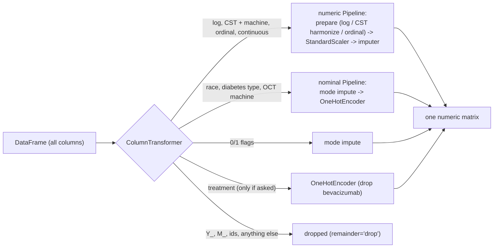

M5 wraps it as `Pipeline([("prep", build_preprocessor(...)), ("model", estimator)])`
(`eq/supervised/models.py:_pipe`), so cross-validation refits the preprocessing inside each
fold automatically.

**Common confusions.** A ColumnTransformer *re-orders* columns: the output follows the
transformer list, not the input order. Use `get_feature_names_out()` to see the names.

**Viva questions.** *Why put preprocessing inside a Pipeline?* So cross-validation and the
final fit learn imputation medians, scaling means/SDs, harmonization parameters and encoder
categories from training folds only. That prevents leakage, and it is tested in
`tests/test_preprocess.py`.

### 7.2 Data and numerics

| Library (version) | What it is | Used in Equipoise for |
|---|---|---|
| **NumPy** 2.4.6 | fast n-dimensional arrays and maths | every numeric step; linear algebra; random numbers; the 3-D tensor |
| **pandas** 2.3.3 | tables (DataFrame) with named columns | loading CSVs, joins, group summaries, report tables |
| **SciPy** 1.17.1 | scientific routines | statistical tests, interpolation, root finding, clustering, sparse matrices |
| **PyYAML** 6.0.3 | reads YAML config files | `config/*.yaml` |
| **tabulate** 0.10.0 | pretty text tables | `DataFrame.to_markdown()` for every `reports/tables/*.md` |

**NumPy: key functions.**

| Call | What it does | Where |
|---|---|---|
| `np.linalg.solve(A, b)` | solves $Ax = b$ for $x$ (stable; no explicit inverse) | `scratch.py:normal_equations`, IRLS step, closed-form Ridge |
| `np.linalg.svd(X, full_matrices=False)` | thin SVD, returns `U, s, Vt` | `represent/pca.py:svd_pca` |
| `np.interp(x, xp, fp, left=nan, right=nan)` | linear interpolation of points `(xp, fp)` at `x` | `longitudinal/tensor.py:interpolate` |
| `np.random.default_rng(seed)` | a seeded random generator (`.integers`, `.normal`, `.choice`, `.random`) | search algorithms, synthetic data, bootstrap |
| `np.quantile(a, q, axis=0)` | quantiles, e.g. the 2.5% and 97.5% bootstrap limits | `causal/bundle.py:ModelBundle.predict` |

**pandas: key functions.**

| Call | What it does | Where |
|---|---|---|
| `pd.read_csv(path, sep="\|", encoding="latin1")` | read a text table (DRCR files are pipe-separated) | `scripts/build_protocolT_table.py:load` |
| `df.merge(other, on="pt_id", how="left")` | SQL-style join; `how="left"` keeps every left row | the M0 build |
| `df.groupby("treatment")[col].mean()` | split → apply → combine | arm means everywhere |
| `pd.cut(x, bins=edges, labels=..., right=False)` | turn numbers into bands (right-open intervals) | `preprocess/discretize.py:discretize` |
| `pd.crosstab(a, b)` | contingency table of counts | chi-square tests, cluster × arm tables |
| `df.to_markdown(index=False, floatfmt=".3g")` | Markdown table (needs tabulate); 3 significant digits | `tracking.py:log_table` |

Note on rounding: `log_table` writes the `.csv` copy with 10 significant digits and the `.md`
copy with 3. The handbook quotes the `.md` precision.

**SciPy: key functions.**

| Call | Purpose | Where |
|---|---|---|
| `scipy.stats.ttest_ind(a, b, equal_var=False)` | Welch's t-test | `stats/replication.py:welch_ci` |
| `stats.f_oneway(*groups)`, `stats.kruskal(*groups)` | one-way ANOVA / Kruskal–Wallis | Table 1, replication |
| `stats.chi2_contingency(table)` | chi-square test of independence | Table 1, laser, trajectory clusters |
| `stats.mannwhitneyu(a, b)` | rank test for two groups | injection counts |
| `stats.levene(*g, center="median")`, `stats.bartlett(*g)` | equal-variance tests | `stats/inference.py:variance_tests` |
| `stats.t.ppf(q, df)` | t quantile for CIs | `mean_ci`, `welch_ci` |
| `scipy.optimize.brentq(f, a, b)` | guaranteed root in a bracket $[a, b]$ with $f(a)f(b) < 0$ | `decision/breakeven.py:brent_root` |
| `scipy.interpolate.CubicSpline(x, y)`, `lagrange(x, y)` | spline and polynomial interpolation | `longitudinal/tensor.py` |
| `scipy.cluster.hierarchy.linkage(X, "ward")`, `fcluster`, `dendrogram` | hierarchical clustering | `represent/cluster.py:ward_labels` |
| `scipy.sparse.csr_matrix` | compressed sparse row matrix | `preprocess/encode.py:one_hot_sparse` |
| `scipy.special.logsumexp(a)` | stable $\log\sum e^{a_i}$ | `longitudinal/hmm.py:forward_loglik` |

**PyYAML.** `yaml.safe_load(text)` turns YAML into Python dicts and lists. Unlike `yaml.load`,
it refuses to construct arbitrary Python objects, so it is safe on untrusted files
(`eq/config.py:_read_yaml`).

#### Concept card: YAML configuration

**In plain words.** **YAML** is a human-friendly text format for settings: `key: value` lines,
indentation for nesting, `- item` or `[a, b]` for lists, and `#` for comments. Keeping every
setting in one YAML file means you change behaviour without touching code, and the file
documents itself.

**Technically.** YAML maps onto JSON-like data: mappings (dicts), sequences (lists) and
scalars. `null` becomes Python `None`.

**Tiny worked example.**

```yaml
effects:
  mcid_letters: 5             # one chart line
  mcid_sensitivity_letters: [3]
```

`yaml.safe_load` turns this into `{"effects": {"mcid_letters": 5, "mcid_sensitivity_letters": [3]}}`.

**In Equipoise.** There are three YAML files:

- `config/default.yaml`: every setting and hyperparameter;
- `config/costs.yaml`: prices, deliberately `null`;
- `config/replication_targets.yaml`: published numbers.

`eq/config.py:load_config` reads them into a frozen dataclass `Config`, with all paths made
absolute. CLAUDE.md: "No magic numbers in code." DVC also reads `config/default.yaml` as its
parameter file (§19).

**Common confusions.** Indentation is meaningful in YAML (like Python); tabs are not allowed.

**Viva questions.** *Why a config file instead of constants in code?* One place to see and
change every setting; reproducibility (DVC reruns a stage when its parameters change); and
reviewers can audit the numbers.

### 7.3 Machine learning and statistics

| Library (version) | What it is | Used in Equipoise for |
|---|---|---|
| **scikit-learn** 1.9.1 | the standard ML toolkit | preprocessing, models, CV, clustering, feature selection, metrics |
| **statsmodels** 0.15.0 | classical statistics with p-values | OLS/ANOVA inference, logistic check, Holm correction, ARIMA, ADF |
| **mlxtend** 0.25.0 | ML extensions | Apriori association rules |
| **EconML** 0.17.0 (Microsoft) | causal ML estimators | S/T/X/DR-learners, causal forest |
| **Optuna** 5.0.0 | hyperparameter optimization | TPE tuner (vs grid and PSO) |
| **AutoGluon-Tabular** 1.6.3 (optional `[automl]`) | AutoML | T-learner base model comparison |
| **hmmlearn** 0.3.3 | hidden Markov models | reference HMM fit (EM) |
| **scikit-fuzzy** 0.5.0 | fuzzy logic | fuzzy inference system |
| **SHAP** 0.51.0 | Shapley-value explanations | explaining the effect model |

**scikit-learn: what we import** [`scripts/handbook/scan_usage.py`]:

| Area | Classes / functions | Main arguments we set | Chapter |
|---|---|---|---|
| Preprocessing | `StandardScaler()`, `MinMaxScaler()`, `OneHotEncoder(handle_unknown="ignore", drop="first", min_frequency=10, sparse_output=False)`, `OrdinalEncoder(categories=[...])`, `FunctionTransformer(np.log)` | `drop="first"` avoids the dummy trap; `min_frequency` pools rare categories | §09 |
| Imputation | `SimpleImputer(strategy="median" / "most_frequent")`, `KNNImputer(n_neighbors=5)`, `IterativeImputer(max_iter=10, random_state=seed)` | `IterativeImputer` needs `from sklearn.experimental import enable_iterative_imputer` first | §09 |
| Composition | `Pipeline`, `ColumnTransformer`, `clone` | see §7.1 | §07 |
| Splitting / CV | `train_test_split(ids, test_size=0.2, stratify=arm, random_state=42)`, `StratifiedKFold(5, shuffle=True, random_state=seed)`, `GroupShuffleSplit`, `cross_val_predict` | `stratify` keeps arm proportions; groups keep a patient's images together | §08, §18 |
| Linear models | `LinearRegression`, `Ridge(alpha)`, `RidgeCV(alphas=[...])`, `LassoCV(alphas=50, cv=5)` (an integer `alphas` means "try 50 values along the path"), `lasso_path`, `LogisticRegression(C=1.0, class_weight=...)`, `PoissonRegressor(alpha=1e-4)` | `alpha` / `C` = regularization strength (`C` is its inverse) | §12, §13 |
| Neighbours | `KNeighborsRegressor/Classifier(n_neighbors=15, algorithm=...)`, `NearestNeighbors` | `algorithm` ∈ kd_tree / ball_tree / brute | §13 |
| Trees and ensembles | `DecisionTreeRegressor/Classifier(max_depth=4, min_samples_leaf=20)`, `RandomForestRegressor(n_estimators=300, min_samples_leaf=10, max_features=0.33)`, `GradientBoostingRegressor(n_estimators=200, learning_rate=0.05, max_depth=2, subsample=0.8)`, `HistGradientBoostingRegressor(loss="poisson")`, `IsolationForest(contamination=0.05)` | values from `config/default.yaml: supervised` | §09, §13 |
| Naive Bayes | `GaussianNB`, `BernoulliNB` | n/a | §13 |
| Baselines | `DummyClassifier` | n/a | §13 |
| Clustering / reduction | `KMeans(n_clusters=k, n_init=10, random_state=seed)` (`n_init=20` for trajectories), `DBSCAN(eps, min_samples=10)`, `PCA` | `eps` from the k-distance curve | §09, §11 |
| Feature selection | `mutual_info_regression`, `chi2`, `RFE(estimator, n_features_to_select=12)` | n/a | §12 |
| Metrics | `mean_squared_error`, `mean_absolute_error`, `r2_score`, `mean_poisson_deviance`, `accuracy_score`, `precision_score`, `recall_score`, `f1_score`, `roc_auc_score`, `average_precision_score`, `roc_curve`, `precision_recall_curve`, `confusion_matrix`, `precision_recall_fscore_support`, `silhouette_score` | n/a | §13, §11 |

**statsmodels.**

| Call | What it does | Where |
|---|---|---|
| `smf.ols("y ~ C(treatment) * va + cov", data=df).fit()` | OLS with an R-style formula; `C()` marks a categorical variable, `*` adds the interaction | `stats/inference.py:interaction_regression`, `multiple_correlation` |
| `anova_lm(reduced, full)` | F-test comparing nested models | `interaction_regression` |
| `sm.OLS(y, X).fit()`, `sm.Logit(y, sm.add_constant(X)).fit()` | matrix-style OLS and logistic regression | `preprocess/missing.py:_ols_arm_differences`; `supervised/evaluate.py:irls_check` |
| `multipletests(pvals, method="holm")` | multiple-testing correction | `stats/replication.py:hypothesis_tests` |
| `ARIMA(y, order=(p, d, q)).fit()`, `.aic`, `.forecast(steps)` | ARIMA time-series model | `longitudinal/timeseries.py:fit_arima_by_aic` |
| `adfuller(y, maxlag=1)` | augmented Dickey–Fuller stationarity test | `timeseries.py:adf_table` |

**mlxtend.** `apriori(onehot_df, min_support=0.08, use_colnames=True, max_len=3)` finds
frequent itemsets. `association_rules(itemsets, metric="confidence", min_threshold=0.4)`
scores rules A → B (`eq/represent/rules.py:mine_rules`, §11).

**EconML.** The project uses these classes (`eq/causal/learners.py`):

| Class | Key arguments | Where |
|---|---|---|
| `SLearner(overall_model=m, categories=[0, 1, 2])` | one outcome model with treatment as an input | `causal/learners.py:EconMLMeta._make` |
| `TLearner(models=m, categories=...)` | one copy of `m` per arm | same |
| `XLearner(models=m, cate_models=clone(m), propensity_model=KnownPropensity(...), categories=...)` | imputed-effect learner | same |
| `DRLearner(model_propensity=KnownPropensity(...), model_regression=m, model_final=clone(m), cv=5, categories=..., random_state=seed)` | doubly robust learner | same |
| `CausalForestDML(model_y=GB, model_t=KnownPropensity(...), discrete_treatment=True, categories=..., n_estimators=500, min_samples_leaf=10, max_depth=None, cv=5, random_state=seed)` | causal forest with DML residualization | `causal/learners.py:CausalForest.fit` |

Every estimator is fitted with `est.fit(Y, T, X=X)`, where `T` is the arm code (bevacizumab =
0). Effects come from `est.effect(X, T0=0, T1=k)`, and for the forest also
`est.effect_interval(X, T0=0, T1=k, alpha=0.05)`. `m` is the base learner: gradient boosting
or Ridge (`base_learner`).

**Optuna.** `optuna.create_study(direction="minimize", sampler=TPESampler(seed=seed))` creates
a study. `study.optimize(objective, n_trials=30)` runs it. Inside the objective,
`trial.suggest_float(name, low, high, log=...)` and `trial.suggest_int(...)` propose
values (`eq/causal/tuning.py:compare_tuners`, §14).

**AutoGluon.** One predictor per arm: `TabularPredictor(label="y",
problem_type="regression", eval_metric="rmse", path=..., verbosity=0).fit(df,
time_limit=120, presets="medium_quality")`, then `.predict(df)` and
`.leaderboard(silent=True)` (`eq/causal/automl.py:AutoGluonTLearner`).

**hmmlearn.** `GaussianHMM(n_components=3, covariance_type="diag", n_iter=200, tol=1e-4,
random_state=seed)`. `.fit(X, lengths)` uses EM; `.means_`, `.covars_`, `.transmat_` and
`.startprob_` hold the learned parameters; `.decode()` is the library's Viterbi, used to check
ours (`eq/longitudinal/hmm.py`, §15).

**scikit-fuzzy.**

- `fuzz.trimf(universe, [a, b, c])` and `fuzz.trapmf(universe, [a, b, c, d])` build
  triangular and trapezoidal membership functions.
- `ctrl.Antecedent(universe, name)` defines an input variable; `ctrl.Consequent(universe,
  name, defuzzify_method="centroid")` defines the output.
- `ctrl.Rule(antecedent, consequent)` writes a rule, with `&` for AND, `|` for OR and `~`
  for NOT.
- `ctrl.ControlSystem(rules)` and `ctrl.ControlSystemSimulation(system)` assemble and run
  the system: set `.input[...]`, call `.compute()`, read `.output[...]`
  (`eq/decision/fuzzy.py:build`, §16).

**SHAP.**

- `shap.Explainer(f, masker, algorithm="permutation", feature_names=names, seed=seed)` builds
  an explainer for any function `f(X)`. `shap.maskers.Independent(background,
  max_samples=len(background))` supplies the background rows that stand in for "feature
  unknown".
- `explainer(X, max_evals=2 * n_features + 1, silent=True)` returns an `Explanation`.
- `shap.plots.waterfall(expl[i])` and `shap.plots.beeswarm(expl)` draw the plots
  (`eq/explain/shap_effects.py:explain_effect`, §17).

### 7.4 Deep learning and computer vision

| Library (version) | What it is | Used for |
|---|---|---|
| **PyTorch** 2.14.1 | tensors + automatic differentiation + neural-network layers | TARNet (M6); ResNet18 (M10) |
| **torchvision** 0.29.1 (`[cv]`) | vision models, datasets, image transforms | ResNet18 pretrained weights, `ImageFolder`, transforms |
| **Ultralytics** 8.4.175 (`[cv]`) | YOLO models | YOLO11n classification |
| **pytorch-grad-cam** 1.5.7 (`[cv]`) | Grad-CAM heatmaps | explaining the ResNet |
| **OpenCV** (`opencv-python-headless` 5.0.0.93, `[cv]`) | image processing | grayscale, denoise, CLAHE, resize |
| **Pillow (PIL)** | image file reading | inference on uploaded images |

**PyTorch key pieces** (`eq/causal/tarnet.py`):

- `torch.nn.Module`: the base class for networks. You define layers in `__init__` and the
  computation in `forward(x)`.
- `nn.Linear(in, out)`, `nn.ELU()`, `nn.Dropout(p)`, `nn.Sequential(...)`, `nn.ModuleList`:
  layers and containers.
- `torch.optim.SGD(params, lr, momentum, weight_decay)`, `Adam(params, lr, weight_decay)`,
  `RMSprop(params, lr, weight_decay)`: optimizers (§14). In `_make_optimizer`, all three get
  the same `weight_decay` (1e-4).
- Training step: `optimizer.zero_grad()`, `loss.backward()`, `optimizer.step()`.
  `torch.no_grad()` turns off gradient tracking for prediction.
- **Mini-batches.** TARNet does *not* use a `DataLoader`. It shuffles row indices itself
  with a seeded NumPy generator (`rng.permutation`) and slices batches of 64, so every
  optimizer sees exactly the same batches. The OCT ResNet uses
  `torch.utils.data.DataLoader(ImageFolder(...), batch_size=32, shuffle=...)`
  (`eq/vision/resnet.py:_loader`, §18).

**OpenCV key calls** (`eq/vision/preprocess.py`): `cv2.medianBlur(img, 3)`,
`cv2.fastNlMeansDenoising(img, h=10)`, `cv2.createCLAHE(clipLimit=2.0,
tileGridSize=(8, 8)).apply(img)` and `cv2.resize(img, (224, 224),
interpolation=cv2.INTER_AREA)`.

### 7.5 Engineering, serving and MLOps

| Library / tool (version) | What it is | Used for | Chapter |
|---|---|---|---|
| **Typer** 0.27.3 | builds command-line interfaces from Python functions | `python -m equipoise <stage>` | §19 |
| **joblib** 1.6.0 | fast saving/loading of Python objects | the model bundle, early-response model, serving assets | §19 |
| **MLflow** 3.17.0 | experiment tracking and model registry | one experiment per stage; registry alias `champion` | §19 |
| **DVC** 3.67.1 | data and pipeline versioning | `dvc.yaml` stages, `dvc repro` | §19 |
| **pytest** 9.1.1 / **ruff** 0.16.10 | testing / linting | `tests/`, CI | §19 |
| **FastAPI** 0.143.0 + **Uvicorn** 0.54.0 | web API framework + server | `/predict`, `/breakeven`, … | §19, §22 |
| **Pydantic** 2.14.0 | data validation with type hints | request/response schemas | §19, §22 |
| **requests** 2.34.2 / **httpx** 0.28.1 | HTTP clients | app → API client; FastAPI `TestClient` | §19 |
| **Streamlit** 1.65.0 + **Altair** 6.3.0 | web apps in Python + declarative charts | the clinician app | §23 |
| **fpdf2** 2.8.9 | PDF generation | one-page patient summary | §23 |
| **Evidently** 0.7.23 | data-drift reports | `python -m equipoise monitor` | §19 |
| **Gradio** 6.30.0 (`[cv]`) | quick ML demo UIs | OCT demo (`app/oct_gradio.py`) | §18 |
| **matplotlib** 3.11.2 | static plots | every report figure | all |
| **networkx** 3.6.1 | graphs | drawing the causal DAG | §03 |
| **Playwright** 1.63.0 (`[ui-dev]`) | browser automation | UI screenshots | §23 |
| **kaggle** (`[cv]`) | Kaggle API client | finding the OCT archive URL | §18 |
| **packaging** | version/requirement parsing | `scripts/freeze_requirements.py` | §19 |

Key calls are shown in the chapter that uses each tool. Two small ones:

- **joblib.** `joblib.dump(obj, path)` and `obj = joblib.load(path)`
  (`eq/causal/bundle.py:save_bundle`, `load_bundle`).
- **MLflow.** `mlflow.set_tracking_uri("sqlite:///mlflow.db")` and `with
  mlflow.start_run(run_name=..., tags=...)` open a run; `mlflow.log_params(dict)`,
  `mlflow.log_metrics(dict)` and `mlflow.log_artifact(path)` record it
  (`eq/tracking.py:start_run`, `log_params`, `log_figure`, `log_table`).

#### Concept card: joblib serialization

**In plain words.** **Serialization** means saving a Python object (such as a trained model,
with all its learned numbers) to a file so a different program can load it later and use it
straight away, without retraining. It is like freezing cooked food to reheat later.

**Technically.** `joblib.dump` pickles the object graph. Large NumPy arrays are stored
efficiently. Loading requires compatible library versions; that is one reason requirements are
pinned. Pickle files can run code when loaded, so only load files you trust.

**Tiny worked example.**

```python
joblib.dump(model, "m.joblib")
model2 = joblib.load("m.joblib")
model2.predict(X)       # same predictions as model.predict(X)
```

**In Equipoise.** `models/equipoise_bundle.joblib` holds everything needed to score a patient:
preprocessor, chosen effect model, 50 bootstrap copies, per-arm outcome / injection / laser
models, feature schema, training-data hash and config snapshot
(`eq/causal/bundle.py:ModelBundle`; `causal.bundle_bootstrap_models: 50`).
`models/early_response_model.joblib` (M7) and `models/serving_assets.joblib` (M9: k-means
centroids and form defaults, no patient rows) are saved the same way.

**Common confusions.** A joblib file is not portable across very different library versions.
MLflow's pyfunc wrapper records the environment for that reason (§19).

**Viva questions.** *What is inside your model bundle?* See above. Note that it contains no raw
patient rows, only fitted models, and Docker images never include it; it is mounted at run time.

### 7.6 Python standard library (built in, no install)

`pathlib.Path` (cross-platform paths), `json`, `dataclasses` (`@dataclass(frozen=True)` for
`Config`, results), `functools.lru_cache` (cache the loaded bundle), `itertools`
(`product`, `combinations`), `collections` (`deque` as the tabu list, `Counter`,
`defaultdict`), `heapq` (beam search's priority queue), `hashlib.sha256` (data-version tag),
`subprocess` (read the git commit), `threading.Lock` (safe request logging), `argparse`
(script options), `ast` (parsing code for the tech-stack table and the copy test), `zipfile` /
`zlib` / `struct` (reading parts of the Kaggle zip), `concurrent.futures.ThreadPoolExecutor`
(parallel downloads), `contextlib` (`@contextmanager` for MLflow runs, the FastAPI
`lifespan`), `warnings`, `random`, `math`, `csv`, `datetime`, `importlib`.

#### Concept card: caching

**In plain words.** **Caching** means remembering the answer to an expensive question so the
second time you ask, you get it instantly. Loading a 100 MB model or running 50 bootstrap
models for the same patient twice would be slow, so the app remembers.

**Technically.**
- `functools.lru_cache(maxsize=...)` memoizes a function by its arguments (LRU = "least
  recently used" entries are dropped first when full).
- `st.cache_resource` keeps one shared object per server, such as a loaded model or client.
- `st.cache_data` caches data results by their inputs.

**Tiny worked example.**

```python
@lru_cache(maxsize=2)
def load(path): ...          # first call reads the file; later calls with the same path return instantly
```

**In Equipoise.**
- `eq/decision/recommend.py:_cached_bundle` and `_cached_fuzzy` use `lru_cache`.
- `app/services.py` caches predictions per (patient, prices) key, so moving between wizard
  steps never re-runs the model (`canonical()` rounds floats so the key is stable).
- M4's `Evaluator` memoizes the objective per feature mask (§12).

**Common confusions.** A cache must be keyed on *everything* that changes the answer. If you
forget the prices, a cached answer becomes stale. That is why the key includes them.

**Viva questions.** *What do you cache and why?* The loaded bundle (slow to load), the fuzzy
system (slow to build), and predictions per patient + prices (so navigation is instant).

### 7.7 Check yourself

1. **What does `remainder="drop"` in `build_preprocessor`'s ColumnTransformer protect
   against?** Any column not explicitly assigned to a transformer (outcomes `Y_`, bookkeeping
   `M_`, identifiers) is silently dropped, so it cannot reach a model. That is a structural
   leakage guard, backed by `assert_no_leakage`.
2. **Why is `IterativeImputer` imported together with
   `sklearn.experimental.enable_iterative_imputer`?** scikit-learn still marks it as
   experimental, and the import of the enabler module switches it on. Without it the import
   fails.
3. **Which library supplies the causal forest, and which method returns its per-patient
   effects?** EconML's `CausalForestDML`. The project calls its effect methods inside
   `eq/causal/learners.py:CausalForest.effect` and `effect_interval`.

---

## 08. M0 Data integration

Part C walks through the pipeline one module at a time. Every module chapter has the same
order:

1. the story;
2. inputs and outputs;
3. concept cards;
4. a code walkthrough;
5. "Run it yourself";
6. what we found;
7. limitations;
8. plan vs reality;
9. check yourself.

### 8.1 The story

**What question does M0 answer?** "How do 31 separate hospital-form tables become one clean
table with one row per patient, and a second table with one row per visit?"

Think of a school admission office. Every student has a separate form for personal details,
marks, medical check-up and fee receipts, each in a different file, some filled several times.
Before anyone can ask "do students who joined the maths club score higher?", someone must
gather each student's forms, pick the right copy of each, and write one row per student in a
register. M0 is that clerk. Every later module depends on the register being correct, so M0
also checks itself loudly.

### 8.2 Inputs → outputs

| Inputs | Outputs |
|---|---|
| `data/raw/Data Tables - Text files/*.txt` (31 DRCR tables, §4.2) | `data/protocolT_analysis.csv`: 660 × 47, one row per patient |
| `config/default.yaml: visits`, `split`, `seed` | `data/protocolT_visits.csv`: 14,149 rows, one per patient × visit |
| | `data/protocolT_cst_quality.csv`: CST quality flags (`M_` only) |
| | `data/splits.json`: train/test patient IDs |
| | `reports/tables/m0_visits_crosscheck.csv/.md` |

None of the `data/` outputs are committed (DRCR terms). DVC tracks them (§19).

### 8.3 Concept cards

#### Concept card: relational join (merge) on a key

**In plain words.** Two tables that describe the same patients can be lined up side by side
using a shared ID, like matching exam marks to students by roll number. That is a **join**.
A **left join** keeps every row of the left table, even when the right table has no match;
the missing values become empty (NaN).

**Technically.** For tables $A$ and $B$ with key $k$, an inner join returns the rows where
$A.k = B.k$; a left join also keeps unmatched rows of $A$ with nulls. Joins can be
**one-to-one** (each key appears at most once on both sides), **many-to-one**, or
**many-to-many**. A many-to-many join multiplies rows, which is a classic silent bug.
pandas' `merge(..., validate="one_to_one")` raises an error if the assumption is broken.

**Tiny worked example.**

| PtID | arm |
|---|---|
| 1 | Afl |
| 2 | Bev |

left-joined with

| PtID | HbA1c |
|---|---|
| 1 | 7.5 |

gives

| PtID | arm | HbA1c |
|---|---|---|
| 1 | Afl | 7.5 |
| 2 | Bev | NaN |

**In Equipoise.**
- `scripts/build_protocolT_table.py:main` builds a **spine** of 660 patients from
  `TTrtGroupUnmasked` and left-joins every baseline source to it on `pt_id`.
- `scripts/build_protocolT_visits.py:visits_with_va` joins vision to visit dates with
  `validate="one_to_one", indicator=True`. It then fails if any row is unmatched.

**Common confusions.**
- A left join can still *add* rows if the right table has duplicate keys. That is why the
  build filters to one row per patient (for example `Visit == "Baseline"`, then
  `drop_duplicates("pt_id")`) before merging.
- "Join" in pandas is called `merge`. `DataFrame.join` is a variant that joins on the index.

**Viva questions.**
- *What is the spine of your table?* The 660 randomized patients from `TTrtGroupUnmasked`
  (PtID, arm, randomized eye). Everything else is left-joined to it.
- *How do you avoid duplicating patients in a join?* Filter each source to one
  pre-randomization row per patient before merging. The visit build additionally asserts
  uniqueness of the visit key and uses `validate="one_to_one"`.

#### Concept card: study-eye selection

**In plain words.** Every patient has two eyes, but only one was randomized (the study eye).
Many DRCR tables have a right-eye column and a left-eye column for the same measurement. We
must always take the study eye's value, and the fellow eye's value only where we explicitly
want the other eye.

**Technically.** `RandEye` ∈ {OD, OS} per patient. For a column stem $s$, the study-eye value
is `sOD` if `RandEye == "OD"`, else `sOS` (`pick_eye`). For tables with one row per eye (the
reading-centre OCT grades), the build keeps rows with `OCTScanEye == RandEye`. For treatment
tables, it keeps rows with `TrtEye == StudyEye` (injections) or `LasEyeTrt == RandEye`
(laser).

**Tiny worked example.** RandEye OS, `EtdrsOD = 80`, `EtdrsOS = 62`: study-eye vision 62,
fellow-eye vision 80.

**In Equipoise.** `pick_eye` is reused by the visit build and the CST-quality build.
CLAUDE.md: "reuse its study-eye (`pick_eye`, `RandEye`) and join logic". The visit build also
checks `TIntraInj.StudyEye == RandEye` for every injection (`attach_treatments`).

**Common confusions.** Injections in the *other* eye exist (`TNonStudyEyeInj`) and are
deliberately ignored. That table is on the banned list anyway.

**Viva questions.** *Why not average both eyes?* Only the study eye was randomized and
treated per protocol. The fellow eye was treated at the clinician's discretion (or not at all),
so mixing it in would break the causal design.

#### Concept card: schema validation

**In plain words.** A **schema** is a contract that says what a table must look like: which
columns, what type, what range, which may be empty. **Validation** checks a table against the
contract and refuses to continue if anything is off, like a bank refusing a cheque with a
missing signature instead of guessing.

**Technically.** `eq/data/schema.py` lists every column as a `ColumnSpec(name, dtype, role,
description, nullable, min, max, categories, binary, integer)`. `validate_analysis(df,
real)` checks:

- column names and order;
- dtypes;
- ranges and category levels;
- nulls;
- uniqueness of `pt_id`;
- internal consistency: `X_va_below_69 == (X_va_letters < 69)`; `M_has_wk52` equals
  "week-52 vision present"; total injections ≥ year-1 injections; laser-any ≥ laser-year-1.

With `real=True` it also enforces 660 patients and arm sizes 224/218/218. All problems are
collected and raised together as one `SchemaError`.

**Tiny worked example.** A row with `X_va_letters = 85` violates the range 24–78. The error
message names the column and the count of bad rows. Other modules never see the bad table.

**In Equipoise.**
- Every stage loads data through `eq/data/load.py:load_analysis` / `load_visits`, which
  validate first.
- The pydantic API schema is generated from the same `ColumnSpec`s (§19), so the API accepts
  exactly the ranges the table was validated against.
- `tests/test_schema.py` corrupts tables on purpose and checks that validation fails.

**Common confusions.** Validation checks *form*, not *truth*. A plausible but wrong value
(HbA1c 7.0 instead of 9.0) passes. The cross-check (next card) catches some content errors.

**Viva questions.** *What happens if DRCR releases an updated file with a renamed column?* The
build or the first stage that loads the table stops with a `SchemaError` listing the
mismatch, instead of silently producing wrong features.

#### Concept card: cross-checking two derivations

**In plain words.** If you compute the same number two different ways and get the same answer,
you can trust both more. Like checking a long addition by adding the column again from the
bottom.

**Technically.** `eq/data/crosscheck.py:outcomes_from_visits` re-derives every `Y_` outcome
from the visit table: week-52/104 vision and CST change, injection counts, laser.
`cross_check` compares them patient by patient with the analysis table and reports, per
outcome:

- the number of patients compared;
- missing-value mismatches;
- value mismatches;
- the maximum absolute difference.

The visit build fails if the week-52 vision change disagrees by more than 0.5 letters.

**Tiny worked example.** The analysis table says patient X gained 12 letters at week 52. The
visit table shows baseline 60 and week-52 visit 72. $72 - 60 = 12$, so it agrees.

**In Equipoise.** On real data: zero mismatches for all eight outcomes (616 patients compared
for `Y_va_change_wk52`, 660 for injections and laser) [`reports/tables/m0_visits_crosscheck.csv`].

**Common confusions.** The two builds count injections slightly differently: M0 by treatment
date before the week-52 visit day, the visit table by visit key. They still agreed exactly.

**Viva questions.** *How do you know your data integration is right?* Built-in asserts (660
patients, arm sizes, the vision range), schema validation, a byte-for-byte rebuild test
(`tests/test_visits.py:test_real_build_reproduces_visit_table`), a zero-mismatch cross-check,
and a replication of the published results (M2, §10).

#### Concept card: the fixed stratified train/test split

The ideas are in §5.3. The M0 specifics are:

- `python -m equipoise split` calls `eq/data/splits.py:create_split`.
- That calls `train_test_split(pt_ids, test_size=0.2, random_state=42, stratify=treatment)`.
- It saves `data/splits.json` with the seed, fraction, stratum and sorted ID lists (528
  train, 132 test).
- `get_split` refuses to work if the file is missing, the config changed, or the IDs no longer
  match the data.

### 8.4 Code walkthrough

**Execution order.**

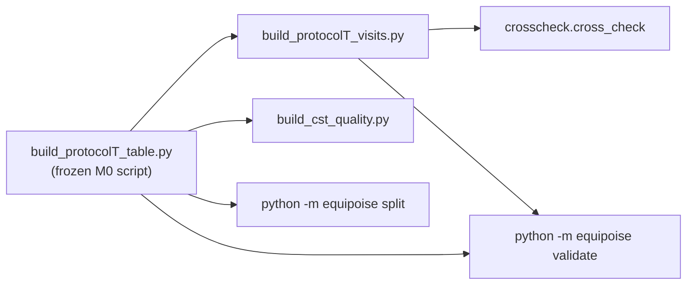

**1. The spine and baseline history** (`scripts/build_protocolT_table.py:main`):

```python
trt = load(folder, "TTrtGroupUnmasked")[["PtID", "TTrtGroup", "RandEye"]]
ros = load(folder, "PtRoster")[["PtID", "AgeAsOfEnrollDt"]]
status = load(folder, "TPtRoster")[["PtID", "TPtStatus"]]
df = (trt.rename(columns={"PtID": "pt_id", "TTrtGroup": "treatment", "RandEye": "study_eye"})
         .merge(ros.rename(columns={"PtID": "pt_id", "AgeAsOfEnrollDt": "X_age"}), on="pt_id")
         .merge(status.rename(columns={"PtID": "pt_id", "TPtStatus": "M_final_status"}), on="pt_id"))
eye = lambda d: d["pt_id"].map(df.set_index("pt_id")["study_eye"])
```

- `load` reads a pipe-separated file with `encoding="latin1"` (the DRCR files are not UTF-8).
- Renaming to `pt_id`, `X_…` and `M_…` at the moment of loading means the prefix rules hold
  from the first line.
- `eye(d)` is a small helper that returns each row's study eye by looking up its `pt_id`.
  `pick_eye` uses it everywhere.

**2. Outcomes from the vision table:**

```python
va = load(folder, "TVAReVATest").rename(columns={"PtID": "pt_id"})
va["eye"] = eye(va)
va["va_study"] = pick_eye(va, va.eye, "Etdrs")
vb = va[va.Visit == "Baseline"][["pt_id", "va_study", "va_fellow"]]
...
for wk in (52, 104):
    v = va[va.Visit == f"{wk} week"][["pt_id", "va_study"]].rename(columns={"va_study": f"_va{wk}"})
    df = df.merge(v.drop_duplicates("pt_id"), on="pt_id", how="left")
    df[f"Y_va_change_wk{wk}"] = df.pop(f"_va{wk}") - df.X_va_letters
```

- Baseline vision becomes `X_va_letters`.
- The week-52 and week-104 values become *changes* from baseline. They are named `Y_`
  immediately, so they can never be mistaken for features.
- `df.pop` removes the helper column after use.

**3. Treatment burden, counted only before the week-52 visit:**

```python
cut52 = df.pt_id.map(wk52_day).fillna(364)   # count treatments BEFORE the 52-week visit
ij = ij[ij.InjNotDone.isna() & (ij.TrtEye == ij.StudyEye)]
df["Y_n_inj_yr1"] = df.pt_id.map(ij[day < ij_cut].groupby("pt_id").size()).fillna(0).astype(int)
```

- An injection counts only if it was actually given (`InjNotDone` is blank) in the study
  eye, before that patient's own 52-week visit day.
- Patients without a 52-week visit use day 364.

**4. Self-checks before writing:**

```python
assert df.pt_id.is_unique and len(df) == 660, "expected 660 unique patients"
assert df.treatment.value_counts().to_dict() == {"Aflibercept": 224, "Bevacizumab": 218, "Ranibizumab": 218}
assert df.X_va_letters.between(24, 78).all(), "baseline VA outside eligibility range 24-78"
```

**5. The visit table** (`scripts/build_protocolT_visits.py`). Each function fails loudly
(`require(...)` raises `BuildError`) when an assumption breaks:

- `spine` checks 660 unique patients and the arm sizes.
- `visits_with_va` checks:
  - the visit keys are unique;
  - every vision row has a dated, non-missed visit;
  - every patient has exactly one baseline visit, on day 0.
- `attach_oct` checks one standard study-eye grade per visit, and scan dates within 14 days.
- `attach_treatments` checks one study-eye treatment per visit, given 0–28 days after the
  visit.
- `main` writes LF line endings (`lineterminator="\n"`), so the file is byte-identical on
  Windows and Linux. `tests/test_visits.py:test_real_build_reproduces_visit_table` relies on
  this.

**Config keys.**

| Key | Value |
|---|---|
| `visits.oct_window_days` | 14 |
| `visits.treatment_window_days` | 28 |
| `visits.cross_check_tolerance_letters` | 0.5 |
| `split.test_fraction` | 0.2 |
| `split.stratify_by` | `treatment` |
| `seed` | 42 |
| `paths.*` | file locations |

### 8.5 Run it yourself (synthetic data)

The real build needs the DRCR download in `data/raw/`. On synthetic data you can run the
split, the validation and the cross-check. These commands were verified for this handbook.

```bash
python -m equipoise split --synthetic
python -m equipoise validate --synthetic
python -c "from equipoise.config import load_config; from equipoise.data.load import load_analysis, load_visits; from equipoise.data.crosscheck import cross_check; c = load_config(); print(cross_check(load_visits(c, synthetic=True), load_analysis(c, synthetic=True)).to_string(index=False))"
```

What you should see:

- `wrote …\data\synthetic\splits.json: train 528, test 132 {'Aflibercept': 45,
  'Bevacizumab': 44, 'Ranibizumab': 43}`. The file is identical to the committed one, because
  the seed is fixed.
- `analysis table OK: 660 rows x 47 columns`, then `visit table OK: 16833 rows, 660
  patients`.
- An 8-row cross-check table with all mismatch columns 0 (synthetic: 622 patients compared
  for `Y_va_change_wk52`).

With the real data present, `dvc repro build_analysis build_visits build_cst_quality split`
rebuilds everything (§19, §24).

### 8.6 What we found

- The integration reproduces the trial's size and arms exactly: 660 patients, 224 / 218 / 218
  [`scripts/build_protocolT_table.py` asserts; `config/default.yaml: trial`].
- The visit table and the analysis table agree on all eight outcomes, with zero mismatches
  [`reports/tables/m0_visits_crosscheck.csv`].
- The replication in M2 matches the published 1-year means to within 0.3 letters, which is
  the strongest check that M0 is right: 13.3 / 9.4 / 11.2 vs 13.3 / 9.7 / 11.2
  [`reports/tables/m2_replication_vs_published.csv`].
- 44 patients have no week-52 vision and 96 have no week-104 vision
  [`reports/tables/m1_missingness.csv`].

### 8.7 Limitations and caveats

- The M0 script is **frozen** (CLAUDE.md), so it is excluded from ruff formatting
  (`pyproject.toml: extend-exclude`) and from code changes.
- Its `yes()` helper turns "Ungradable" or blank OCT grades into 0 (§4.10 item 5; §28).
- Bevacizumab's week-52 mean is 9.4 here versus 9.7 published. The published 1-year analysis
  adjusted for baseline vision and imputed missing outcomes; ours is an unadjusted
  complete-case mean (§10).
- The visit table excludes the optional 2–3-day post-injection safety visits, which have no
  vision row.

### 8.8 Plan vs reality

- README §4 says M0 produces "~20 DRCR tables → one row per patient (660 × 47)". The build
  actually reads **16** of the 31 tables for the analysis table (§4.2). The "660 × 47" part is
  exact.
- README §5 lists `scripts/build_protocolT_table.py`, `build_protocolT_visits.py` and
  `make_synthetic_data.py`. The repo also has `build_cst_quality.py` (a later addition for the
  CST sensitivity analysis), which README §5 does not mention.

### 8.9 Check yourself

1. **Why does the build filter `TBloodPressure` to `Visit == "Baseline"` before merging?**
   The table has one row per visit. Merging all rows would duplicate patients, and using
   later visits would leak post-randomization data into `X_` features.
2. **How does the code make sure an injection is counted only if it was given to the study
   eye?** It keeps `TIntraInj` rows with `InjNotDone` blank and `TrtEye == StudyEye`. The
   visit build additionally asserts `StudyEye == RandEye` for all of them.
3. **What three things make `get_split` refuse to run?** The split file is missing; or the
   seed, test fraction or stratum in config differ from the saved ones; or the saved patient
   IDs do not match the data.

---

## 09. M1 Preprocessing

### 9.1 The story

**What question does M1 answer?** "How do we turn the raw analysis table, with gaps, skewed
numbers, text categories and machine-dependent thickness readings, into a clean numeric matrix
that every model can use fairly, without letting test patients influence anything?"

Think of a cook preparing ingredients before any recipe:

- washing (handling odd values);
- filling in what is missing (imputation);
- cutting everything to the same size (scaling);
- converting different measuring cups to one standard (harmonizing CST across OCT machines);
- sorting ingredients into labelled bowls (encoding categories).

M1 also does two side analyses that the report needs:

- **How much does the way we handle the 44 missing week-52 outcomes change the trial's
  answer?** (Hardly at all.)
- **Which patients look unusual?** (They are flagged, never deleted.)

### 9.2 Inputs → outputs

| Inputs | Outputs |
|---|---|
| `data/protocolT_analysis.csv`, `data/splits.json`, `data/protocolT_cst_quality.csv` | `build_preprocessor()`: the fitted `ColumnTransformer` that M3–M9 reuse (an object in code, not a file) |
| `config/default.yaml: preprocess.*`, `stats.ci_level` | `reports/tables/m1_missingness`, `m1_missing_strategies`, `m1_imputer_scores`, `m1_imputer_scores_mean`, `m1_cst_harmonization`, `m1_cst_quality`, `m1_outlier_overlap`, `m1_preprocessor_features`, `m1_sparse_one_hot`, `m1_bands` (`.csv` + `.md`) |
| | `reports/figures/m1_missing_strategies.png`, `m1_imputer_scores.png`, `m1_cst_by_machine.png`, `m1_dbscan_kdistance.png`, `m1_outlier_overlap.png` |
| | `data/derived/m1_outlier_flags.csv` (patient-level, never committed) |
| | `reports/metrics/m1_preprocess.json`; MLflow experiment `equipoise-m1-preprocess` |

**Which rows are used where** (`eq/preprocess/run.py` docstring):

- The missing-data comparison is *trial-level inference*, so it uses all 660 patients, as the
  published analysis did.
- Everything that *learns parameters for later models* is fitted on the 528 training
  patients only: imputer scoring, the harmonizer, the outlier detectors and the preprocessor.

### 9.3 Concept cards

#### Concept card: missing-data mechanisms (MCAR, MAR, MNAR)

**In plain words.** Why a value is missing matters more than how many are missing.

- **MCAR** (missing completely at random): unrelated to anything, like a lab sample dropped
  by accident.
- **MAR** (missing at random): missingness depends on things we *did* record. Older patients
  might miss more visits, and we know their age.
- **MNAR** (missing not at random): missingness depends on the missing value itself, for
  example a patient whose vision got worse stops coming.

**Technically.** Let $R$ be the missingness indicator, $Y_{obs}$ the observed values and
$Y_{mis}$ the missing ones.

- MCAR: $P(R \mid Y_{obs}, Y_{mis}) = P(R)$.
- MAR: $P(R \mid Y_{obs}, Y_{mis}) = P(R \mid Y_{obs})$.
- MNAR: otherwise.

Complete-case analysis is unbiased under MCAR. Multiple imputation is valid under MAR.
Nothing simple fixes MNAR; you need sensitivity analyses.

**Tiny worked example.** If the patients without a week-52 visit were those doing badly, then
dropping them would make every arm look better than it really was.

**In Equipoise.** 44 patients (6.67%) lack week-52 vision: 16 / 14 / 14 by arm
[`reports/tables/m1_missingness.csv`]. The roughly equal split by arm is reassuring but
does not prove MCAR.

**Common confusions.** "MAR" does not mean "random" in everyday speech. It means "explainable by
observed data".

**Viva questions.** *Can you test whether data is MCAR?* Partly. You can compare observed
characteristics of patients with and without the outcome. You can never rule out MNAR from
the data alone.

#### Concept card: complete-case analysis

**In plain words.** Use only the patients who have every value you need, and drop the rest.
It is simple and honest about what was observed, but it wastes information and can be biased
if the dropped patients differ.

**Technically.** Restrict to rows with $R = 1$, then estimate as usual. Here that means
ordinary least squares of letters gained on arm dummies:

$$Y = \beta_0 + \beta_1 [\text{Afl}] + \beta_2 [\text{Ran}] + \varepsilon$$

where $[\text{Afl}]$ is 1 for aflibercept patients and 0 otherwise. $\beta_1$ is then the
difference in mean letters, aflibercept − bevacizumab (`eq/preprocess/missing.py:_ols_arm_differences`).

**Tiny worked example.** Six patients with gains 10, 12, ?, 8, 15, ?: the complete-case mean
uses the four known values, $45/4 = 11.25$.

**In Equipoise.** On 616 complete cases:

- aflibercept − bevacizumab = 3.95 letters (95% CI 1.85 to 6.06);
- ranibizumab − bevacizumab = 1.82 (−0.293 to 3.93).

[`reports/tables/m1_missing_strategies.csv`] M5 and M6 models are fitted on complete cases.

**Common confusions.** "Complete case" refers to the variables in *this* analysis. A patient
missing BMI is still a complete case for the arm comparison.

**Viva questions.** *Why do the models use complete cases if MICE is the published approach?*
Because the target must be observed to train or evaluate a predictor. Imputing targets would
create fake training labels. The trial-level comparison shows the choice barely changes the
arm differences.

#### Concept card: kNN imputation

**In plain words.** Fill a missing value with the average of the $k$ most similar patients,
judged on the values that *are* present, like asking your five nearest neighbours what the
electricity bill usually is.

**Technically.** For each row with a missing entry, find the $k$ rows nearest in Euclidean
distance, computed over the coordinates both rows have observed (sklearn's `nan_euclidean`
distance). Average their values for the missing coordinate. Features must be scaled first,
otherwise large-unit features dominate the distance.

**Tiny worked example.** The patient's HbA1c is missing. Their two nearest neighbours (by age,
vision and CST) have HbA1c 7.0 and 8.0, so with $k = 2$ the imputed value is 7.5.

**In Equipoise.**
- `KNNImputer(n_neighbors=5)` (`preprocess.knn_neighbors: 5`) is applied after
  `StandardScaler`, both in `compare_strategies` and as an option of `build_preprocessor`
  (`preprocess.imputer: knn`).
- kNN gave aflibercept − bevacizumab = 4.01 (2.04 to 5.98) [`m1_missing_strategies.csv`].
  The table notes "SE ignores imputation uncertainty": a single filled-in dataset pretends
  the guesses are real data, so its CI is too narrow.

**Common confusions.** kNN imputation is not the kNN *classifier* (§13), though both use
nearest neighbours.

**Viva questions.** *Why is single imputation's CI too narrow?* It treats the imputed values as
if they had been measured, ignoring our uncertainty about them.

#### Concept card: MICE (multiple imputation by chained equations) and Rubin's rules

**In plain words.** Instead of one guess per missing value, MICE makes **several** plausible
guesses, building $m$ complete copies of the dataset. Each copy's guesses include random
noise reflecting our uncertainty. You analyse each copy separately and then combine the
results with **Rubin's rules**. The spread between copies tells you how much the missing data
matters.

**Technically.** MICE cycles through the variables, regressing each on all the others and
drawing imputations from the predictive distribution, repeated for a number of iterations.
sklearn's `IterativeImputer(sample_posterior=True)` with different random seeds produces the
$m$ datasets. For the estimates $\hat q_j$ and their variances $U_j$, $j = 1, \dots, m$:

- pooled estimate $\bar q = \frac1m\sum_j \hat q_j$;
- within-imputation variance $W = \frac1m\sum_j U_j$;
- between-imputation variance $B = \frac{1}{m-1}\sum_j(\hat q_j - \bar q)^2$;
- total variance $T = W + (1 + \tfrac1m)B$, and SE $= \sqrt T$;
- fraction of missing information $\lambda = (1+\tfrac1m)B/T$.

Degrees of freedom use the Barnard–Rubin small-sample formula
(`eq/preprocess/missing.py:rubin_pool`).

**Tiny worked example.** $m = 3$ estimates 4.0, 3.8, 3.6 with variances 1.0, 1.1, 0.9.

- $\bar q = 3.8$ and $W = 1.0$.
- $B = \frac{(0.2)^2 + 0 + (0.2)^2}{2} = 0.04$.
- $T = 1.0 + \frac43 \times 0.04 = 1.0533$, so SE $= 1.026$.
- $\lambda = 0.0533/1.0533 \approx 0.05$.

**In Equipoise.** `preprocess.mice_imputations: 20` and `mice_max_iter: 10`. The imputation
design includes features, arm dummies and the outcome (`imputation_design`). Results:

- aflibercept − bevacizumab = 3.83 (1.72 to 5.95), fraction of missing information 0.07;
- ranibizumab − bevacizumab = 1.97 (−0.125 to 4.06), fraction 0.04.

[`m1_missing_strategies.csv`] `tests/test_preprocess.py:test_rubin_rules_known_values` checks
the formula on known numbers.

**Common confusions.** Averaging the imputed *values* and analysing once is not MICE. You must
analyse each copy and pool the *results*.

**Viva questions.**
- *Why include the outcome and arm in the imputation model?* An imputation model that ignores
  the outcome would bias the arm differences towards zero. The imputation must preserve the
  relationships the analysis will look at.
- *What does a fraction of missing information of 0.07 mean?* About 7% of the uncertainty
  about the aflibercept effect comes from the missing outcomes. That is small.

#### Concept card: scoring imputers by masking observed values

**In plain words.** To test how well an imputer guesses, hide some values you *do* know, let
it guess them, and compare the guesses with the truth, like covering answers in your own
notes to quiz yourself.

**Technically.** For each numeric feature, hide a random 10% of observed training values
(`preprocess.imputation_mask_fraction: 0.1`). Impute, then compute the **normalized RMSE**:

$$\text{nRMSE} = \frac{\sqrt{\tfrac1h\sum(\text{true} - \text{imputed})^2}}{\text{SD of the feature}}$$

where $h$ is the number of hidden values. 0 is perfect; about 1 is no better than guessing the
average (`score_feature_imputers`).

**Tiny worked example.** True values 7, 9, imputed 8, 8, feature SD 1.5:
RMSE $= \sqrt{(1+1)/2} = 1$, so nRMSE $= 0.67$.

**In Equipoise.** Mean nRMSE over 12 numeric features [`reports/tables/m1_imputer_scores_mean.csv`]:

| Imputer | Mean nRMSE |
|---|---|
| MICE (single run) | 0.849 |
| kNN | 0.965 |
| median | 1.01 |

MICE wins on average. Per feature it helps most for diastolic blood pressure (0.618) and
reading-centre DR severity (0.708) [`reports/tables/m1_imputer_scores.csv`]. These features
are well predicted by related ones (systolic BP; clinical DR severity).

**Common confusions.** Masked values are hidden at random (MCAR), so the score says nothing
about MNAR gaps.

**Viva questions.** *MICE scored best, so do your models use MICE?* No. The models use median
imputation (`preprocess.imputer: median`); see Plan vs reality (§9.8). Feature gaps are small:
at most 9.39% for BMI, and under 4% for every other feature [`m1_missingness.csv`]. Median is
simple, deterministic and fast.

#### Concept card: log transform for skewed features

**In plain words.** Some measurements have a long tail of large values; a few very high HbA1c
or BMI readings stretch the scale. Taking the logarithm squeezes the large values closer
together, so the distribution looks more like a symmetric bell and extreme values pull models
less.

**Technically.** Replace $x$ with $\log x$ for $x > 0$, or $\log(1 + x)$ when zeros are
possible (`np.log1p`). On the log scale, multiplicative differences become additive. The
skewness drops.

**Tiny worked example.** HbA1c 6, 7, 8, 14 has logs 1.79, 1.95, 2.08, 2.64. The gap from 8 to
14 shrinks from 6 units to 0.56, compared with about 0.15 between neighbouring small values.

**In Equipoise.** `preprocess.log_features: [X_hba1c, X_bmi]`. The config comment says they are
"right-skewed on the training split (skew > 1)". The training skews are 1.0 (HbA1c) and 1.14
(BMI) [computed for this handbook]. Applied by `FunctionTransformer(np.log)` inside
`build_preprocessor`. UACR is already stored as $\log(1 + \text{UACR})$ by M0 (§4.5).

**Common confusions.** HbA1c's training skew is 1.0, right at the threshold, not clearly above
it. The choice is a judgement call, written into config, not computed at run time.

**Viva questions.** *Why log-transform before standardizing?* Standardizing does not change a
distribution's shape. The log reduces skew first, then scaling puts everything on a common
scale.

#### Concept card: standard scaling (z-score)

**In plain words.** Features come in different units: age in years, CST in hundreds of µm,
flags as 0/1. Standardizing converts each to "how many standard deviations from the average",
so all features are on the same footing. That matters for distances (kNN, clustering) and
for penalties (Ridge, Lasso).

**Technically.**

$$z = \frac{x - \mu}{\sigma}$$

where $\mu$ and $\sigma$ are the **training** mean and SD. After scaling, the training data has
mean 0 and SD 1.

**Tiny worked example.** Training ages 50, 60, 70: $\mu = 60$, $\sigma = 8.165$ (population SD,
as `StandardScaler` uses). A new patient aged 75 gets $z = 1.84$.

**In Equipoise.** `StandardScaler()` is the second step of the numeric pipeline in
`build_preprocessor`. Scaling happens **before** imputation, so kNN distances weigh features
equally (code comment: "before kNN so distances weigh features equally"). `StandardScaler`
ignores NaN when fitting, which allows this order.

**Common confusions.** Scaling does not remove outliers or skew, and tree models do not need it.
It is still applied to all models for simplicity.

**Viva questions.** *Which models need scaling and why?* kNN (distances), Ridge/Lasso (the
penalty treats every coefficient equally), PCA (variance-based), neural networks (optimizer
stability). Trees do not.

#### Concept card: one-hot encoding (and sparse matrices)

**In plain words.** Models need numbers, but "OCT machine = Cirrus" is a word. One-hot encoding
makes one 0/1 column per category: Cirrus → (0, 1, 0). Using codes 1, 2, 3 instead would
wrongly suggest that Spectralis is "three times" Stratus.

**Technically.** A nominal feature with $K$ levels becomes $K$ indicator columns, or $K-1$ with
`drop="first"` to avoid the dummy-variable trap with an intercept (§6.1). Most entries are 0,
so the matrix can be stored **sparse** in CSR (compressed sparse row) format, which stores
only the non-zeros.

**Tiny worked example.**

| Machine | Stratus | Cirrus | Spectralis |
|---|---|---|---|
| Cirrus | 0 | 1 | 0 |
| Spectralis | 0 | 0 | 1 |

**In Equipoise.** Three nominal features (`X_race`, `X_diabetes_type`, `X_oct_machine`) are
mode-imputed, then one-hot encoded (`eq/preprocess/columns.py:NOMINAL`).

- **Default.** `OneHotEncoder(handle_unknown="ignore")` gives all $K$ columns. Penalized and
  tree models cope fine with that.
- **Full rank.** For unpenalized models with an intercept (OLS by normal equations, IRLS
  logistic), `full_rank=True` uses `drop="first"` and pools categories rarer than 10
  (`supervised.one_hot_min_frequency: 10`).
- **Sparse demo.** `one_hot_sparse` makes the sparse block for inspection. It has 14 columns
  and 528 rows, density 0.214, and needs 2.11 × 10⁴ bytes in CSR versus 5.91 × 10⁴ dense
  [`reports/tables/m1_sparse_one_hot.csv`].

**Common confusions.** With `handle_unknown="ignore"`, a category never seen in training becomes
all zeros instead of an error. That is sensible for the API.

**Viva questions.** *Why drop one category for OLS?* With an intercept, the $K$ indicators add up
to the intercept column, so $X^\top X$ is singular (§6.1).

#### Concept card: ordinal encoding

**In plain words.** Some categories have a natural order: DR severity goes from
"microaneurysms only" to "PDR". Ordinal encoding maps them to 0, 1, 2, 3, keeping the order in
one column.

**Technically.** `OrdinalEncoder(categories=[ordered list])` maps level $j$ to $j$. Unknown or
missing values become NaN, which is then imputed.

**Tiny worked example.** "Severe NPDR" becomes 2 in the order (Microaneurysms only,
Mild/moderate NPDR, Severe NPDR, PDR and/or prior scatter).

**In Equipoise.** `eq/preprocess/columns.py:ORDINAL = {"X_dr_severity_clinical":
DR_SEVERITY_CLINICAL}`. `X_dr_severity_rc` is already numeric (1–10).

**Common confusions.** Ordinal encoding assumes equal steps between levels. That is an
approximation.

**Viva questions.** *Why not one-hot DR severity?* Its order carries meaning, and one column
uses fewer parameters than four.

#### Concept card: CST harmonization across OCT machines

**In plain words.** The same eye measures thicker on Spectralis than on Stratus, so raw CST
values from different machines are like temperatures in °C and °F mixed in one column. We
convert them to a common scale before using them.

**Technically.** `eq/preprocess/harmonize.py:CSTHarmonizer` is a custom sklearn transformer that
takes the two columns [CST, machine] and outputs one column. It has three methods:

- `zscore` (the **default**): $z = (\text{CST} - \mu_m)/\sigma_m$, using the mean and SD of
  machine $m$ **learned on the training fold**. A machine never seen in training uses the
  pooled mean and SD.
- `offset`: subtract a published median difference versus Stratus (+43 µm Cirrus, +67 µm
  Spectralis; `preprocess.cst.offset_um`). These offsets are UNVERIFIED against the paper
  (§2.4).
- `equations`: apply linear Stratus-equivalent equations. The config coefficients are `null`
  ("TEAM: … Fill both and cite"), so using this method raises an error.

**Tiny worked example.** Spectralis training mean 467, SD 127 (rounded). A Spectralis reading of
594 µm gives $z = (594 - 467)/127 = 1.0$. A Stratus reading with $z = 1.0$ would be about
$433 + 126 = 559$ µm. Both mean "one SD thicker than typical for that machine".

**In Equipoise.** Before harmonization, the raw means are 433 / 453 / 467 µm (Stratus / Cirrus /
Spectralis). After z-scoring, the means are 0.034 / 0.0417 / −0.00633 and the SDs about 1
[`reports/tables/m1_cst_harmonization.csv`]. The output column is named
`X_cst_harmonized_zscore` [`reports/tables/m1_preprocessor_features.csv`].

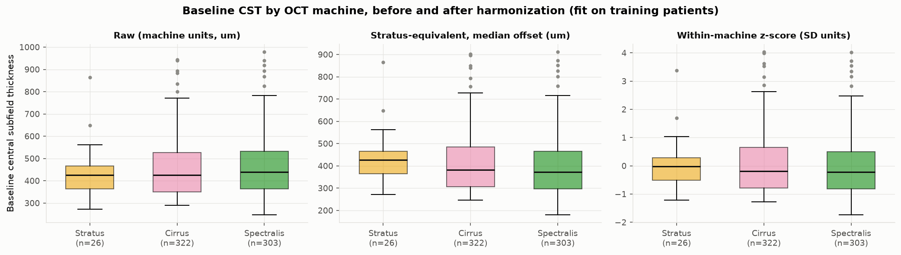

*Figure 9.1: Baseline CST by OCT machine: raw (left), after the published median offset
(middle), after within-machine z-scoring (right). The parameters were fitted on training
patients; all patients with a baseline CST are shown (26 / 322 / 303)
[`reports/figures/m1_cst_by_machine.png`]. How to read it: each box shows the middle 50% of
patients, with the line at the median. After z-scoring, the three boxes line up around 0, so
"thick for its machine" means the same thing on every machine.*

**Common confusions.**
- Z-scoring within machine also removes any *real* difference in average thickness between
  patients measured on different machines. That is acceptable only because machine choice was
  a site matter, not a patient characteristic.
- `X_oct_machine` is still one-hot encoded as its own feature.

**Viva questions.**
- *Why is z-score the default, not the published offsets?* The harmonize.py docstring says
  "The published regression coefficients were not available to us". Z-scoring needs no
  external numbers and is fitted on training data only.
- *Why must the harmonizer be fitted on training data only?* Its machine means and SDs are
  learned statistics. Fitting on all patients would leak test information.

#### Concept card: CST quality policy (sensitivity analysis)

**In plain words.** Some CST values were rated "Unacceptable" by the reading centre, and some
patients changed machine between visits. We keep them in the main analysis, as the published
trial did. We also rerun the numbers with them removed, to show whether that choice matters.
Checking that a conclusion survives a different reasonable choice is called a **sensitivity
analysis**.

**Technically.** `eq/preprocess/cst_quality.py:apply_cst_quality(df, quality, policy)`:

- `keep` returns the table unchanged.
- `missing` sets `X_cst_um` to NaN when the baseline grade is flagged. It also sets the CST
  change to NaN when either grade is flagged or the machine switched by week 52.

**Tiny worked example.** A patient with a flagged week-52 grade keeps their baseline CST, but
their `Y_cst_change_wk52` becomes NaN under `missing`.

**In Equipoise.** Under `missing`:

- baseline CST is available for 522 patients instead of 651;
- the week-52 CST change for 359 instead of 604.

[`m1_cst_quality.csv`] M2 reports the CST-change replication under both policies
(`reports/tables/m2_cst_change_sensitivity.csv`, §10).

**Common confusions.** The quality flags are `M_` bookkeeping columns. They are never features.

**Viva questions.** *What is a sensitivity analysis?* Re-running an analysis under a different
reasonable assumption to check whether the conclusion depends on it.

#### Concept card: outlier detection with the IQR rule

**In plain words.** A value far outside the usual range is suspicious. The IQR rule draws
"fences" a bit beyond the middle half of the data and calls anything outside them an outlier.
Equipoise flags a *patient* only if at least two features are outside their fences, because
one odd lab value is common.

**Technically.** For each continuous feature, the fences are $[Q_1 - kI, Q_3 + kI]$ with
$I = Q_3 - Q_1$ and $k = 1.5$, all computed on **training** patients
(`preprocess.outliers.iqr_k: 1.5`). A patient is flagged if
`n_features_outside_iqr ≥ 2` (`iqr_min_features: 2`; `eq/preprocess/outliers.py:iqr_flags`).

**Tiny worked example.** Ages: Q1 = 54, Q3 = 67, so IQR = 13 and the fences are
$54 - 19.5 = 34.5$ and $67 + 19.5 = 86.5$. An age of 30 is outside.

**In Equipoise.** 17 patients (2.58%) are flagged by the IQR rule
[`reports/tables/m1_outlier_overlap.csv`].

**Common confusions.** "Outlier" does not mean "error". A very thick retina is a real, sick eye.

**Viva questions.** *Why not delete outliers?* They are real patients. Deleting them would bias
the trial comparison, and the app must still work for unusual patients. The project flags
them, never drops them (module docstring: "never drop them by default").

#### Concept card: Isolation Forest

**In plain words.** Pick a random feature and a random cut, and keep splitting. An unusual
patient gets separated from everyone else after only a few cuts, while a typical patient deep
inside the crowd needs many. Few cuts = anomalous. It is like finding the one student in a
different uniform: very few questions isolate them.

**Technically.** Build many random **isolation trees** on subsamples. The anomaly score is based
on the average path length $h(x)$ to isolate $x$, normalized by the expected path length
$c(n)$ for $n$ points:

$$s(x) = 2^{-E[h(x)]/c(n)}$$

Scores near 1 are anomalies. `contamination` sets the expected share of outliers, which fixes
the threshold.

**Tiny worked example.** In 1-D data {1, 2, 3, 4, 100}, one random cut between 4 and 100
isolates 100 immediately. Isolating 3 needs several cuts.

**In Equipoise.** `IsolationForest(contamination=0.05, random_state=42)` is fitted on the
preprocessed training matrix (`detect_outliers`). It flagged 38 of 660 patients (5.76%)
[`m1_outlier_overlap.csv`].

**Common confusions.** `contamination` is a *setting*, not something learned. With 0.05, about 5%
of training patients are flagged by construction.

**Viva questions.** *Why combine three outlier methods?* They define "unusual" differently:
extreme single values (IQR), easy to isolate (Isolation Forest), far from dense regions
(DBSCAN). Agreement between them is stronger evidence.

#### Concept card: DBSCAN and the k-distance curve

**In plain words.** DBSCAN finds crowded regions. A point with enough neighbours nearby is a
**core** point; core points that are close to each other form a cluster; anything not near a
cluster is **noise**. It needs two settings: the neighbourhood radius `eps` and the crowd size
`min_samples`. The **k-distance curve** helps pick `eps`: for each patient, measure the
distance to their k-th nearest neighbour and sort. Where the curve shoots up, patients start
being isolated.

**Technically.**
- A point $p$ is **core** if at least `min_samples` points lie within distance `eps` of $p$
  (counting $p$).
- Points reachable through chains of core points form one cluster.
- Points not within `eps` of any core point are noise (label −1).

The project sets `eps` to the 95th percentile of the 10-nearest-neighbour distances of training
patients (`dbscan_min_samples: 10`, `dbscan_eps_quantile: 0.95`). Any patient whose nearest
training core point is farther than `eps` is flagged as noise.

**Tiny worked example.** With `min_samples = 3` and `eps = 1`, points at 0, 0.5, 1.0, 1.4 form one
cluster (every point has two others within 1), and a point at 5 is noise.

**In Equipoise.** `eps = 4.63` (standardized feature space; the metric `dbscan_eps` is 4.625935)
[`reports/metrics/m1_preprocess.json`]. 5 patients (0.758%) were flagged as noise
[`m1_outlier_overlap.csv`]. The same function supports clustering in M3 (§11).

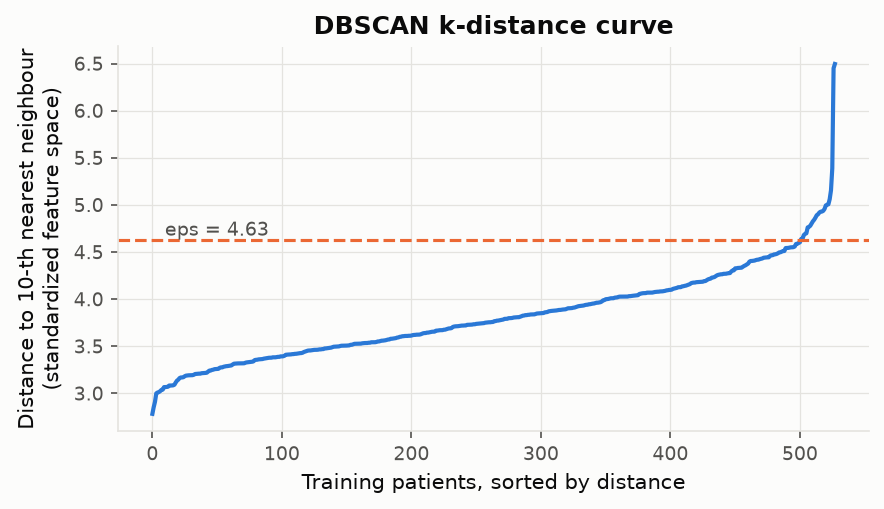

*Figure 9.2: Sorted distance of each training patient to its 10th nearest neighbour; the dashed
line is the chosen eps = 4.63 [`reports/figures/m1_dbscan_kdistance.png`]. How to read it: the
curve is flat for most patients and bends sharply upward at the right. The few patients past
the bend are far from everyone else.*

**Common confusions.** In 42 dimensions, distances between all points become similar (the "curse
of dimensionality"). That is why DBSCAN finds almost everyone in one blob, and why very few
are noise.

**Viva questions.** *How did you choose eps?* From the k-distance curve: the 95th percentile of
10th-nearest-neighbour distances on training patients. It is a rule written in config, not a
value tuned by eye.

#### Concept card: discretization (binning)

**In plain words.** Turn a number into a band: HbA1c 7.6 becomes "7–8". Association rules (M3)
need yes/no items rather than numbers, and clinically meaningful bands are easy to read.

**Technically.** `pd.cut(x, bins=edges, labels=labels, right=False)` makes right-open intervals
$[a, b)$. The edges are fixed in config, so a band means the same thing in every fold.

**Tiny worked example.** With edges [0, 7, 8, 9, 100], HbA1c 8.0 falls in $[8, 9)$, which is
"8–9".

**In Equipoise.** `preprocess.bands` defines HbA1c (<7, 7–8, 8–9, ≥9), baseline vision
(20/100 or worse; 20/50–20/80; 20/32–20/40, cut at 54 and 69 letters) and age (<50, 50–59,
60–69, ≥70) (`eq/preprocess/discretize.py:discretize`). Counts on all patients: vision bands
105 / 224 / 331; HbA1c bands 185 / 178 / 123 / 168 [`reports/tables/m1_bands.csv`]. The HbA1c
counts add to 654 because 6 values are missing. The "gained ≥ 15 letters" item
(`gain_item`, threshold `preprocess.gain_threshold_letters: 15`) is an outcome, used only as a
target or rule consequent.

**Common confusions.** Binning throws away information. That is why models use the raw numbers;
the bands exist only for association rules.

**Viva questions.** *Why are the vision bands cut at 54 and 69?* 69 is the published subgroup
boundary (20/50 or worse). 54 separates 20/100 or worse, matching Snellen lines (config
comment).

### 9.4 Code walkthrough

**Files in execution order.**

1. `eq/preprocess/run.py:run`, the stage entry point.
2. `missing.py`: `missingness_table`, `compare_strategies`, `score_feature_imputers`.
3. `harmonize.py` and `cst_quality.py`.
4. `outliers.py:detect_outliers`.
5. `encode.py:build_preprocessor` and `one_hot_sparse`.
6. `discretize.py`.

`columns.py` decides which group each feature belongs to.

**The heart: `build_preprocessor`** (`eq/preprocess/encode.py`, abridged):

```python
prepare = ColumnTransformer([
    ("log", FunctionTransformer(np.log, feature_names_out="one-to-one"), list(g.log)),
    ("cst", harmonizer_from_config(cfg.preprocess["cst"], cst_method), cst_cols),
    ("ordinal", OrdinalEncoder(categories=[list(v) for v in ORDINAL.values()], ...), list(g.ordinal)),
    ("continuous", "passthrough", list(g.continuous)),
], verbose_feature_names_out=False)
numeric = Pipeline([("prepare", prepare),
                    ("scale", StandardScaler()),  # before kNN so distances weigh features equally
                    ("impute", make_imputer(imputer or cfg.preprocess["imputer"], cfg))])
nominal = Pipeline([("impute", SimpleImputer(strategy="most_frequent")), ("onehot", onehot)])
transformers = [("numeric", numeric, [*g.log, *cst_cols, *g.ordinal, *g.continuous]),
                ("nominal", nominal, list(g.nominal)),
                ("binary", SimpleImputer(strategy="most_frequent"), list(g.binary))]
```

- **Lines 1–6.** The numeric "prepare" step treats each kind of number in its own way: logs
  for skewed labs, the harmonizer for [CST, machine], ordinal codes for DR severity, and
  pass-through for the rest.
- **Lines 7–9.** The prepared numbers are standardized, then imputed. The default imputer is
  the median (`preprocess.imputer: median`).
- **Line 10.** Nominal features are filled with the most common category, then one-hot
  encoded.
- **Lines 11–13.** 0/1 flags are mode-imputed.
- **Not shown.** When `include_treatment=True`, a fourth block one-hot encodes the arm with
  bevacizumab dropped (the reference). The function then calls `assert_no_leakage` on the
  input column list and returns `ColumnTransformer(transformers, remainder="drop")`.

**Output.** With the default settings it produces 42 columns:

- 13 numeric;
- 12 one-hot (6 race + 3 diabetes type + 3 machine);
- 17 binary.

[`reports/tables/m1_preprocessor_features.csv`; `reports/metrics/m1_preprocess.json:
n_output_features = 42`]

**Missing-data comparison** (`compare_strategies`, abridged):

```python
for i in range(m):
    imp = IterativeImputer(max_iter=int(p["mice_max_iter"]), sample_posterior=True,
                           random_state=cfg.seed + i)
    y_i = imp.fit_transform(design)[:, j]
    for arm, res in _ols_arm_differences(y_i, df["treatment"], cfg).items():
        per_arm[arm].append(res)
...
q, se, dof, lam = rubin_pool(est_, se_**2, float(dof_[0]))
```

- `sample_posterior=True` draws imputations with noise, so the $m$ datasets differ.
- Seeds `cfg.seed + i` make each draw different but reproducible.
- Each dataset gets its own OLS arm difference, and `rubin_pool` combines them.

**Config keys.**

| Key | Value |
|---|---|
| `preprocess.imputer` | `median` |
| `preprocess.knn_neighbors` | 5 |
| `preprocess.mice_imputations` | 20 |
| `preprocess.mice_max_iter` | 10 |
| `preprocess.imputation_mask_fraction` | 0.1 |
| `preprocess.log_features` | `[X_hba1c, X_bmi]` |
| `preprocess.cst.method` | `zscore` |
| `preprocess.cst.offset_um` | as above |
| `preprocess.cst.equations` | null |
| `preprocess.cst.quality_policy` | `keep` |
| `preprocess.outliers.*` | `iqr_k` 1.5, `iqr_min_features` 2, `isolation_contamination` 0.05, `dbscan_min_samples` 10, `dbscan_eps_quantile` 0.95 |
| `preprocess.bands.*` | as above |
| `preprocess.gain_threshold_letters` | 15 |
| `supervised.one_hot_min_frequency` | 10 |
| `stats.ci_level` | 0.95 |

### 9.5 Run it yourself (synthetic data)

```bash
python -m equipoise preprocess --synthetic
```

Verified for this handbook (part of `python -m equipoise all --synthetic`). It prints the
headline metrics, including:

```
[preprocess] running on synthetic data ...
  diff_complete-case_aflibercept: 5.247
  diff_mice_aflibercept: 4.959
  nrmse_mice: 0.9261
  nrmse_knn: 1.059
  nrmse_median: 0.9889
  outliers_iqr: 2
  outliers_isolation_forest: 32
  outliers_dbscan: 1
  n_output_features: 42
```

Outputs go to `reports/synthetic/tables/m1_*` and `reports/synthetic/figures/m1_*`, never over
the real report assets (`eq/config.py:for_data_source`). These are **synthetic** numbers. The
planted average aflibercept effect is around 3.7 letters (7.0 for half the patients, 0.5 for
the rest), and the noise and chance imbalance move the estimate around that.

### 9.6 What we found (real data)

- **Missing outcomes barely matter.** The aflibercept − bevacizumab difference is 3.95
  (complete case), 4.01 (kNN) and 3.83 (MICE) letters. All the intervals exclude 0. For
  ranibizumab − bevacizumab, the complete-case and MICE intervals include 0, and the kNN
  interval only just excludes it (0.0105 to 3.98) [`m1_missing_strategies.csv`].

  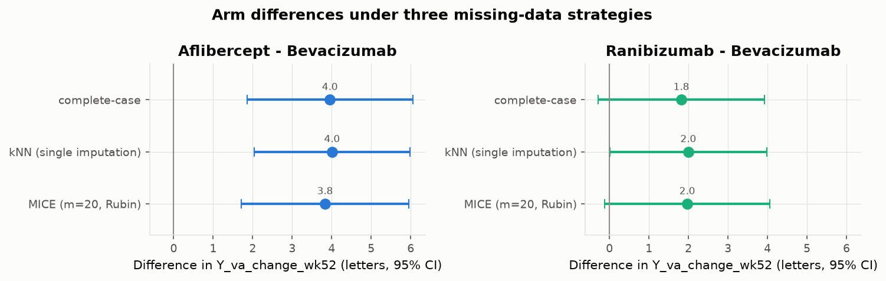

  *Figure 9.3: Arm differences with 95% CIs under the three strategies
  [`reports/figures/m1_missing_strategies.png`]. How to read it: each dot is an estimate and
  each bar its CI. The vertical line at 0 means "no difference". The three rows in each panel
  nearly coincide, so the conclusion does not depend on the missing-data method.*
- **MICE imputes features best** on average (nRMSE 0.849 vs 0.965 kNN and 1.01 median)
  [`m1_imputer_scores_mean.csv`].
- **CST harmonization** aligns the three machines (§9.3).
- **Outliers are few and methods disagree.** IQR flags 17, Isolation Forest 38, DBSCAN 5. Only
  2 are flagged by all three, and 53 (8.03%) by any [`m1_outlier_overlap.csv`]. None were
  removed.
- **The model-ready matrix** has 42 columns [`m1_preprocessor_features.csv`].

### 9.7 Limitations and caveats

- Feature imputation uses the median, although MICE scored better on masked values.
- The CST offsets in config are unverified, and the "equations" method cannot run until its
  coefficients are filled in.
- The log-feature list is fixed in config, not re-derived from data. HbA1c's training skew is
  exactly at the threshold (1.0).
- The outlier flags are computed but not used downstream; they are descriptive only.
- "Ungradable" ERM/fluid grades are coded 0 upstream in M0 (§4.10).

### 9.8 Plan vs reality

- **README §4** describes M1 as "complete-case vs KNN vs MICE". In reality, the three strategies
  are *compared* for the trial-level arm difference, while every predictive model uses
  **median** imputation inside `build_preprocessor` (`preprocess.imputer: median`). kNN and
  iterative are available as options, but are not the default.
- **README §7.5** says "M1 harmonizes [CST]". The harmonization is the *within-machine z-score*.
  The published-equation route is wired up but disabled, because its coefficients are `null`.

### 9.9 Check yourself

1. **Why is `StandardScaler` placed before the imputer in the numeric pipeline?** So that kNN
   imputation (if selected) measures distances with every feature on the same scale. It also
   means the median is computed on standardized values, which gives the same result.
2. **Rubin's rules: estimates 2, 3, 4 with within-variances all 1. What is the total SE?**
   $W = 1$, $B = 1$, $T = 1 + \tfrac43 \times 1 = 2.33$, so SE $= 1.53$.
3. **A test patient has CST measured on a machine no training patient used. What does the
   harmonizer do?** It uses the pooled training mean and SD, not a machine-specific one
   (`CSTHarmonizer.transform`: `self.stats_.get(m, self.pooled_)`).

---

## 10. M2 EDA and statistical inference

### 10.1 The story

**What question does M2 answer?** "Did randomization work, and do our data reproduce what the
trial published? Beyond the averages, what does the data say about who benefits more?"

Before trusting any fancy model, a careful researcher checks two things:

1. **Fair start.** Were the three groups alike at the start? That is the "Table 1" check.
2. **Correct data.** Can we recompute the published headline numbers from our table? If we
   cannot, our data integration (M0) is wrong, or we misunderstood the outcomes.

M2 also runs classical tests for **effect modification**: does the aflibercept advantage grow
as baseline vision gets worse? The modern causal models in M6 should rediscover this.

Think of a new accountant who first re-adds last year's audited accounts before preparing
this year's. If the totals don't match, nothing else is trustworthy.

M2 is *trial-level inference*, so it uses all 660 randomized patients (completers at each
horizon), exactly as the published analysis did. Nothing in M2 trains a predictive model
(`eq/stats/run.py` docstring).

### 10.2 Inputs → outputs

| Inputs | Outputs |
|---|---|
| `data/protocolT_analysis.csv`, `data/protocolT_cst_quality.csv` | `reports/tables/m2_table1`, `m2_replication_means`, `m2_replication_burden`, `m2_replication_tests`, `m2_replication_vs_published`, `m2_variance_tests`, `m2_correlations`, `m2_correlation_matrix`, `m2_interaction_regression`, `m2_interaction_tests`, `m2_cst_change_sensitivity` |
| `config/replication_targets.yaml` | `reports/figures/m2_baseline_distributions.png`, `m2_outcome_by_arm.png`, `m2_replication_means.png`, `m2_baseline_va_vs_gain.png`, `m2_correlation_heatmap.png`, `m2_injections_yr1.png` |
| `config/default.yaml: stats.*` | `reports/metrics/m2_stats.json`; MLflow experiment `equipoise-m2-stats` |

### 10.3 Concept cards

General statistics concepts (mean, SD, CI, p-value, t, chi-square and F distributions, Holm)
are in §06. The cards below are the specific tests M2 uses.

#### Concept card: Table 1 (baseline balance)

**In plain words.** "Table 1" of every clinical trial paper lists the patients' starting
characteristics for each group side by side. If randomization worked, the columns look
alike. It is the "were the teams fair?" check.

**Technically.** For each baseline feature, `eq/stats/table1.py:table1` reports per arm:

- mean ± SD for roughly symmetric numbers;
- median [IQR] when $|\text{skew}| > 1$ (`stats.skew_threshold`);
- n (%) for categories and flags.

It then computes a p-value: one-way ANOVA, Kruskal–Wallis (skewed) or chi-square (categories).
`n_significant` counts features with $p < 0.05$.

**Tiny worked example.** With 33 independent tests at α = 0.05, the expected number of "false
alarms" under perfect randomization is $33 \times 0.05 \approx 1.65$.

**In Equipoise.** 0 of 33 features have $p < 0.05$
[`reports/metrics/m2_stats.json: table1_n_p_below_alpha = 0, table1_n_tested = 33`]. The closest
are age ($p = 0.054$; means 59.5 / 61.4 / 59.2) and diastolic BP ($p = 0.069$)
[`reports/tables/m2_table1.csv`]. Baseline vision medians are 68.5 / 69.0 / 68.0 letters
($p = 0.834$) [`m2_table1.csv`].

**Common confusions.**
- Many statisticians argue that p-values in Table 1 are meaningless: any imbalance is due to
  chance by definition. The module docstring says the same: "p-values here are descriptive,
  not evidence of imbalance".
- The docstring says "about 40 features"; the actual count tested is 33.

**Viva questions.**
- *What would you do if one baseline feature differed significantly?* Nothing drastic. With
  33 tests, one or two are expected by chance. If it is a strong outcome predictor, report a
  sensitivity analysis adjusting for it. The trial's own plan said the same (protocol §7.2.1).

#### Concept card: one-way ANOVA

**In plain words.** ANOVA (analysis of variance) asks: "are three or more group averages
different, or could the differences be chance?" It compares how far apart the group averages
are with how spread out the patients are inside each group.

**Technically.**

$$F = \frac{\text{between-group variance}}{\text{within-group variance}} = \frac{\sum_g n_g(\bar y_g - \bar y)^2/(G-1)}{\sum_g\sum_i (y_{gi} - \bar y_g)^2/(N-G)}$$

where $G$ is the number of groups, $n_g$ the size of group $g$, $\bar y_g$ its mean, $\bar y$ the
overall mean and $N$ the total. Under $H_0$ (all means equal), $F \sim F_{G-1,\,N-G}$. It assumes
roughly normal residuals with equal variances in the groups.

**Tiny worked example.** Groups {1, 2, 3}, {4, 5, 6}, {7, 8, 9}:
- The means are 2, 5, 8, and the overall mean is 5.
- Between: $3[(2-5)^2 + 0 + (8-5)^2]/2 = 27$.
- Within: $(1+0+1)\times3/6 = 1$.
- $F = 27$: the groups clearly differ.

**In Equipoise.** For letters gained at 1 year across arms: $F = 6.85$, $p = 0.00115$
[`reports/tables/m2_replication_tests.csv`]. ANOVA says *some* arm differs. The Welch t-tests then
say which (`eq/stats/replication.py:hypothesis_tests`).

**Common confusions.** A significant ANOVA does not say which groups differ. You need pairwise
(post-hoc) tests, corrected for multiplicity.

**Viva questions.** *Why ANOVA before the t-tests?* It is the single overall test of "any
difference among three arms". The pairwise tests (Holm-corrected) then locate the difference.

#### Concept card: Welch's t-test

**In plain words.** It compares two group averages without assuming the two groups are equally
spread out. It is the safe default.

**Technically.**

$$t = \frac{\bar y_1 - \bar y_2}{\sqrt{s_1^2/n_1 + s_2^2/n_2}}$$

with Welch–Satterthwaite degrees of freedom

$$\nu = \frac{(s_1^2/n_1 + s_2^2/n_2)^2}{\frac{(s_1^2/n_1)^2}{n_1-1} + \frac{(s_2^2/n_2)^2}{n_2-1}}$$

The CI is the difference $\pm\, t_{0.975,\nu} \times$ SE (`welch_ci`).

**Tiny worked example (real numbers).** Aflibercept 13.3 (SD 11.6, n 208) vs bevacizumab 9.38
(SD 11.5, n 204):
- SE $= \sqrt{11.6^2/208 + 11.5^2/204} = \sqrt{0.647 + 0.648} = 1.138$.
- Difference 3.95 (using unrounded means), $t \approx 3.47$.
- The repository reports the CI 1.72 to 6.19 and $p = 0.000546$ [`m2_replication_tests.csv`].

**In Equipoise.** Pairwise Welch tests are run for letters (all patients and each vision
subgroup) and CST change, each family Holm-corrected (§6.5).

**Common confusions.** The complete-case OLS difference in M1 is also 3.95. Its CI (1.85 to
6.06) differs slightly from Welch's (1.72 to 6.19) because OLS pools the variance across all
three arms.

**Viva questions.** *Why Welch rather than Student's t?* The arms' SDs differ: ranibizumab 9.39
versus about 11.5 for the others [`reports/tables/m2_variance_tests.csv`]. Welch does not
assume equal variances.

#### Concept card: Mann–Whitney U test and Kruskal–Wallis test

**In plain words.** These are rank tests. Instead of comparing averages, they compare *orders*:
if you mixed both groups and lined everyone up from smallest to largest, would one group tend
to sit further along? They work for skewed data and counts, where averages mislead.

**Technically.**
- **Mann–Whitney U** (two groups): $U$ counts the pairs (one from each group) in which the
  first group's value is larger, with ties counting ½. Under $H_0$ it is centred at
  $n_1 n_2/2$.
- **Kruskal–Wallis** (three or more groups) is its extension, based on the average rank per
  group.

**Tiny worked example.** A = {2, 4}, B = {3, 5}. The pairs (a, b) where a > b: (4, 3) only, so
$U_A = 1$, out of $n_1 n_2 = 4$ pairs.

**In Equipoise.**
- Year-1 injections, aflibercept vs bevacizumab: Mann–Whitney $p = 0.00922$, Holm 0.0277.
  The median difference is −1 (9 vs 10).
- Ranibizumab vs bevacizumab: $p = 0.182$.

[`m2_replication_tests.csv`] Kruskal–Wallis is used in Table 1 for the skewed features (BMI,
CST, HbA1c, …).

**Common confusions.** Mann–Whitney is not strictly a "test of medians". It tests whether one
distribution tends to be larger.

**Viva questions.** *Why not a t-test for injection counts?* Counts are skewed and bounded. A
rank test makes fewer assumptions.

#### Concept card: chi-square test of independence

**In plain words.** It checks whether two categorical things are linked, for example "arm" and
"needed laser". It compares the counts you see with the counts you'd expect if there were no
link.

**Technically.**

$$\chi^2 = \sum_{\text{cells}}\frac{(O - E)^2}{E}, \qquad E_{rc} = \frac{\text{row}_r \times \text{col}_c}{N}$$

where $O$ is the observed count and $E$ the expected count. Degrees of freedom are
$(R-1)(C-1)$. The approximation is unreliable when expected counts are below 5, and Table 1
says so in its "test" column.

**Tiny worked example.** Laser yes/no × 2 arms with 50 patients each: observed yes counts 20
and 30. The expected yes count is 25 per arm, and the expected no count also 25. Then
$\chi^2 = 4 \times (5^2/25) = 4$, with df 1, giving $p \approx 0.046$.

**In Equipoise.** Year-1 laser by arm: 37.0% / 55.9% / 46.6%, $\chi^2 = 14.7$, $p = 0.000631$
[`reports/tables/m2_replication_burden.csv`, `m2_replication_tests.csv`].

**Common confusions.** Chi-square tests association, not direction, and gives no pairwise
answer for three arms (none is computed here).

**Viva questions.** *Which laser comparison is significant?* The overall test is. The code runs
no pairwise laser tests, so which pair drives it is **not computed**. The published paper
reports pairwise results.

#### Concept card: tests for equal variances (Levene, Bartlett, F-test)

**In plain words.** These ask: "are the groups equally *spread out*?"
- **Levene's test** (median-centred, also called Brown–Forsythe) is robust when the data
  isn't normal.
- **Bartlett's test** is more powerful but very sensitive to non-normality.
- The **F-test** compares two variances directly as a ratio.

**Technically.**
- **F-test.** $F = s_1^2/s_2^2$, with $F_{n_1-1,n_2-1}$ under $H_0$. The two-sided p-value is
  $2\min(\text{cdf}, 1-\text{cdf})$.
- **Levene.** An ANOVA on the absolute deviations from each group's median.

**Tiny worked example.** SDs 9.39 and 11.5 give $F = (9.39/11.5)^2 = 0.667$. That means
ranibizumab's variance is about two-thirds of bevacizumab's.

**In Equipoise.** `eq/stats/inference.py:variance_tests` on week-52 letters
[`reports/tables/m2_variance_tests.csv`]:

| Test | Comparison | Statistic | p |
|---|---|---|---|
| Levene | all arms | 1.86 | 0.156 |
| Bartlett | all arms | 10.8 | 0.00462 |
| F | ranibizumab / bevacizumab | 0.669 | 0.00437 |
| F | aflibercept / bevacizumab | 1.01 | 0.925 |

**Common confusions.** The robust and non-robust tests disagree here: Levene finds no
difference, while Bartlett and F do. Week-52 letter changes have a long left tail (minimum
−72 letters [computed for this handbook]), and that is exactly where Bartlett and F are
misled. Report both and explain.

**Viva questions.** *Why do Levene and Bartlett disagree?* Bartlett and the F-test assume
normality and react to a few extreme values. Levene uses absolute deviations from the median,
which resist outliers. This is also why Welch's test is used for means.

#### Concept card: partial and multiple correlation

**In plain words.**
- **Partial correlation** asks whether two things are still linked after removing what a third
  thing explains. Here: is baseline vision linked to letters gained, *beyond* what retinal
  thickness explains?
- **Multiple correlation R** measures how well several features *together* predict the
  outcome, on a 0–1 scale.

**Technically.**
- **Partial r.** Regress $x$ and $y$ separately on the controls $Z$ by least squares, take the
  residuals $r_x$ and $r_y$, and correlate them (`partial_correlation`; `np.linalg.lstsq`). The
  test uses $t = r\sqrt{\nu/(1-r^2)}$ with $\nu = n - 2 - k$, where $k$ is the number of
  controls.
- **Multiple R.** $R = \sqrt{R^2}$ of the OLS regression of $y$ on the features, with the
  overall F-test (`multiple_correlation`).

**Tiny worked example.** If CST explained all of the link between vision and gain, the
residuals would be uncorrelated and partial $r \approx 0$, even if the raw $r$ were −0.44.

**In Equipoise** [`reports/tables/m2_correlations.csv`]:
- **Partial correlation**, controlling for within-machine CST z-score: $r = -0.419$
  ($p = 3.68 \times 10^{-27}$, n 608). The raw correlation is −0.44. So the link between worse
  starting vision and bigger gains is not explained by retinal thickness.
- **Multiple correlation** on 8 baseline features (`stats.multiple_correlation_features`):
  $R = 0.503$, $R^2 = 0.253$ (adjusted 0.243), $F = 25.1$, n 603.

**Common confusions.** A larger gain for worse starting vision is partly **ceiling effect**: an
eye near 20/20 has little room to gain. This is a property of the outcome scale, not a drug
effect.

**Viva questions.** *What does $R^2 = 0.25$ tell you?* Baseline features explain about a
quarter of the variation in letters gained. Three-quarters is unexplained. This sets
expectations for the prediction models in M5, whose best test $R^2$ is about 0.24.

#### Concept card: interaction (effect-modification) regression

**In plain words.** Does the drug's benefit *depend on* a patient characteristic? We fit a
regression with a "drug × characteristic" term. If that term matters, the drug's advantage
changes with the characteristic. This is the classical, pre-machine-learning way to look for
heterogeneous effects (§3.6).

**Technically.** For modifier $M$:

$$Y = \beta_0 + \beta_A[\text{Afl}] + \beta_R[\text{Ran}] + \beta_M M + \gamma_A[\text{Afl}]M + \gamma_R[\text{Ran}]M + \text{covariates} + \varepsilon$$

where $\gamma_A$ is how much aflibercept's advantage over bevacizumab changes per unit of $M$.
The F-test compares this model with the one without the $\gamma$ terms (nested models,
`statsmodels anova_lm`). The covariates are `stats.regression_covariates`: baseline vision,
CST, HbA1c, age and prior anti-VEGF (minus the modifier itself).

**Tiny worked example.** With $M$ = baseline letters, $\gamma_A = -0.317$ means each extra
baseline letter shrinks aflibercept's advantage by 0.317 letters. An eye 20 letters worse at
baseline gets about 6.3 more letters of advantage.

**In Equipoise** [`reports/tables/m2_interaction_tests.csv`, `m2_interaction_regression.csv`]:

| Modifier | Interaction F | p | Aflibercept × modifier coefficient (95% CI) |
|---|---|---|---|
| `X_va_letters` (continuous) | 8.1 | 0.000337 | −0.317 (−0.48 to −0.153) per letter |
| `X_va_below_69` (yes/no) | 5.32 | 0.00513 | +5.62 (1.96 to 9.28) letters |

The ranibizumab interaction is not significant ($p = 0.412$ and $0.668$). This reproduces the
published finding that the aflibercept advantage is concentrated in worse-vision eyes (Wells
2015: "P<0.001 for interaction").

**Common confusions.** The main-effect coefficient "treatment[Aflibercept] = 24.5" in the
continuous model is the predicted difference at baseline vision **0 letters**, an impossible
value. Read main effects together with the interaction.

**Viva questions.** *How is this different from M6?* M2 tests one pre-specified modifier with a
linear model. M6 lets flexible learners search all 33 features for any pattern. M2's result
is the benchmark M6 should rediscover.

### 10.4 Code walkthrough

**Files in order:** `eq/stats/run.py:run` → `table1.py:table1` → `replication.py`
(`means_table`, `burden_table`, `hypothesis_tests`, `versus_targets`) → `inference.py`
(`variance_tests`, `partial_correlation`, `multiple_correlation`, `interaction_regression`).

**Completers per horizon** (`replication.py`):

```python
HORIZONS = {
    1: {"has": "M_has_wk52", "va": "Y_va_change_wk52", "cst": "Y_cst_change_wk52",
        "inj": "Y_n_inj_yr1", "laser": "Y_laser_yr1"},
    2: {"has": "M_has_wk104", ...},
}
SUBGROUPS = {"all": None, "va_below_69": 1, "va_69_or_better": 0}
...
done = df[df[c["has"]] == 1]                 # completers at this horizon
sub = done if val is None else done[done.X_va_below_69 == val]
```

Every replication number uses the completers at that horizon, like README §9.1. Injection
counts and laser rates are also computed on completers.

**Comparison with the published values** (`versus_targets`). This builds a three-column
table: published, the README's "our table" and "this run". It rounds the run values the way
the paper did: one decimal for letters, whole numbers for CST, injections and percentages.
`tests/test_stats.py:test_replication_matches_readme` fails if a letter mean drifts by more than
0.2 letters (`stats.replication_tolerance_letters`), or if injection medians or laser
percentages differ after rounding.

**Interaction model** (`inference.py:interaction_regression`):

```python
trt = f"C(treatment, Treatment('{cfg.reference_arm}'))"
main = smf.ols(f"{y} ~ {trt} + {modifier} + {rhs}", data=d).fit()
full = smf.ols(f"{y} ~ {trt} * {modifier} + {rhs}", data=d).fit()
comp = anova_lm(main, full)
```

- `C(..., Treatment('Bevacizumab'))` makes bevacizumab the reference category.
- `*` expands to the main effects plus the interaction.
- `anova_lm(main, full)` is the nested-model F-test.

**Config keys.**

| Key | Value |
|---|---|
| `stats.ci_level` | 0.95 |
| `stats.alpha` | 0.05 |
| `stats.skew_threshold` | 1.0 |
| `stats.regression_covariates` | baseline vision, CST, HbA1c, age, prior anti-VEGF |
| `stats.multiple_correlation_features` | 8 features |
| `stats.replication_tolerance_letters` | 0.2 |

`config/replication_targets.yaml` holds the published and expected values.

### 10.5 Run it yourself (synthetic data)

```bash
python -m equipoise stats --synthetic
```

Verified for this handbook. It prints, among other lines:

```
[stats] running on synthetic data ...
  table1_n_p_below_alpha: 1
  table1_n_tested: 33
  mean_gain_yr1_aflibercept: 14.76
  mean_gain_yr1_bevacizumab: 9.517
  mean_gain_yr1_ranibizumab: 11.28
  anova_yr1_p: 2.599e-06
  p_interaction_va_below_69: 5.25e-05
```

The synthetic data plants an aflibercept × (`X_va_below_69`) effect (7.0 vs 0.5 letters), so the
interaction test should, and does, detect it.
`tests/test_stats.py:test_interaction_detects_planted_effect` checks this automatically. Outputs
are in `reports/synthetic/`.

### 10.6 What we found (real data)

1. **Randomization worked.** No baseline feature differs across arms at $p < 0.05$ (0 of 33)
   [`m2_stats.json`].
2. **The replication matches the published results.** Mean 1-year letters 13.3 / 9.4 / 11.2 vs
   published 13.3 / 9.7 / 11.2. Median injections 9 / 10 / 10 (identical). Laser 37 / 56 /
   47% vs 37 / 56 / 46%. CST change −165 / −98 / −147 vs −169 / −101 / −147 µm. Year 2 gives
   12.9 / 9.6 / 12.2 vs 12.8 / 10.0 / 12.3 [`reports/tables/m2_replication_vs_published.csv`].

   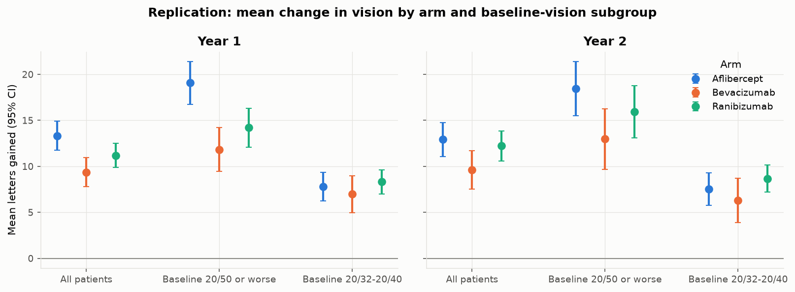

   *Figure 10.1: Mean letters gained with 95% CIs, by arm and baseline-vision subgroup, years 1
   and 2 [`reports/figures/m2_replication_means.png`]. How to read it: in the middle group
   (20/50 or worse) the blue aflibercept dot sits well above the others, and its interval does
   not overlap bevacizumab's. In the right group (20/32–20/40) all three overlap. That is the
   published subgroup finding.*
3. **Aflibercept beats bevacizumab on average.**
   - All patients: difference 3.95 letters, Holm $p = 0.00164$.
   - Below 69 letters: difference 7.24 (3.92 to 10.6), Holm $p = 7.83\times10^{-5}$.
   - 69 or better: difference 0.84 (−1.7 to 3.38), Holm $p = 1$.
   - Ranibizumab vs bevacizumab is not significant in any group [`m2_replication_tests.csv`].
4. **CST.** Aflibercept thins the retina more: −67.2 µm versus bevacizumab at 1 year (Holm
   $p = 7.91\times10^{-7}$) [`m2_replication_tests.csv`]. Under the CST-quality sensitivity
   policy the arm ordering is the same: −150 / −83.2 / −146 µm, on fewer patients (122 / 114 /
   123) [`reports/tables/m2_cst_change_sensitivity.csv`].
5. **Effect modification by baseline vision** is confirmed by interaction regression
   ($p = 0.000337$ continuous; $0.00513$ binary) [`m2_interaction_tests.csv`].
6. **Variance.** Ranibizumab's outcomes are less spread out (SD 9.39 vs 11.5–11.6). The
   robust Levene test does not confirm this ($p = 0.156$) [`m2_variance_tests.csv`].

Further figures for the report (all aggregate):

- `m2_baseline_distributions.png`: baseline feature histograms by arm.
- `m2_correlation_heatmap.png`: correlation matrix.
- `m2_injections_yr1.png`: distribution of year-1 injections by arm.

`m2_baseline_va_vs_gain.png` and `m2_outcome_by_arm.png` plot **individual patients as points**,
so this handbook describes them rather than embedding them (privacy rule). The first shows one
least-squares line per arm, with slopes −0.61 (aflibercept), −0.32 (bevacizumab) and −0.35
(ranibizumab) letters gained per baseline letter [legend of `m2_baseline_va_vs_gain.png`]. The
steeper aflibercept line is the interaction, seen visually.

### 10.7 Limitations and caveats

- **The replication is unadjusted and complete-case.** The published primary analysis was
  ANCOVA, adjusted for baseline vision, with multiple imputation (protocol §7.2.1). That
  explains the small bevacizumab gap (9.4 vs 9.7).
- **No pairwise laser tests** are computed.
- **Interaction regression assumes linearity** in the modifier and covariates.
- **Many tests are reported.** Only the pairwise families are Holm-corrected; the subgroup
  analyses and the interaction tests are not corrected across each other.

### 10.8 Plan vs reality

- **Correction method.** The protocol planned the **Hochberg** correction for the primary
  comparisons (protocol §7.2.1). The code uses **Holm**. Both control the family-wise error;
  Hochberg is slightly more powerful under positive dependence.
- **Missing test file.** `config/replication_targets.yaml` says the targets are checked in
  `tests/test_stats_replication.py`. That file does not exist; the check is
  `tests/test_stats.py:test_replication_matches_readme`.
- **Table 1 docstring.** It mentions "about 40 features"; 33 are tested.

### 10.9 Check yourself

1. **Why are Table 1 p-values "descriptive, not evidence of imbalance"?** In a randomized trial
   every baseline difference is due to chance by construction. With 33 tests, about 1.65
   would fall below 0.05 even under perfect randomization.
2. **The aflibercept × baseline-vision interaction coefficient is −0.317 per letter. Estimate
   aflibercept's extra advantage for an eye at 50 letters compared with one at 70.**
   $(70 - 50) \times 0.317 = 6.3$ letters more advantage for the worse eye.
3. **Why does the replication use completers, while the published primary analysis used
   multiple imputation?** README §9.1 compares complete-case values. M1 shows that MICE
   changes the aflibercept − bevacizumab difference only from 3.95 to 3.83 letters
   [`m1_missing_strategies.csv`], so the choice barely matters here.

---

## 11. M3 Patient representation

### 11.1 The story

**What question does M3 answer?** "What do the patients look like as a group? Are there natural
types of patient, and do these types respond differently to the drugs? Which characteristics
tend to occur together?"

Imagine 528 patients described by 42 numbers each. Nobody can picture 42 dimensions. M3 uses
three classic **unsupervised** tools, which look for structure without being told the right
answer:

- **PCA** squeezes 42 numbers into a few summary directions, like describing a city's weather
  by "overall warmth" and "rainy season" instead of 365 daily readings.
- **Clustering** groups similar patients, like a teacher noticing three kinds of students in a
  class.
- **Association rules** find items that often appear together, like "people who buy bread
  often buy butter".

M3 is **exploratory**. It uses training patients only, never feeds the treatment model, and
every cluster comparison is labelled "not pre-specified".

### 11.2 Inputs → outputs

| Inputs | Outputs |
|---|---|
| training patients (528) from `data/protocolT_analysis.csv` + `data/splits.json` | `reports/tables/m3_svd_vs_sklearn`, `m3_pca_variance`, `m3_pca_loadings`, `m3_kmeans_scan`, `m3_cluster_effects`, `m3_cluster_profiles`, `m3_association_rules` |
| `build_preprocessor` output (42 scaled columns) | `reports/figures/m3_scree.png`, `m3_pca_map.png`, `m3_kmeans_scan.png`, `m3_dendrogram.png`, `m3_cluster_effects.png` |
| `config/default.yaml: represent.*`, `preprocess.bands`, `preprocess.outliers` (DBSCAN) | `reports/metrics/m3_represent.json`; MLflow experiment `equipoise-m3-represent` |

### 11.3 Concept cards

#### Concept card: unsupervised learning

**In plain words.** Supervised learning has a teacher, the target column. Unsupervised learning
has none. It finds patterns in the features alone: groups, main directions, co-occurring items.

**Technically.** The input is only $X$, with no $y$. Typical goals are density estimation,
clustering, dimensionality reduction and rule mining. There is no single "accuracy", so
results are judged by internal criteria (silhouette, explained variance) and by whether they
make sense.

**Tiny worked example.** Given heights and weights of 30 people with no labels, a clustering
algorithm may still separate children from adults.

**In Equipoise.** Used in M3 (PCA, k-means, Ward, DBSCAN, Apriori), M1 (outliers) and M7
(trajectory clusters, HMM).

**Common confusions.** The "gain ≥ 15" item in the rules is an outcome, so the rule mining is not
purely unsupervised in spirit. It is exploratory association, not prediction.

**Viva questions.** *How do you evaluate a clustering without labels?* With internal measures
such as silhouette and inertia, by its stability, and by whether the clusters have a sensible
clinical profile.

#### Concept card: principal component analysis (PCA)

**In plain words.** PCA finds the directions in which patients differ most. The first principal
component (PC1) is the single direction with the most spread, PC2 the next-most-spread
direction at right angles to PC1, and so on. Keeping the first few PCs gives a compact summary
that loses as little information (variance) as possible.

**Technically.** For centred, standardized data $X$ ($n \times p$), PCA finds orthonormal
directions $v_1, v_2, \dots$ maximizing $\mathrm{Var}(Xv)$. These are the eigenvectors of the
covariance matrix, obtained in practice from the SVD $X = USV^\top$ (§6.1):

- the **components** (directions) are the rows of $V^\top$;
- the **scores** (patient coordinates) are $US = XV$;
- the **explained variance** of PC $k$ is $s_k^2/(n-1)$, and its **ratio** is
  $s_k^2/\sum_j s_j^2$;
- the **loadings** are the entries of $v_k$: how much each feature contributes.

A **scree plot** shows the variance ratio per component.

**Tiny worked example.** For points on the line $y = x$, all variance lies along $(1,1)/\sqrt2$.
PC1 explains 100% and PC2 0% (§6.1).

**In Equipoise.**
- `eq/represent/pca.py:svd_pca` implements PCA with `np.linalg.svd`, fixing each component's
  sign so its largest loading is positive.
- `compare_with_sklearn` checks it against sklearn: the components match exactly (max
  difference 0) and the scores to $3.55\times10^{-15}$ [`reports/tables/m3_svd_vs_sklearn.csv`].
- On the 528 training patients × 42 features, PC1 explains 15.7% of the variance and PC2
  10.2%. **12 components** are needed to reach 80% (`represent.variance_target: 0.8`)
  [`reports/tables/m3_pca_variance.csv`; `reports/metrics/m3_represent.json`].
- PC1's largest loadings are clinical DR severity (0.43), reading-centre DR severity (0.428),
  log UACR (0.357) and diastolic BP (0.333) [`reports/tables/m3_pca_loadings.csv`]. So PC1 is
  roughly a "systemic and retinal disease severity" axis.

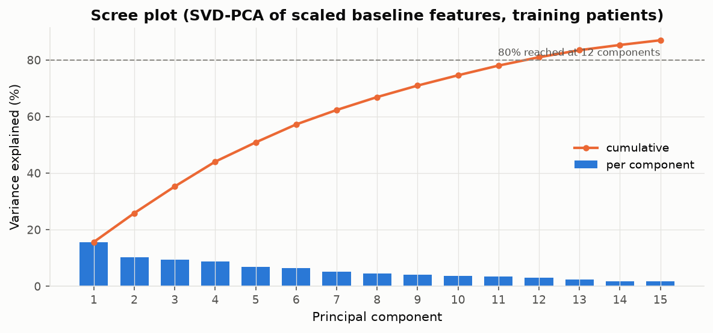

*Figure 11.1: Scree plot: variance explained by each of the first 15 components, with the
cumulative line [`reports/figures/m3_scree.png`]. How to read it: there is no sharp "elbow".
Variance is spread over many components, so these patients do not lie on a low-dimensional
surface.*

`m3_pca_map.png` plots each training patient on PC1–PC2 and is not embedded here (it shows
individual patients).

**Common confusions.**
- PCA directions are not "features". Each mixes all features.
- The sign of a component is arbitrary (**sign ambiguity of components**): $v$ and $-v$ describe
  the same direction. That is why `svd_pca` flips each component so its largest loading is
  positive.
- Standardizing first matters. Otherwise CST in µm (SD around 130) would dominate the
  variance.

**Viva questions.**
- *Why implement PCA via SVD yourselves?* To show we understand it, and to verify it against
  sklearn (identical to $10^{-15}$).
- *How many components do you need?* 12 for 80% of the variance, which says the baseline
  features are fairly independent of each other.

#### Concept card: k-means clustering, inertia and the elbow

**In plain words.** Choose $k$. Place $k$ centres, give each patient to the nearest centre,
move each centre to the average of its patients, and repeat until nothing changes. The result
is $k$ groups of similar patients.

**Technically.** k-means minimizes the **inertia** (within-cluster sum of squares)

$$J = \sum_{i}\lVert x_i - \mu_{c(i)}\rVert^2$$

where $\mu_c$ is the centre of cluster $c$ and $c(i)$ is patient $i$'s cluster. **Lloyd's
algorithm** alternates two steps: assign each point to the nearest centre, then update each
centre to its cluster mean. It reaches a *local* minimum, so it is run from several random
starts (`n_init=10`) and the best is kept. Inertia always drops as $k$ grows. The "elbow" is
where the drop flattens.

**Tiny worked example.** 1-D points 1, 2, 9, 10 with $k = 2$ and starting centres 1 and 2:
- Assign: {1} and {2, 9, 10}. Update: centres 1 and 7.
- Assign: {1, 2} and {9, 10}. Update: centres 1.5 and 9.5.
- Assign: unchanged, so it has converged. $J = 4 \times 0.25 = 1$.

**In Equipoise.** `eq/represent/cluster.py:kmeans_scan` tries $k = 2, \dots, 8$
(`represent.k_range`). Inertia falls from 7,850 at $k = 2$ to 6,180 at $k = 8$
[`reports/tables/m3_kmeans_scan.csv`], smoothly, without a clear elbow.

**Common confusions.** k-means assumes roughly round, similar-sized clusters, and always returns
$k$ groups even when the data has no real groups.

**Viva questions.** *Is the k-means result unique?* No. It depends on the starting centres.
Several restarts and a fixed seed make it reproducible.

#### Concept card: silhouette score

**In plain words.** For each patient, compare how close they are to their own cluster with how
close they are to the nearest other cluster. Near +1 means clearly in the right group; near 0
means on the border; negative means probably in the wrong group. The average over patients
judges the whole clustering.

**Technically.**

$$s(i) = \frac{b(i) - a(i)}{\max(a(i), b(i))}$$

where $a(i)$ is the mean distance from $i$ to the other members of its cluster, and $b(i)$ is
the mean distance from $i$ to the members of the nearest other cluster.

**Tiny worked example.** $a = 2$ and $b = 8$ give $s = 6/8 = 0.75$, a good fit. $a = 5$ and
$b = 5.5$ give $s = 0.09$, on the border.

**In Equipoise.** The best $k$ by silhouette is $k = 3$, with silhouette **0.109**. The value
for $k = 2$ is 0.106 [`m3_kmeans_scan.csv`; `m3_represent.json`]. Values this close to 0 mean
the "clusters" are weak: patients form one continuous cloud, cut into regions.

**Common confusions.** The best silhouette among bad options can still be bad. 0.109 is low.

**Viva questions.** *Your best silhouette is 0.11. Are there real patient types?* Not strongly.
The clusters are convenient summaries, not natural groups, and we say so.

#### Concept card: hierarchical clustering (Ward linkage) and the dendrogram

**In plain words.** Start with every patient as its own group, then repeatedly merge the two
groups whose merger increases the spread the least. The full history of mergers is a tree
(**dendrogram**). Cutting the tree at some height gives clusters.

**Technically.** In agglomerative clustering, Ward's criterion merges the pair of clusters
$A, B$ that minimizes the increase in total within-cluster sum of squares:

$$\Delta(A, B) = \frac{|A||B|}{|A|+|B|}\lVert\mu_A - \mu_B\rVert^2$$

`scipy.cluster.hierarchy.linkage(Z, method="ward")` builds the tree, and
`fcluster(L, t=k, criterion="maxclust")` cuts it into $k$ clusters.

**Tiny worked example.** Points 1, 2, 9, 10:
- Merge {1, 2} (Δ = 0.5) and {9, 10} (Δ = 0.5).
- Then merge the two groups: $\Delta = \frac{2\cdot2}{4}(1.5 - 9.5)^2 = 64$, a big jump, so
  two clusters is natural.

**In Equipoise.** `ward_labels(Z, k)` with the same $k = 3$ as k-means. The dendrogram shows
the top 25 merges (`represent.dendrogram_truncate: 25`).

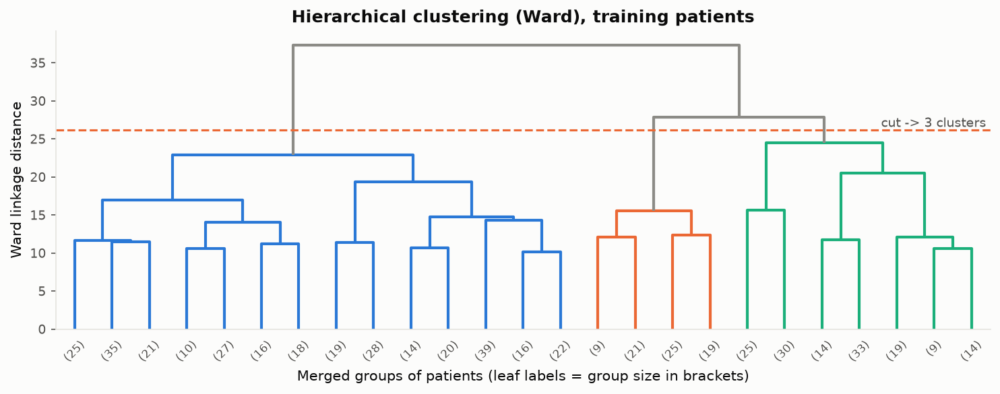

*Figure 11.2: Truncated Ward dendrogram of training patients [`reports/figures/m3_dendrogram.png`].
How to read it: the vertical height of each join is the cost of that merge. Long vertical
lines just below the cut mean well-separated groups.*

**Common confusions.** A dendrogram is not a phylogenetic or causal tree. It is only the order
of merges.

**Viva questions.** *k-means vs Ward: which is better here?* Both give similar 3-cluster
pictures (§11.6). Ward is deterministic and shows the hierarchy; k-means scales better.

#### Concept card: DBSCAN for clustering

See the DBSCAN card in §9.3. In M3 the same eps rule (95th percentile of the 10-NN distance)
gives **1 cluster plus 3 noise patients** among 528 training patients [`m3_represent.json`].
DBSCAN therefore finds no natural density-separated groups: one more sign that patients form
a continuum.

#### Concept card: treatment effects within clusters (exploratory subgroups)

**In plain words.** After grouping patients, look at the drug difference inside each group. If
one cluster showed a large aflibercept benefit, it would hint at a subgroup. But with many
clusters and two comparisons each, some will look "significant" by chance.

**Technically.** For each cluster and each comparison arm, a Welch difference in mean week-52
letters versus bevacizumab is computed among complete cases (`effects_by_cluster`). These are
14 tests with no multiplicity correction, labelled "exploratory; not pre-specified".

**Tiny worked example.** With 14 tests at α = 0.05, about 0.7 false positives are expected
under no real differences.

**In Equipoise.** 7 of the 14 cluster comparisons have $p < 0.05$ [`m3_represent.json`]. The
most striking:
- **k-means cluster 2** (121 complete cases; mean baseline vision 54.8 letters; mean CST
  589 µm): aflibercept − bevacizumab = **8.31** letters (2.86 to 13.8, $p = 0.00328$).
- The same comparison is −1.86 (−5.42 to 1.69) in cluster 0 (mean vision 68.9).

[`reports/tables/m3_cluster_effects.csv`, `m3_cluster_profiles.csv`] Ward's cluster 2 gives a
similar 7.09 (1.35 to 12.8).

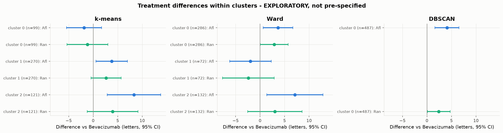

*Figure 11.3: Arm differences versus bevacizumab within each cluster, with 95% CIs
[`reports/figures/m3_cluster_effects.png`]. How to read it: dots right of the vertical line
favour the costlier drug. The poor-vision, thick-retina cluster (cluster 2) sits furthest
right for aflibercept. That is the published baseline-vision subgroup again, found without
being told.*

**Common confusions.** A cluster defined by poor vision *and* thick retinas cannot say which of
the two drives the bigger benefit.

**Viva questions.** *Is the cluster-2 benefit a new finding?* No. That cluster has poor baseline
vision, so it rediscovers the published < 69-letter subgroup. It is exploratory, with 14
uncorrected tests.

#### Concept card: association rules and Apriori (support, confidence, lift)

**In plain words.** Turn each patient into a "shopping basket" of yes/no items: "HbA1c 8–9",
"prior laser", "gained ≥ 15 letters", … Then find rules like "IF poor vision THEN gained ≥ 15
letters" that hold often. Three numbers judge a rule:

- **support**: how often the items occur together;
- **confidence**: how often the rule is right when its IF part holds;
- **lift**: how much more often than by chance.

**Technically.** For itemsets $A$ and $B$ over $N$ baskets:

- $\text{support}(A \Rightarrow B) = P(A \cap B)$;
- $\text{confidence} = P(B \mid A) = \text{support}(A\cup B)/\text{support}(A)$;
- $\text{lift} = \text{confidence}/P(B)$.

Lift > 1 means positive association. **Apriori** finds all itemsets with support ≥ a minimum.
It uses the **downward-closure property**: every subset of a frequent itemset is frequent, so
candidate itemsets of size $k+1$ are built only from frequent itemsets of size $k$.

**Tiny worked example.** 10 baskets. "Poor vision" appears in 4, "gain ≥ 15" in 5, and both
together in 3.
- support = 0.3;
- confidence = 3/4 = 0.75;
- lift = 0.75/0.5 = 1.5.

**In Equipoise.** `eq/represent/rules.py`:
- `baskets` builds items from the bands (§9.3), from nine binary features
  (`represent.apriori.binary_items`), from DR severity levels, and from the "gain ≥ 15" item,
  for complete-case training patients.
- `mine_rules` runs `apriori(min_support=0.08, max_len=3)` and
  `association_rules(metric="confidence", min_threshold=0.4)` **within each arm**. It keeps
  the top 10 rules by lift, plus the top 10 whose consequent is "gain ≥ 15".
- 51 rules are reported [`m3_represent.json`].

Examples (aflibercept arm, 167 baskets) [`reports/tables/m3_association_rules.csv`]:

| Rule | Support | Confidence | Lift |
|---|---|---|---|
| prior_prp ⇒ DR = PDR and/or prior scatter & prior_focal_laser | 0.102 | 0.654 | 6.42 |
| va_letters = 20/100 or worse ⇒ gain ≥ 15 | 0.132 | 0.815 | 2.09 |

The first is trivially true by definition: prior scatter laser *is* part of that DR category.
The second restates that very poor starting vision gains most.

**Common confusions.**
- High lift with low support can be a fluke.
- Rules describe co-occurrence in this sample, not cause (every rule is labelled
  "exploratory; association, not causation").

**Viva questions.**
- *Why mine rules within each arm?* So that a rule's consequent ("gain ≥ 15") is not mixed
  across drugs that have different average gains.
- *What does lift 2.09 mean?* Among aflibercept patients with 20/100 or worse vision, gaining
  ≥ 15 letters is 2.09 times as common as among aflibercept patients overall.

### 11.4 Code walkthrough

`eq/represent/run.py:run` (abridged order):

```python
Z = build_preprocessor(cfg).fit_transform(train)          # 528 x 42, scaled, imputed
pca = svd_pca(Z); check = compare_with_sklearn(Z, pca)     # PCA + verification
scan = kmeans_scan(Z, tuple(rp["k_range"]), cfg.seed)      # k = 2..8: inertia, silhouette
k_best = int(scan.loc[scan.silhouette.idxmax(), "k"])      # best silhouette -> k = 3
labels = {"k-means": KMeans(n_clusters=k_best, n_init=10, random_state=cfg.seed).fit_predict(Z)}
L, labels["Ward"] = ward_labels(Z, k_best)
labels["DBSCAN"], eps, _ = dbscan_labels(Z, int(o["dbscan_min_samples"]), float(o["dbscan_eps_quantile"]))
eff = pd.concat([effects_by_cluster(train, lab, m, cfg) for m, lab in labels.items()])
rules = mine_rules(train, cfg)
```

- **Line 1.** The same preprocessor as every model, fitted on training patients.
- **Line 4.** $k$ is chosen by a rule (maximum silhouette), not by eye.
- **Lines 5–7.** The three clusterings use that $k$ (DBSCAN chooses its own number).
- **Lines 8–9.** Per-cluster arm differences, then rule mining.

**PCA sign fixing** (`svd_pca`):

```python
U, S, Vt = np.linalg.svd(X - mean, full_matrices=False)
signs = np.sign(Vt[np.arange(len(Vt)), np.abs(Vt).argmax(axis=1)])
Vt = Vt * signs[:, None]
var = S**2 / (len(X) - 1)
```

For each component, the code finds the loading with the largest absolute value and flips the
component's sign so that loading is positive. That makes results reproducible and comparable
with sklearn.

**Config keys.**

| Key | Value |
|---|---|
| `represent.n_components_plot` | 15 |
| `represent.variance_target` | 0.8 |
| `represent.k_range` | [2, 8] |
| `represent.dendrogram_truncate` | 25 |
| `represent.apriori.min_support` | 0.08 |
| `represent.apriori.min_confidence` | 0.4 |
| `represent.apriori.max_len` | 3 |
| `represent.apriori.top_n` | 10 |
| `represent.apriori.binary_items` | nine flags |
| `preprocess.bands` | see §9.3 |
| `preprocess.outliers.dbscan_*` | see §9.3 |

### 11.5 Run it yourself (synthetic data)

```bash
python -m equipoise represent --synthetic
```

Verified for this handbook. Expected output:

```
[represent] running on synthetic data ...
  pca_components_for_target: 13
  pca_pc1_pct: 11.86
  svd_sklearn_max_diff: 2.22e-15
  k_best: 2
  silhouette_best: 0.08512
  dbscan_clusters: 1
  dbscan_noise: 1
  n_rules_reported: 49
```

The synthetic features are drawn mostly independently, so they have even less structure than
the real data: PC1 explains 11.86%, and the best silhouette is 0.085.

`tests/test_represent.py` checks that SVD-PCA matches sklearn, that the clustering helpers and
per-cluster effects run, and that the baskets and association rules are built correctly.

### 11.6 What we found (real data)

- **No strong low-dimensional structure.** PC1 explains 15.7%, and 12 components are needed
  for 80% [`m3_pca_variance.csv`].
- **Weak clusters.** The best k-means silhouette is 0.109 at $k = 3$, and DBSCAN finds a
  single cluster [`m3_represent.json`]. The three k-means clusters are interpretable
  [`m3_cluster_profiles.csv`]:
  - **cluster 0** (103 training patients): long diabetes (mean 21 years), 65% prior PRP, 26%
    prior anti-VEGF;
  - **cluster 1** (292): older (mean 63), little prior treatment;
  - **cluster 2** (133): worst vision (mean 54.7 letters) and thickest retinas (mean 589 µm).
- **The poor-vision cluster shows the largest aflibercept benefit:** 8.31 letters
  [`m3_cluster_effects.csv`]. This matches the published subgroup, but it is exploratory.
- **Association rules** mostly restate definitions or known facts [`m3_association_rules.csv`].

### 11.7 Limitations and caveats

- Low silhouettes mean the clusters are partitions of a continuum, not distinct patient types.
- The cluster effect tests are uncorrected (14 tests) and not pre-specified.
- Discretization loses information. Rule support depends on the arbitrary band edges.
- PCA is linear. Non-linear structure (if any) would be missed. This is acceptable for an
  exploratory module.

### 11.8 Plan vs reality

- **SVD.** README §10 lists "PCA, SVD — M3". Both are implemented, and SVD is the engine of
  PCA. There is no separate truncated-SVD analysis.
- **Unused representation.** README §4 says M3 is "Map and group patients". Nothing from M3
  feeds later modules. The k-means used for SHAP backgrounds in M9 is a separate fit
  (`eq/serving/assets.py:build_serving_assets`).

### 11.9 Check yourself

1. **The first three PCs explain 15.7%, 10.2% and 9.43%. What share do the first three explain
   together, and what does that say?** 35.3% [`m3_pca_variance.csv`]. Most variation lies
   outside any 3-D summary, so a 2-D PCA map hides most of the differences between patients.
2. **Silhouette for a patient with $a = 3$ and $b = 3.3$?** $s = 0.3/3.3 = 0.09$: on the
   border.
3. **In a basket set of 200 patients, rule A ⇒ B has support 0.1 and confidence 0.5, and
   P(B) = 0.25. Lift? How many patients have both A and B?** Lift = 0.5/0.25 = 2.
   $0.1 \times 200 = 20$ patients have both.

---

## 12. M4 Feature search

### 12.1 The story

**What question does M4 answer?** "Which baseline features actually help predict letters gained,
and can we find a small subset that predicts as well as all 33?"

Choosing features is like packing a suitcase with a weight limit. Every item could be useful,
but each one costs something. With 33 features there are $2^{33} \approx 8.6$ billion possible
suitcases, far too many to try. M4 treats feature selection two ways:

1. **Classical selection.** Score features one at a time (filter), let a model choose while it
   fits (embedded), or repeatedly drop the weakest feature (wrapper).
2. **Search.** Treat feature selection as a search problem on a landscape of subsets. Six
   algorithms (random search, hill climbing, beam search, tabu search, a genetic algorithm and
   particle swarm optimisation) all hunt for the best subset with the same budget of 1,500
   evaluations, so they can be compared fairly.

M4 uses training patients only. The selected subset is reported, and its held-out RMSE is shown
once. It is **not** forced onto M6; M6 only reports whether using it changes the results
(`eq/search/run.py` docstring).

### 12.2 Inputs → outputs

| Inputs | Outputs |
|---|---|
| training patients with a week-52 outcome (490) | `reports/tables/m4_feature_rankings`, `m4_top_features_by_method`, `m4_search_runs`, `m4_search_summary`, `m4_hill_climbing_restarts`, `m4_selected_features`, `m4_selected_vs_all` |
| `build_preprocessor` (median imputation, with arm dummies) | `reports/figures/m4_feature_rankings.png`, `m4_lasso_path.png`, `m4_convergence.png`, `m4_hill_climbing_restarts.png` |
| `config/default.yaml: search.*` | `reports/metrics/m4_search.json`; MLflow experiment `equipoise-m4-search` with one child run per algorithm × seed |

### 12.3 Concept cards: classical feature selection

#### Concept card: filter, embedded and wrapper methods

**In plain words.**
- **Filter** methods score each feature alone, like shortlisting job applicants by their CV
  without an interview.
- **Embedded** methods choose features *while* training a model, as part of the fit.
- **Wrapper** methods train a model on candidate subsets and keep the subset that works best,
  like interviewing different teams. Wrappers are the most expensive and the most tailored.

**Technically.**
- **Filter scores.**
  - Mutual information $I(X_j; Y)$ measures any kind of dependence. It is 0 if and only if
    the two are independent.
  - $|r|$, the absolute Pearson correlation, measures linear dependence.
  - The chi-square statistic measures association between a non-negative feature and a
    class.
- **Embedded.**
  - The Lasso path is the sequence of solutions as the penalty $\alpha$ decreases. A feature
    that enters at a larger $\alpha$ is more important.
  - Random-forest impurity importance is the total reduction in squared error from splits on
    that feature.
- **Wrapper.** Recursive feature elimination (RFE) repeatedly fits a model (Ridge) and removes
  the feature with the smallest |coefficient| until $k$ remain.

**Tiny worked example.**
- **Filter.** If $Y$ = letters gained and $X_1$ = baseline vision with $r = -0.45$, then
  $|r| = 0.45$ and $X_1$ ranks high.
- **Lasso path.** With a huge α, all coefficients are 0. As α shrinks, baseline vision becomes
  non-zero first.

**In Equipoise.** `eq/search/selection.py:rank_features` computes six scores per raw feature on
encoded training data. One-hot columns are mapped back to their raw feature: the best column
for most scores, the sum for RF importance. Settings:

- `search.lasso_path_alphas: 60`;
- `search.rfe_n_features: 12`;
- RFE with `Ridge(alpha=10)`;
- RF settings from `supervised.random_forest`.

The chi-square target is the "gained ≥ 15 letters" flag on min-max-scaled features.

Results [`reports/tables/m4_feature_rankings.csv`, `m4_top_features_by_method.csv`]:

- **Baseline vision (`X_va_letters`) ranks first by every method**: mutual information 0.285,
  |r| 0.45, Lasso entry α 4.39, RF importance 0.298, RFE rank 1. The exception is chi-square,
  where its own binary version `X_va_below_69` ranks first.
- Age is second by |r|, Lasso, RF importance and RFE.
- Below the top two, the methods disagree.
  - Chi-square ranks subretinal fluid 2nd ($\chi^2$ 18.9).
  - Mutual information gives 0 for diastolic BP, prior PRP and diabetes duration.

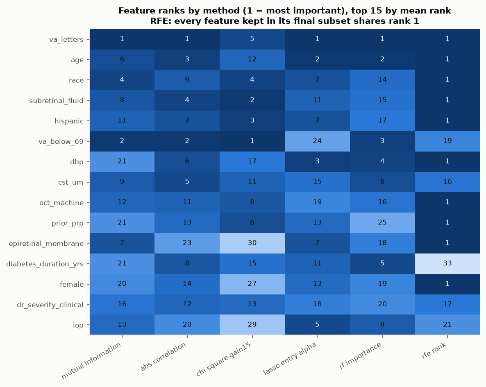

*Figure 12.1: Rank of each feature (rows) under each selection method (columns)
[`reports/figures/m4_feature_rankings.png`]. How to read it: dark cells are high ranks. A row
that is dark across all columns (baseline vision) is important by every definition. Mixed rows
mean "important" depends on the method.*

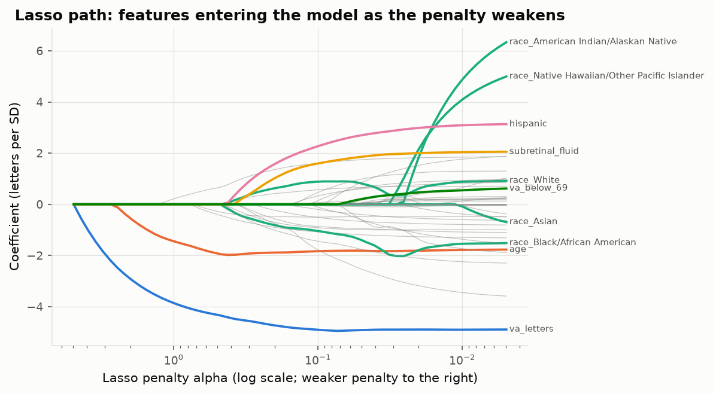

*Figure 12.2: Lasso coefficient paths as the penalty decreases
[`reports/figures/m4_lasso_path.png`]. How to read it: each line is one encoded column. The
earlier (further left, at higher α) a line leaves zero, the more important the feature.*

**Common confusions.**
- Mutual information on continuous data is estimated with a nearest-neighbour method, so small
  values of 0 versus 0.01 are noise.
- RF importance favours features with many possible split points.

**Viva questions.**
- *Why use six ranking methods?* They define importance differently. Agreement (baseline
  vision) is reliable; disagreement shows that importance is not one number.
- *Is RFE a wrapper?* Yes. It repeatedly retrains the model and removes features based on the
  fitted model.

### 12.4 Concept cards: feature selection as search

#### Concept card: search space, neighbourhood, local optimum and plateau

**In plain words.** Picture every possible feature subset as a point on a landscape. Its height
is how bad the subset is (lower is better). Searching means walking on this landscape to find
the lowest point.

- The **neighbours** of a subset are the subsets that differ by one feature (add or remove
  one).
- A **local optimum** is a valley bottom: every neighbour is higher, but it is not the deepest
  valley.
- A **plateau** is flat ground: many neighbours equally good, so you cannot tell which way is
  downhill.

**Technically.**
- **Search space.** $\{0, 1\}^p$, binary masks over the $p = 33$ raw features: $2^{33}$
  subsets.
- **Neighbourhood.** $N(m) = \{m \oplus e_i\}$, the $p$ masks one bit-flip away.
- **Local optimum.** $J(m) \le J(m')$ for all $m' \in N(m)$.
- **Global optimum.** The minimum over the whole space.
- **Exploitation vs exploration.** Search algorithms trade off local improvement against
  jumping to new regions.

**Tiny worked example: the toy problem used for every algorithm below.** Four features A, B, C,
D, and the objective $J$ for all 16 masks (made-up numbers, lower is better):

| Mask ABCD | $J$ | Mask | $J$ | Mask | $J$ | Mask | $J$ |
|---|---|---|---|---|---|---|---|
| 0000 | 10.0 | 1000 | 9.0 | 0100 | 9.8 | 0010 | 9.9 |
| 0001 | 10.1 | 1100 | **8.6** | 1010 | 8.9 | 1001 | 9.1 |
| 0110 | 9.5 | 0101 | 9.7 | 0011 | *9.3* | 1110 | 8.7 |
| 1101 | 8.8 | 1011 | 9.4 | 0111 | 9.5 | 1111 | 8.9 |

- **Global optimum: 1100** (A and B), $J = 8.6$.
- **Local optimum: 0011** (C and D), $J = 9.3$. Its neighbours 1011 (9.4), 0111 (9.5),
  0001 (10.1) and 0010 (9.9) are all worse, so single-flip moves cannot leave it.

**In Equipoise.** $p = 33$ raw features (one-hot columns of a nominal feature are switched on or
off together; `eq/search/objective.py:FoldData.columns_of`). The hill-climbing diagnostic found
**2 distinct local optima** from 10 random starts [`reports/metrics/m4_search.json:
hill_climb_distinct_optima`; `reports/tables/m4_hill_climbing_restarts.csv`]:

- 9 of the 10 starts ended at $J = 9.39$ with 7 features;
- one ended at $J = 9.42$ with a different 8-feature subset (ERM, Hispanic, subretinal fluid,
  HbA1c, age, DBP, SBP, vision).

**Common confusions.** "Local optimum" depends on the neighbourhood definition. With two-bit
flips as moves, a single-flip local optimum might not be one.

**Viva questions.** *What is a plateau and why does it matter here?* Many subsets give nearly the
same $J$, because adding a weak feature changes the CV RMSE by about as much as the penalty. A
plateau gives hill climbing no direction. Tabu search and GA can cross it.

#### Concept card: the objective $J$ (penalized cross-validated RMSE)

**In plain words.** Every algorithm needs a score for a subset. Ours is "how well a simple model
predicts letters gained from just these features, judged by cross-validation", plus a small
charge per feature, so a feature has to earn its place.

**Technically.**

$$J(m) = \text{CV-RMSE}_{5\text{-fold}}\big(\text{Ridge}_{\alpha=10}(X_m \cup \text{arm}) \to Y\big) + \lambda\,|m|$$

where:

- $X_m$ are the encoded columns of the selected features (the arm dummies are always
  included);
- $\lambda = 0.02$ letters per feature (`search.feature_penalty`);
- $|m|$ is the number of selected raw features.

For speed:

- each fold's matrix is preprocessed once (median imputation, scaling, encoding, fitted on
  that fold's training part), and a mask just selects columns (`build_fold_data`);
- Ridge is solved in closed form (`ridge_fit_predict`): centre $X$ and $y$, then solve
  $(X^\top X + \alpha I)\beta = X^\top y$;
- the `Evaluator` **memoizes** results (each unique mask is computed once) and counts unique
  evaluations against the **budget of 1,500** (`search.budget`).

**Tiny worked example.** A subset with CV RMSE 9.25 and 7 features costs
$9.25 + 0.02 \times 7 = 9.39$. All 33 features: CV RMSE 9.47 + 0.66 = 10.13.

**In Equipoise.** On real training data [`reports/tables/m4_selected_vs_all.csv`]:

| Subset | Features | $J$ | CV RMSE |
|---|---|---|---|
| all baseline features | 33 | 10.1 | 9.47 |
| best subset | 7 | 9.39 | 9.25 |
| arm only | 0 | 10.9 | 10.9 |

**Common confusions.**
- $J$ is not the RMSE. Remember the penalty term when comparing.
- Memoization means a revisited mask costs no budget. A safety "call cap" of 20 × budget stops
  algorithms that cycle among already-seen masks (`Evaluator.__call__`).

**Viva questions.** *Why the feature penalty?* Without it, extra features that reduce CV RMSE by
0.001 by chance would always be added. The penalty encodes "simpler is better unless clearly
worse".

#### Concept card: random search (the yardstick)

**In plain words.** Try random subsets and keep the best. Any clever algorithm should beat this.

**Technically.**

```
repeat until budget:
    m ← random mask (each bit 1 with probability 0.5)
    evaluate J(m); remember the best
```

(`eq/search/algorithms.py:random_search`)

**Tiny worked example (toy).** Draw 0110 (9.5), then 1001 (9.1), then 0011 (9.3). The best so
far is 1001 (9.1). The global 8.6 is not found unless 1100 happens to be drawn.

**In Equipoise.** Best $J$ = 9.54 (the best of 3 seeds) with 11–13 features
[`reports/tables/m4_search_summary.csv`, `m4_search_runs.csv`]. It is the worst of the six.
Random masks include about half the features, and the penalty punishes that.

**Viva questions.** *Why include random search?* It is the honest baseline. If it matched the
others, the "clever" algorithms would be adding nothing.

#### Concept card: hill climbing (steepest descent) with random restarts

**In plain words.** Stand somewhere. Look at every neighbour, step to the best one if it is
lower, and repeat. When no neighbour is lower, you are in a valley, possibly not the deepest.
Then restart from a new random spot.

**Technically.**

```
repeat until budget:
    current ← random mask;  v ← J(current)
    loop:
        evaluate all p one-bit-flip neighbours
        best ← neighbour with lowest J
        if J(best) ≥ v: record local optimum; break      # no improving move
        current, v ← best, J(best)
```

(`hill_climbing`) Each step costs up to $p = 33$ evaluations.

**Tiny worked example (toy).**
- **Start at 0011** ($J = 9.3$). The neighbours are 1011 (9.4), 0111 (9.5), 0001 (10.1) and
  0010 (9.9). None is lower, so the climb is **stuck in the local optimum 9.3**.
- **Restart at 0110** (9.5). The neighbours are 1110 (8.7), 0010 (9.9), 0100 (9.8) and
  0111 (9.5), so move to 1110.
- **From 1110** the neighbours are 0110 (9.5), 1010 (8.9), **1100 (8.6)** and 1111 (8.9), so
  move to 1100.
- **From 1100** the neighbours are 0100 (9.8), 1000 (9.0), 1110 (8.7) and 1101 (8.8). None is
  lower, so it stops at the global optimum 8.6.

**In Equipoise.** All three seeds reached $J = 9.39$ with 7 features: race, epiretinal
membrane, female, Hispanic, prior PRP, age, baseline vision [`m4_search_runs.csv`].

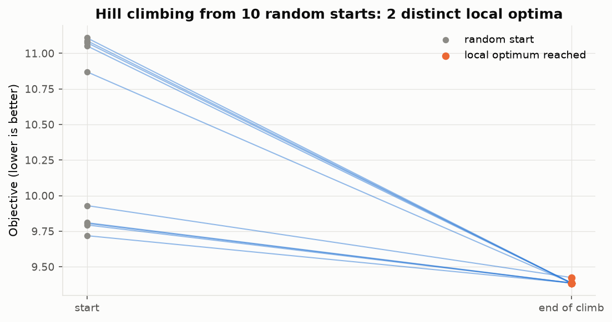

*Figure 12.3: Ten independent hill climbs from random starts: starting $J$ and the local optimum
reached [`reports/figures/m4_hill_climbing_restarts.png`]. How to read it: most climbs end at the
same bottom (9.39), and one stalls higher (9.42). That is a local optimum.*

**Common confusions.** "Steepest" means checking *all* neighbours before moving. "First-improvement"
hill climbing moves to the first better neighbour it finds.

**Viva questions.** *How do you escape local optima in hill climbing?* With random restarts (as
here), by accepting worse moves (simulated annealing, tabu), or with population methods (GA,
PSO).

#### Concept card: beam search

**In plain words.** Grow subsets one feature at a time, but keep only the best few candidates at
each size (the "beam") instead of exploring everything. It is like a talent show that keeps the
top 5 acts after each round.

**Technically.**

```
beam ← {empty set}
loop:
    children ← every subset formed by adding one feature to a beam member (deduplicated)
    keep the `width` best children (a heap)
    if the best child is not better than the best so far: stop
    beam ← kept children
```

(`beam_search`, width 5 from `search.beam.width`) A heap keeps the `width` best children
cheaply: Python's `heapq`, used as a max-heap of the worst kept score.

**Tiny worked example (toy, width 2).**
- **Round 1.** From 0000 (10.0), the children are 1000 (9.0), 0100 (9.8), 0010 (9.9) and
  0001 (10.1). Keep 1000 and 0100.
- **Round 2.** The children are 1100 (8.6), 1010 (8.9), 1001 (9.1), 0110 (9.5) and
  0101 (9.7). Keep 1100 and 1010. 8.6 < 9.0, so continue.
- **Round 3.** The children are 1110 (8.7), 1101 (8.8) and 1011 (9.4). The best, 8.7, is not
  below 8.6, so stop. Result: 1100.

**In Equipoise.** Beam search found $J = 9.39$ (the same 7 features) and **stopped by itself**
after 996 evaluations, the fewest of any method [`m4_search_summary.csv`, `m4_search_runs.csv`:
"algorithm converged"].

**Common confusions.** Beam search only adds features (forward). It can never remove a feature
added early.

**Viva questions.** *What data structure does beam search use and why?* A heap (priority queue)
keeps the best `width` candidates in $O(\log w)$ per insertion (`docs/data_structures.md`).

#### Concept card: tabu search

**In plain words.** Like hill climbing, but you **always** move to the best neighbour, even if it
is worse. To avoid walking straight back, you keep a short "tabu list" of recent moves you are
not allowed to undo. The one exception (**aspiration**): a tabu move is allowed if it would give
the best result ever seen.

**Technically.**

```
current ← random mask; tabu ← empty queue of length `tenure`
loop:
    for each bit i: candidate = flip(current, i)
        allowed if i not in tabu  OR  J(candidate) < best ever (aspiration)
    move to the allowed candidate with lowest J (even if worse than current)
    push i onto tabu (the oldest entry drops off)
```

(`tabu_search`; tenure 7 from `search.tabu.tenure`) The tabu list is a `collections.deque(maxlen=7)`.

**Tiny worked example (toy, tenure 2), starting in the local optimum 0011** (9.3):

1. The neighbours are 1011 (9.4), 0111 (9.5), 0001 (10.1) and 0010 (9.9). Move to the best,
   **1011 (9.4), although it is worse**. Tabu = [A].
2. From 1011, flipping A back gives 0011 (9.3). A is tabu, and 9.3 is not below the best ever
   (9.3), so this is not allowed. The others are 1111 (8.9), 1001 (9.1) and 1010 (8.9). Move to
   1010 (8.9). Tabu = [A, D].
3. From 1010, the allowed candidates are 1110 (8.7) and 1000 (9.0). Move to 1110. Tabu = [D, B].
4. From 1110, flip C to reach **1100 (8.6)**. The search has escaped the local optimum.

**In Equipoise.** Best $J$ = 9.39 [`m4_search_summary.csv`]. All three seeds stopped with
"call cap (20 x budget) - search was cycling" after 929–1,053 unique evaluations
[`m4_search_runs.csv`]. Once the landscape is explored, tabu keeps revisiting cached masks.
The cap stops it.

**Common confusions.** Too short a tenure lets the search cycle; too long forbids good moves.

**Viva questions.** *What is aspiration in tabu search?* An override: a tabu move is allowed if it
would beat the best solution found so far.

#### Concept card: genetic algorithm (GA)

**In plain words.** Breed a population of subsets like plants. Better subsets are more likely to
become parents. Children mix their parents' features (**crossover**) and get small random
changes (**mutation**). The best few are copied straight into the next generation
(**elitism**). Over generations the population improves.

**Technically** (`genetic_algorithm`; `search.ga`):

```
pop ← 30 random masks
each generation:
    cost of each member; fitness = max(cost) − cost  (lower cost → higher fitness)
    children ← copies of the 2 best (elitism)
    while fewer than 30 children:
        pick 2 parents by roulette wheel (probability ∝ fitness)
        with prob. 0.9 crossover: half the time two-point, else one-point
        mutate each bit with probability 1/p
    stop at budget or after 25 generations without improvement
```

**Tiny worked example (toy, one generation, population 4, elite 1).**

- **Population and costs:** 0011 (9.3), 0110 (9.5), 1001 (9.1), 0101 (9.7).
- **Fitness** $= 9.7 - J$: 0.4, 0.2, 0.6, 0.0. **Roulette probabilities:** 0.33, 0.17, 0.5, 0.
- **Elite:** keep 1001.
- **Pick parents** 1001 and 0011 (likely, given their probabilities).
- **One-point crossover after bit 2:** children 10|11 = **1011** and 00|01 = **0001**.
- **Mutation** (rate ¼ per bit). Say bit C of the first child flips: 1011 → **1001**.
- **Next population:** 1001 (elite), 1001, 0001, plus one more child.

Over generations, recombining A from one parent with B from another can produce 1100.

**In Equipoise.**
- Two seeds reached 9.39. The third reached 9.40 with 6 features and stopped after "no
  improvement for 25 generations" [`m4_search_runs.csv`].
- The GA needed the most evaluations to reach its best (median 1,120)
  [`m4_search_summary.csv`].

**Common confusions.** Roulette selection gives the worst member probability ≈ 0, not exactly 0
(a tiny ε is added). Elitism guarantees the best never gets worse.

GA and PSO are **bio-inspired optimization** methods: the GA copies evolution (selection,
breeding, mutation), and PSO copies a flock of birds sharing where food was found.

**Viva questions.** *What do crossover and mutation each contribute?* Crossover recombines good
building blocks from different parents (exploitation of what works). Mutation injects new bits
(exploration), so the population does not converge prematurely.

#### Concept card: particle swarm optimisation (PSO), binary and continuous

**In plain words.** A flock of particles flies over the landscape. Each particle remembers the
best place *it* has found, and everyone knows the best place *anyone* has found. Each step, a
particle's velocity is a blend of where it was going, a pull towards its own best, and a pull
towards the swarm's best. In the binary version, a velocity is turned into the *probability*
that a bit is 1.

**Technically.** For particle $k$, bit (or coordinate) $d$:

$$v_{kd} \leftarrow w\,v_{kd} + c_1 r_1 (p_{kd} - x_{kd}) + c_2 r_2 (g_d - x_{kd})$$

where:

- $w = 0.7$ is the inertia;
- $c_1 = c_2 = 1.5$ are the pull strengths;
- $r_1, r_2 \sim U(0,1)$ are random numbers;
- $p_k$ is the particle's personal best and $g$ the swarm's global best.

Velocities are clipped to $\pm v_{max} = 4$.

- **Binary PSO:** $x_{kd} = 1$ with probability $\sigma(v_{kd}) = 1/(1+e^{-v_{kd}})$
  (`binary_pso`; 20 particles, `search.pso`).
- **Continuous PSO:** $x \leftarrow \text{clip}(x + v)$ within a box (`continuous_pso`, used for
  hyperparameter tuning in M6, §14).

**Tiny worked example (toy, one particle, one step).**
- $x = 0011$, $v = (0,0,0,0)$, personal best $p = 0011$, global best $g = 1001$. Take
  $r_1 = r_2 = 0.5$.
- $v = 0.7\cdot0 + 1.5\cdot0.5\cdot(p - x) + 1.5\cdot0.5\cdot(g - x) = 0 + 0.75\cdot(1, 0, -1, 0)
  = (0.75, 0, -0.75, 0)$.
- The bit probabilities are $\sigma(v) = (0.68, 0.5, 0.32, 0.5)$. A is now likely on, C likely
  off, and B and D are a coin toss.
- The particle drifts towards 1001.

**In Equipoise.** Binary PSO's best $J$ was 9.43, with 8–10 features. It did not reach 9.39 within
1,500 evaluations [`m4_search_summary.csv`, `m4_search_runs.csv`].

**Common confusions.** In binary PSO, velocity is not a speed in space. It is the log-odds that a
bit is on.

**Viva questions.** *Why did binary PSO do worse here?* It re-samples every bit stochastically each
step, so it keeps exploring noisy, larger subsets on a flat landscape. The deterministic local
methods settle faster.

### 12.5 Code walkthrough

`eq/search/run.py:run`:

1. `rank_features(train, cfg)` runs the filter, embedded and wrapper methods.
2. `make_evaluator(train, cfg)` preprocesses the 5 CV folds once.
3. It records the objective for all features and for none.
4. It runs every algorithm in `ALGORITHMS` with seeds 42, 43 and 44 (`search.seed_offsets`).
   Each run gets a **fresh** evaluator (empty cache, same budget) and its own seeded RNG
   (`run_algorithm`), and is logged as an MLflow child run.
5. It summarizes the runs, then runs the hill-climbing diagnostic: 10 independent climbs.
6. It picks the overall best subset: lowest $J$, ties broken by fewer features.
7. It computes held-out RMSE for all features / selected features / none (`_holdout_rmse`). The
   test set is used only for this report line.

**The budgeted, memoized evaluator** (`objective.py:Evaluator.__call__`):

```python
key = mask.tobytes()
self.calls += 1
if self.calls > self.call_factor * self.budget:
    self.stopped_by = f"call cap ({self.call_factor} x budget) - search was cycling"
    raise BudgetExhausted
if key in self.cache:
    return self.cache[key]
if self.n_evals >= self.budget:
    self.stopped_by = "evaluation budget"
    raise BudgetExhausted
value = self.cv_rmse(mask) + self.penalty * int(mask.sum())
```

- The mask's bytes are its dictionary key, so memoization is a plain dict lookup.
- Two different stopping reasons are recorded: the budget, and the cycling cap.
- Every algorithm catches `BudgetExhausted` and returns its best result. That is how "the same
  budget for everyone" is enforced without changing each algorithm's logic.

**Config keys.**

| Key | Value |
|---|---|
| `search.ridge_alpha` | 10.0 |
| `search.feature_penalty` | 0.02 |
| `search.budget` | 1500 |
| `search.seed_offsets` | [0, 1, 2] |
| `search.beam.width` | 5 |
| `search.tabu.tenure` | 7 |
| `search.ga` | population 30, crossover_rate 0.9, two_point_share 0.5, elite 2, patience_generations 25 |
| `search.pso` | particles 20, inertia 0.7, c1 1.5, c2 1.5, v_max 4.0 |
| `search.filter_top_k` | 10 |
| `search.rfe_n_features` | 12 |
| `search.lasso_path_alphas` | 60 |

### 12.6 Run it yourself (synthetic data)

```bash
python -m equipoise search --synthetic
```

Verified for this handbook (the last lines of its output):

```
  best_beam_search: 9.244
  best_tabu_search: 9.244
  best_genetic_algorithm: 9.244
  best_binary_pso: 9.294
```

Expect a few minutes: 6 algorithms × 3 seeds × up to 1,500 CV evaluations. The synthetic
outcome is driven by baseline vision and age, so the search should keep those.
`tests/test_search.py:test_rankings_put_baseline_vision_on_top` checks the rankings.
`test_algorithms_find_known_optimum` checks every algorithm on a 12-feature toy where only
features 0, 3 and 7 matter.

### 12.7 What we found (real data)

- **Five of six algorithms converge on the same 7-feature subset** ($J = 9.39$, CV RMSE 9.25):
  race, epiretinal membrane, female, Hispanic, prior PRP, age, baseline vision. Binary PSO
  reached 9.43 and random search 9.54 [`m4_search_summary.csv`].
- **Efficiency differs.** Beam search stopped itself after 996 evaluations. Hill climbing and
  tabu reached the best after a median of 568 and 582 evaluations. The GA needed 1,120 and
  PSO 1,140 [`m4_search_summary.csv`].
- **Convergence.** All methods beat "all features" ($J$ = 10.13) quickly.

  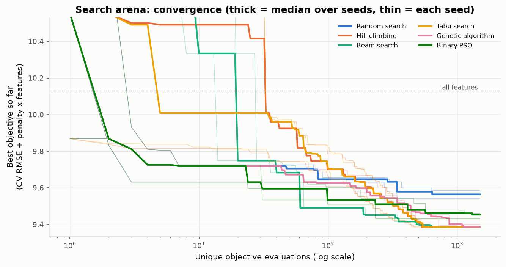

  *Figure 12.4: Best objective so far versus number of unique evaluations (log scale); the
  thick lines are medians over 3 seeds [`reports/figures/m4_convergence.png`]. How to read it:
  lower is better, and further left is faster. The dashed line is the "all features" objective.
  Random search (blue) flattens highest.*
- **A small held-out gain.** The selected 7 features give held-out RMSE 9.34, versus 9.47 with
  all 33 and 10.8 with arm only [`m4_selected_vs_all.csv`]. That is 0.13 letters, small
  compared with the fold-to-fold SD of CV RMSE (about 0.8–0.9 letters in M5,
  `m5_regression_comparison.csv`).
- **The subset is not stable at the edges.** Age, vision, ERM and prior PRP are selected in
  100% of the 18 runs. Hispanic is selected in 94%, race and female in 78%
  [`m4_selected_features.csv`].
- **M6 does not use the subset.** §14 reports what happens when it does
  (`reports/tables/m6_m4_subset_effect.csv`).

### 12.8 Limitations and caveats

- **The objective uses a linear Ridge model.** Features with non-linear or interaction effects
  (for example, a feature that only modifies the treatment effect) can be dropped even if they
  matter for M6's question. **Selecting features for *prediction* is not the same as selecting
  features for *treatment-effect heterogeneity*.**
- **Clinical sense.** Some selected features (race, Hispanic, female) are not obviously
  clinical. Their inclusion may reflect noise on a flat landscape (penalty 0.02 per feature).
  CST is *not* selected, although clinicians consider it central.
- **Single objective.** Each subset is evaluated once with fixed folds, so a subset can win by
  fold luck.

### 12.9 Plan vs reality

- README §4 lists M4 as "filter / embedded / wrapper; hill climbing, beam, tabu, GA, PSO". All
  are implemented as described, plus a random-search baseline.
- The README describes M4 as feeding M6 (README §4 pipeline arrow "M4 ─► M5 ─► M6"). In
  reality, the selected subset is **not** used by M5 or by the final M6 model. M6 only tests it
  as a side analysis.

### 12.10 Check yourself

1. **On the toy table, start hill climbing from 0101 (9.7). Where does it end?**
   - The neighbours of 0101 are 1101 (8.8), 0001 (10.1), 0111 (9.5) and 0100 (9.8). Move to
     1101.
   - The neighbours of 1101 are 0101 (9.7), 1001 (9.1), 1111 (8.9) and 1100 (8.6). Move to
     1100.
   - The neighbours of 1100 are all higher. It ends at the global optimum, 8.6.
2. **What is the objective value of a 10-feature subset with CV RMSE 9.30?**
   $9.30 + 0.02 \times 10 = 9.50$. That is worse than the 7-feature best (9.39), even though
   its CV RMSE is not much higher.
3. **Why did tabu search stop with "call cap … cycling"?** After it had evaluated most promising
   masks, every candidate move was already cached and cost no budget. So the budget never ran
   out, and the safety cap (20 × budget total calls) ended the run.

---

## 13. M5 Outcome models

### 13.1 The story

**What question does M5 answer?** "Given a patient's baseline profile and the drug they got, how
well can we *predict* their outcome after one year: letters gained, whether they gain ≥ 15
letters, whether they need rescue laser, and how many injections they need?"

This is ordinary supervised machine learning. We train many standard models, compare them
fairly with cross-validation, and score the winner once on the held-out test set. Think of
it as auditioning nine singers for one song, judged by the same five-judge panel.

Why does a causal project need prediction models?

1. **The building blocks.** Outcome models are the base learners inside every M6 causal
   learner (§14).
2. **The bundle.** The injection and laser models are used directly in the app's cost
   estimates (§16).
3. **A sense of scale.** M5 shows how much of the outcome *any* model can explain, which sets
   expectations for M6.

M5 trains on the 528 training patients, or the 490 of them with a week-52 outcome, and never
chooses anything with the test set.

### 13.2 Inputs → outputs

| Inputs | Outputs |
|---|---|
| training/test patients; `build_preprocessor(include_treatment=True)` | `reports/tables/m5_regression_comparison`, `m5_regression_full`, `m5_regression_best`, `m5_lasso_coefficients`, `m5_classification_gain15(_full)`, `m5_classification_laser_yr1(_full)`, `m5_class_weight_*`, `m5_count_comparison`, `m5_count_full`, `m5_count_dispersion`, `m5_knn_algorithms`, `m5_scratch_checks` |
| targets: `Y_va_change_wk52`, gain ≥ 15 (from it), `Y_laser_yr1`, `Y_n_inj_yr1` | `reports/figures/m5_regression_rmse.png`, `m5_regression_pred_vs_obs.png`, `m5_roc_pr_curves.png`, `m5_confusion_gain15.png`, `m5_confusion_laser_yr1.png` |
| `config/default.yaml: supervised.*` | `reports/metrics/m5_supervised.json`; MLflow experiment `equipoise-m5-supervised` with nested runs per model |

### 13.3 Concept cards: regression models

#### Concept card: baseline (arm-mean) model

**In plain words.** The simplest sensible guess: predict each patient's gain as the average gain
of their drug's arm in training. Any real model must beat this. A model that cannot is
useless, however clever.

**Technically.** $\hat y_i = \bar y_{\text{arm}(i)}$, computed on the training data
(`eq/supervised/scratch.py:ArmMeanRegressor`). The classification version predicts the arm's
event rate (`ArmRateClassifier`). `DummyClassifier(strategy="prior")` predicts the overall
rate.

**Tiny worked example.** If aflibercept patients gained 13 on average in training, every new
aflibercept patient is predicted 13.

**In Equipoise.** Week-52 letters: CV RMSE 10.906, test RMSE 10.8, test R² ≈ 0
[`reports/tables/m5_regression_comparison.csv`].

**Viva questions.** *Why does the baseline use the arm?* Because the outcome models also see the
arm. The question is what the *baseline features* add beyond knowing the drug.

#### Concept card: linear regression (OLS) and the normal equations

**In plain words.** Fit the best straight-line (flat-plane, in many dimensions) relationship
between the features and the outcome: each feature gets a weight, and the prediction is the
weighted sum plus a constant. "Best" means the smallest total squared error.

**Technically.** The model is $\hat y = \beta_0 + \sum_j \beta_j x_j = A\beta$, where $A$ is $X$
with a column of 1s added. OLS minimizes $\lVert y - A\beta\rVert^2$. Setting the gradient to
zero gives the **normal equations**:

$$A^\top A\,\beta = A^\top y$$

Assumptions (for valid inference, not for prediction): linearity, independent errors, constant
variance, and no perfect collinearity.

**Tiny worked example.** Points (1, 2), (2, 3), (3, 5). With an intercept,
$A^\top A = \begin{pmatrix}3 & 6\\6 & 14\end{pmatrix}$ and $A^\top y = (10, 23)$. Solving
gives $\beta_1 = 1.5$ and $\beta_0 = 0.333$, so $\hat y = 0.333 + 1.5x$.

**In Equipoise.** Two versions are fitted on the same full-rank design (`full_rank=True`):

- sklearn `LinearRegression`;
- `NormalEquationsRegressor` (from scratch, `np.linalg.solve`).

They match to $4.62\times10^{-14}$, with condition number 502 for 39 coefficients
[`reports/tables/m5_scratch_checks.csv`]. Both give CV RMSE 9.559 and test RMSE 9.5
[`m5_regression_comparison.csv`].

**Common confusions.** "Linear" means linear in the *coefficients*. You can still include $x^2$ or
logs as features.

**Viva questions.** *Why do OLS-sklearn and OLS-numpy give identical results?* Both solve the same
least-squares problem on the same design matrix. The match to $10^{-14}$ verifies our
implementation.

#### Concept card: regularization, Ridge (L2) and Lasso (L1)

**In plain words.** With many features and limited data, OLS weights can become large and
unstable as they chase noise. **Regularization** adds a penalty for large weights, like telling
a student "explain the data, but keep your theory simple".
- **Ridge** shrinks all weights a little.
- **Lasso** can shrink some all the way to zero, which removes those features.

**Technically.**

- **Ridge:** $\min_\beta \lVert y - A\beta\rVert^2 + \alpha\sum_{j\ge1}\beta_j^2$. Closed form:
  $(A^\top A + \alpha I)\beta = A^\top y$, with the intercept unpenalized.
- **Lasso:** $\min_\beta \frac{1}{2n}\lVert y - A\beta\rVert^2 + \alpha\sum_{j\ge1}|\beta_j|$.
  There is no closed form; it is solved by coordinate descent. The corners of the L1 penalty
  produce exact zeros.

A larger $\alpha$ gives more shrinkage, more bias and less variance (§5.4). `RidgeCV` and
`LassoCV` choose $\alpha$ by internal cross-validation on the training fold.

**Tiny worked example.** One standardized feature with $x^\top x = 10$ and $x^\top y = 5$:
- OLS: $\beta = 5/10 = 0.5$.
- Ridge with $\alpha = 10$: $\beta = 5/(10+10) = 0.25$.
- Lasso (with the same scaling convention): $\beta = \max(0, 5 - \alpha')/10$, which is exactly
  0 once $\alpha' \ge 5$.

**In Equipoise.**
- Ridge searches $\alpha \in \{0.01, 0.1, 1, 10, 100, 1000\}$ (`supervised.ridge_alphas`).
  Lasso tries 50 values with 5-fold CV (`lasso_n_alphas: 50`).
- **Lasso is the best regression model by CV**: CV RMSE 9.390, test RMSE 9.43, test R² 0.237.
  Ridge: CV 9.425, test 9.45 [`m5_regression_comparison.csv`; `m5_regression_best.csv`].
- Lasso's chosen α was 0.193. Its largest coefficients [`reports/tables/m5_lasso_coefficients.csv`]:
  - baseline vision −4.77 per SD;
  - age −1.86;
  - the aflibercept indicator +1.63;
  - Hispanic +1.56;
  - Black race −1.42.

**Common confusions.** Regularization requires standardized features. Otherwise the penalty hits
large-unit features differently. `build_preprocessor` standardizes.

**Viva questions.**
- *Why did Lasso beat OLS?* With 39 coefficients and 490 noisy outcomes, shrinking weak
  coefficients towards zero reduces variance more than it adds bias.
- *What does a Lasso coefficient of −4.77 for baseline vision mean?* One SD more baseline
  vision predicts 4.77 fewer letters gained, holding the others fixed. That is the ceiling
  effect.

#### Concept card: k-nearest neighbours (kNN) and KD-tree / ball-tree search

**In plain words.** To predict for a new patient, find the $k$ most similar training patients and
average their outcomes (regression) or let them vote (classification). There is no training
beyond storing the data. Finding the neighbours quickly is a data-structure problem.

**Technically.** $\hat y(x) = \frac1k\sum_{i\in N_k(x)} y_i$ with Euclidean distance. Neighbour
search:

- **brute force** computes all distances, $O(nd)$ per query;
- a **KD-tree** splits space along coordinate axes;
- a **ball tree** nests hyperspheres.

The trees help in low dimensions, but in high dimensions they degrade to brute force (the curse
of dimensionality).

**Tiny worked example.** Training gains for patients at distances 1, 2, 3, 4 from the query are
10, 14, 6, 20. With $k = 3$: $(10 + 14 + 6)/3 = 10$.

**In Equipoise.**
- $k = 15$ (`supervised.knn_neighbors`). kNN regression: CV RMSE 10.032, test 10.7, worse than
  the linear models [`m5_regression_comparison.csv`].
- `evaluate.py:knn_algorithm_timing` compares search algorithms on 490 × 44 data. All give
  identical predictions. **Brute force was fastest** (fit 0.664 ms, query 4.79 ms), versus
  KD-tree (4.87 / 11.5 ms) and ball tree (3.13 / 9.16 ms) [`reports/tables/m5_knn_algorithms.csv`;
  wall-clock, machine-dependent].

**Common confusions.** kNN imputation (§9) and the kNN model are different uses of the same idea.

**Viva questions.** *Why was brute force faster than the KD-tree?* In 44 dimensions with only 490
points, tree pruning rarely removes branches. The tree overhead costs more than it saves.

#### Concept card: decision tree

**In plain words.** A tree asks a sequence of yes/no questions ("Is baseline vision < 60?" "Is
age > 65?") and predicts the average outcome of the training patients who end up at the same
leaf. It is easy to read but unstable: a slightly different sample can grow a very different
tree.

**Technically.** Recursive binary splitting. At each node, choose the feature and threshold that
most reduce squared error (regression) or Gini impurity (classification):

- **Gini** $= 1 - \sum_c p_c^2$, where $p_c$ is the share of class $c$ at the node.

Growth stops at `max_depth` or when a leaf would have fewer than `min_samples_leaf` patients.

**Tiny worked example.** Gains: vision < 60 → (20, 18, 22); vision ≥ 60 → (5, 7, 6). The split at
60 gives leaf means 20 and 6, and squared error drops from 304 (around the overall mean 13) to
10.

**In Equipoise.** `max_depth: 4`, `min_samples_leaf: 20` (`supervised.tree`). Regression CV RMSE
10.483, the worst after the baseline [`m5_regression_comparison.csv`].

**Common confusions.** Trees do not need scaling, and they capture interactions automatically,
but a single tree overfits easily.

**Viva questions.** *Why did one tree do so badly?* High variance: with depth 4, each leaf averages
about 20–60 noisy outcomes, and the split points chase noise.

#### Concept card: random forest (bagging)

**In plain words.** Grow hundreds of different trees, each on a random resample of patients and
considering a random subset of features at each split, then average their predictions. The
crowd is wiser and steadier than any single tree.

**Technically.** **Bagging** (bootstrap aggregating) averages models fitted to bootstrap
samples, which reduces variance. Random forests also choose among a random fraction of features
at each split (`max_features`), which de-correlates the trees.

**Tiny worked example.** Three trees predict 12, 8 and 10, so the forest predicts 10.

**In Equipoise.** `n_estimators: 300`, `min_samples_leaf: 10`, `max_features: 0.33`. CV RMSE
9.714, test 9.61, R² 0.208: better than one tree, worse than Lasso
[`m5_regression_comparison.csv`]. RF importance is also used in M4 (§12) and as M6's surrogate
for effect importance (§14).

**Viva questions.** *Why is RF worse than Lasso here?* The signal is mostly linear (baseline vision,
age). RF's flexibility mainly fits noise with 490 patients.

#### Concept card: gradient boosting

**In plain words.** Build small trees one after another. Each new tree tries to fix the errors the
previous trees still make. A small **learning rate** means each tree only corrects a little,
which makes the ensemble more careful.

**Technically.** Start from $F_0 = \bar y$. For $m = 1, \dots, M$:

1. compute the residuals (the negative gradient of the loss) $r_i = y_i - F_{m-1}(x_i)$;
2. fit a small tree $h_m$ to them;
3. update $F_m = F_{m-1} + \eta\,h_m$, where $\eta$ is the learning rate.

`subsample < 1` gives *stochastic* gradient boosting.

**Tiny worked example.** $y = 10$, $F_0 = 8$, residual 2. A tree predicts 2, and $\eta = 0.1$
gives $F_1 = 8.2$. Each round closes 10% of the remaining gap.

**In Equipoise.**
- M5: `n_estimators: 200`, `learning_rate: 0.05`, `max_depth: 2`, `subsample: 0.8`. CV RMSE
  9.898, test 10.2, R² 0.0986 [`m5_regression_comparison.csv`]: it overfits here.
- Gradient boosting is also the default **base learner** in M6
  (`causal.base_learners.gb`), tuned there to learning rate 0.0118, depth 1, 343 trees
  [`m6_chosen_model.csv`].
- For injection counts, a `HistGradientBoostingRegressor(loss="poisson")` is used.

**Viva questions.** *What does the learning rate trade off?* A smaller rate needs more trees but
generalizes better; a larger rate fits faster and overfits sooner.

### 13.4 Concept cards: classification models

#### Concept card: logistic regression

**In plain words.** It predicts the *probability* of a yes/no outcome, such as "gains ≥ 15
letters". It computes a weighted sum like linear regression, then squeezes it through the
S-shaped **sigmoid** function so the answer lies between 0 and 1.

**Technically.**

$$P(y = 1 \mid x) = \sigma(\beta_0 + \beta^\top x), \qquad \sigma(z) = \frac{1}{1+e^{-z}}$$

The linear part is the **log-odds**: $\log\frac{p}{1-p}$. The model is fitted by maximum
likelihood (minimizing log-loss), with an L2 penalty controlled by `C` (sklearn), where a
larger `C` means less penalty.

**Tiny worked example.** $\beta_0 = -1$ and $\beta_1 = 0.5$. For $x = 4$: $z = 1$, so
$p = 1/(1+e^{-1}) = 0.73$.

**In Equipoise.**
- **Gain ≥ 15 letters** (training prevalence 0.335 [`reports/metrics/m5_supervised.json`]):
  logistic regression has CV AUC 0.792, **test AUC 0.811**, test PR-AUC 0.755
  [`reports/tables/m5_classification_gain15_full.csv`].
- **Laser in year 1** (prevalence 0.443): test AUC 0.578, versus 0.565 for the arm-rate
  baseline [`m5_classification_laser_yr1_full.csv`]. Laser is barely predictable.

**Viva questions.** *Why is "gain ≥ 15" predictable but laser not?* Gaining 15 letters depends
strongly on baseline vision (room to improve). Laser depended on persistent edema at week 24
and on clinician judgement, which baseline features capture poorly.

#### Concept card: logistic regression by Newton–Raphson (IRLS), from scratch

**In plain words.** To find the best logistic weights, Newton's method uses the slope (gradient)
and the curvature (Hessian) of the log-likelihood to jump straight towards the peak. Each jump
turns out to be a weighted least-squares fit, hence "iteratively reweighted least squares".

**Technically.** With $p = \sigma(A\beta)$ and $W = \text{diag}(p(1-p))$:

- gradient $g = A^\top(y - p)$;
- Hessian of the negative log-likelihood $H = A^\top W A$;
- update $\beta \leftarrow \beta + H^{-1}g$, solved with `np.linalg.solve`.

Start from $\beta = 0$ and stop when $\max|\text{step}| < $ `tol` (`IRLSLogisticRegression.fit`).
Convergence is quadratic near the optimum.

**Tiny worked example (one feature, no intercept, one step from $\beta = 0$).** Data
$x = (1, -1)$, $y = (1, 0)$.

- $p = (0.5, 0.5)$, so $g = 1\cdot0.5 + (-1)(-0.5) = 1$.
- $H = 0.25 + 0.25 = 0.5$.
- So $\beta_1 = 0 + 1/0.5 = 2$.

**In Equipoise.** `supervised.irls: {max_iter: 50, tol: 1e-8}`. It converged in **7 iterations**
(gain ≥ 15) and **5** (laser), matching statsmodels `Logit` to $1.26\times10^{-15}$ and
$4.44\times10^{-16}$ [`reports/tables/m5_scratch_checks.csv`]. Its test AUC for gain ≥ 15 is
0.813 [`m5_classification_gain15_full.csv`].

**Common confusions.** sklearn's `LogisticRegression` is penalized (`C = 1`), while the IRLS version
is unpenalized. That is why their numbers differ slightly. The IRLS version needs a full-rank
design (`full_rank=True`).

**Viva questions.** *Why Newton rather than gradient descent for logistic regression?* With 39
coefficients, the Hessian is small, so each Newton step is cheap and convergence takes a
handful of iterations instead of hundreds.

#### Concept card: Naive Bayes (Gaussian and Bernoulli)

**In plain words.** Use Bayes' rule (§6.3) to compute "probability of gaining ≥ 15 given these
features", with a bold simplification: pretend the features are independent within each class.
It is fast and needs little data, but the independence assumption is usually wrong.

**Technically.**

$$P(c \mid x) \propto P(c)\prod_j P(x_j \mid c)$$

- **GaussianNB** models each $x_j \mid c$ as a normal distribution.
- **BernoulliNB** binarizes the features (`binarize=0.0`: positive vs non-positive after
  standardizing) and models each as a coin flip.

**Tiny worked example.** $P(\text{gain}) = 0.33$. $P(\text{poor vision} \mid \text{gain}) = 0.7$,
$P(\text{poor vision} \mid \text{no gain}) = 0.4$. Then
$P(\text{gain} \mid \text{poor}) = \frac{0.7\times0.33}{0.7\times0.33 + 0.4\times0.67} = 0.46$.

**In Equipoise.** For gain ≥ 15: GaussianNB test AUC 0.696, BernoulliNB 0.736
[`m5_classification_gain15_full.csv`]. For laser, **BernoulliNB had the highest test AUC (0.605)**
of all models, but within noise of the others [`m5_classification_laser_yr1_full.csv`].

**Viva questions.** *Why is it called "naive"?* It assumes every feature is independent of every
other within a class. Systolic and diastolic BP, for example, clearly are not.

### 13.5 Concept cards: count models

#### Concept card: Poisson regression (GLM) and dispersion

**In plain words.** Injection counts are whole numbers ≥ 0. Poisson regression models the
*average count* as $e^{\text{weighted sum}}$, which is always positive, and treats each
patient's count as a Poisson draw around that average.

**Technically.** $\log E[Y \mid x] = \beta_0 + \beta^\top x$, with $Y \sim \text{Poisson}$. This is a
**generalized linear model (GLM)** with a log link. It is fitted by maximum likelihood with a
small L2 penalty (`poisson_alpha: 1e-4`). The Poisson assumption is $\text{Var}(Y) = E[Y]$. The
**Pearson dispersion** statistic $\frac{1}{n-p}\sum\frac{(y - \hat\mu)^2}{\hat\mu}$ checks it:

- ≈ 1: Poisson fits;
- > 1: overdispersed;
- < 1: underdispersed.

**Tiny worked example.** $\hat\mu = 9$ and $y = 12$ contribute $(3)^2/9 = 1$ to the dispersion sum.

**In Equipoise.** Year-1 injections [`reports/tables/m5_count_comparison.csv`]:

| Model | Test MAE | Test RMSE | Test Poisson deviance |
|---|---|---|---|
| Arm-mean baseline | 1.9 | 2.24 | 0.557 |
| Poisson GLM | **1.73** | 2.05 | 0.47 |
| Gradient boosting (Poisson loss) | 1.81 | 2.16 | 0.522 |

The dispersion is **0.625**: *less* variable than Poisson. The table's note says the counts
"are bounded by the visit schedule" [`m5_count_dispersion.csv`]. The M6 bundle uses an injection
model like this for the cost estimates (§14).

**Common confusions.** Underdispersion means the Poisson model *overstates* uncertainty here. The
point predictions are still fine.

**Viva questions.** *Why not ordinary linear regression for counts?* It could predict negative
counts and assumes constant variance. Poisson regression guarantees positive means and has
variance that grows with the mean.

### 13.6 Concept cards: evaluation

#### Concept card: regression metrics (MSE, RMSE, MAE, R²)

**In plain words.**
- **MAE**: the average size of the errors, in letters.
- **RMSE**: similar, but punishes big errors more.
- **R²**: the share of the outcome's variation the model explains. 0 is no better than
  predicting the mean; 1 is perfect.

**Technically.**

$$\text{MSE} = \tfrac1n\sum(y_i - \hat y_i)^2, \quad \text{RMSE} = \sqrt{\text{MSE}}, \quad \text{MAE} = \tfrac1n\sum|y_i - \hat y_i|, \quad R^2 = 1 - \frac{\sum(y_i - \hat y_i)^2}{\sum(y_i - \bar y)^2}$$

**Tiny worked example.** Errors 2, −2, 4:
- MAE $= 8/3 = 2.67$;
- RMSE $= \sqrt{24/3} = 2.83$.
- If the outcomes' variance is 16, then $R^2 = 1 - 8/16 = 0.5$.

**In Equipoise.** The best test RMSE is 9.43 (Lasso) versus 10.8 for the baseline. The test R²
of 0.237 means about a quarter of the variance is explained [`m5_regression_comparison.csv`].
Typical errors stay around 9–10 letters, about two chart lines.

**Viva questions.** *Is RMSE 9.4 letters good?* It is about 1.4 letters better than knowing only
the arm. But it is still about two chart lines of error per patient, which shows how noisy
individual vision outcomes are.

#### Concept card: confusion matrix and classification metrics

**In plain words.** A **confusion matrix** counts four kinds of results: true positives (said yes,
was yes), false positives (said yes, was no), true negatives and false negatives. Every metric
is a ratio of these four counts.

**Technically.** With TP, FP, TN and FN:

| Metric | Formula |
|---|---|
| Accuracy | $(TP+TN)/n$ |
| Precision (PPV) | $TP/(TP+FP)$ |
| Recall (sensitivity) | $TP/(TP+FN)$ |
| Specificity | $TN/(TN+FP)$ |
| F1 | $2\cdot\frac{P\cdot R}{P+R}$, the harmonic mean of precision and recall |

The class is decided at threshold 0.5 (`supervised.classification_threshold`).

**Tiny worked example.** TP 30, FP 10, TN 70, FN 16:
- accuracy $100/126 = 0.794$;
- precision $0.75$;
- recall $0.652$;
- specificity $0.875$;
- F1 $= 2(0.75)(0.652)/(1.402) = 0.698$.

**In Equipoise.** Gain ≥ 15, logistic regression on the test set: accuracy 0.786, precision 0.744,
recall 0.63, specificity 0.875, F1 0.682 [`m5_classification_gain15.csv`].

The baselines show why accuracy alone misleads. The majority-class baseline gets accuracy 0.635
by always saying "no", with recall 0 [`m5_classification_gain15.csv`].

**Common confusions.** Precision and recall trade off: lowering the threshold raises recall and
lowers precision.

**Viva questions.** *Your majority baseline has 63.5% accuracy. Is that good?* No. It never
predicts a gain (recall 0). Accuracy is misleading when classes are unbalanced. Use AUC, F1 or
recall.

#### Concept card: ROC curve, AUC and the precision–recall curve

**In plain words.** Instead of one threshold, try them all.
- The **ROC curve** plots the true-positive rate against the false-positive rate. **AUC** (area
  under it) is the probability that a random positive patient gets a higher score than a
  random negative one: 0.5 is a coin flip, 1 is perfect.
- The **precision–recall curve** focuses on the positive class. Its area (average precision,
  PR-AUC) is compared with the prevalence.

**Technically.** For thresholds $t$: TPR$(t)$ = recall and FPR$(t) = 1 -$ specificity.
AUC $= P(\hat p_+ > \hat p_-)$. Average precision $= \sum_k (R_k - R_{k-1})P_k$.

**Tiny worked example.** Scores: positives 0.9 and 0.6; negatives 0.7 and 0.2. Of the four
positive–negative pairs, the positive is higher in 3: (0.9 > 0.7), (0.9 > 0.2), (0.6 > 0.2). So
AUC $= 3/4 = 0.75$.

**In Equipoise.**

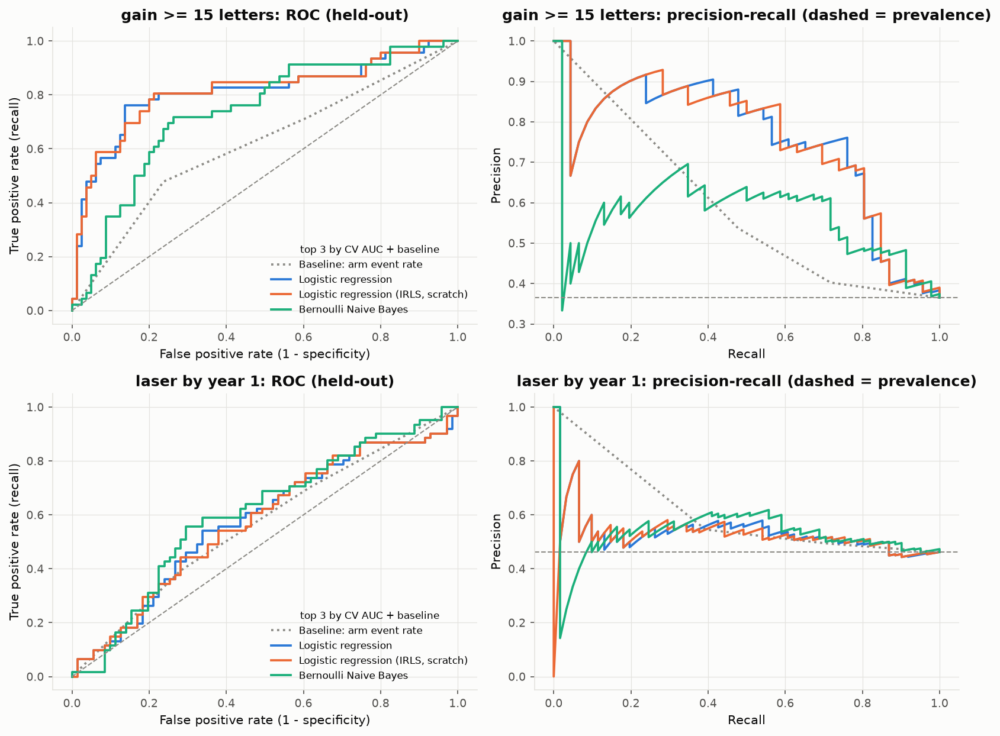

*Figure 13.1: Held-out ROC (left) and precision–recall (right) curves for gain ≥ 15 (top) and
laser by year 1 (bottom). The three models with the best CV AUC are shown, plus the arm-rate
baseline [`reports/figures/m5_roc_pr_curves.png`]. How to read it: the closer a ROC curve hugs
the top-left corner, the better, and the diagonal is chance. For gain ≥ 15 the logistic models
reach AUC about 0.81. For laser all curves stay close to the diagonal (AUC about 0.55–0.6).*

**Common confusions.** AUC measures *ranking*, not calibration. A model can rank well and still
give wrong probabilities.

**Viva questions.** *Why show PR curves too?* When positives are a minority, PR curves show how
precise the model is at useful recall levels. The dashed line marks the prevalence that random
guessing would achieve.

#### Concept card: class imbalance and class weights

**In plain words.** When one class is rarer (33.5% gain ≥ 15), a model can look good by
favouring the common class. **Class weights** make mistakes on the rare class count more in
training.

**Technically.** `class_weight="balanced"` weights class $c$ by $n/(K\cdot n_c)$, where $K$ is the
number of classes and $n_c$ the size of class $c$.

**Tiny worked example.** With 100 patients, 25 positive: the positive weight is
$100/(2\cdot25) = 2$ and the negative weight $100/(2\cdot75) = 0.67$.

**In Equipoise.** For gain ≥ 15, balancing raised logistic CV recall from 0.49 to 0.642, lowered
precision from 0.652 to 0.548, and left AUC almost unchanged (0.792 → 0.796)
[`reports/tables/m5_class_weight_gain15.csv`].

**Viva questions.** *Does class weighting improve AUC?* Not much. It mainly moves the operating point
(recall vs precision at threshold 0.5). Ranking quality is similar.

### 13.7 Code walkthrough

`eq/supervised/run.py:run` builds four tasks and calls `evaluate` for each:

1. **Regression:** 9 models on `Y_va_change_wk52`.
2. **Classification:** 8 models on gain ≥ 15, plus the class-weight variants.
3. **Classification:** the same models on `Y_laser_yr1`.
4. **Counts:** 3 models on `Y_n_inj_yr1`.

It also runs `normal_equations_check`, `irls_check` and `knn_algorithm_timing`.

**The evaluation loop** (`eq/supervised/evaluate.py:evaluate`, abridged):

```python
tr = train.dropna(subset=[y_col]).reset_index(drop=True)      # complete cases only
folds = list(cv_folds(tr, cfg.n_folds, cfg.seed))              # 5 folds stratified by arm
for name, model in models.items():
    for i_tr, i_va in folds:
        m = clone(model).fit(tr.iloc[i_tr], y_tr[i_tr])        # preprocessing refit per fold
        fold_scores.append(_score(kind, y_tr[i_va], _predict(m, tr.iloc[i_va], kind), cfg))
    final = clone(model).fit(tr, y_tr)                         # refit on all training patients
    held = _score(kind, y_te, _predict(final, te, kind), cfg)  # scored once on the test set
```

- Every model is a `Pipeline(build_preprocessor(...), estimator)` (`models.py:_pipe`), so
  `clone(model).fit` re-learns the imputation, scaling and encoding inside each fold.
- `clone` starts each fit from a clean, unfitted copy.
- The held-out score is computed for reporting, but the "best" model is picked by CV
  (`m5_regression_best.csv`: "best_by_cv").

**Config keys.** The `supervised.*` block:

| Key | Value |
|---|---|
| `knn_neighbors` | 15 |
| `knn_timing_repeats` | 7 |
| `tree` | `{max_depth: 4, min_samples_leaf: 20}` |
| `random_forest` | `{300, 10, 0.33}` |
| `gradient_boosting` | `{200, 0.05, 2, 0.8}` |
| `ridge_alphas` | as above |
| `lasso_n_alphas` | 50 |
| `logistic_C` | 1.0 |
| `irls` | as above |
| `classification_threshold` | 0.5 |
| `poisson_alpha` | 1e-4 |
| `hist_gb_poisson` | `{200, 0.05, 3, 20}` |
| `one_hot_min_frequency` | 10 |

Also `preprocess.gain_threshold_letters: 15`.

### 13.8 Run it yourself (synthetic data)

```bash
python -m equipoise supervised --synthetic
```

Verified for this handbook (first lines of its output):

```
[supervised] running on synthetic data ...
  reg_baseline_cv_rmse: 10.58
  reg_best_cv_rmse: 9.278
```

The other metrics (AUCs, count MAE) follow. Synthetic outputs go to `reports/synthetic/`.
`tests/test_supervised.py` checks the scratch estimators against numpy/statsmodels and confirms
the pipelines see only baseline columns plus treatment.

### 13.9 What we found (real data)

| Task | Best model (by CV) | Test result | Baseline test | Source |
|---|---|---|---|---|
| Week-52 letters | Lasso | RMSE 9.43, R² 0.237 | RMSE 10.8 | `m5_regression_comparison.csv` |
| Gain ≥ 15 letters | Logistic regression (CV AUC 0.792) | AUC 0.811 | arm rate 0.614 | `m5_classification_gain15_full.csv` |
| Laser in year 1 | Logistic regression (CV AUC 0.598) | AUC 0.578 | arm rate 0.565 | `m5_classification_laser_yr1_full.csv` |
| Year-1 injections | Poisson GLM | MAE 1.73 | 1.90 | `m5_count_comparison.csv` |

*Note:* for laser, the arm-rate baseline's CV AUC (0.596) is almost the same as logistic
regression's (0.598) [`m5_classification_laser_yr1.csv`].

**What this means:**
- Baseline features predict vision gains moderately well, mainly through baseline vision and age.
- They hardly predict laser.
- The simple linear models win, a sign that there is little non-linear signal to find with 490
  patients.

`m5_regression_pred_vs_obs.png` plots individual held-out patients, so it is not embedded here.
`m5_regression_rmse.png` (bar chart of CV and test RMSE per model) and the two confusion-matrix
figures are aggregate and can go straight into the report.

### 13.10 Limitations and caveats

- Complete cases only: 490 of 528 training patients for vision outcomes.
- The test set is small (126–132), so test metrics have wide uncertainty. Gain ≥ 15 AUC 0.811
  vs 0.813 is a tie.
- `IRLSLogisticRegression.predict` hard-codes a 0.5 threshold instead of reading
  `supervised.classification_threshold`. Metrics are unaffected, because `evaluate` thresholds
  probabilities itself (listed in §28).
- No random forest or gradient boosting is run for the classification tasks.

### 13.11 Plan vs reality

- README §4 lists "trees, RF, gradient boosting" for M5. These are run for **regression**.
  Classification uses logistic regression (two kinds), kNN, a single tree and the two Naive
  Bayes variants.
- README §9.2's numbers match the generated tables: Lasso test RMSE 9.43, R² 0.24 (rounded
  from 0.237); gain ≥ 15 AUC 0.81; laser 0.58 vs 0.57 (rounded from 0.565); injection MAE 1.73
  vs 1.90.

### 13.12 Check yourself

1. **TP = 20, FP = 20, TN = 60, FN = 26. Compute precision, recall and specificity.**
   Precision 20/40 = 0.5; recall 20/46 = 0.435; specificity 60/80 = 0.75.
2. **Why is the injection model's dispersion of 0.625 plausible?** Injections were scheduled every
   4 weeks with mandatory injections early on, so counts are squeezed into a narrow range (the
   year-1 IQR is 8–11 [`m2_replication_burden.csv`]). That is less spread than a Poisson
   distribution with the same mean.
3. **One IRLS step: $x = (2, -2)$, $y = (1, 0)$, $\beta = 0$, no intercept. New $\beta$?**
   $p = (0.5, 0.5)$; $g = 2(0.5) + (-2)(-0.5) = 2$; $H = 4(0.25) + 4(0.25) = 2$;
   $\beta = 2/2 = 1$.

---

## 14. M6 Counterfactual engine (the core)

### 14.1 The story

**What question does M6 answer?** "For *this* patient, how many more letters would aflibercept
(or ranibizumab) give than bevacizumab, how sure are we, and how do we know the method works,
given that a patient's outcome under the drugs they did not receive is never observed?"

Chapter 03 set up the idea. M6 is where it is computed:

1. **Fit** eleven ways of estimating per-patient effects (the "learners") on the training
   patients.
2. **Test** each learner on fake-but-realistic data where the true effects are known (the
   semi-synthetic benchmark), and **choose** one by a rule fixed in advance.
3. **Check** the chosen learner on held-out patients with methods that need no counterfactuals:
   policy value, calibration by tertile, and rediscovery of the published subgroup.
4. **Quantify** uncertainty per patient by refitting it 200 times on resampled data (the
   bootstrap).
5. **Save** everything the app needs in one model bundle.

An analogy: imagine choosing a weather-forecasting method for your town when you can never
check tomorrow's weather. You would test each method in a flight simulator with known weather,
pick the most reliable one, and then check that its forecasts are at least sensible in real
life. That is what M6 does with drug effects.

### 14.2 Inputs → outputs

| Inputs | Outputs |
|---|---|
| training complete cases (490), held-out complete cases (126) via `eq/causal/data.py:prepare` (preprocessor fitted on training) | `models/equipoise_bundle.joblib` (registered in MLflow as `equipoise-cate`) |
| known propensities (224/660, 218/660, 218/660) | `reports/tables/m6_*` (19 tables: learner effects, PEHE, selection, tuning, policies, calibration, rediscovery, uncertainty, M4 subset, AutoGluon, chosen model) |
| `config/default.yaml: causal.*`, `effects.mcid_letters`, `bootstrap.n_reps` | `reports/figures/m6_tarnet_optimizers.png`, `m6_semisynthetic_pehe.png`, `m6_tuning.png`, `m6_policy_values.png`, `m6_calibration_*.png`, `m6_effect_distribution.png` |
| `config/costs.yaml` (DEMO prices) for the cost-aware policy | `data/derived/m6_heldout_effects.csv` (patient-level, never committed) |
| `reports/tables/m4_selected_features.csv` (side analysis) | `reports/metrics/m6_causal.json`; MLflow experiment `equipoise-m6-causal` |

Arms are coded bevacizumab = 0, aflibercept = 1, ranibizumab = 2 (`arm_codes`: reference
first). Every learner outputs two effects per patient: aflibercept − bevacizumab and
ranibizumab − bevacizumab.

### 14.3 The learners

Notation for this chapter:

- $X$: preprocessed baseline features (42 columns);
- $T \in \{0,1,2\}$: arm code;
- $Y$: observed week-52 letters gained;
- $e_a = P(T = a)$: the known propensity;
- $\mu_a(x) = E[Y \mid X = x, T = a]$: the outcome surface of arm $a$;
- $\tau_a(x) = \mu_a(x) - \mu_0(x)$: the CATE of arm $a$ versus bevacizumab (§3.6).

**The running example** is the six-patient table from §3.4. The true effects are
$(8, 7, 5, 1, 0, 1)$ and the true mean is 3.67. The observed data are P1 Afl 18, P2 Bev 12,
P3 Afl 14, P4 Bev 8, P5 Afl 7, P6 Bev 6, with baseline vision 50, 55, 60, 70, 72, 75. The
learners below use straight lines as base learners. Every number comes from
`python scripts/handbook/six_patients.py` (invented data).

#### Concept card: S-learner ("single model")

**In plain words.** Train **one** model that takes the patient's features *and* the drug as
inputs. To get a patient's effect, ask the model twice: "what if this patient got Eylea?" and
"what if they got Avastin?", and subtract.

**Technically.** Fit $\hat\mu(x, t)$ on all patients, then

$$\hat\tau_a(x) = \hat\mu(x, a) - \hat\mu(x, 0)$$

The treatment is just one more feature. A regularized or tree base learner may **ignore** it,
which shrinks effects towards 0 (a bias towards "no effect").

**Tiny worked example (six patients).** The least-squares fit is
$Y = 35.566 - 0.4035\,\text{VA} + 1.912\,T$. With a linear model and no interaction term, the
effect is the coefficient of $T$, **1.91 for every patient**. That gives a mean of 1.91
(truth 3.67) and PEHE 3.60. **It cannot vary by patient.**

**In Equipoise.** `EconMLMeta(kind="S")` wraps econml's `SLearner(overall_model=m)` with
$m$ = gradient boosting or Ridge (`eq/causal/learners.py`).

- **S-learner (Ridge)** behaves exactly like the toy: its training effect SD is
  $7.64\times10^{-15}$ (constant), so it is **excluded** as "effect identical for every
  patient by construction".
- **S-learner (GB)** is excluded for average-effect bias of 1.61 letters, above the 1.0 limit.

[`reports/tables/m6_learner_selection.csv`] On held-out patients, S-learner (GB) predicts a
mean aflibercept effect of only 1.64 letters [`reports/tables/m6_learner_effects_heldout.csv`].
That is the shrinkage towards 0.

**Common confusions.** A low PEHE for the S-learner in the null scenario (1.43 for Ridge) is
expected: a constant estimate is right when the truth is constant.

**Viva questions.** *Why was the S-learner (Ridge) excluded even though its PEHE looks good?*
Its effect is the same for everyone by construction. A model that cannot vary by patient
cannot do per-patient recommendation, which is the point of the project.

#### Concept card: T-learner ("two models")

**In plain words.** Train a **separate** model for each drug, each only on the patients who got
that drug. A patient's effect is the difference between the two models' predictions for them.

**Technically.** $\hat\mu_a$ is fitted on $\{i : T_i = a\}$, and
$\hat\tau_a(x) = \hat\mu_a(x) - \hat\mu_0(x)$. It is flexible, but each model sees only about a
third of the data, and the *difference* of two noisy models is noisier still. With noisy
outcomes, the T-learner tends to invent heterogeneity.

**Tiny worked example (six patients).** $\hat\mu_1 = 43.500 - 0.5027\,\text{VA}$ (Afl) and
$\hat\mu_0 = 28.154 - 0.2923\,\text{VA}$ (Bev). The effects are
$(4.82, 3.77, 2.72, 0.62, 0.19, -0.44)$: large for poor vision, about 0 for good vision. That
is the right *shape*, with PEHE 2.16. P6's effect is estimated slightly *negative*, a noise
artefact.

**In Equipoise.** `TLearner(models=m)`. Results:

- **PEHE.** 7.54 (GB) and 7.22 (Ridge) letters in the null scenario, where the truth has *no*
  heterogeneity.
- **False heterogeneity.** It "found" heterogeneity in **100%** of null replications
  [`reports/tables/m6_semisynthetic_pehe.csv`].
- **Held-out spread.** The predicted aflibercept effect has SD **6.0** letters across patients
  (GB) [`m6_learner_effects_heldout.csv`]. That spread is mostly noise.

**Common confusions.** "More flexible = better" fails here. Each arm model fits its own noise,
and their difference amplifies it.

**Viva questions.** *Why does the T-learner find heterogeneity where there is none?* Each arm's
model has errors of several letters (outcome noise SD about 12 letters). Subtracting two
independent noisy predictions gives individual "effects" that vary a lot even when the true
effect is constant.

#### Concept card: X-learner

**In plain words.** First do a T-learner. Then, for each treated patient, **impute** their
individual effect as "what they actually got minus what the *other* arm's model predicts
for them". Do the same for the controls. Train a second-stage model to predict these imputed
effects from the features, and blend the two second-stage models.

**Technically.**

1. **Stage 1.** Fit $\hat\mu_0$ and $\hat\mu_1$, as in the T-learner.
2. **Stage 2.** Impute effects:
   - treated: $D^1_i = Y_i - \hat\mu_0(x_i)$;
   - controls: $D^0_i = \hat\mu_1(x_i) - Y_i$.

   Fit $\hat\tau_1$ on $(x, D^1)$ among the treated and $\hat\tau_0$ on $(x, D^0)$ among the
   controls.
3. **Combine.** $\hat\tau(x) = g(x)\hat\tau_0(x) + (1-g(x))\hat\tau_1(x)$, with $g$ the
   propensity. Here $g$ is the **known** constant (`propensity_model=KnownPropensity(...)`).

The X-learner helps most when arms are unbalanced.

**Tiny worked example (six patients).**
- Imputed effects: treated P1, P3, P5 have $D^1 = (4.46, 3.38, -0.11)$; controls P2, P4, P6
  have $D^0 = (3.85, 0.31, -0.21)$.
- With $g = 0.5$ and straight-line second stages, the result is **exactly the T-learner's**
  $(4.82, 3.77, 2.72, 0.62, 0.19, -0.44)$.

That is not a coincidence. When the base learners are straight lines fitted by least squares,
the second stage just reproduces the first-stage difference. The learners only differ with
flexible or regularized base learners, unequal arms, or non-constant weights.

**In Equipoise.** `XLearner(models=m, cate_models=clone(m), propensity_model=KnownPropensity)`.

- Null PEHE: 6.02 (GB) and 6.55 (Ridge), better than the T-learner but still finding false
  heterogeneity in 100% of null replications [`m6_semisynthetic_pehe.csv`].
- Held-out aflibercept effect SD: 4.97 (GB) [`m6_learner_effects_heldout.csv`].

**Viva questions.** *What is the X-learner's advantage over the T-learner?* It borrows strength
across arms (each imputed effect uses the other arm's model) and weights the two estimates. That
helps most when one arm is small. Our arms are almost equal (≈1:1:1), so the gain is modest.

#### Concept card: DR-learner (doubly robust)

**In plain words.** Build, for every patient, a "noisy but unbiased" estimate of their effect
(a **pseudo-outcome**). It combines the outcome models' guess with a correction from the
patient's actual result, weighted by the inverse of the probability of the drug they got.
Then regress these pseudo-outcomes on the features. It is called "doubly robust" because the
average stays right if *either* the outcome models *or* the propensities are right. Ours are
known exactly.

**Technically.** With cross-fitted $\hat\mu_a$ (fitted on other folds, `cv=5`):

$$\phi_i = \hat\mu_1(x_i) - \hat\mu_0(x_i) + \frac{\mathbb{1}[T_i = 1]}{e_1}(Y_i - \hat\mu_1(x_i)) - \frac{\mathbb{1}[T_i = 0]}{e_0}(Y_i - \hat\mu_0(x_i))$$

Then fit $\hat\tau$ by regressing $\phi$ on $x$ (`model_final`). $E[\phi \mid x] = \tau(x)$ when
the propensities are correct. But dividing by $e \approx 0.33$ **triples** each residual, so
$\phi$ is very noisy.

**Tiny worked example (six patients, $e = 0.5$, no cross-fitting).** The pseudo-outcomes are
$(4.10, 3.93, 4.05, 0.00, -0.41, 0.02)$. Regressing them on vision with a straight line again
reproduces the T-learner's effects (PEHE 2.16), for the same linear-smoother reason.

**In Equipoise.** `DRLearner(model_propensity=KnownPropensity, model_regression=m,
model_final=clone(m), cv=5)`.

- **Worst PEHE of all learners**: 9.08 (GB) and 8.76 (Ridge) in the null scenario
  [`m6_semisynthetic_pehe.csv`].
- Held-out aflibercept effect SD: 6.64 (GB) [`m6_learner_effects_heldout.csv`].

**Common confusions.** Doubly robust protects the *average* against model misspecification. It
does not make *individual* estimates precise. The inverse weights add variance.

**Viva questions.** *Why did the DR-learner, the "theoretically best" learner, do worst?* Its
pseudo-outcomes divide residuals of about 12 letters by propensities of about 0.33, so each
patient's pseudo-outcome is extremely noisy. With 370 fitting patients, the final regression
cannot average that noise away.

#### Concept card: the constant-effect yardstick

**In plain words.** The humblest estimate: give everyone the average trial difference. Any
"personalized" learner must beat this, or personalization is adding only noise.

**Technically.** $\hat\tau_a(x) = \bar Y_{T=a} - \bar Y_{T=0}$ for every $x$
(`learners.py:ConstantEffect`).

**Tiny worked example.** Six patients: $(18 + 14 + 7)/3 - (12 + 8 + 6)/3 = 13 - 8.67 = 4.33$
for everyone, giving PEHE $\sqrt{\text{mean}((4.33 - \text{truth})^2)} = \sqrt{61.98/6} \approx 3.21$.

**In Equipoise.** PEHE 1.19 (null), 2.88 (published-like), 2.51 (nonlinear). It beats every
heterogeneous learner except the causal forest in the published-like and nonlinear scenarios,
and the S-learners. It is excluded from selection because it is constant
[`m6_learner_selection.csv`]. On held-out patients it gives 3.90 letters for aflibercept and
2.26 for ranibizumab to everyone [`m6_learner_effects_heldout.csv`].

**Viva questions.** *Why keep a model you can never choose?* As a yardstick. If the chosen learner
cannot beat "everyone gets the average", its personalization is noise. The causal forest beats
it only slightly: worst case 2.80 vs 2.88.

#### Concept card: causal forest (intuitively, then technically)

**In plain words (intuition).** A normal decision tree splits patients into groups with
different *outcomes*. A causal tree splits them into groups with different *treatment
effects*: "patients with thick retinas seem to gain more from Eylea than from Avastin". A
causal forest grows hundreds of such trees on random subsamples and averages them. Two tricks
keep it honest:

- **Honesty.** Each tree uses one half of its sample to decide *where* to split and the
  *other* half to estimate the effects in the leaves. The tree cannot fool itself with noise
  it chose to split on.
- **Residualization (DML).** Before looking for effect differences, it removes everything the
  baseline features predict about the outcome. The trees then focus only on how the drug
  changes things, not on "who would do well anyway".

Because each leaf averages many patients and the forest averages many trees, its estimates are
**smooth and cautious**. It only shows differences that survive averaging.

**Technically.** econml's `CausalForestDML` implements the generalized random forest of Athey,
Tibshirani & Wager in a double machine learning (DML) frame:

1. **Residualize with cross-fitting** (`cv=5`): $\tilde Y = Y - \hat m(X)$, where
   $\hat m(x) = E[Y \mid X = x]$ comes from `model_y` (gradient boosting), and
   $\tilde T = \mathbb{1}[T = a] - \hat e_a(X)$, where $\hat e$ comes from `model_t`. Here
   $\hat e$ is the **known propensity** (`KnownPropensity`), so $\tilde T$ is exact.
2. **Solve a local moment equation.** For a target $x$, the forest defines similarity weights
   $\alpha_i(x)$: how often patient $i$ falls in the same leaf as $x$. It then solves
   $\sum_i \alpha_i(x)\,(\tilde Y_i - \tau(x)\tilde T_i)\tilde T_i = 0$, which is a locally
   weighted regression of $\tilde Y$ on $\tilde T$.
3. **Grow honest trees** with splits chosen to maximize heterogeneity in $\tau$, using
   subsampling. Asymptotic normality gives **confidence intervals** (`effect_interval`).

Settings: `n_estimators=500`, `min_samples_leaf=10`, `max_depth=None` (`causal.causal_forest`).

**Tiny worked example (intuition).** Suppose the residualized data show treated-minus-expected
outcomes of about +6 among poor-vision patients and +1 among good-vision patients. A split at
vision < 65 separates them. With only 6 patients per leaf, though, the honest half might show
+4 and +2. The forest averages many such trees, so the estimate stays modest.

**In Equipoise.**
- **Chosen learner.** PEHE 1.80 (null), 2.80 (published-like), 2.44 (nonlinear). It found false
  heterogeneity in **0%** of null replications. Its maximum |ATE bias| was 0.49
  [`m6_semisynthetic_pehe.csv`; `m6_learner_selection.csv`].
- **Held-out effects.** The mean aflibercept effect is 3.17 letters with SD 1.24 across
  patients: 3.76 for baseline < 69 and 2.59 for ≥ 69 [`m6_learner_effects_heldout.csv`].
- **Intervals.** Its own forest confidence intervals have median width 6.4 letters (aflibercept)
  and 5.6 (ranibizumab) [`reports/tables/m6_uncertainty_summary.csv`].

**Common confusions.**
- A causal forest's intervals are about the *conditional average* effect $\tau(x)$, not the
  outcome of one person.
- The app uses **bootstrap** intervals (§14.6), not the forest's own intervals.

**Viva questions.**
- *Why did the causal forest win?* It was the only heterogeneous learner whose PEHE stayed close
  to the constant yardstick in every scenario, and it never invented heterogeneity in the null
  scenario. Honest splitting and heavy averaging make it conservative, and that is exactly
  what 490 noisy patients need.
- *What does "DML" add?* It removes the predictable part of $Y$ (and of $T$) before estimating
  the effect. Errors in those nuisance models then affect the effect estimate only to second
  order, and cross-fitting stops overfitting from leaking in.

#### Concept card: neural networks from scratch (neuron, layer, activation, forward pass)

**In plain words.**
- A **neuron** takes some numbers, multiplies each by a weight, adds them up with a bias, and
  passes the result through a simple bend (the **activation**).
- A **layer** is many neurons side by side.
- A **network** stacks layers, so the output of one feeds the next.

Stacking bends lets the network draw curved relationships that a straight line cannot. The
**forward pass** means pushing an input through the layers to get an output.

**Technically.** A dense (fully connected) layer computes $h = \sigma(Wx + b)$, where:

- $W$ is a weight matrix (out × in);
- $b$ is a bias vector;
- $\sigma$ is applied element-wise.

TARNet uses **ELU** (exponential linear unit): $\sigma(z) = z$ for $z > 0$ and $e^z - 1$ for
$z \le 0$. It is smooth, and it avoids "dead" neurons that ReLU can produce. The forward pass
composes the layers: $\hat y = f_L(\dots f_2(f_1(x)))$.

**Tiny worked example.** One neuron with weights $(0.5, -1)$ and bias 0.2, input $(2, 1)$:
$z = 0.5\cdot2 - 1\cdot1 + 0.2 = 0.2$, and ELU$(0.2) = 0.2$. With input $(0, 1)$:
$z = -0.8$, and ELU $= e^{-0.8} - 1 = -0.551$.

**In Equipoise.** `eq/causal/tarnet.py:TARNet` builds `nn.Linear` → `nn.ELU` → `nn.Dropout`
blocks with PyTorch.

**Viva questions.** *Why an activation function at all?* Without it, stacked linear layers collapse
into one linear map. The non-linearity is what makes depth useful.

#### Concept card: training a network (loss, backpropagation, epochs, batches, learning rate, early stopping, regularization)

**In plain words.**
- **Loss.** A number saying how wrong the network is; here, the mean squared error in letters
  (standardized).
- **Backpropagation.** Uses the chain rule (§6.4) to work out, for every weight, which way to
  nudge it to reduce the loss.
- **Optimizer.** Makes the nudge. The **learning rate** sets how big a nudge is.
- **Batches and epochs.** Instead of the whole dataset at once, the network learns from small
  **batches** (64 patients). One pass over all training patients is an **epoch**.
- **Early stopping.** We watch the loss on held-aside validation patients, and stop when it
  has not improved for 25 epochs, keeping the best weights. This prevents memorizing noise.
- **Dropout and weight decay.** Extra brakes on overfitting.

**Technically.**
- **Mini-batch gradient descent.** For each batch $B$: compute $L_B(\theta)$ (forward pass),
  then $\nabla_\theta L_B$ (`loss.backward()`, reverse-mode automatic differentiation), then
  update $\theta$ (`optimizer.step()`).
- **Dropout($p$).** During training, randomly zeroes a fraction $p$ of activations
  (here 0.1), so neurons cannot co-adapt.
- **Weight decay.** Adds $\lambda\lVert\theta\rVert^2$, implemented as $\theta \leftarrow \theta
  - \eta\lambda\theta$ in the update (here $10^{-4}$).
- **Early stopping.** Patience 25, maximum 300 epochs; the validation split is 20%, stratified
  by arm.
- **Outcome scaling.** Outcomes are standardized with the fitting part's mean and SD, then
  un-scaled at prediction (`potential_outcomes`).

**Tiny worked example.** 392 fitting patients (80% of 490) in batches of 64 gives 7 batches per
epoch (the last holds 8), so 7 weight updates per epoch.

**In Equipoise.** `train_tarnet`:
- shuffles the fitting indices with a seeded NumPy generator each epoch;
- slices batches by hand;
- computes the validation loss under `torch.no_grad()`;
- copies the best `state_dict`.

Config (`causal.tarnet`): `shared: [64, 64]`, `head: [32]`, `dropout: 0.1`,
`weight_decay: 1e-4`, `batch_size: 64`, `max_epochs: 300`, `patience: 25`,
`validation_fraction: 0.2`.

**Viva questions.** *What does early stopping protect against, and what did it do here?* Overfitting:
training loss keeps falling while validation loss rises. Here the best validation epoch came
very early (epoch 1–7; §14.3 next card), showing the network had little generalizable signal
to learn.

#### Concept card: TARNet (shared representation + one head per drug)

**In plain words.** TARNet is a neural network with a shared "trunk" and three "heads". The trunk
learns a compact description of the patient that is useful whatever drug they get. Each head
predicts the outcome under one drug. A patient trains **only the head of the drug they actually
received**, because we only know that outcome. To get the effect, read both heads and subtract.

**Technically.** For TAR-Net (treatment-agnostic representation network), the representation
is $\Phi(x)$ = two dense layers of 64 (ELU, dropout). The heads are
$h_a(\Phi)$ = dense 32 (ELU) → 1, for $a = 0, 1, 2$. The **factual loss** on a batch is

$$L = \frac{1}{|B|}\sum_{i\in B}\big(h_{T_i}(\Phi(x_i)) - y_i\big)^2$$

Only the factual head enters (`factual_loss`: `out[torch.arange(len(idx)), Tt[idx]]`). The
effect is $\hat\tau_a(x) = h_a(\Phi(x)) - h_0(\Phi(x))$, un-standardized.

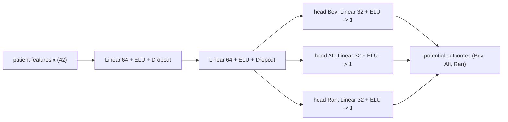

**Tiny worked example.** A patient who got Avastin has outcome 10. The network outputs
$(9, 12, 11)$. The loss uses only $(9 - 10)^2 = 1$. The gradients update the trunk and the
Avastin head; the Eylea and Lucentis heads are untouched by this patient.

**In Equipoise.** The `TARNet (best optimizer)` learner enters the benchmark. **RMSprop** was best
by validation loss.

- PEHE 4.37 (null), 5.28 (published-like), 4.64 (nonlinear).
- It found false heterogeneity in **90%** of null replications.
- It was a "candidate" in selection but not chosen [`m6_semisynthetic_pehe.csv`,
  `m6_learner_selection.csv`].
- On held-out patients its mean aflibercept effect is only 1.19 letters
  [`m6_learner_effects_heldout.csv`].

**Common confusions.** TARNet without a balancing penalty is not CFRNet. With randomized
treatment, balancing is unnecessary anyway.

**Viva questions.** *Why does TARNet need one head per drug instead of feeding treatment as an
input?* With the treatment as just one input among 42 (S-learner style), a network can learn to
ignore it. Separate heads force a separate outcome function per drug, while the shared trunk
still pools information across all patients.

#### Concept card: optimizers, SGD vs momentum vs RMSprop vs Adam

**In plain words.** All four use the gradient to decide which way to step. They differ in *how
big* a step to take and how they smooth noisy gradients.
- **SGD** takes a fixed-size step down the current slope.
- **Momentum** remembers past steps, like a rolling ball, so it speeds up on consistent slopes
  and damps zig-zags.
- **RMSprop** gives each weight its own step size, shrinking steps for weights whose gradients
  are large and noisy.
- **Adam** combines momentum and RMSprop, with a correction for the first few steps.

**Technically.** With gradient $g_t$ and learning rate $\eta$:

| Optimizer | Update | Project setting |
|---|---|---|
| SGD + momentum | $v_t = \beta v_{t-1} + g_t$; $\theta_t = \theta_{t-1} - \eta v_t$ | $\eta = 0.01$, $\beta = 0.9$ |
| RMSprop | $s_t = \rho s_{t-1} + (1-\rho)g_t^2$; $\theta_t = \theta_{t-1} - \eta\, g_t/(\sqrt{s_t} + \epsilon)$ | $\eta = 0.001$, $\rho = 0.99$ (PyTorch default) |
| Adam | $m_t = \beta_1 m_{t-1} + (1-\beta_1)g_t$; $s_t = \beta_2 s_{t-1} + (1-\beta_2)g_t^2$; $\hat m_t = m_t/(1-\beta_1^t)$, $\hat s_t = s_t/(1-\beta_2^t)$; $\theta_t = \theta_{t-1} - \eta\,\hat m_t/(\sqrt{\hat s_t}+\epsilon)$ | $\eta = 0.001$, $\beta_1 = 0.9$, $\beta_2 = 0.999$ (defaults) |

(`causal.tarnet.learning_rates`, `momentum`; `_make_optimizer`.) All three also apply weight
decay $10^{-4}$.

**Tiny worked example (one weight, gradient $g = 2$ at every step).**
- **SGD+momentum.** Step 1: $v = 2$, move $-0.02$. Step 2: $v = 0.9\cdot2 + 2 = 3.8$, move
  $-0.038$. It accelerates.
- **RMSprop.** Step 1: $s = 0.01\cdot4 = 0.04$, move $-0.001\cdot2/0.2 = -0.01$. The step is
  normalized by the gradient's size.
- **Adam.** Step 1: $\hat m = 2$ and $\hat s = 4$, so the move is $-0.001\cdot2/2 = -0.001$.
  The first step equals the learning rate, whatever the gradient's scale.

**In Equipoise.** The three optimizers were trained from **identical initial weights, splits and
batches** (same seed) [`reports/tables/m6_tarnet_optimizers.csv`]:

| Optimizer | Epochs run | Best epoch | Best validation loss | Final training loss |
|---|---|---|---|---|
| SGD | 32 | 7 | 0.542 | 0.521 |
| Adam | 30 | 5 | 0.542 | 0.52 |
| RMSprop | 26 | 1 | 0.541 | 0.515 |

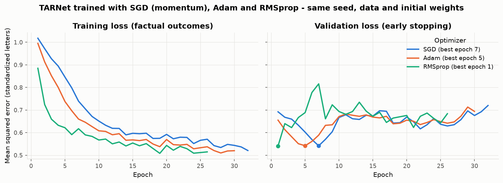

*Figure 14.1: Training (left) and validation (right) loss per epoch for the three optimizers
[`reports/figures/m6_tarnet_optimizers.png`]. How to read it: training loss keeps falling for
all three. Validation loss reaches its minimum within the first 1–7 epochs, then rises, which
is classic overfitting. RMSprop drops fastest in training and hits its best validation loss
after one epoch. All three end at nearly the same best validation loss (about 0.54 in
standardized units).*

**Common confusions.** A faster-falling *training* loss is not better. Here the optimizer that
fits fastest (RMSprop) overfits soonest. The three best validation losses are practically
identical.

**Viva questions.**
- *Which optimizer is best here?* They tie on best validation loss (0.541–0.542). RMSprop was
  picked by the code (lowest by 0.001), but the difference is meaningless. The data limit
  performance, not the optimizer.
- *Why does Adam's first step equal the learning rate?* Its bias-corrected first and second
  moments are $g$ and $g^2$ at step 1, so the ratio is ±1 times η.

#### Concept card: AutoGluon as a T-learner base model (AutoML)

**In plain words.** AutoML tries many model types automatically and stacks the best. Here it
replaces the hand-picked outcome model inside a T-learner: one AutoGluon run per drug.

**Technically.** `AutoGluonTLearner` fits `TabularPredictor(problem_type="regression",
eval_metric="rmse", presets="medium_quality", time_limit=120 s)` per arm and takes the
difference of the predictions (`eq/causal/automl.py`). It is compared on **one** replication
of the published-like scenario.

**Tiny worked example.** If AutoGluon's Eylea model predicts 15 and its Avastin model 11 for a
patient, the effect is 4.

**In Equipoise.** On one published-like replication, PEHE was:

| T-learner base model | PEHE |
|---|---|
| AutoGluon | 5.41 |
| tuned GB | **4.77** |
| default GB | 8.38 |
| Ridge | 8.61 |

[`reports/tables/m6_autogluon_comparison.csv`] AutoGluon's held-out "most letters" policy
value is 14.9. For the bevacizumab arm, its own best model was a weighted ensemble with
validation RMSE 9.14 [`reports/tables/m6_autogluon_leaderboard.csv`].

**Viva questions.** *Did AutoML help?* Not for the causal question. It is still a T-learner, so it
inherits the T-learner's noise problem. The tuned GB T-learner did better on this one
replication.

### 14.4 How do we evaluate effects we can never observe?

#### Concept card: cross-fitting

**In plain words.** When one model's predictions are used as inputs to another estimate (as in
the DR-learner or the causal forest's residuals), those predictions must come from a model that
did **not** see that patient. Otherwise the patient's own noise leaks in. Split the data into
folds, and predict each fold with a model trained on the others.

**Technically.** For $K$ folds, the nuisance $\hat\eta^{(-k)}$ is fitted on all folds except $k$
and used only for observations in fold $k$. This removes the "own-observation" bias and keeps
DML estimators valid with flexible models.

**Tiny worked example.** With 2 folds: fit on fold A, predict fold B; fit on fold B, predict
fold A. Every patient gets an out-of-fold prediction.

**In Equipoise.** `causal.cv_folds: 5` for `DRLearner(cv=5)` and `CausalForestDML(cv=5)`. M9
also uses 5-fold cross-fitting for out-of-sample subgroup predictions (§17).

**Viva questions.** *Is cross-fitting the same as cross-validation?* Same mechanics, different
purpose. CV *scores* a model. Cross-fitting *produces* out-of-sample nuisance predictions to
plug into a second-stage estimate.

#### Concept card: the semi-synthetic benchmark and PEHE

**In plain words.** We can't check a learner on real patients because the true individual effects
are unknown. So we build a **realistic simulator**:

1. Keep the real patients' features.
2. Make up an outcome rule close to reality, fitted to the real data.
3. **Choose** the true drug effects ourselves.
4. Re-randomize the drugs and generate outcomes with realistic noise.

Now every learner can be scored against a truth we know. We use three scenarios:

- **(a) null**: everyone has the same effect (catches learners that invent heterogeneity);
- **(b) published-like**: aflibercept helps more when vision < 69;
- **(c) nonlinear**: a smooth, complicated effect pattern.

**Technically** (`eq/causal/semisynth.py`):

- **Base surface.** $f_0$ is a Ridge model (α = 10) fitted on the training **bevacizumab**
  patients and applied to everyone. The noise SD is the SD of $f_0$'s 5-fold cross-validated
  residuals: **12.1 letters** [`reports/tables/m6_semisynthetic_setup.csv`].
- **Simulation.** $Y(a) = f_0(X) + \tau_a(X) + \varepsilon$, with
  $\varepsilon \sim N(0, 12.1^2)$ and $T$ drawn with the known propensities.
- **Scenario effects** (`causal.semi_synthetic`):
  - (a) Afl 3.9, Ran 1.8 for everyone;
  - (b) Afl 7.1 / Ran 2.4 if vision < 69, else Afl 0.5 / Ran 0.8;
  - (c) Afl $= 8\,\sigma\!\left(\frac{60 - \text{VA}}{4}\right)\cdot\frac{1 + \tanh(z_{\text{CST}})}{2} + 3\cdot\mathbb{1}[\text{HbA1c} > 8.5]$,
    and Ran $= 0.4 \times$ Afl.
- **Scoring.** Each of 10 replications holds out 25% of training patients for scoring
  (`eval_fraction`) and fits on the rest. The main score is the **PEHE**:

$$\text{PEHE} = \sqrt{\frac{1}{n}\sum_{i}(\hat\tau(x_i) - \tau(x_i))^2}$$

  averaged over both comparisons. Also recorded:
  - **ATE bias** = mean(estimated) − mean(true);
  - the **tertile gap**: mean estimated effect in the top third of patients minus the bottom
    third. "Finds heterogeneity" if the gap > MCID (5 letters).

**Tiny worked example.** The six-patient T-learner estimates $(4.82, 3.77, 2.72, 0.62, 0.19, -0.44)$
against truth $(8, 7, 5, 1, 0, 1)$. The squared errors are 10.1, 10.4, 5.2, 0.14, 0.04, 2.1,
with mean 4.67, so PEHE $= 2.16$ letters.

**In Equipoise.** The mean PEHE over 10 replications [`m6_semisynthetic_pehe.csv`]:

| Learner | Null | Published-like | Nonlinear | False heterogeneity in null |
|---|---|---|---|---|
| Constant effect (yardstick) | 1.19 | 2.88 | 2.51 | 0% |
| S-learner (Ridge) | 1.43 | 2.50 | 2.30 | 0% |
| **Causal forest** | **1.80** | **2.80** | **2.44** | **0%** |
| S-learner (GB) | 1.92 | 2.65 | 2.21 | 0% |
| TARNet (RMSprop) | 4.37 | 5.28 | 4.64 | 90% |
| X-learner (GB) | 6.02 | 5.91 | 6.09 | 100% |
| X-learner (Ridge) | 6.55 | 6.47 | 6.07 | 100% |
| T-learner (Ridge) | 7.22 | 7.11 | 6.70 | 100% |
| T-learner (GB) | 7.54 | 7.38 | 7.50 | 100% |
| DR-learner (Ridge) | 8.76 | 8.62 | 8.48 | 100% |
| DR-learner (GB) | 9.08 | 9.36 | 9.33 | 100% |

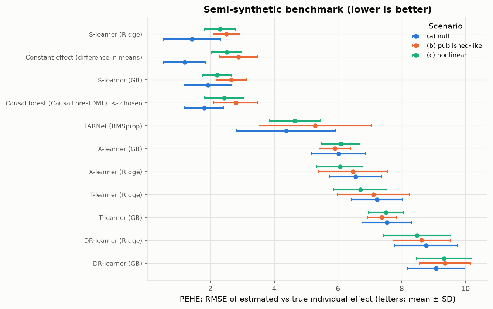

*Figure 14.2: Mean PEHE per learner in each scenario [`reports/figures/m6_semisynthetic_pehe.png`].
How to read it: shorter bars are better. The constant-effect bar is the yardstick, and any
learner longer than it is worse than "give everyone the average".*

**Common confusions.** The semi-synthetic truth is only as realistic as the simulator. It tests
learners under *assumed* effect patterns with the *real* features and noise level. It does not
reveal the real per-patient effects.

**Viva questions.** *How do you evaluate counterfactual predictions you can't observe?* (1) A
semi-synthetic benchmark with the real features, a real noise level and planted effects. (2)
Policy value on real held-out patients via IPW, which needs only observed outcomes and known
propensities. (3) Rediscovery of the known published subgroup. Each check is partial; together
they constrain the method.

#### Concept card: the learner-selection rule

**In plain words.** We wrote down *before looking at test results* how the final learner would be
chosen:

1. Drop learners that cannot vary by patient.
2. Drop learners that get the *average* effect wrong by more than 1 letter in any scenario.
3. Among the rest, pick the one whose *worst* scenario is least bad.

**Technically** (`eq/causal/run.py:select_learner`; `causal.selection`):

1. Exclude if the training-patient effect SD ≤ $10^{-6}$ (`constant_effect_sd`).
2. Exclude if max |ATE bias| over scenarios > 1.0 letters (`max_abs_ate_bias`).
3. Choose the minimum of the **worst-case PEHE** = max over scenarios (`criterion:
   worst_case_pehe`).

It never uses test-set outcomes.

**Tiny worked example.** Learner A has PEHE (2, 3, 2), so its worst case is 3. Learner B has
(1, 4, 1), worst case 4. The rule picks A, even though B is better on average.

**In Equipoise** [`m6_learner_selection.csv`; `m6_chosen_model.csv`]:

- The constant effect and S-learner (Ridge) are excluded as constant.
- S-learner (GB) is excluded for bias (1.61).
- Among the 8 candidates, **causal forest** has the lowest worst-case PEHE: **2.80**. The next is
  TARNet at 5.28.

**Viva questions.** *Why worst-case rather than average PEHE?* We do not know which scenario
resembles reality. Choosing the learner that is never badly wrong is the safer decision rule.

#### Concept card: policy value by inverse probability weighting (IPW) and AIPW

**In plain words.** A **policy** is a rule that picks a drug for each patient, for example "everyone
gets Eylea" or "Eylea if vision < 69, else Avastin". Its **value** is the average letters gained
*if everyone followed the rule*. We can estimate this from the trial without any counterfactuals:

- look at the patients who happened to get the drug the rule would have given them;
- because each of them only had about a one-in-three chance of that drug, count each one about
  three times (inverse probability weighting).

Randomization makes this fair.

**Technically.**

$$\hat V_{\text{IPW}}(\pi) = \frac1n\sum_i \frac{\mathbb{1}[T_i = \pi(x_i)]}{e_{T_i}}\,Y_i$$

This is unbiased because $e$ is known. The **doubly robust (AIPW)** version adds an outcome model:

$$\hat V_{\text{AIPW}} = \frac1n\sum_i\Big[\hat\mu_{\pi(x_i)}(x_i) + \frac{\mathbb{1}[T_i = \pi(x_i)]}{e_{T_i}}\big(Y_i - \hat\mu_{T_i}(x_i)\big)\Big]$$

It is usually less noisy. $\hat\mu$ here is the tuned per-arm GB outcome models, fitted on
training patients (`eq/causal/policy.py`). 95% intervals come from 200 percentile-bootstrap
resamples of held-out patients (`bootstrap.n_reps`).

**Tiny worked example.** Six patients with $e = 0.5$; policy "everyone Afl". The followers are
P1, P3 and P5, with outcomes 18, 14, 7. Then
$\hat V = \frac16\left(\frac{18}{0.5} + \frac{14}{0.5} + \frac{7}{0.5}\right) = 13$. That equals
the Afl arm mean, as it should.

**In Equipoise.** On 126 held-out complete cases [`reports/tables/m6_policy_values.csv`]:

| Policy | IPW (95% CI) | AIPW (95% CI) | Patients following |
|---|---|---|---|
| All bevacizumab | 11.7 (8.1–17.1) | 11.1 (8.33–14.5) | 44 |
| All aflibercept | 14.9 (9.65–20.7) | 14.6 (11.5–17.7) | 41 |
| All ranibizumab | 11.2 (7.63–15.0) | 11.7 (9.83–14.0) | 41 |
| Published rule (< 69 → aflibercept) | 15.7 (10.8–21.7) | 14.2 (10.8–17.9) | 47 |
| Model: most letters (causal forest) | 14.9 (9.86–21.0) | 14.6 (11.5–18.2) | 41 |
| Model: letters − λ × cost (DEMO prices) | 14.6 (9.93–20.5) | 12.9 (9.48–17.1) | 45 |

The model's "most letters" policy gives **everyone aflibercept** (share 1.0), because every
patient's estimated aflibercept effect is positive and larger than ranibizumab's. So it equals
"All aflibercept". **All intervals overlap.** On 126 patients, no policy can be distinguished from
another.

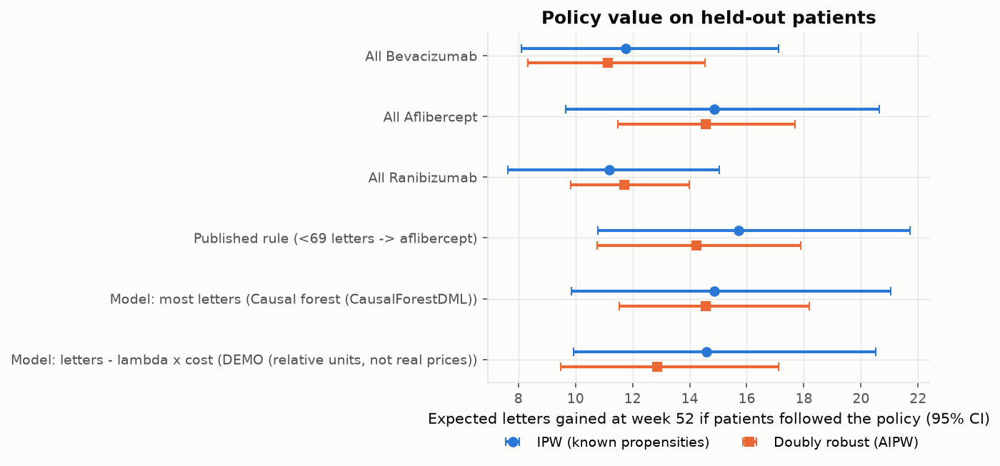

*Figure 14.3: IPW and AIPW policy values with bootstrap 95% CIs [`reports/figures/m6_policy_values.png`].
How to read it: further right means more letters gained if everyone followed the rule. The bars
overlap heavily, so the data cannot rank these policies.*

**Common confusions.**
- AIPW intervals are narrower than IPW, but still overlap.
- The policy values for *other* learners (`m6_policy_values_by_learner.csv`) range from 14.6 to
  17.2. The DR-learner (GB), the *worst* by PEHE, has the highest IPW value, 17.2 (12.1–22.4).
  That shows why selection must **not** use test-set policy values: with 126 patients they are
  too noisy, and choosing on them would be tuning on the test set.

**Viva questions.** *Why is IPW unbiased here?* Because the propensities are the true
randomization probabilities. Weighting each follower by $1/e$ exactly re-creates the population
that would have resulted if everyone had received the policy's drug.

#### Concept card: bootstrap intervals and P(benefit > MCID)

**In plain words.** To see how much a patient's estimated effect might wobble, refit the whole
learner 200 times. Each time, use a slightly different random resample of the training patients
(some patients picked twice, some left out). The spread of the 200 estimates for the same patient
is our uncertainty. The share of the 200 that exceed 5 letters is reported as "P(benefit > MCID)".

**Technically.** In the **within-arm** bootstrap (`_bootstrap`), each resample draws, with
replacement, as many patients from each arm as it had, which keeps the arm sizes. Then:

- **interval**: the 2.5th and 97.5th percentiles of the 200 effect estimates;
- **P(benefit > MCID)**: the fraction of estimates above 5.

The bundle keeps 50 of these refits for the app (`causal.bundle_bootstrap_models: 50`). The
report uses all 200 (`causal.bootstrap_reps: 200`).

**Tiny worked example.** 10 bootstrap estimates for one patient: 1.8, 2.5, 2.9, 3.0, 3.1, 3.3,
3.6, 4.0, 4.4, 5.2. The middle 80% runs from about 2.5 to 4.4. The share above 5 is 0.1.

**In Equipoise** [`reports/tables/m6_uncertainty_summary.csv`]:

| Comparison | Median bootstrap interval width | Intervals excluding 0 | P(> MCID) > 0.8 | Mean P(> MCID) |
|---|---|---|---|---|
| Aflibercept − bevacizumab | 4.46 | 69.8% | 0% | 0.0958 |
| Ranibizumab − bevacizumab | 4.23 | 12.7% | 0% | 0.00794 |

For **100%** of held-out patients, the interval includes values below the MCID.

**Common confusions.**
- "P(benefit > MCID)" is a bootstrap *frequency*, not a Bayesian probability. It is a useful
  summary of estimation uncertainty, not of the patient's chance of benefiting.
- The bootstrap captures *estimation* uncertainty. It does not capture model misspecification.

**Viva questions.** *Why resample within each arm?* So every bootstrap dataset keeps the trial's
arm sizes. A plain resample could, by chance, contain few bevacizumab patients and distort the
effects.

#### Concept card: calibration by predicted-effect tertile

**In plain words.** If the model says "these patients benefit most", do they really? Split
held-out patients into thirds by *predicted* effect. Within each third, compare the actual
outcomes of those who got Eylea with those who got Avastin. That comparison is fair because of
randomization. A well-calibrated model shows larger observed differences in the higher thirds.

**Technically.** Tertile cut points come from the held-out predicted effects. Within each
tertile, the Welch difference of observed $Y$ between arm $a$ and bevacizumab, with a 95% CI
(`run.py:_calibration`).

**Tiny worked example.** If the predicted effects are low / middle / high = 1, 3, 5 and the
observed differences are 0, 4, 8, the model ranks patients correctly, although it is too
cautious in size.

**In Equipoise** [`reports/tables/m6_calibration_aflibercept.csv`]:

| Tertile | Mean predicted | Observed Afl − Bev (95% CI) | Patients (Afl / Bev) |
|---|---|---|---|
| low | 1.83 | −0.105 (−5.29 to 5.08) | 14 / 15 |
| middle | 3.07 | 4.48 (−4.79 to 13.7) | 12 / 14 |
| high | 4.61 | 8.4 (−2.37 to 19.2) | 15 / 15 |

The observed differences **rise in the right order**, but each tertile has only 12–15 patients
per arm, so every interval includes 0.

For ranibizumab there is no ordering: 3.8, −5.33, 1.55
[`m6_calibration_ranibizumab.csv`].

**Viva questions.** *Is the model calibrated?* For aflibercept, the ranking looks right (observed
differences increase from the low to the high tertile). But with 42 patients per tertile, it is
not statistically demonstrated. For ranibizumab, there is no evidence of useful ranking.

#### Concept card: rediscovery check and surrogate importance

**In plain words.** A trustworthy model should, without being told, rediscover what the trial
already proved: Eylea's advantage is larger for poorer starting vision. We also ask which
features drive the model's estimates, using a "surrogate" random forest that is trained to
mimic the model's estimated effects.

**Technically.**
- **Rediscovery.** Mean predicted aflibercept effect for held-out patients with `X_va_below_69 = 1`
  versus 0.
- **Surrogate.** `RandomForestRegressor(300 trees, min_samples_leaf=10)` fitted on (training X,
  predicted aflibercept effect). Its impurity importances are summed per raw feature
  (`_importance_rank`). The "top driver" check passes if the top feature is baseline vision.

**In Equipoise** [`reports/tables/m6_rediscovery.csv`, `m6_effect_importance_aflibercept.csv`]:

- Held-out: 3.76 (< 69) vs 2.59 (≥ 69), which **passes**. Training: 3.57 vs 2.46, which also
  passes.
- Top driver: **CST** (importance 0.699), then baseline vision (0.109) and log UACR (0.0654).
  The top-driver check **fails**.

**Common confusions.** CST and baseline vision are correlated (thicker retina, worse vision), so
the forest may route the vision signal through CST. Failing the top-driver check does not mean
the model ignores vision.

**Viva questions.** *Your model's top driver is CST, not vision. Is it wrong?* Not necessarily.
The direction of the vision effect is rediscovered (3.76 vs 2.59). The forest's splits prefer
CST, which is correlated with vision and itself predicts response. We report the failed check
honestly instead of hiding it.

#### Concept card: hyperparameter tuning, grid vs Optuna (TPE) vs PSO

**In plain words.** The base outcome model (gradient boosting) has knobs: learning rate, depth,
leaf size and number of trees. Three tuners get the same 30 tries to find the best setting:
- **grid search** tries a fixed lattice;
- **Optuna TPE** learns which regions look promising and samples there;
- **PSO** flies a swarm through the space (§12.4).

**Technically.** The objective is the 5-fold CV RMSE of per-arm GB outcome models, T-learner
style, on training patients (`eq/causal/tuning.py:make_objective`). The search space:

- learning_rate log-uniform on [0.01, 0.3];
- max_depth in {1, …, 4};
- min_samples_leaf in {5, …, 60};
- n_estimators in {50, …, 400}.

**TPE** (Tree-structured Parzen Estimator) models $p(\theta \mid \text{good})$ and
$p(\theta \mid \text{bad})$ with density estimates, and proposes the $\theta$ maximizing their
ratio. **PSO** runs in a unit-free box, with log scale for the learning rate (`decode`, `box`),
using 6 particles (`causal.tuning.pso_particles`). The **grid** takes the first 30 points of a
3 × 3 × 2 × 2 = 36-point factorial lattice.

**Tiny worked example.** If the grid's best is lr 0.05 with depth 1, TPE may notice that the
low-lr, depth-1 trials score well and focus there, finding lr 0.0118.

**In Equipoise** [`reports/tables/m6_tuning_summary.csv`]:

| Tuner | Best CV RMSE | Best setting |
|---|---|---|
| Default config | 10.2 | n/a |
| Grid search | 9.93 | lr 0.05, depth 1, leaf 10, 100 trees |
| **Optuna (TPE)** | **9.86** | **lr 0.0118, depth 1, leaf 23, 343 trees** |
| PSO | 9.87 | lr 0.0116, depth 1, leaf 14, 399 trees |

All three agree that **depth 1** (stumps) works best, a sign of little interaction structure.

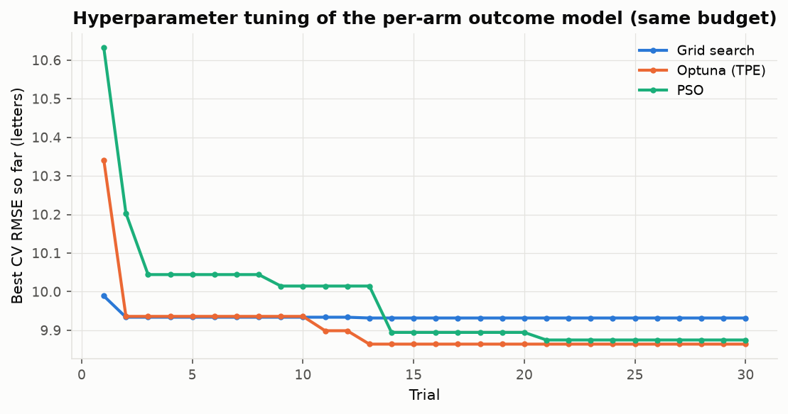

*Figure 14.4: Best CV RMSE so far after each trial [`reports/figures/m6_tuning.png`]. How to read
it: lower is better. Optuna gets close to its best after about 13 trials, PSO after 21. The grid
stalls because its lattice does not contain small learning rates.*

**Viva questions.** *Where are the tuned parameters used?* In the per-arm outcome models (the
bevacizumab baseline letters in the app and the AIPW $\hat\mu$), and in meta-learners when one of
them is chosen. The **chosen causal forest's `model_y` uses the untuned config GB**
(`learners.py:CausalForest.fit` calls `base_learner("gb", cfg)`). See Plan vs reality.

### 14.5 Why the model says "no clear winner" for every held-out patient, and why that is valid

For all 132 held-out patients, the app's rule (§3.8: claim a clear benefit only if the *whole*
95% interval is at or above 5 letters) gives "no clear winner" at MCID 5, and also at MCID 3
[`reports/tables/m8_heldout_no_clear_winner.csv`; `m8_population_summary.csv`]. Here is why.

1. **The estimated benefits are modest.** The median estimated aflibercept benefit is 3.1
   letters, with a range of 0.719 to 6.21 [`m8_heldout_no_clear_winner.csv`]. Even the point
   estimates rarely reach 5 letters.
2. **The uncertainty is wide compared with the benefit.** The median 95% interval width is 4.47
   letters [`m8_heldout_no_clear_winner.csv`]. The highest lower bound for any patient is 2.41
   letters, below 5 and below 3.
3. **The data are noisy.** Individual letter changes have a residual SD of about 12 letters
   [`m6_semisynthetic_setup.csv`], and 490 patients split three ways give about 160 per arm to
   learn from.
4. **The chosen learner is cautious by design.** It was chosen *because* it does not invent
   heterogeneity (0% false heterogeneity in the null scenario). A learner that produced big,
   confident per-patient differences, such as the T-learner (SD 6.0 letters across patients),
   was shown by the benchmark to be mostly noise.

**Why this is defensible:**

- It is an honest answer to the question asked. The trial supports the published subgroup
  difference, about 7 letters below 69 versus about 1 letter above
  [`m2_replication_tests.csv`]. It does not support finer per-patient predictions.
- It agrees with independent checks: overlapping policy values, calibration intervals that
  include 0, and the trial's own interaction finding.
- The app does not stop at "no clear winner". It shows the estimated size of the benefit, the
  published rule (`expert.py` rules `published-subgroup*` and `model-vs-published`), and, with
  real prices, the cost trade-off.
- CLAUDE.md requires this honesty: "No heterogeneity or no gain over baseline is a legitimate
  finding; report it plainly."

**What would change it?** More patients (narrower intervals), a lower MCID (not sufficient
here: 3 letters still gives 100% equipoise), a looser decision rule (for example, point
estimate > MCID; more recommendations, but more wrong ones), or stronger effect modifiers
measured at baseline.

### 14.6 Code walkthrough

`eq/causal/run.py:run`, in the order the code executes:

1. **TARNet optimizer comparison.** `train_tarnet` with SGD, Adam and RMSprop. Pick
   `best_opt` by best validation loss.
2. **All learners on real training data.** `learner_zoo` (constant, 4 meta-learners × 2 base
   learners, causal forest) + TARNet(best_opt). Held-out effects are recorded for description
   only.
3. **Semi-synthetic benchmark.** `run_benchmark(tr, zoo, cfg)`: 3 scenarios × 10 replications ×
   11 learners.
4. **Selection.** `select_learner(summary, train_sd, cfg)`, using only benchmark results and
   training-patient effect SDs.
5. **Tuning.** `compare_tuners(tr, cfg, "gb")`.
6. **Final learner.** `factory(cfg).fit(tr.X, tr.T, tr.Y)`, plus per-arm tuned GB outcome
   models.
7. **Policies.** The injection model (Poisson GLM) and laser model (logistic) are fitted on raw
   training data. DEMO costs feed the "letters − λ × cost" policy (λ = 0.05 letters per cost
   unit, `causal.policy`). Then `evaluate_policies`.
8. **Calibration and rediscovery** on held-out patients; surrogate importance on training
   patients.
9. **Uncertainty.** `_bootstrap` 200 times; summaries; the patient-level file in
   `data/derived/`.
10. **M4 subset side analysis.** Refit the chosen learner on M4's 7 features.
11. **AutoGluon comparison** (if the `[automl]` extra is installed).
12. **Bundle.** `ModelBundle(...)` → `save_bundle` → `register_bundle` (MLflow, real data only).

**The selection function** (abridged):

```python
for _, r in out.iterrows():
    if r.train_effect_sd <= float(rule["constant_effect_sd"]):
        reasons.append("excluded: effect identical for every patient by construction")
    elif r.max_abs_ate_bias > float(rule["max_abs_ate_bias"]):
        reasons.append(f"excluded: average-effect bias > {rule['max_abs_ate_bias']} letters")
    else:
        reasons.append("candidate")
cand = out[out.status == "candidate"]
best = cand.loc[cand.worst_case_pehe.idxmin(), "learner"]
```

Each learner gets a recorded *reason*, so the selection table in the report explains itself.

**How the bundle predicts for a new patient** (`eq/causal/bundle.py:ModelBundle.predict`, abridged):

```python
X = self.preprocessor.transform(df)
eff = self.effect_model.effect(X)                                  # causal forest: (n, 2)
boot = np.stack([m.effect(X) for m in self.bootstrap_models])      # 50 refits
ref = self.outcome_models[0].predict(X)                            # bevacizumab letters (tuned GB)
letters = np.column_stack([ref, ref[:, None] + eff])               # anchor others on bevacizumab
return {"effect": eff, "effect_low": np.quantile(boot, 0.025, axis=0),
        "effect_high": np.quantile(boot, 0.975, axis=0),
        "p_benefit_gt_mcid": (boot > self.mcid_letters).mean(axis=0), ...}
```

- The predicted letters under aflibercept and ranibizumab are **bevacizumab's predicted letters
  plus the causal-forest effect**. They are not separate outcome predictions, so the displayed
  differences always equal the effect model's estimates.
- Injections and laser come from the Poisson and logistic pipelines, evaluated with the
  `treatment` column switched to each arm.

**Config keys.** The `causal.*` block:

| Key | Value |
|---|---|
| `cv_folds` | 5 |
| `base_learners.gb` | `{150, 0.05, 2, 20, 0.8}` |
| `base_learners.ridge` | `{alpha: 10}` |
| `causal_forest` | `{500, 10, null}` |
| `tarnet.*` | see above |
| `semi_synthetic.*` | `replications` 10, `eval_fraction` 0.25, `noise_scale` 1.0, scenario effects |
| `heterogeneity_rule` | `tertile_gap` |
| `selection.*` | see above |
| `tuning.trials` | 30 |
| `tuning.pso_particles` | 6 |
| `bootstrap_reps` | 200 |
| `bundle_bootstrap_models` | 50 |
| `policy.lambda_letters_per_cost_unit` | 0.05 |
| `automl` | `{120, medium_quality}` |

Also `effects.mcid_letters: 5` and `bootstrap.n_reps: 200` (policy intervals).

### 14.7 Run it yourself (synthetic data)

```bash
python -m equipoise causal --synthetic
```

Verified for this handbook. It takes several minutes, mostly AutoGluon (2 minutes per arm),
and prints AutoGluon warnings about optional model types (CatBoost, XGBoost, FastAI) that are
not installed. Those are harmless; it skips them. The final metrics:

```
[causal] running on synthetic data ...
  tarnet_best_val_loss: 0.6919
  pehe_chosen_worst_case: 2.262
  pehe_constant_b: 2.423
  pehe_chosen_b: 2.262
  false_heterogeneity_chosen_a: 0
  policy_all_bev_ipw: 8.65
  policy_all_afl_ipw: 15.69
  policy_model_ipw: 15.69
  policy_published_ipw: 12.15
  rediscovery_va_passes: 1
  top_driver_is_vision: 1
  share_equipoise_afl: 1
  pehe_b_autogluon_1rep: 5.142
```

Two lessons from the synthetic run:

1. With baseline vision as the only planted modifier, the forest's top driver *is* vision
   (`top_driver_is_vision: 1`).
2. Even with a planted 7-letter effect for half the patients, **every** test patient is still
   "equipoise" at MCID 5 (`share_equipoise_afl: 1`). A true effect of 7 letters is not far
   enough above 5 for the whole 95% interval to clear it with about 400 fitting patients and
   noise SD 9. This shows the strict rule is a property of the *design*, not a bug in the
   real data.

On synthetic data the true effects are known (`data/synthetic/protocolT_truth.csv`):
aflibercept +7.0 below 69 and +0.5 otherwise; ranibizumab +2.0. The synthetic bundle is saved
to `models/synthetic/equipoise_bundle.joblib`, which the public demo serves
(`EQUIPOISE_SYNTHETIC=1`). The light version used by the tests runs in seconds
(`tests/conftest.py: light`).

### 14.8 What we found (real data)

1. **The chosen effect model is a causal forest** (`CausalForestDML`), selected by worst-case
   semi-synthetic PEHE 2.80 [`m6_chosen_model.csv`].
2. **Flexible learners invent heterogeneity.** T-, X- and DR-learners and TARNet find
   "heterogeneity" in 90–100% of null replications, with PEHE 4.4–9.4 letters
   [`m6_semisynthetic_pehe.csv`].
3. **The causal forest barely beats the constant yardstick** (2.80 vs 2.88 in the
   published-like scenario) [`m6_learner_selection.csv`]. Personalization adds little that is
   reliable.
4. **Its estimates rediscover the published direction** (3.76 vs 2.59 letters by vision
   subgroup), but the top driver is CST [`m6_rediscovery.csv`].
5. **No policy is distinguishable on held-out patients.** All intervals overlap: model 14.9,
   published rule 15.7, all-bevacizumab 11.7 [`m6_policy_values.csv`].
6. **Uncertainty is wide.** No held-out patient has P(benefit > 5 letters) above 0.8
   [`m6_uncertainty_summary.csv`].
7. **Tuning helps the outcome model a little** (CV RMSE 10.2 → 9.86 with Optuna)
   [`m6_tuning_summary.csv`]. The TARNet optimizers tie [`m6_tarnet_optimizers.csv`].
8. **M4's subset changes little.** The aflibercept effects correlate 0.5 with the
   full-feature effects, and 94.4% of policy assignments are the same (IPW 15.6 vs 14.9)
   [`reports/tables/m6_m4_subset_effect.csv`].

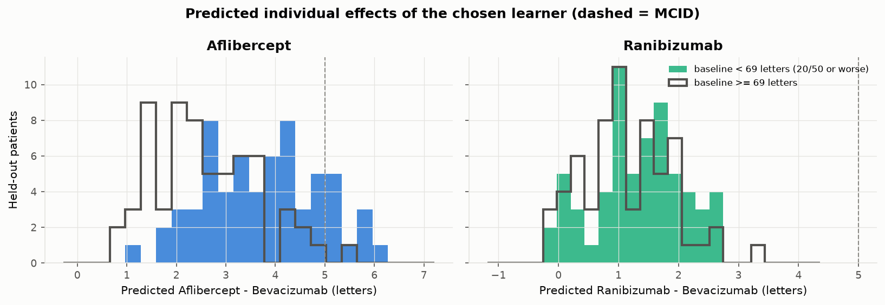

*Figure 14.5: Histogram of the chosen learner's estimated effects on held-out patients, split by
baseline vision subgroup; the dashed line is the MCID [`reports/figures/m6_effect_distribution.png`].
How to read it: almost all estimated aflibercept effects lie between 1 and 6 letters. The
< 69 group (filled) sits further right than the ≥ 69 group (outline). Few patients pass the
dashed line, and none confidently.*

### 14.9 Limitations and caveats

- **Sample size** (490 training complete cases) dominates everything. Per-patient effects are
  weakly identified.
- **The simulator assumes effects add to a Ridge-shaped baseline** with normal noise. Real
  heterogeneity could be shaped differently.
- **Complete cases only.** 44 patients without week-52 vision are dropped from fitting.
- **The bundle has 50 bootstrap refits** (the report uses 200), so the app's intervals are a
  little rougher than the report's.
- **Policy values use 126 patients**, of whom about 41–47 follow any given policy, so the
  intervals are wide.
- **The cost-aware policy uses DEMO prices.** Its result (14.6 IPW) is illustrative only.

### 14.10 Plan vs reality

- **Selection rule.** The `causal/run.py` module docstring says the final learner is chosen by
  "lowest **mean** over the three scenarios". The code, config, CLAUDE.md and
  `m6_chosen_model.csv` all use the **worst-case** PEHE with two exclusion filters. The code
  wins. (Here both rules pick the causal forest among candidates: its mean PEHE is 2.35, the
  lowest candidate mean [`m6_learner_selection.csv`].)
- **Tuning scope.** README §4 lists "Optuna vs PSO tuning" for M6. Tuning is done, but the tuned
  GB parameters are **not** used inside the chosen causal forest. They are used for the per-arm
  outcome models (bevacizumab anchor letters, AIPW) and would be used by a chosen meta-learner.
- **TARNet name.** README calls it a "3-head TARNet (SGD vs Adam vs RMSprop)". Implemented
  exactly so. The benchmark includes only the optimizer with the best validation loss (RMSprop).
- **Inconsistent CIs.** The causal-forest policy CI differs slightly between
  `m6_policy_values.csv` (9.86–21.0) and `m6_policy_values_by_learner.csv` (9.89–19.9), because
  the two bootstraps use different seeds (`cfg.seed + i` depends on the policy's position).
  The point values agree (14.9).

### 14.11 Check yourself

1. **On the six-patient data, why does the S-learner give the same effect (1.91) to everyone,
   and what in M6 does the same thing?** A linear model with treatment as one additive input
   has a single treatment coefficient, so the effect cannot depend on $x$. The project's
   S-learner (Ridge) does the same (training effect SD $7.6\times10^{-15}$) and is excluded for
   that reason.
2. **A learner has PEHE (null 1.5, published 3.2, nonlinear 2.0) and max |ATE bias| 0.4. Would
   the rule prefer it to the causal forest?** Its worst case is 3.2 > 2.80, so no, even though
   its null PEHE is better.
3. **Six patients with $e = 0.5$; policy "Afl if VA < 65 else Bev". Which patients follow it,
   and what is the IPW value?** Followers: P1 (Afl, 50) and P3 (Afl, 60) get Afl as the policy
   says; P4 (Bev, 70) and P6 (Bev, 75) get Bev as it says. Non-followers: P2 (VA 55, got Bev)
   and P5 (VA 72, got Afl). $\hat V = \frac16(18 + 14 + 8 + 6)/0.5 = 46/3 \approx 15.3$.

---

## 15. M7 Longitudinal analysis

### 15.1 The story

**What question does M7 answer?** "How does vision change *over time* under each drug, visit by
visit, over two years? Do patients follow typical response patterns? And once a patient has had
a few injections, can their early response tell us how they will be doing at one year?"

Up to now every module used one number per patient (the change at week 52). But each patient
was seen about every 4 weeks, so we have a *movie*, not a photograph. M7 works with the movie.
It uses numerical methods (interpolation, finite differences), time-series models (ARIMA), a
probabilistic model of hidden disease states (HMM with forward and Viterbi), clustering of
whole curves, and one carefully fenced prediction model that is allowed to use early follow-up
vision.

M7's own rule (`eq/longitudinal/run.py` docstring): descriptive trajectories use all
randomized patients, like M2. Everything that is *fitted* (HMM, trajectory clusters,
early-response model) uses training patients. The early-response model is scored once on the
held-out test set.

### 15.2 Inputs → outputs

| Inputs | Outputs |
|---|---|
| `data/protocolT_visits.csv` (14,149 visit rows), analysis table, split | `reports/tables/m7_tensor`, `m7_mean_trajectories`, `m7_lagrange_check`, `m7_rates_of_change`, `m7_finite_difference_orders`, `m7_arm_mean_series`, `m7_adf`, `m7_arima_aic_grid`, `m7_arima_forecast`, `m7_hmm_checks`, `m7_hmm_states`, `m7_hmm_transitions`, `m7_hmm_state_vs_injection`, `m7_trajectory_clusters(_by_arm)`, `m7_early_response` |
| `config/default.yaml: longitudinal.*` | `reports/figures/m7_mean_trajectories.png`, `m7_interpolation.png`, `m7_rates_of_change.png`, `m7_time_series.png`, `m7_hmm.png`, `m7_trajectory_clusters.png`, `m7_early_response.png` |
| | `models/early_response_model.joblib` (used by the app's Progress check); `reports/metrics/m7_longitudinal.json`; MLflow `equipoise-m7-longitudinal` |

### 15.3 Concept cards: trajectories and numerical methods

#### Concept card: trajectory, irregular sampling and the 3-D tensor

**In plain words.** Each patient's vision readings form a **trajectory**: a curve over time. But
patients came on slightly different days ("week 8" might be day 54 for one patient and day 59
for another), and some missed visits. To average or compare curves we put everyone on the
**same weekly timetable**, filling between visits. The result is a 3-D block of numbers:
patients × weeks × measures.

**Technically.** `eq/longitudinal/tensor.py:build_tensor` creates `values[i, t, m]` for patient
$i$, week $t \in \{0, 1, \dots, 104\}$ (`grid_max_week: 104`, `grid_step_weeks: 1`), and measure
$m \in$ {vision, CST, injected}.

- Vision and CST are interpolated between visits.
- Injections are **events**, so they are placed at the nearest week, not interpolated.
- Weeks before the first or after the last visit stay **NaN**: no extrapolation.

**Tiny worked example.** A patient seen on days 0, 30 and 85 is placed on weeks 0–12 by joining
the three points. Week 13 onwards is NaN if day 85 was their last visit.

**In Equipoise.** The tensor has shape **(660, 105, 3)**. 92.4% of the vision cells are
observed or interpolated (the rest lie after a patient's last visit). Linear and spline
interpolation differ by 0.893 letters on average [`reports/tables/m7_tensor.csv`].
`docs/data_structures.md` describes it as the project's 3-D tensor data structure.

**Viva questions.** *Why not just use the visit values directly?* Visits are at different days for
different patients. A common grid lets us average across patients at exactly the same week and
compute slopes on an even spacing.

#### Concept card: linear interpolation vs cubic splines

**In plain words.**
- **Linear interpolation** joins consecutive points with straight lines, like a dot-to-dot
  puzzle.
- A **cubic spline** joins them with smooth curves that bend gently, like a flexible ruler
  pinned at each point. The curve has no sharp corners, because its slope and curvature are
  continuous.

**Technically.**
- **Linear.** Between $(x_k, y_k)$ and $(x_{k+1}, y_{k+1})$:
  $L(x) = y_k + (y_{k+1} - y_k)\frac{x - x_k}{x_{k+1} - x_k}$ (`np.interp`).
- **Cubic spline.** A cubic polynomial on each interval, with matching values, first
  derivatives and second derivatives at the knots. A **natural** spline sets the second
  derivative to 0 at the ends (`CubicSpline(..., bc_type="natural")`). Writing $M_k$ for the
  second derivative at knot $k$, the interior $M_k$ solve a tridiagonal system:
  $h_{k-1}M_{k-1} + 2(h_{k-1} + h_k)M_k + h_kM_{k+1} = 6\left(\frac{y_{k+1}-y_k}{h_k} - \frac{y_k - y_{k-1}}{h_{k-1}}\right)$.

**Tiny worked example (by hand).** Visits at weeks 0, 4 and 12 with vision 60, 66 and 70.
Estimate week 8.

- **Linear:** $66 + (70 - 66)\cdot\frac{8-4}{12-4} = 68$ letters.
- **Natural spline:** $h_0 = 4$ and $h_1 = 8$, with $M_0 = M_2 = 0$. Then
  $2(4+8)M_1 = 6\left(\frac{4}{8} - \frac{6}{4}\right) = -6$, so $M_1 = -0.25$. On [4, 12] at
  $x = 8$:

$$S(8) = M_1\frac{(12-8)^3}{6\cdot8} + \left(\frac{66}{8} - \frac{M_1\cdot8}{6}\right)(12-8) + \frac{70}{8}(8-4) = -0.333 + 34.333 + 35 = 69.0$$

  The spline bends upward between visits (vision recovers fast, then slows), giving 69.0
  instead of 68.

**In Equipoise.** `interpolate(days, values, grid_days, method)`. "linear" is the default for
the tensor. Splines are used only when a patient has ≥ 4 points; otherwise it falls back to
linear.

**Common confusions.** A spline can overshoot between points (go above both neighbours). With
noisy vision readings, that is why linear is the default.

**Viva questions.** *Why never extrapolate?* Before the first or after the last visit we have no
information. Extending a curve there would invent data.

#### Concept card: Lagrange polynomial interpolation and Runge's phenomenon

**In plain words.** Through any $n$ points you can draw exactly one polynomial of degree $n-1$.
That sounds perfect, but with many points the polynomial **wiggles wildly** between them,
especially near the ends (Runge's phenomenon). It is a classic lesson in why splines exist.

**Technically.**

$$L(t) = \sum_{i=0}^{n-1} y_i \prod_{j\ne i}\frac{t - x_j}{x_i - x_j}$$

`lagrange_coefficients` expands this into power-basis coefficients with `np.convolve`, and
`lagrange_eval` evaluates the product form directly (numerically stabler). Both are written
from scratch and checked against `scipy.interpolate.lagrange`.

**Tiny worked example.** Points (0, 60), (4, 66), (12, 70):

$$L(8) = 60\frac{(8-4)(8-12)}{(0-4)(0-12)} + 66\frac{(8-0)(8-12)}{(4-0)(4-12)} + 70\frac{(8-0)(8-4)}{(12-0)(12-4)}$$

$$= 60(-0.333) + 66(1) + 70(0.333) = 69.33$$

**In Equipoise.** For one training patient, the code fits 5 visits (degree 4) and 12 visits
(degree 11) [`reports/tables/m7_lagrange_check.csv`]:

| Points | Degree | Fitted curve's range | Observed range | Match with scipy |
|---|---|---|---|---|
| 5 | 4 | 9.45 letters | 9 letters | 1.42 × 10⁻¹⁴ |
| 12 | 11 | **45** letters | 13 letters | 8.19 × 10⁻¹⁵ |

With 12 points, the polynomial swings over a range more than three times the data's: Runge's
phenomenon in real data. (`m7_interpolation.png` shows this for that one patient and is not
reproduced here.)

**Viva questions.** *Why splines and not one high-degree polynomial?* High-degree interpolating
polynomials oscillate between points (Runge). Splines use low-degree pieces, so they stay
well-behaved.

#### Concept card: finite differences (forward, backward, central) and order of accuracy

**In plain words.** To estimate how fast vision is improving (letters per week) from values on
a grid, compare neighbouring values.
- **Forward**: next minus current.
- **Backward**: current minus previous.
- **Central**: next minus previous, divided by twice the step.

The central version is much more accurate, because its errors on the two sides cancel.

**Technically.** With step $h$:

- forward $\frac{f(t+h) - f(t)}{h} = f'(t) + O(h)$;
- backward $\frac{f(t) - f(t-h)}{h} = f'(t) + O(h)$;
- central $\frac{f(t+h) - f(t-h)}{2h} = f'(t) + O(h^2)$.

The Taylor-series terms in $h$ cancel for the central difference. The **observed order** is
$\log_2(e(2h)/e(h))$: halving $h$ should halve the error (order 1) or quarter it (order 2).

**Tiny worked example.** Mean vision change at weeks 8, 12 and 16 = 8.0, 9.7, 10.3 (illustrative
numbers):

- forward at 12: $(10.3 - 9.7)/4 = 0.15$ letters/week;
- backward: $(9.7 - 8.0)/4 = 0.425$;
- central: $(10.3 - 8.0)/8 = 0.29$.

The central estimate is the average of the other two.

**In Equipoise.**
- **Error orders.** `derivatives.py:error_orders` tests the schemes on
  $f(t) = 15(1 - e^{-t/10})$, a recovery-shaped curve with a known derivative. As $h$ halves
  from 4 to 0.25 weeks, the observed orders approach **0.988** (forward), **0.976** (backward)
  and **1.96** (central) [`reports/tables/m7_finite_difference_orders.csv`;
  `reports/metrics/m7_longitudinal.json: central_difference_order`]. That is first, first and
  second order, as theory predicts.
- **Real arm means.** Applied to the aflibercept arm-mean trajectory, the central difference
  gives 1.41 letters/week at week 2 and 0.105 at week 24 [`reports/tables/m7_rates_of_change.csv`].
  Vision improves fast early, then plateaus.

**Viva questions.** *Why is the central difference second order?* Expanding $f(t \pm h)$ in Taylor
series, the $f''(t)h^2/2$ terms cancel when you subtract. The error starts at $f'''h^2/6$.

### 15.4 Concept cards: time series

#### Concept card: stationarity and the ADF test

**In plain words.** A series is **stationary** if its behaviour does not drift over time: same
average level, same spread. A recovering-vision curve rises and then flattens, so it is not
stationary. Many time-series models need stationarity, so we often model the **changes**
(differencing) instead of the levels. The ADF test checks for a "unit root", the kind of
wandering that never settles.

**Technically.** The augmented Dickey–Fuller test regresses
$\Delta y_t = \alpha + \gamma y_{t-1} + \sum_{k=1}^{p}\beta_k\Delta y_{t-k} + \varepsilon_t$.

- $H_0$: $\gamma = 0$ (unit root, non-stationary).
- A strongly negative statistic, with small $p$, rejects $H_0$.

The project uses `adfuller(z, maxlag=1, autolag=None)`.

**Tiny worked example.** The series 0, 5, 8, 10, 11, 11.5 keeps changing level. Its first
differences 5, 3, 2, 1, 0.5 shrink towards 0, which is closer to stationary.

**In Equipoise.** On the arm-mean vision series, sampled every 4 weeks over weeks 0–52 (14 points,
`ts_step_weeks: 4`) [`reports/tables/m7_adf.csv`]:

- aflibercept is "stationary" at level ($p = 0.0138$);
- bevacizumab is not ($p = 0.373$), and is still not after differencing ($p = 0.0592$);
- ranibizumab becomes stationary after differencing ($p = 0.000132$).

With 13–14 points, these tests have very little power. The docstring warns: "every result here
is fragile".

**Viva questions.** *Why difference a series?* To remove a trend or level drift so the remaining
series is stationary, which ARIMA's AR and MA parts assume.

#### Concept card: moving average, AR, MA, ARMA, ARIMA and choosing the order by AIC (ARIMA intuition)

**In plain words.**
- A **moving average** smooths a series by averaging each point with its neighbours.
- An **AR** (autoregressive) model predicts the next value from the last few values: "today is
  like yesterday".
- An **MA** model predicts from the last few *surprises* (errors).
- **ARIMA** combines them on a differenced series: "I" stands for *integrated*, meaning
  differenced.
- We try several combinations and keep the one with the best **AIC** (§6.3): good fit,
  penalized for complexity.

**Technically.** ARIMA$(p, d, q)$: difference $d$ times, then

$$y'_t = c + \sum_{i=1}^{p}\phi_i y'_{t-i} + \sum_{j=1}^{q}\theta_j\varepsilon_{t-j} + \varepsilon_t$$

where:

- $y'$ is the differenced series;
- the $\phi_i$ are AR coefficients and the $\theta_j$ MA coefficients;
- $\varepsilon$ is white noise.

The grid is $p \in \{0,1,2\}$, $d \in \{0,1\}$, $q \in \{0,1,2\}$, except (0, 0, 0)
(`longitudinal.arima_orders`), with `trend="c"` when $d = 0$. The model is fitted on weeks 0–52
(14 points) and forecasts weeks 56–104 (`ts_fit_until_week: 52`). The baseline is a **naive
forecast** that repeats the last observed value.

**Tiny worked example (ARIMA intuition).** Take an AR(1) on differences, ARIMA(1, 1, 0) with
$\phi = 0.5$ and no constant. The changes over the last two 4-week steps were +2 and then +1.

- The next change is forecast as $0.5 \times 1 = 0.5$.
- The one after as $0.25$, then $0.125$, and so on.
- So the forecast level rises by $1 + 0.5 + 0.25 + \dots \approx 1$ letter in total, then
  flattens.

AR(1) forecasts decay geometrically towards the mean change, which is how ARIMA "expects" a
recovery curve to level off.

**In Equipoise.** The moving average uses a window of 3 (`ma_window: 3`). AIC chose ARIMA(1, 1, 2)
for aflibercept and ARIMA(1, 1, 1) for bevacizumab and ranibizumab [`reports/tables/m7_arima_forecast.csv`,
`m7_arima_aic_grid.csv`]. **Every ARIMA forecast was worse than simply repeating the last value**:

| Arm | Chosen order | Forecast RMSE weeks 56–104 | Naive last-value RMSE |
|---|---|---|---|
| Aflibercept | (1, 1, 2) | 3.82 | 0.344 |
| Bevacizumab | (1, 1, 1) | 1.23 | 0.764 |
| Ranibizumab | (1, 1, 1) | 6.09 | 0.878 |

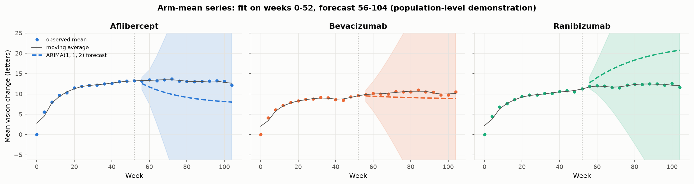

*Figure 15.1: Arm-mean vision change every 4 weeks (dots), moving average (thin line) and the ARIMA
forecast beyond week 52 (dashed, with its interval) [`reports/figures/m7_time_series.png`]. How to
read it: the observed series flattens after week 52. ARIMA, fitted to the rising first year,
extrapolates a curve that drifts away (down for aflibercept, up for ranibizumab), and its
intervals widen rapidly.*

**Common confusions.** A low AIC means a good fit *in the fitting window*, not good forecasts.

**Viva questions.** *Your ARIMA lost to a naive forecast. Is that a failure?* It is an honest
finding. The year-2 plateau differs from the year-1 rise, and 14 points cannot teach ARIMA that.
For saturating recovery curves, "it stays where it is" is a strong baseline.

### 15.5 Concept cards: hidden Markov model

#### Concept card: hidden Markov model (HMM)

**In plain words.** Imagine the eye has a hidden "mood" at each visit, for example *improving*,
*active* (still swinging) or *stable*. We never see the mood directly. We only see its effects:
how much vision and retinal thickness changed since the last visit. The mood tends to persist,
but can switch between visits with certain probabilities. An HMM learns those moods and their
switching probabilities from the visit data.

**Technically.** An HMM has hidden states $z_t \in \{1, \dots, K\}$ and:

- initial probabilities $\pi_k = P(z_1 = k)$;
- transition matrix $A_{jk} = P(z_{t+1} = k \mid z_t = j)$;
- **emissions** $x_t \mid z_t = k \sim N(\mu_k, \Sigma_k)$, with diagonal covariance here.

Here $x_t$ = (Δvision, ΔCST) since the previous visit (`hmm.py:visit_sequences`), and $K = 3$.
Parameters are learned by **EM (Baum–Welch)** in hmmlearn: repeat the E-step (state
probabilities given the current parameters) and the M-step (re-estimate the parameters).

States are named after fitting (`label_states`):
- *improving* = the highest mean Δvision;
- of the other two, *stable* = the smaller total variance;
- *active* = the remaining one.

**Tiny worked example.** If $A_{\text{stable}\to\text{stable}} = 0.8$, a stable eye stays stable
at the next visit with probability 0.8, and for two more visits with $0.8^2 = 0.64$.

**In Equipoise.** The HMM is fitted on 519 training sequences with 10,522 observations, and
converged [`reports/tables/m7_hmm_checks.csv`]. The states [`m7_hmm_states.csv`]:

| State | Mean Δvision | Mean ΔCST (µm) | SD ΔCST | Share of visits | Start probability |
|---|---|---|---|---|---|
| improving | +1.32 | −26.1 | 138 | 14.8% | 0.635 |
| active | +0.477 | −4.97 | 33.9 | 44.9% | 0.357 |
| stable | +0.276 | −1.59 | 7.1 | 40.4% | 0.00787 |

The transitions [`m7_hmm_transitions.csv`]: active → active 0.789, stable → stable 0.817,
improving → improving 0.532.

The state is strongly linked to injections given at that visit (chi-square $p = 5.75\times10^{-216}$):
90.6% of "improving" visits had an injection, versus 48.0% of "stable" visits
[`m7_hmm_state_vs_injection.csv`]. That is consistent with the protocol, which deferred
injections in stable eyes (§2.6).

**Viva questions.** *Why is the HMM "hidden"?* We observe only the changes in measurements. The
disease state that generates them is never recorded and must be inferred.

#### Concept card: forward algorithm (likelihood of a sequence)

**In plain words.** "How likely is this whole sequence of visit changes under the model?" There
are $K^T$ possible hidden paths, far too many to list. The forward algorithm adds them up
cleverly, one visit at a time, by carrying "the probability of the observations so far, ending
in each state".

**Technically.** Define $\alpha_t(k) = P(x_1..x_t, z_t = k)$. Then:

- $\alpha_1(k) = \pi_k b_k(x_1)$;
- $\alpha_t(k) = \left[\sum_j \alpha_{t-1}(j)A_{jk}\right]b_k(x_t)$;
- $P(x) = \sum_k \alpha_T(k)$.

The cost is $O(TK^2)$. To avoid underflow over long sequences, the code works with logs and
`logsumexp` (`hmm.py:forward_loglik`).

**Tiny worked example.** The toy HMM is in the Viterbi card below. For observations G, G, N,
the forward values are:

- $\alpha_1 = (0.48, 0.04)$;
- $\alpha_2 = ((0.48\cdot0.7 + 0.04\cdot0.2)\cdot0.8,\ (0.48\cdot0.3 + 0.04\cdot0.8)\cdot0.1) = (0.2752, 0.0176)$;
- $\alpha_3 = ((0.2752\cdot0.7 + 0.0176\cdot0.2)\cdot0.2,\ (0.2752\cdot0.3 + 0.0176\cdot0.8)\cdot0.9) = (0.039232, 0.086976)$.

So $P(\text{G, G, N}) = 0.126208$.

**In Equipoise.** Our forward log-likelihoods match hmmlearn's `score` within $10^{-12}$ for all
519 sequences [`m7_hmm_checks.csv`].

#### Concept card: Viterbi decoding (with a 3-step example by hand)

**In plain words.** The forward algorithm *adds* over all paths. Viterbi finds the **single most
likely** path of hidden states. At each step, for each state, it keeps only the best way of
arriving there and remembers where that came from (a back-pointer). At the end, it follows the
back-pointers from the best final state.

**Technically.** $\delta_1(k) = \pi_k b_k(x_1)$ and
$\delta_t(k) = \max_j[\delta_{t-1}(j)A_{jk}]\,b_k(x_t)$, with back-pointer
$\psi_t(k) = \arg\max_j[\cdot]$. Backtrack from $\arg\max_k\delta_T(k)$. This is **dynamic
programming**: the best path to $k$ at $t$ extends a best path to some $j$ at $t-1$. The code
works in log space (`hmm.py:viterbi`).

**Tiny worked example: a 3-step Viterbi by hand.** Two states: *Improving* (I) and *Stable* (S).
Observations are "gained letters" (G) or "no change" (N). (Made-up, discrete for simplicity; the
project uses Gaussian emissions.)

| | Start | → I | → S | P(G) | P(N) |
|---|---|---|---|---|---|
| **I** | 0.6 | 0.7 | 0.3 | 0.8 | 0.2 |
| **S** | 0.4 | 0.2 | 0.8 | 0.1 | 0.9 |

The observed sequence is G, G, N.

- **t = 1 (G):** $\delta_1(I) = 0.6 \times 0.8 = 0.48$ and $\delta_1(S) = 0.4 \times 0.1 = 0.04$.
- **t = 2 (G):**
  - $\delta_2(I) = \max(0.48\cdot0.7,\ 0.04\cdot0.2)\times0.8 = \max(0.336, 0.008)\times0.8 = 0.2688$,
    with $\psi = I$.
  - $\delta_2(S) = \max(0.48\cdot0.3,\ 0.04\cdot0.8)\times0.1 = \max(0.144, 0.032)\times0.1 = 0.0144$,
    with $\psi = I$.
- **t = 3 (N):**
  - $\delta_3(I) = \max(0.2688\cdot0.7,\ 0.0144\cdot0.2)\times0.2 = 0.18816\times0.2 = 0.0376$,
    with $\psi = I$.
  - $\delta_3(S) = \max(0.2688\cdot0.3,\ 0.0144\cdot0.8)\times0.9 = 0.08064\times0.9 = 0.0726$,
    with $\psi = I$.
- **Backtrack.** The best final state is S (0.0726). $\psi_3(S) = I$ and $\psi_2(I) = I$, so the
  path is **I → I → S**: improving, improving, then stable once vision stops changing.

Compare with the forward probability of the whole sequence, 0.126 (previous card). The best
single path carries $0.0726/0.126 \approx 58\%$ of it.

**In Equipoise.** Our Viterbi paths are **identical** to hmmlearn's `predict` for 100% of the
519 sequences [`m7_hmm_checks.csv`; `m7_longitudinal.json: hmm_viterbi_agreement = 1`].
`m7_hmm.png` shows the decoded states for one training patient and is not reproduced here.

**Common confusions.** The Viterbi path is not the sequence of individually most likely states.
That would come from forward–backward posteriors and can even be an impossible path.

**Viva questions.**
- *What is the complexity of Viterbi and why is it efficient?* $O(TK^2)$, because it keeps only
  the best path into each state at each step (dynamic programming) instead of all $K^T$ paths.
- *Why work in log space?* Multiplying hundreds of probabilities underflows to 0 in floating
  point. Logs turn products into sums.

### 15.6 Concept cards: response patterns and early response

#### Concept card: clustering trajectories into response patterns

**In plain words.** Treat each patient's whole first-year curve (weekly vision change, 53
numbers) as one point, and group similar curves with k-means (§11.3). Name the groups by how
much they gained.

**Technically.**
- Only training patients observed through week 52 are clustered, so no curve is extrapolated.
- k-means with $k = 3$ (`trajectory_k`) and `n_init=20`.
- The clusters are named by their week-52 centre: highest = "fast responders", lowest =
  "non-responders" (`clusters.py:cluster_trajectories`).
- The arm × cluster association is tested with chi-square.

**In Equipoise** [`reports/tables/m7_trajectory_clusters.csv`, `_by_arm.csv`]:

| Pattern | Patients | Mean gain week 12 | Mean gain week 52 |
|---|---|---|---|
| fast responders | 76 | 20.2 | 26.0 |
| slow responders | 250 | 8.71 | 12.5 |
| non-responders | 162 | 1.27 | 1.8 |

The silhouette is 0.33: better separated than M3's baseline clusters (0.109), because whole
outcome curves differ more than baseline profiles. By arm:

- fast responders are 19.2% of aflibercept, 12.4% of bevacizumab and 15.0% of ranibizumab;
- non-responders are 28.1%, 40.4% and 31.2%;
- chi-square $p = 0.127$, so this is not significant.

**Common confusions.** The response pattern is an *outcome*. It can never be a model input
(module docstring).

#### Concept card: the early-response model (the one allowed use of post-baseline vision)

**In plain words.** Once a patient has had three monthly injections, their response so far is
very informative: someone who has already gained 10 letters by week 12 will probably keep most
of it. This model predicts week-52 letters from baseline features **plus** vision at weeks 4, 8
and 12 and the early slope. It answers a different question at a different time ("how is my
patient doing?" at week 12), so it does not break the leakage rule. It lives in its own module,
and nothing else may use early vision.

**Technically.** Early features carry the prefix `E_`:

- `E_va_change_wk4`, `E_va_change_wk8`, `E_va_change_wk12`: change from baseline at visits
  labelled 4/8/12 week;
- `E_early_slope`: the least-squares slope (`np.polyfit`) of vision against weeks, over visits
  up to day $12 \times 7 + 21 = 105$ (`early_response.py:early_features`).

The model is `Ridge(alpha=10)` (`early_ridge_alpha`) on `build_preprocessor(include_treatment=True)`
plus a median-impute/scale block for the `E_` columns (`make_model`). `assert_no_leakage(...,
allow_early=True)` is the **only** place the early prefix is allowed, which
`tests/test_longitudinal.py:test_only_early_response_module_uses_early_vision` checks.

**Tiny worked example.** Two patients have the same baseline profile, so the baseline-only model
predicts the same week-52 gain for both. If one has gained +12 by week 12 and the other +1, the
early model separates their forecasts.

**In Equipoise.** 490 training and 126 test patients [`reports/tables/m7_early_response.csv`]:

| Model | CV RMSE | Test RMSE | Test R² |
|---|---|---|---|
| Baseline features only | 9.44 | 9.47 | 0.23 |
| + vision weeks 4/8/12 + early slope | **8.13** | **8.21** | **0.421** |

The model is saved to `models/early_response_model.joblib`. The app's **Progress check** page
uses it (§23). `m7_early_response.png` plots individual held-out patients (predicted vs observed)
and is not reproduced here.

**Viva questions.** *Isn't using week-12 vision leakage?* Not for this question. Leakage means
using information unavailable at prediction time. At week 12 the early visits are known. It
would be leakage in the drug-choice model, which runs at week 0, and the code prevents that.

### 15.7 Code walkthrough

`eq/longitudinal/run.py:run`, in order:

1. Build linear and spline tensors.
2. Mean trajectories with CIs.
3. A Lagrange check on one training patient.
4. Finite-difference rates and error orders.
5. Arm-mean series, ADF, moving average, ARIMA by AIC.
6. **HMM.** `visit_sequences(train_ids)` → `fit_hmm` → `label_states` → our forward/Viterbi vs
   hmmlearn → state tables.
7. Trajectory clusters on training patients.
8. **Early response.** `early_features`, `compare(train, test)`, then save the model with
   `joblib.dump`.

**Forward algorithm in log space** (`hmm.py:forward_loglik`):

```python
logB = _log_emissions(model, X)                # log N(x_t | mean_k, diag cov_k), shape (T, K)
logA = np.log(model.transmat_)
alpha = np.log(model.startprob_) + logB[0]
for t in range(1, len(X)):
    alpha = logsumexp(alpha[:, None] + logA, axis=0) + logB[t]
return float(logsumexp(alpha))
```

- `alpha[:, None] + logA` is a $K\times K$ matrix of "come from $j$, go to $k$" scores.
- `logsumexp(axis=0)` sums over $j$ in probability space, stably.
- Adding `logB[t]` multiplies by the emission probability.

**Viterbi** is the same loop with `max`/`argmax` instead of `logsumexp`, plus back-pointers.

**Config keys.**

| Key | Value |
|---|---|
| `longitudinal.grid_max_week` | 104 |
| `longitudinal.grid_step_weeks` | 1 |
| `longitudinal.ts_step_weeks` | 4 |
| `longitudinal.ts_fit_until_week` | 52 |
| `longitudinal.arima_orders` | p {0,1,2}, d {0,1}, q {0,1,2} |
| `longitudinal.ma_window` | 3 |
| `longitudinal.lagrange` | `{short_points: 5, long_points: 12}` |
| `longitudinal.hmm` | `{n_states: 3, n_iter: 200, covariance_type: diag, tol: 1e-4}` |
| `longitudinal.early_weeks` | [4, 8, 12] |
| `longitudinal.early_ridge_alpha` | 10 |
| `longitudinal.trajectory_k` | 3 |
| `longitudinal.trajectory_until_week` | 52 |

### 15.8 Run it yourself (synthetic data)

```bash
python -m equipoise longitudinal --synthetic
```

Verified for this handbook. Expected output:

```
[longitudinal] running on synthetic data ...
  central_difference_order: 1.964
  hmm_forward_matches: 1
  hmm_viterbi_agreement: 1
  hmm_state_injection_p: 3.241e-138
  early_cv_rmse_baseline: 9.635
  early_cv_rmse_with_early: 3.2
  early_test_rmse_baseline: 9.22
  early_test_rmse_with_early: 2.944
  early_test_r2_with_early: 0.9275
```

The synthetic early-response R² (0.93) is far higher than on real data (0.42). The fake visits
follow a smooth exponential approach to each patient's week-52 value with only 3 letters of
visit noise (`scripts/make_synthetic_data.py: VA_TIME_CONSTANT_WEEKS`, `VA_VISIT_NOISE_SD`), so
week 12 almost determines week 52. Real eyes are less predictable.

`tests/test_longitudinal.py` checks that interpolation never extrapolates, that Lagrange matches
scipy, the finite-difference orders, that forward and Viterbi match hmmlearn, and the early-vision
gate.

### 15.9 What we found (real data)

- **Mean vision rises fast, then plateaus.** Aflibercept's mean change is 9.7 letters at week 12,
  11.9 at week 24 and 13.2 at week 52 [`reports/tables/m7_mean_trajectories.csv`]. The central
  differences fall from 1.41 letters/week at week 2 to 0.105 at week 24
  [`m7_rates_of_change.csv`].
- **The numerical methods behave as theory says.** Central differences are second order (1.96)
  [`m7_longitudinal.json`]. 12-point Lagrange shows Runge oscillation (45-letter range for 13
  letters of data) [`m7_lagrange_check.csv`].
- **ARIMA does not forecast year 2** better than repeating the last value [`m7_arima_forecast.csv`].
- **The HMM finds three interpretable states**, strongly tied to injection decisions
  [`m7_hmm_states.csv`, `m7_hmm_state_vs_injection.csv`]. Our forward and Viterbi match
  hmmlearn exactly [`m7_hmm_checks.csv`].
- **Response patterns.** 76 fast, 250 slow and 162 non-responders, with no significant arm
  association ($p = 0.127$) [`m7_trajectory_clusters*.csv`].
- **Early response is strongly informative.** Test RMSE drops 9.47 → 8.21 and R² rises 0.23 →
  0.421 [`m7_early_response.csv`].

### 15.10 Limitations and caveats

- The time-series models use arm means (14 fitting points), a demonstration only.
- The HMM uses visit-to-visit *changes*, which are noisy (vision test–retest noise). Its states
  are statistical, not clinical diagnoses.
- The early-response model is Ridge only. It is not compared with other learners.
- Visit timing differs after week 52 ("Post 52 week" visits every 4–16 weeks), so year-2
  interpolation spans longer gaps.

### 15.11 Plan vs reality

- **ARIMA.** README §4 lists "AR/ARIMA" for M7. ARIMA is implemented on the *population arm-mean*
  series, not per patient. The docstring explains why: about 20 visits per patient is too few.
- **Interpolation.** README §10 says interpolation and splines are covered in M7. Both are used
  to build the tensor. Lagrange is implemented from scratch as a demonstration of Runge's
  phenomenon, not used for analysis.

### 15.12 Check yourself

1. **Linear interpolation between (week 4, 62 letters) and (week 12, 70 letters) at week 10?**
   $62 + 8\cdot\frac{6}{8} = 68$.
2. **In the toy HMM, run Viterbi on the sequence N, N. Most likely path?**
   - $\delta_1 = (0.6\cdot0.2,\ 0.4\cdot0.9) = (0.12, 0.36)$.
   - $\delta_2(I) = \max(0.12\cdot0.7,\ 0.36\cdot0.2)\cdot0.2 = 0.084\cdot0.2 = 0.0168$.
   - $\delta_2(S) = \max(0.12\cdot0.3,\ 0.36\cdot0.8)\cdot0.9 = 0.288\cdot0.9 = 0.2592$, from S.
   - The best path is **S → S**.
3. **Why can the early-response model use week-12 vision while the drug-choice model cannot?**
   The drug choice is made at week 0, when week-12 vision does not exist yet, so using it would
   be leakage. The early-response forecast is made at week 12, when it is known.

---

## 16. M8 Decision layer

### 16.1 The story

**What question does M8 answer?** "Given the model's estimates for one patient, what should we
actually *say*? Is a costlier drug worth its price? How strongly should we lean towards it? And
can we show the reasoning step by step?"

M6 produces numbers: letters, intervals, injections, laser probability. A clinician needs a
decision with reasons. M8 is the translator. It has five classic AI and numerical tools, each
answering one sub-question.

| Tool | Sub-question | File |
|---|---|---|
| Cost model | What will each drug cost this patient in year 1, and per extra letter? | `eq/decision/cost.py` |
| Newton–Raphson break-even | At what price would the dearer drug stop being worth it? How much benefit would justify its current price? | `eq/decision/breakeven.py` |
| Fuzzy inference | How strong is the case for paying more, on a 0–100 scale, when "benefit", "certainty" and "cost" are all matters of degree? | `eq/decision/fuzzy.py` |
| Expert system (rule engine) | Which explicit rules lead to the recommendation, in a readable trace? | `eq/decision/expert.py` |
| Agent | How does it all fit together as perceive → decide → act? | `eq/decision/agent.py` |

`eq/decision/recommend.py:recommend(patient, prices)` is the **single function** the API and the
app call. It chains all of these.

Think of a hospital pharmacist advising a family. They know the doctor's estimate of benefit
(M6), they check prices (cost model), they work out when the dearer drug stops being worth it
(break-even), they weigh several fuzzy considerations at once (fuzzy logic), and they explain
using the hospital's written guidelines (expert system).

### 16.2 Inputs → outputs

| Inputs | Outputs |
|---|---|
| model bundle (M6), one patient's baseline features | `Recommendation` object (pydantic) returned by `recommend` |
| `config/costs.yaml` (null → DEMO prices), `decision.*`, `effects.*` | `reports/tables/m8_fuzzy_rules`, `m8_typical_patient_profile`, `m8_typical_patient_explanation`, `m8_population_summary`, `m8_cost_by_drug`, `m8_newton_vs_brentq`, `m8_heldout_no_clear_winner` |
| held-out patients (aggregate summaries only) | `reports/figures/m8_fuzzy_membership.png`, `m8_fuzzy_worked_example.png`, `m8_break_even.png`, `m8_strength_vs_benefit.png`; `reports/metrics/m8_decision.json` |

**The "typical patient".** The worked examples use a profile built from **training medians and
modes** (`eq/decision/run.py:typical_patient`). It is an aggregate, not a real person. Its main
values [`reports/tables/m8_typical_patient_profile.csv`]:

- age 60, HbA1c 7.7%;
- baseline vision **69 letters**, so `X_va_below_69 = 0`, just on the "better vision" side of the
  published cut;
- CST 430 µm on Heidelberg Spectralis;
- type 2 diabetes, on insulin, hypertensive, no prior eye treatment.

Every intermediate value below comes from
`python scripts/handbook/trace_typical_patient.py`, run on the real bundle for this handbook
[script output, real data].

### 16.3 Concept cards

#### Concept card: the cost model and cost per extra letter (ICER)

**In plain words.** The expected first-year cost of a drug is (number of injections × price per
injection) plus (chance of laser × price of laser). To compare drugs fairly, divide the *extra*
cost of a dearer drug by the *extra* letters it gives. That is "rupees per extra letter", a
health-economics measure called the incremental cost-effectiveness ratio (ICER).

**Technically.**

$$C_a = \hat n_a\, p_a + \hat\pi_a\, p_{\text{laser}}, \qquad \text{ICER}_a = \frac{C_a - C_0}{\hat L_a - \hat L_0}\ \text{ (only if } \hat L_a > \hat L_0\text{)}$$

where:

- $\hat n_a$ is the predicted year-1 injections;
- $p_a$ is the price per injection;
- $\hat\pi_a$ is the predicted laser probability;
- $\hat L_a$ is the predicted letters under drug $a$;
- index 0 is bevacizumab.

The ICER is NaN when the dearer drug is not predicted to give more letters
(`cost.py:cost_per_letter`).

**Tiny worked example (typical patient, DEMO units: Avastin 1, Lucentis 5, Eylea 10, laser 2).**
- Avastin: $8.939 \times 1 + 0.603 \times 2 = 10.15$.
- Eylea: $8.413 \times 10 + 0.380 \times 2 = 84.90$.
- Extra cost $= 74.75$ units for $10.669 - 8.506 = 2.163$ extra letters, so the ICER is
  $\approx 34.6$ units per letter.

[trace script, real data]

**In Equipoise.** On held-out patients with DEMO prices, the mean expected cost is 10.6
(bevacizumab), 90 (aflibercept) and 47.8 (ranibizumab). The median ICER is 25.9 units per letter
(aflibercept) and 28.1 (ranibizumab) [`reports/tables/m8_cost_by_drug.csv`,
`m8_population_summary.csv`]. **These are DEMO relative units, not rupees** (§2.7).

**Common confusions.** The ICER is not the total cost ÷ total letters. It is *incremental*,
compared with the cheapest option.

**Viva questions.** *Why is the cost model "expected" cost?* Laser is uncertain, so its cost is
weighted by its predicted probability. Injection counts are a predicted mean.

#### Concept card: value of vision, willingness to pay and net benefit

**In plain words.** To decide whether extra letters are "worth" extra money, we need an exchange
rate between vision and money. The project uses a curve where each extra letter is worth a little
less than the previous one: going from 0 to 5 letters matters more than going from 30 to 35.
Multiplying by a willingness to pay (WTP) turns it into money. **Net benefit** = value of the
vision − cost.

**Technically.**

$$U(L) = 1 - e^{-kL}, \qquad k = 0.05$$

This utility is concave and saturating (`decision.value_of_vision_k`; `breakeven.py:value_of_vision`).
The net benefit of drug $a$ is $\text{NB}_a = W\cdot U(\hat L_a) - C_a$, where $W$ is the
willingness to pay per unit of $U$. Config: `costs.yaml: willingness_to_pay_inr_per_utility:
null`, so the DEMO value is 200 units (`demo.willingness_to_pay_per_utility`). The app can derive
$W$ from "how much is one eye-chart line worth to this family?"
(`app/presenters.py:wtp_from_value_per_line`).

**Tiny worked example.** $U(8.506) = 1 - e^{-0.4253} = 0.3464$ and $U(10.669) = 0.4134$
[computed for this handbook]. With $W = 200$, aflibercept's extra vision is worth
$200 \times 0.0670 = 13.4$ units, which is far below its extra cost of 74.75. So its net benefit
is lower than Avastin's.

**Common confusions.** $W$ is a *value judgement*, not a market price. The config comment says
exactly that.

**Viva questions.** *Why a concave utility rather than "1 letter = X rupees"?* Diminishing returns
are realistic, because the first lines regained restore reading or driving. The concavity also
makes the break-even benefit equation non-linear, which is a genuine use for Newton–Raphson.

#### Concept card: Newton–Raphson for break-even price and break-even benefit (one iteration by hand)

**In plain words.** "Break-even price" = the price per injection at which the dearer drug's net
benefit exactly equals the cheapest drug's. Above it, the dearer drug isn't worth it for this
patient. "Break-even benefit" = how many extra letters the dearer drug would need to give, at
today's prices, to be worth it. Both are roots of an equation, and Newton–Raphson finds roots
(§6.4).

**Technically.**

- **Break-even price.** $g(p) = W[U(\hat L_a) - U(\hat L_0)] - (\hat n_a p + \hat\pi_a p_{\text{laser}} - C_0)$.
  This is linear in $p$, with $g'(p) = -\hat n_a$.
- **Break-even benefit.** $h(\delta) = W[U(\hat L_0 + \delta) - U(\hat L_0)] - \Delta C$, with
  $h'(\delta) = Wk\,e^{-k(\hat L_0 + \delta)}$. This is non-linear.
- **Newton.** $x_{k+1} = x_k - g(x_k)/g'(x_k)$, stopping when the step is $< 10^{-10}\max(1,|x|)$,
  for at most 50 iterations (`decision.newton`). Without an analytic derivative it uses the
  central difference with step $10^{-4}$.
- **Checks.** Each root is checked against `scipy.optimize.brentq`. Special cases are handled:
  "no root" when $\Delta C \ge W e^{-k\hat L_0}$ (no amount of benefit is worth the cost), and
  "no price ≥ 0" (`break_even`).

**One Newton iteration by hand (typical patient, DEMO prices).**

1. **Break-even price.** The value of the extra letters is $13.40$; $C_0 = 10.146$; Eylea has
   $\hat n = 8.413$ and $\hat\pi = 0.380$. So $g(p) = 13.40 - (8.413p + 0.760 - 10.146) =
   22.786 - 8.413p$. Start at today's price $p_0 = 10$: $g(10) = -61.344$ and $g' = -8.413$,
   so $p_1 = 10 - \frac{-61.344}{-8.413} = 10 - 7.292 = 2.708$. Because $g$ is a straight line,
   **one step lands exactly on the root**. The code reports 2.708 [trace script]. The second
   iteration only confirms convergence (median 2 iterations [`m8_newton_vs_brentq.csv`]).
2. **Break-even benefit.** $\Delta C = 74.75$, $W e^{-k\hat L_0} = 200 \times 0.6536 = 130.7$.
   Start at $\delta_0 = 5$:
   - $h(5) = 130.7(1 - e^{-0.25}) - 74.75 = 130.7 \times 0.2212 - 74.75 = -45.8$;
   - $h'(5) = 130.7 \times 0.05 \times e^{-0.25} = 5.09$;
   - so $\delta_1 = 5 + 45.8/5.09 = 14.0$.

   The full iterate path is 5 → 14.0 → 16.76 → 16.963 → 16.964: **16.96 letters**, converged
   in 6 iterations [computed with `break_even` for this handbook]. With DEMO prices, Eylea would
   need to give about 17 more letters than Avastin to be worth it for this patient.

**In Equipoise.** Over 264 held-out comparisons (132 patients × 2 drugs)
[`reports/tables/m8_newton_vs_brentq.csv`]:

| Check | Value |
|---|---|
| Newton vs brentq, price (max abs difference) | $1.78\times10^{-15}$ |
| Newton vs brentq, benefit | $2.56\times10^{-13}$ |
| Analytic vs finite-difference derivative, benefit | $4.26\times10^{-14}$ |
| Median iterations | 2 (price), 5 (benefit) |
| Benefit cases with no root | 5 |

The median break-even price with DEMO prices is 3.15 units (Eylea, priced at 10) and 1.85
(Lucentis, priced at 5) [`m8_population_summary.csv`].

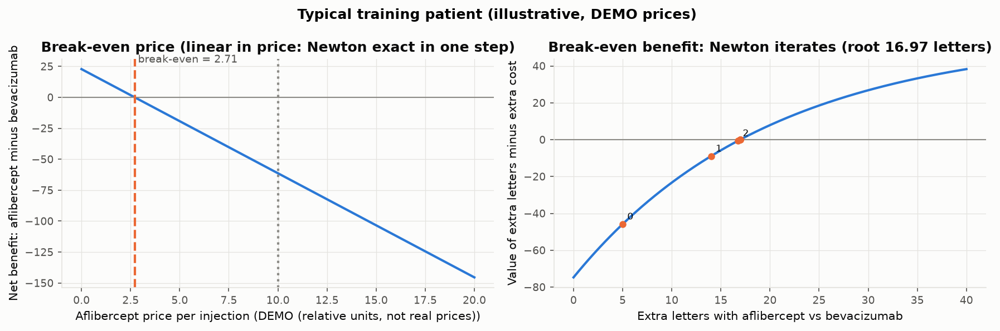

*Figure 16.1: Typical patient, DEMO prices. Left: net-benefit difference (Eylea − Avastin) against
Eylea's price; it crosses zero at the break-even price. Right: value of extra letters minus extra
cost, with the Newton iterates numbered [`reports/figures/m8_break_even.png`]. How to read it: the
left line is straight, so Newton needs one step. The right curve bends, so Newton takes several
steps, each one following the tangent.*

**Common confusions.** Newton can diverge or hit a zero derivative. The code checks both and
falls back to messages, and brentq is the safety net that verifies it.

**Viva questions.**
- *Why did the price need only one Newton step?* The net-benefit difference is linear in price,
  so the tangent *is* the function. Newton is exact for linear functions.
- *When does break-even benefit have no root?* When the extra cost exceeds the maximum value any
  gain could have: $W e^{-k\hat L_0}$, the ceiling of the concave utility.

#### Concept card: fuzzy sets and membership functions

**In plain words.** Ordinary ("crisp") logic says a benefit is either "large" or not. People think
in degrees: 4 letters is "somewhat moderate, slightly negligible". A **fuzzy set** gives every
value a **membership degree** between 0 and 1. A **linguistic variable** such as "benefit" has a
few fuzzy sets ("negligible", "moderate", "large") that overlap.

**Technically.** A membership function $\mu_A : U \to [0, 1]$ over a universe $U$. The project
uses two shapes:

- **triangular** `trimf[a, b, c]`: rises from $a$ to a peak at $b$, falls to $c$;
- **trapezoidal** `trapmf[a, b, c, d]`: flat top between $b$ and $c$.

The project's variables, with MCID = 5 (`eq/decision/fuzzy.py:build`; `decision.fuzzy`):

| Variable (universe) | Sets |
|---|---|
| **benefit**: letters vs cheapest [−5, 15] | negligible `trap[−5, −5, 2, 5]`; moderate `tri[2, 5, 10]`; large `trap[5, 10, 15, 15]` |
| **certainty**: P(benefit > MCID) [0, 1] | low `trap[0, 0, 0.2, 0.45]`; medium `tri[0.25, 0.5, 0.75]`; high `trap[0.55, 0.8, 1, 1]` |
| **extra cost**: share of the dearer drug's cost that is extra [0, 1] | low `trap[0, 0, 0.2, 0.4]`; medium `tri[0.25, 0.5, 0.75]`; high `trap[0.6, 0.8, 1, 1]` |
| **burden**: injection difference vs cheapest [−4, 4] | fewer `trap[−4, −4, −1.5, 0]`; similar `tri[−1.5, 0, 1.5]`; more `trap[0, 1.5, 4, 4]` |
| **strength** (output) [0, 100] | weak `trap[0, 0, 20, 45]`; moderate `tri[25, 50, 75]`; strong `trap[55, 80, 100, 100]` |

The benefit sets are built from the MCID: $0.4 \times \text{MCID} = 2$, MCID $= 5$,
$2 \times \text{MCID} = 10$.

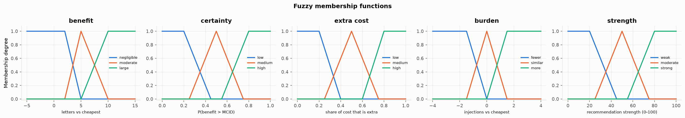

*Figure 16.2: The membership functions of the four inputs and the output
[`reports/figures/m8_fuzzy_membership.png`]. How to read it: pick a value on the x-axis and read
the height of each curve. Those heights are its membership degrees.*

**Tiny worked example.** Benefit 2.163 letters on "negligible" `trap[−5, −5, 2, 5]`: it lies on the
falling edge between 2 and 5, so $\mu = (5 - 2.163)/(5 - 2) = 0.946$. On "moderate" `tri[2, 5, 10]`
it is on the rising edge: $(2.163 - 2)/(5 - 2) = 0.054$.

#### Concept card: fuzzy inference (Mamdani): fuzzify → rules → aggregate → defuzzify

**In plain words.**
1. Turn each number into membership degrees (**fuzzify**).
2. Each IF–THEN rule fires to the degree its IF-part is true: AND takes the smaller degree, OR
   the larger, NOT is 1 − degree.
3. Each rule "clips" its output set at that degree.
4. Merge all clipped shapes by taking the maximum (**aggregate**).
5. Turn the merged shape into one number, its balance point (**defuzzify**, centroid).

**Technically (Mamdani inference, scikit-fuzzy `control`).**

- **Rule firing.** For rule $r$: $\alpha_r = \min$ over its AND-ed conditions, using
  $\mu_{\lnot A} = 1 - \mu_A$.
- **Implication.** $\mu'_{r}(y) = \min(\alpha_r, \mu_{C_r}(y))$.
- **Aggregation.** $\mu(y) = \max_r \mu'_r(y)$.
- **Centroid.** $y^* = \frac{\int y\,\mu(y)\,dy}{\int \mu(y)\,dy}$, on 101 points of [0, 100]
  (`output_resolution: 101`).

The 10 rules are in `fuzzy.py:RULE_TEXT` [`reports/tables/m8_fuzzy_rules.csv`], for example:

- R1: IF benefit is negligible THEN strength is weak.
- R3: IF benefit is NOT large AND extra cost is high THEN weak.
- R7: IF benefit is large AND certainty is high AND extra cost is NOT high THEN strong.

The code comment notes that every rule's firing moves monotonically with benefit, which keeps the
output monotone in benefit. `tests/test_decision.py:test_fuzzy_output_in_range_and_monotone_in_benefit`
checks this.

**Full worked example: the typical patient, Eylea vs Avastin** [trace script, real data; DEMO prices]

*Step 1: crisp inputs*

| Input | Value | How it is computed |
|---|---|---|
| benefit | 2.163 letters | causal-forest effect |
| certainty | 0.000 | P(benefit > 5): no bootstrap refit exceeded 5 |
| extra cost | $(84.895 - 10.146)/84.895 = 0.8805$ | share of Eylea's cost that is extra |
| burden | $8.413 - 8.939 = -0.526$ | injections |

*Step 2: fuzzify*

| Variable | Memberships |
|---|---|
| benefit | negligible **0.946**, moderate 0.054, large 0 |
| certainty | low **1.0**, medium 0, high 0 |
| extra cost | low 0, medium 0, high **1.0** (above 0.8) |
| burden | fewer **0.350** ($= -0.526 / -1.5$ on the falling edge), similar **0.650**, more 0 |

*Step 3: rules*

| Rule | Firing | Output set |
|---|---|---|
| R1 benefit negligible | 0.946 | weak |
| R2 certainty low | 1.0 | weak |
| R3 NOT large (1 − 0 = 1) AND cost high (1) | 1.0 | weak |
| R4 NOT large AND burden more (0) | 0 | weak |
| R5 NOT negligible (0.054) AND certainty medium (0) AND … | 0 | moderate |
| R6 NOT negligible (0.054) AND NOT large AND certainty high (0) | 0 | moderate |
| R7–R10 (all need benefit large, which is 0) | 0 | strong / moderate |

*Step 4: aggregate.* "weak" is clipped at $\max(0.946, 1, 1, 0) = 1.0$; "moderate" and "strong" at
0. The merged shape is the full "weak" trapezoid [0, 0, 20, 45].

*Step 5: defuzzify (centroid of the trapezoid, by hand).*
- Area $= 20 \times 1 + \frac12 \times 25 \times 1 = 32.5$.
- Moment $= \int_0^{20} y\,dy + \int_{20}^{45} y\frac{45 - y}{25}dy = 200 + 354.17 = 554.17$.
- Centroid $= 554.17/32.5 = $ **17.05**.

The code gives 17.051 [trace script; `reports/metrics/m8_decision.json:
typical_patient_fuzzy_strength_afl`].

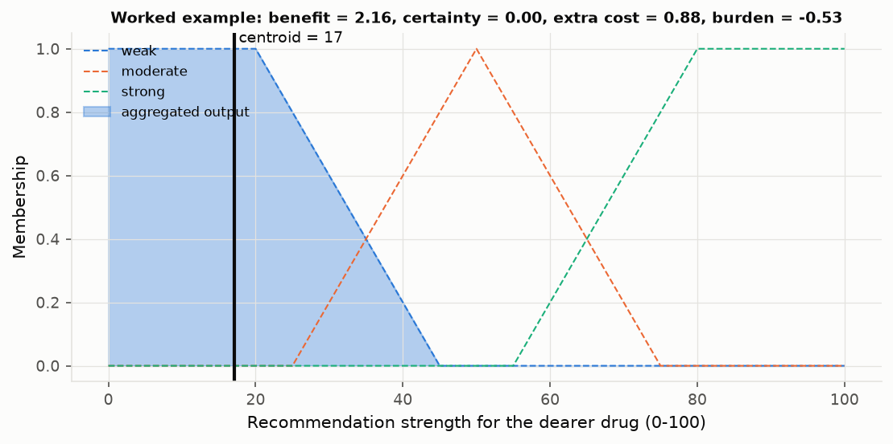

*Figure 16.3: The aggregated output shape for the typical patient (shaded) and its centroid
[`reports/figures/m8_fuzzy_worked_example.png`]. How to read it: the shaded area is the merged
"how strongly to recommend" shape. The vertical line is its balance point, about 17/100, which
is a weak case for paying more.*

**In Equipoise.** The median strength over held-out patients is 17.05 for both dearer drugs
[`m8_population_summary.csv`]. Almost everyone sits at "weak", because certainty is near 0 for
everyone. The app shows a strength word ("weak / moderate / strong case for paying more") **only
when real prices are set** (`ui.strength`: moderate ≥ 40, strong ≥ 70;
`presenters.strength_line`), because the extra-cost input is meaningless with DEMO prices.

**Common confusions.**
- Fuzzy membership is not probability. A benefit can be 0.946 "negligible" and 0.054 "moderate"
  at the same time, and the degrees need not add to 1.
- The centroid never reaches 0 or 100 exactly, because of the shapes' width. 17 is the floor
  when only "weak" fires fully.

**Viva questions.**
- *Why fuzzy logic here?* The decision depends on several soft, graded considerations (benefit
  size, certainty, extra cost, injection burden) that clinicians describe in words. Fuzzy rules
  encode those words transparently and combine them smoothly. A small change in input gives a
  small change in output, unlike a hard if/else threshold.
- *What is defuzzification?* Turning the merged fuzzy output shape into one crisp number. Here it
  is the centroid (centre of mass).

#### Concept card: expert system (forward-chaining rule engine)

**In plain words.** An expert system writes down an expert's guidelines as IF–THEN rules and lets
a program apply them to the facts of a case. **Forward chaining** starts from the facts and keeps
firing whichever rules apply, adding new facts, until nothing new can be concluded. Each firing
is logged, giving a readable **reasoning trace**.

**Technically** (`eq/decision/expert.py:Engine.run`, written from scratch):

- **Working memory** is a dict of facts.
- **Rules** have conditions (functions of the facts), an action (new facts), an explanation and a
  **salience** (priority).
- **Each cycle:**
  1. Build the **agenda**: rules whose conditions all hold and that have not fired yet
     (**refraction**: each rule fires at most once).
  2. **Conflict resolution**: choose the highest salience, then the most conditions (most
     specific), then the earliest defined.
  3. Fire it: update the facts and append to the trace.
- Stop when the agenda is empty. It is deterministic: same facts in, same trace out
  (`tests/test_decision.py:test_rule_engine_is_deterministic_and_reasons_correctly`).

**The rule base** (`default_rules`; salience in brackets):

- **Warnings:** research-prototype (100), demo-prices (90), weak-signal (80).
- **Published rule:** published-subgroup / published-subgroup-better-vision (50), by baseline
  < or ≥ 69 letters.
- **Per drug:** clear-benefit (lower 95% bound ≥ MCID) or equipoise (lower bound < MCID) (40).
- **Combination:** best-drug-clear (30).
- **Recommendations (20):**
  - all-equipoise → bevacizumab;
  - clear-benefit-cost-effective → that drug;
  - clear-benefit-not-cost-effective → "Discuss".
- **Notes:** model-vs-published (10), mcid-sensitivity (5), fallback-cheapest (−10).

**The rule trace for the typical patient** [`reports/tables/m8_typical_patient_explanation.csv`;
trace script]:

```
 1. [research-prototype] Research prototype for a course project; not clinical guidance.
 2. [demo-prices] Prices are DEMO relative units: cost outputs are illustrative only.
 3. [weak-signal] Per-patient differences between drugs are weakly estimated from 660 trial patients; intervals are wide.
 4. [published-subgroup-better-vision] Baseline vision >= 69 letters: in Protocol T the drugs gave similar gains (published rule: no advantage for the dearer drugs).
 5. [equipoise-Aflibercept] Aflibercept: the 95% interval of the benefit vs bevacizumab (0.6 to 3.8) includes values below MCID 5 -> equipoise.
 6. [equipoise-Ranibizumab] Ranibizumab: the 95% interval of the benefit vs bevacizumab (-0.5 to 2.9) includes values below MCID 5 -> equipoise.
 7. [all-equipoise] Equipoise for both dearer drugs -> recommend the cheapest (bevacizumab).
 8. [mcid-sensitivity] Sensitivity: at MCID 3: equipoise.
```

Read it as forward chaining:

- **Cycles 1–3.** The warnings fire first (highest salience).
- **Cycle 4.** The published-rule fact is added. Vision is 69, so the "better vision" branch
  applies.
- **Cycles 5–6.** Each drug's interval is tested against the MCID, adding `equipoise_Aflibercept`
  and `equipoise_Ranibizumab`.
- **Cycle 7.** Those two new facts make `all-equipoise` eligible, and it sets
  `recommendation = Bevacizumab`.
- **Afterwards.** `fallback-cheapest` never fires, because a recommendation now exists, and its
  condition is false. `model-vs-published` does not fire either, because the published rule
  suggested bevacizumab, not aflibercept.
- **Cycle 8.** The sensitivity note fires.

**In Equipoise.** On held-out patients: **100%** recommend bevacizumab (all-equipoise), 0%
aflibercept / ranibizumab / Discuss. For 50% of them the published rule suggests aflibercept
(baseline < 69) [`m8_population_summary.csv`]. For those patients the `model-vs-published` note
fires: "the model is uncertain for this patient, while the published subgroup result favoured
aflibercept; discuss both."

**Common confusions.** Forward chaining (data-driven, facts → conclusions) is different from
backward chaining (goal-driven, start from a hypothesis and look for supporting facts).

**Viva questions.**
- *What is conflict resolution and why do you need it?* Several rules can be eligible at once.
  The strategy (salience, then specificity, then order) decides which fires first, which makes
  the trace deterministic and the warnings appear first.
- *Why an expert system when you already have a model?* Transparency. The final recommendation
  follows written, auditable rules applied to the model's outputs, and every step is printed.

#### Concept card: intelligent agent and PEAS

**In plain words.** An **agent** is anything that perceives its environment and acts on it. Equipoise
is framed as a simple agent: it *perceives* a patient's profile, *decides* using its models and
rules, and *acts* by returning a recommendation with an explanation. **PEAS** is the standard
checklist for describing an agent: Performance measure, Environment, Actuators, Sensors.

**Technically.** `eq/decision/agent.py:EquipoiseAgent` has three methods:

- `perceive(patient)` stores the features and notes the missing ones;
- `decide()` calls `recommend`;
- `explain()` prints the decision, the intervals, the fuzzy strength, the imputed features and
  the rule trace.

The docstring classifies it as "a simple reflex-plus-model agent: it keeps no memory between
patients".

**PEAS of the Equipoise agent** (from the docstring and `docs/concepts/agent.md`):

| PEAS | Equipoise |
|---|---|
| **Performance measure** | expected letters gained at week 52 under the recommended drug, traded off against cost (letters − λ × cost), judged on held-out patients by IPW/AIPW policy value (§14); secondary: honesty about uncertainty (equipoise flagged when the interval includes values below the MCID) |
| **Environment** | a clinic consultation for one DME patient: the patient's baseline profile, drug prices, the trial-derived models; partially observable (unmeasured factors), stochastic (outcomes vary), episodic (each patient independent), static during a decision |
| **Actuators** | the API response and the app screen (recommendation, intervals, costs, trace, PDF) |
| **Sensors** | the input form / API fields (33 baseline features; only baseline vision is required) |

**Viva questions.** *What kind of agent is it?* A model-based reflex agent with no learning at decision
time and no memory across patients. Learning happens offline, in M6.

### 16.4 Code walkthrough

**`recommend()` in order** (`eq/decision/recommend.py`, see §14.6 for the bundle):

1. `patient_frame(patient)`: one-row frame. Missing features become NaN, which the preprocessor
   imputes. `X_va_below_69` is derived from vision.
2. `bundle.predict(X)`: effects, bootstrap intervals, letters, injections, laser.
3. `expected_cost`, `cost_per_letter`, net benefit if a WTP is set.
4. Per costlier drug: the fuzzy `strength(...)`, then `break_even(...)` if a WTP is set.
5. MCID sensitivity: `equipoise_at_sensitivity[m] = all(effect_low < m)`.
6. Build the facts → `Engine(default_rules()).run(facts)` → recommendation, reason, trace.
7. Return a `Recommendation` (pydantic) with warnings: the disclaimer, DEMO prices if used, "WTP
   not set" if so, and weak signal.

**The fuzzy inputs** (from `recommend`):

```python
extra = max(0.0, (cost[0, j] - cost[0, 0]) / cost[0, j]) if cost[0, j] > 0 else 0.0
strengths[arm] = fuzzy_strength(
    fs, est.benefit_vs_reference, est.p_benefit_gt_mcid, extra,
    float(out["injections_yr1"][0, j] - out["injections_yr1"][0, 0]))
```

"Extra cost" is normalized to [0, 1] as the share of the dearer drug's cost that is extra, so the
same membership functions work for any currency.

**Config keys.**

| Key | Value |
|---|---|
| `decision.value_of_vision_k` | 0.05 |
| `decision.newton` | `{tol: 1e-10, max_iter: 50, fd_step: 1e-4}` |
| `decision.fuzzy.benefit_universe` | [−5, 15] |
| `decision.fuzzy.burden_universe` | [−4, 4] |
| `decision.fuzzy.output_resolution` | 101 |
| `decision.rules.net_benefit_margin` | 0.0 |
| `decision.example_patient` | `training_median` |
| `effects.mcid_letters` | 5 |
| `effects.mcid_sensitivity_letters` | [3] |
| `config/costs.yaml` | prices null; DEMO 1/5/10, laser 2, WTP 200 |

### 16.5 Run it yourself (synthetic data)

```bash
python -m equipoise decision --synthetic
python scripts/handbook/trace_typical_patient.py --synthetic
```

Both were verified for this handbook. The first prints (after scikit-fuzzy deprecation
warnings, which are harmless):

```
[decision] running on synthetic data ...
  newton_brentq_max_diff_benefit: 2.522e-13
  share_equipoise: 1
  share_recommend_bevacizumab: 1
  typical_patient_fuzzy_strength_afl: 37.53
  prices_demo: 1
```

The first command scores every synthetic held-out patient and
writes `reports/synthetic/tables/m8_*`. The second prints the full trace above for the synthetic
typical patient. It warns about DEMO prices, which is expected and correct.

The synthetic typical patient makes a useful contrast. Its baseline vision is below 69, where
the planted effect is +7 letters. The output was:

- aflibercept effect 6.309 letters, interval 3.431 to 8.481, P(> MCID) 0.560;
- headline still "No clear winner…", because the lower bound 3.4 < 5. The confidence wording
  is "This is a close call" (level 0.440);
- an extra line, "Eylea may give a small extra benefit for this patient — worth discussing if
  cost is not a concern", because P(> MCID) ≥ 0.5 (`ui.may_benefit_p`).

[trace script on synthetic data] So the app *does* flag possible benefit when the evidence leans
that way. `tests/test_decision.py`
checks Newton against brentq, the fuzzy range and monotonicity, and the rule engine's determinism
and conflict resolution.

### 16.6 What we found (real data)

- **Every held-out patient gets "bevacizumab, equipoise"** at MCID 5 and 3
  [`m8_population_summary.csv`; `m8_heldout_no_clear_winner.csv`]. §14.5 explains why.
- **The fuzzy strength is "weak" for everyone** (median 17.05/100), driven by certainty near 0
  [`m8_population_summary.csv`].
- **Newton–Raphson is verified** against brentq to $10^{-13}$ or better, with median 2 / 5
  iterations [`m8_newton_vs_brentq.csv`].
- **Break-even values exist but are DEMO-only.** With DEMO prices, Eylea's median break-even price
  is 3.15 units against a DEMO price of 10 [`m8_population_summary.csv`]. Real rupee break-even
  prices are **not computed**, because `config/costs.yaml` holds no prices.

### 16.7 Limitations and caveats

- **Prices.** Every cost, ICER, net-benefit and break-even number uses DEMO relative units. The
  value of vision ($k$ = 0.05, WTP) is an assumption, not data.
- **Laser cost.** The cost model assumes at most one laser session in year 1 (probability ×
  price).
- **Fuzzy design.** The membership functions and rules are hand-designed, not learned or
  validated with clinicians.
- **Expert rules.** The rules are "decision-support logic for this project, not clinical guidance"
  (`expert.py`).
- **Strictness.** The "whole 95% interval ≥ MCID" rule is deliberately strict. A different rule
  would change the share of "no clear winner" (§14.5).

### 16.8 Plan vs reality

- README §3 promises "expected cost in ₹". The code supports rupees, but no prices are filled in,
  so every output is in DEMO units, and the app hides cost sentences (§23).
- README §4 lists "agent framing" for M8. It is a thin wrapper class with a PEAS description, not
  a learning or planning agent.

### 16.9 Check yourself

1. **Benefit = 7 letters. Compute its memberships in negligible, moderate and large.**
   - Negligible `trap[−5, −5, 2, 5]`: 7 > 5, so 0.
   - Moderate `tri[2, 5, 10]`: falling edge, $(10 - 7)/(10 - 5) = 0.6$.
   - Large `trap[5, 10, 15, 15]`: rising edge, $(7 - 5)/(10 - 5) = 0.4$.
2. **One Newton step for $g(p) = 20 - 4p$ from $p_0 = 10$?** $g(10) = -20$ and $g' = -4$, so
   $p_1 = 10 - (-20)/(-4) = 5$, which is the exact root (linear function).
3. **In the rule engine, why does `fallback-cheapest` (salience −10) never fire for the typical
   patient?** Its condition is "no recommendation yet". `all-equipoise` (salience 20) fires
   earlier and sets the recommendation, so by the time the fallback could fire, its condition is
   false.

---

## 17. M9 Explainability and fairness

### 17.1 The story

**What question does M9 answer?** "*Why* does the model estimate this benefit for this patient?
And does the model work equally well for women and men, for different races, for type 1 and
type 2 diabetes, and for poorer and better starting vision?"

A recommendation nobody can explain will not be trusted. And a model that works well on average
can still fail for one group. M9 answers both with two tools:

- **SHAP** splits one patient's estimated effect into a contribution from each feature, like an
  itemized bill.
- **Subgroup checks** compute performance and calibration separately for each group, like
  checking a school's average marks class by class rather than only overall.

### 17.2 Inputs → outputs

| Inputs | Outputs |
|---|---|
| the M6 bundle (causal forest), training and held-out patients | `reports/tables/m9_shap_setup`, `m9_shap_importance_aflibercept`, `m9_subgroups` |
| `config/default.yaml: explain.*`, `serving.shap_background_clusters` | `reports/figures/m9_shap_importance.png`, `m9_shap_beeswarm.png`, `m9_shap_waterfall_typical.png`, `m9_subgroups.png` |
| | `models/serving_assets.joblib`: k-means centroids (SHAP background for the API) and form defaults, **no patient rows** |
| | `reports/metrics/m9_explain.json`; MLflow `equipoise-m9-explain` |

### 17.3 Concept cards

#### Concept card: Shapley values and SHAP

**In plain words.** Imagine the features are players in a team, and the "payout" is the patient's
estimated effect minus the average estimate. How do you split the payout fairly among the
players? The **Shapley value** gives each player their *average extra contribution* over all the
orders in which players could join the team. **SHAP** (SHapley Additive exPlanations) applies this
to model predictions. The contributions always **add up exactly** to the patient's prediction
minus the average.

**Technically.** For a model $f$, features $N$ and a patient $x$:

$$\phi_j = \sum_{S \subseteq N\setminus\{j\}}\frac{|S|!\,(|N|-|S|-1)!}{|N|!}\,\big[v(S\cup\{j\}) - v(S)\big]$$

where:

- $v(S)$ is the expected prediction when only the features in $S$ are known. The others are
  filled in from **background** data (an "independent masker").
- **Additivity:** $f(x) = \phi_0 + \sum_j\phi_j$, with base value $\phi_0 = E_{\text{background}}[f]$.

Exact computation is exponential in the number of features, so the **permutation explainer**
estimates it by walking through random feature orderings. It is model-agnostic: it only needs to
call $f$.

**Tiny worked example (two features, by hand).** Base $v(\emptyset) = 3.0$; $v(\{A\}) = 2.0$;
$v(\{B\}) = 3.5$; $v(\{A, B\}) = f(x) = 2.2$.

- $\phi_A = \tfrac12[(v(A) - v(\emptyset)) + (v(AB) - v(B))] = \tfrac12[(-1.0) + (-1.3)] = -1.15$.
- $\phi_B = \tfrac12[(3.5 - 3.0) + (2.2 - 2.0)] = 0.35$.
- Check: $3.0 - 1.15 + 0.35 = 2.2$.

**In Equipoise.** `eq/explain/shap_effects.py:explain_effect` explains $f(x)$ = the causal forest's
**aflibercept − bevacizumab effect** (not the outcome). It uses `shap.Explainer(f, Independent(background),
algorithm="permutation")`.

- **Report.** The background is 100 random training patients (`explain.shap_background: 100`),
  and the 132 held-out patients are explained. The base value is 3.03 letters, and **additivity
  holds within $10^{-6}$** [`reports/tables/m9_shap_setup.csv`].
- **One-hot columns are summed back** to their raw feature (`raw_feature_shap`; summing one-hot
  SHAP to raw features is valid because Shapley values are additive), so "race" gets one
  contribution, not six.
- **The app (per patient).** The background is **10 k-means centroids** of the training patients
  (`serving.shap_background_clusters: 10`), stored in `serving_assets.joblib`. This avoids
  shipping patient rows; the config comment notes that each centroid costs about 0.4 s of SHAP
  time per request. The app shows the top 10 contributions (`serving.shap_top_features`).

**Common confusions.**
- SHAP explains the **model**, not the biology. A big SHAP value means "the model's estimate moves
  with this feature", not "this feature causes the benefit". The app's note says the same
  (`Service.explain`).
- SHAP values depend on the background. Report and app numbers differ slightly for that reason.

**Viva questions.**
- *What does a SHAP value of −0.38 for baseline vision mean for the typical patient?* Knowing this
  patient's baseline vision (69 letters, better than average) lowers the model's estimated Eylea
  benefit by 0.38 letters relative to the average estimate.
- *Why permutation SHAP and not TreeSHAP?* The explained function is the causal forest's
  `effect()` method, not a plain sklearn tree ensemble's prediction. The model-agnostic
  permutation explainer works on any function.

#### Concept card: global importance, beeswarm and waterfall plots

**In plain words.**
- **Global importance** is the average size of each feature's SHAP contribution over many
  patients: which features matter most overall.
- A **beeswarm** shows every patient's SHAP value for each feature as a dot, coloured by the
  feature's value.
- A **waterfall** shows one patient: start at the average, add each feature's push, and end at
  their estimate.

**Technically.** Importance $I_j = \frac1n\sum_i|\phi_{ij}|$ (`global_importance`), in letters.

**In Equipoise.** Mean |SHAP| on held-out patients [`reports/tables/m9_shap_importance_aflibercept.csv`]:

| Rank | Feature | Mean \|SHAP\| (letters) |
|---|---|---|
| 1 | CST | 0.642 |
| 2 | baseline vision | 0.427 |
| 3 | log UACR | 0.205 |
| 4 | female | 0.200 |
| 5 | HbA1c | 0.159 |

Prior MI, prior stroke and current smoking contribute exactly 0.

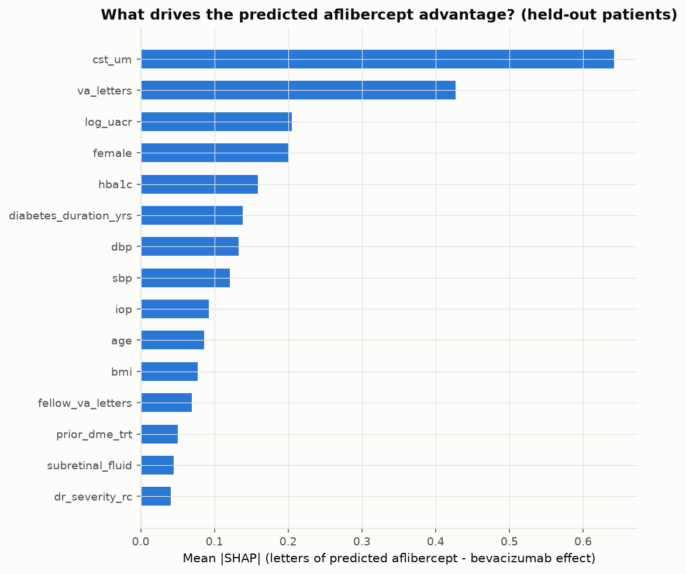

*Figure 17.1: Global SHAP importance for the estimated aflibercept effect
[`reports/figures/m9_shap_importance.png`]. How to read it: longer bars mean the model's per-patient
estimate varies more with that feature. Even the top feature moves estimates by only about 0.6
letters on average, which is small compared with the MCID of 5.*

**The typical patient's waterfall** (`m9_shap_waterfall_typical.png`):

- It starts at the average estimate, $E[f(X)] = 3.026$, and ends at **$f(x) = 2.163$**.
- The largest pushes are baseline vision −0.38, CST z-score −0.33, log UACR −0.30 and
  female = 0 (male) −0.29.
- The upward pushes are SBP +0.13, DBP +0.09, age +0.08, DR severity +0.07, and +0.17 from the
  other 33 encoded columns.

[figure labels]

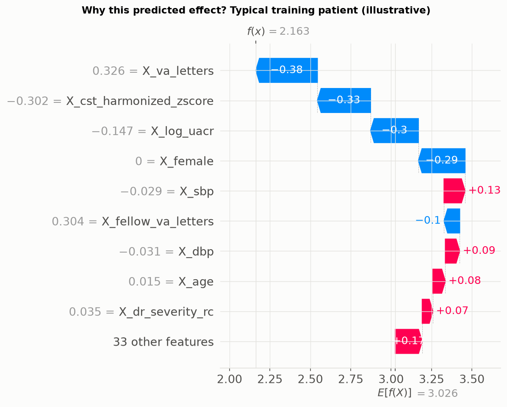

*Figure 17.2: SHAP waterfall for the typical training patient (an aggregate profile, not a real
person) [`reports/figures/m9_shap_waterfall_typical.png`]. How to read it: start at the bottom
($E[f(X)]$) and follow each bar. Blue bars lower the estimated Eylea benefit, red bars raise it.
The top value is this patient's estimate. The grey numbers are the patient's *preprocessed*
(standardized) feature values.*

`m9_shap_beeswarm.png` shows individual held-out patients and is not reproduced here.

**Viva questions.** *Why is CST, not vision, the top SHAP feature?* The causal forest's splits favour
CST, which is correlated with vision and also predicts response. Vision is close behind (0.427).
This matches the surrogate-forest result in M6 (§14.4): the "top driver = vision" check fails
honestly.

#### Concept card: fairness and subgroup performance

**In plain words.** "Fair" here means the model should not work systematically worse for a group
of patients. We compute the same performance numbers separately for each group and look for big
gaps. With small groups, numbers jump around by chance, so groups below a minimum size are
flagged as unreliable rather than interpreted.

**Technically.** Every patient needs a prediction from a model that **did not see them**:

- training patients get **out-of-fold** predictions via 5-fold cross-fitting (all models refitted
  without their fold);
- held-out patients get the final bundle's predictions (`fairness.py:out_of_sample_predictions`).

Per subgroup level (`explain.subgroups`: sex, race, diabetes type, baseline vision <69):

- letters RMSE and $R^2$, under the drug actually received;
- laser AUC;
- **calibration of the effect**: mean predicted aflibercept effect next to the *observed*
  Afl − Bev difference (Welch, 95% CI).

A level is "reliable" if n ≥ 40 (`explain.subgroup_min_n`) and both arms have ≥ 10 patients.

**Tiny worked example.** A group of 30 patients with 6 on Eylea and 7 on Avastin has an observed
difference whose 95% CI might span ±12 letters. Nothing can be concluded, so it is flagged.

**In Equipoise** [`reports/tables/m9_subgroups.csv`]:

| Subgroup | n | Letters RMSE | Laser AUC | Predicted Afl effect | Observed Afl − Bev (95% CI) |
|---|---|---|---|---|---|
| Female | 285 | 10.7 | 0.615 | 3.20 | 5.08 (1.71 to 8.45) |
| Male | 331 | 9.0 | 0.617 | 2.88 | 2.87 (−0.07 to 5.81) |
| White | 479 | 9.25 | 0.623 | 3.06 | 3.66 (1.27 to 6.05) |
| Black/African American | 95 | 12.7 | 0.622 | 2.98 | 4.71 (−2.86 to 12.3) |
| Other / not reported | 42 | 8.37 | 0.534 | 2.78 | 4.17 (−2.34 to 10.7) |
| Type 1 | 48 | 9.21 | 0.657 | 2.55 | 3.00 (−7.93 to 13.9) |
| Type 2 | 556 | 9.91 | 0.612 | 3.07 | 3.95 (1.61 to 6.29) |
| Uncertain type (**unreliable**, n 12) | 12 | 6.65 | 0.531 | 3.06 | not computed (1 bevacizumab patient) |
| Vision < 69 | 303 | 11.1 | 0.633 | **3.57** | **7.24 (3.92 to 10.6)** |
| Vision ≥ 69 | 313 | 8.35 | 0.582 | **2.51** | **0.84 (−1.70 to 3.38)** |

**What this shows:**

- **Prediction error differs between groups.** Letters RMSE is highest for Black/African American
  patients (12.7) and for vision < 69 (11.1). Patients with more room to change have more variable
  outcomes.
- **The model under-states the subgroup difference.** It predicts 3.57 vs 2.51 letters by vision
  subgroup, while the trial observed 7.24 vs 0.84. It ranks the subgroups in the right order, but
  shrinks the gap. That is the expected price of a cautious learner (§14.5).
- **1 of 10 subgroup levels is unreliable** [`reports/metrics/m9_explain.json`].

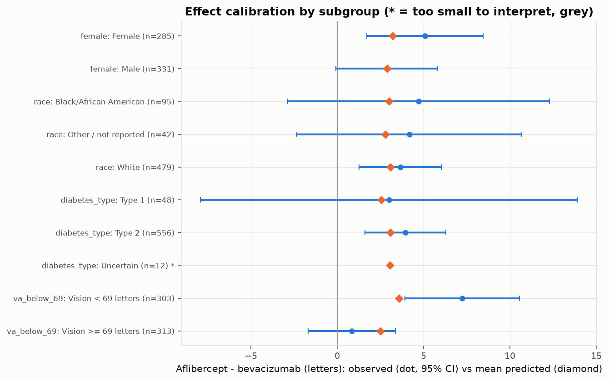

*Figure 17.3: Subgroup performance and effect calibration [`reports/figures/m9_subgroups.png`].
How to read it: compare each group's bars and intervals with the others. Wide intervals mean too
few patients to tell.*

**Common confusions.** "Fairness" in clinical ML usually means *equal accuracy and calibration*
across groups, not equal recommendations. Different groups may legitimately benefit differently.

**Viva questions.**
- *Is the model fair across race?* Accuracy is similar for White patients and the "Other" group
  (RMSE 9.25 and 8.37) and worse for Black/African American patients (12.7). The latter group has
  only 95 patients, and the interval for its observed effect is very wide (−2.86 to 12.3). We
  cannot claim fairness or unfairness with confidence. We report it.
- *Why out-of-fold predictions for training patients?* An in-sample prediction would look better
  than reality and hide subgroup problems.

### 17.4 Code walkthrough

`eq/explain/run.py:run`:

1. Load the bundle. Draw 100 random training rows as the SHAP background.
2. `explain_effect` on all held-out patients. Check additivity
   (`max |Σφ + base − f(x)| < 1e-6`). Compute the importance table and plots.
3. Waterfall for the typical patient.
4. `build_serving_assets(train, bundle, cfg, typical_patient(train))` saves the 10 centroids,
   feature names and form defaults to `models/serving_assets.joblib`.
5. `out_of_sample_predictions`, then `subgroup_report`.

**The SHAP call** (`shap_effects.py:explain_effect`):

```python
def f(z: np.ndarray) -> np.ndarray:
    return effect_model.effect(z)[:, comparison]          # aflibercept - bevacizumab
masker = shap.maskers.Independent(background, max_samples=len(background))
explainer = shap.Explainer(f, masker, algorithm="permutation", feature_names=names, seed=cfg.seed)
return explainer(X, max_evals=2 * X.shape[1] + 1, silent=True)
```

- Wrapping `effect()` in `f` makes SHAP explain the *treatment effect*.
- `max_evals = 2p + 1` is the smallest budget the permutation explainer accepts for $p$ features.
  It corresponds to one forward and one backward pass through a single permutation.

**Config keys.**

| Key | Value |
|---|---|
| `explain.shap_background` | 100 |
| `explain.subgroup_min_n` | 40 |
| `explain.subgroups` | `[X_female, X_race, X_diabetes_type, X_va_below_69]` |
| `serving.shap_background_clusters` | 10 |
| `serving.shap_top_features` | 10 |

### 17.5 Run it yourself (synthetic data)

```bash
python -m equipoise explain --synthetic
```

Verified for this handbook as part of the full synthetic run. Expected output:

```
[explain] running on synthetic data ...
  shap_top_feature_is_vision: 1
  shap_additivity_ok: 1
  shap_rank_va_letters: 1
  n_unreliable_subgroups: 2
  n_subgroups: 10
```

On synthetic data, where vision is the only planted modifier, vision *is* the top SHAP feature. It needs the synthetic bundle from
`python -m equipoise causal --synthetic`. Outputs go to `reports/synthetic/tables/m9_*`, and
`models/synthetic/serving_assets.joblib` is written. `tests/test_api.py:test_predict_matches_recommend_and_explanation_adds_up`
checks that the API's explanation contributions sum to the prediction.

### 17.6 What we found (real data)

- **SHAP is exact.** Additivity holds within $10^{-6}$ [`m9_shap_setup.csv`].
- **CST and baseline vision lead**, at 0.642 and 0.427 letters of mean |SHAP|
  [`m9_shap_importance_aflibercept.csv`]. All contributions are small compared with the MCID.
- **Prediction accuracy varies across subgroups** (RMSE 6.65–12.7). The effect estimates rank the
  vision subgroups correctly but shrink the gap: predicted 3.57 vs 2.51, observed 7.24 vs 0.84
  [`m9_subgroups.csv`].

### 17.7 Limitations and caveats

- SHAP explains model behaviour under an independence assumption between features. Correlated
  features (CST and vision) share credit in ways that are hard to interpret.
- Subgroups are small (Black/African American 95, type 1 48). The intervals are wide, and no
  multiplicity correction is applied.
- Only four subgroup variables are examined. Age bands and OCT machine are not.

### 17.8 Plan vs reality

- README §3 says the output includes "an explanation (SHAP) of *why* the model predicts a benefit
  for this patient". This is implemented (API `explain=true`). It explains only **aflibercept −
  bevacizumab**, not ranibizumab.
- README §4 calls M9 "SHAP, subgroup performance", as implemented. Subgroup performance includes
  effect calibration, which the README does not mention.

### 17.9 Check yourself

1. **Two-feature SHAP: $v(\emptyset) = 5$, $v(A) = 7$, $v(B) = 4$, $v(AB) = 6$. Compute $\phi_A$,
   $\phi_B$ and check additivity.** $\phi_A = \tfrac12[(7-5) + (6-4)] = 2$;
   $\phi_B = \tfrac12[(4-5) + (6-7)] = -1$; $5 + 2 - 1 = 6$.
2. **Why does the app use 10 k-means centroids as the SHAP background instead of real training
   patients?** Privacy: the serving assets must hold aggregates only, never patient rows
   (CLAUDE.md). Speed: SHAP cost grows with background size.
3. **The model predicts a 3.57-letter Eylea benefit for vision < 69, while the trial observed 7.24.
   Is the model wrong?** It is biased towards the average (shrinkage), which is typical for a
   conservative learner on noisy data. It ranks the subgroups correctly. It is safer to
   under-claim than to invent large per-patient effects. The app therefore always shows the
   published rule next to the model.

---

## 18. M10 OCT screening (optional module)

### 18.1 The story

**What question does M10 answer?** "Given an OCT scan image, does it look like DME, or like
another condition (CNV, drusen), or normal?"

This is a **separate, optional** computer-vision demo. It uses a public image dataset (Kermany et
al. 2018, §4.9) that is **not linked to Protocol T patients**. It never feeds the treatment model.
Every M10 output says so (`eq/vision/infer.py:NOT_PROTOCOL_T`). It shows how Equipoise could have
a screening "front door": first check whether the scan shows DME, then offer the treatment
comparison. It also covers the image-processing and deep-learning parts of the syllabus.

Two models are trained with the same images, image size, epochs and seed, so the comparison is
fair:

1. **ResNet18**, a classic convolutional network, using transfer learning.
2. **YOLO11n-cls**, Ultralytics' small classification network.

A Grad-CAM heatmap shows where the ResNet "looked".

### 18.2 Inputs → outputs

| Inputs | Outputs |
|---|---|
| `data/external/kermany_oct/` (subset downloaded by `scripts/download_oct_subset.py`; never committed) | `models/oct/resnet18.pt`, `models/oct/yolo_cls_best.pt`, `models/oct/meta.json` |
| `config/default.yaml: vision.*` | `reports/tables/m10_dataset_summary`, `m10_patient_overlap`, `m10_comparison`, `m10_per_class`, `m10_resnet_history`, `m10_yolo_history` |
| | `reports/figures/m10_preprocessing.png`, `m10_resnet_training.png`, `m10_confusion.png`, `m10_gradcam.png`; `reports/metrics/m10_vision.json` |

`python -m equipoise vision` is **not part of `all`**. It refuses `--synthetic` ("there is no
synthetic version").

### 18.3 Concept cards

#### Concept card: digital images, grayscale and preprocessing filters

**In plain words.** A digital image is a grid of numbers. In a grayscale image each pixel is one
number from 0 (black) to 255 (white): 8-bit, `uint8`. OCT images have **speckle**, a grainy noise
from the light interference. Before a model sees them, we clean and normalize them:

- a **median filter** replaces each pixel by the median of its 3 × 3 neighbourhood. It removes
  isolated specks and keeps edges sharp;
- **non-local means** averages pixels whose surrounding *patches* look alike. It is stronger and
  slower;
- **CLAHE** (contrast-limited adaptive histogram equalization) boosts contrast tile by tile, so
  faint retinal layers and fluid pockets become visible, with a clip so noise is not amplified;
- **resize** to 224 × 224 pixels.

**Technically.**
- **Median.** The output at $(i, j)$ is the median of the $k \times k$ window ($k = 3$).
- **CLAHE.** The image is split into an 8 × 8 grid of tiles. In each tile, the histogram is
  equalized, with each histogram bin clipped at `clipLimit` × average (2.0) and the excess
  redistributed. Neighbouring tiles are blended by bilinear interpolation.
- **INTER_AREA** resampling averages pixel areas, which is good for shrinking.

`eq/vision/preprocess.py:preprocess`: grayscale → denoise (median) → CLAHE → resize.

**Tiny worked example.** The 3 × 3 window $\begin{pmatrix}10 & 12 & 11\\ 13 & 250 & 12\\ 11 & 10 & 12\end{pmatrix}$
contains a speck of 250. Sorted, the nine values are 10, 10, 11, 11, **12**, 12, 12, 13, 250, so the
median is 12 and the speck is removed. A *mean* filter would give 37.9 and smear it.

**In Equipoise.** `vision.preprocess: {image_size: 224, denoise: median, median_kernel: 3,
nlm_h: 10, clahe_clip: 2.0, clahe_grid: 8}`. Non-local means is shown only in the before/after
figure (slow).

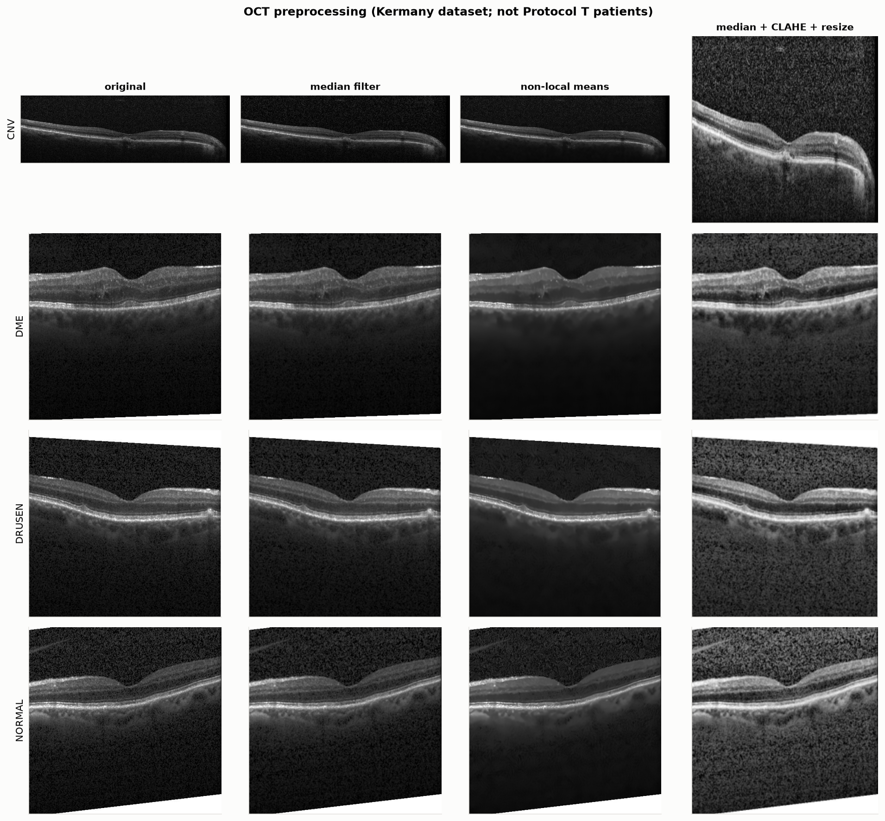

*Figure 18.1: Example Kermany scans: original, median filter, non-local means, and median + CLAHE
(the model input) [`reports/figures/m10_preprocessing.png`]. How to read it: compare columns left
to right. Speckle drops and the retinal layers and dark fluid pockets stand out more.*

**Viva questions.** *Why a median filter and not a Gaussian blur?* Speckle is impulse-like. The
median removes outliers without blurring the layer boundaries, which carry the diagnostic
information.

#### Concept card: convolutional neural network (CNN), convolution, pooling and ResNet

**In plain words.** A CNN looks at an image through small sliding windows (**filters**). Each filter
learns to detect a pattern (an edge, a curve, later a "fluid pocket"), wherever it appears.
Stacking many layers builds from simple patterns to complex ones. **Pooling** shrinks the image
summary step by step. **ResNet** adds "shortcut" connections that let each block learn a
*correction* to its input. That makes very deep networks trainable.

**Technically.**
- **Convolution.** $(I * K)(i, j) = \sum_{u, v} I(i + u, j + v)\,K(u, v)$ for a $k \times k$ kernel
  $K$, followed by a nonlinearity (ReLU). The weights are shared across positions.
- **Pooling.** Max or average over windows; global average pooling at the end.
- **Residual block.** $y = F(x) + x$, so gradients flow through the identity path.
- **ResNet18.** 18 weight layers; the last layer `fc` maps 512 features to the classes.
- **Softmax.** Turns the final scores $z_c$ into probabilities $p_c = e^{z_c}/\sum_k e^{z_k}$.
- **Cross-entropy loss.** $-\log p_{\text{true class}}$.

**Tiny worked example (one convolution step).** Patch $\begin{pmatrix}1 & 2\\ 3 & 4\end{pmatrix}$,
kernel $\begin{pmatrix}1 & 0\\ 0 & -1\end{pmatrix}$ (a diagonal-edge detector):
$1\cdot1 + 2\cdot0 + 3\cdot0 + 4\cdot(-1) = -3$.

**Softmax example.** Scores (2, 1, 0, −1) give $e^z$ = (7.39, 2.72, 1, 0.37), which sum to 11.48,
so $p$ = (0.64, 0.24, 0.09, 0.03).

**In Equipoise.** `eq/vision/resnet.py:build_model` loads `resnet18(weights=ResNet18_Weights.IMAGENET1K_V1)`
and replaces `model.fc` with `nn.Linear(512, 4)`. The loss is `nn.CrossEntropyLoss`.

#### Concept card: transfer learning, freezing and fine-tuning

**In plain words.** Training a big image network from scratch needs millions of images. Instead,
take one already trained on ImageNet (1.2 million everyday photos). It already knows edges,
textures and shapes. Replace its final layer with a new 4-class layer, train only that new layer
at first (**frozen** backbone), then let the whole network adjust gently (**fine-tuning**).

**Technically.**
- **Epoch 1.** Only `fc.*` parameters have `requires_grad=True` (`freeze_backbone_epochs: 1`).
- **Epochs 2–5.** All parameters are trained with **AdamW** ($\eta = 10^{-3}$, weight decay
  $10^{-4}$; AdamW applies the weight decay separately from the gradient step).
- **Input.** The grayscale scan is repeated over 3 channels and normalized with ImageNet means
  and SDs (`transforms`).
- **Augmentation.** Random horizontal flip during training.
- **Model choice.** The epoch with the best **validation** accuracy is kept.

**Tiny worked example.** With a frozen backbone, the only trainable parameters are the new layer's
$512 \times 4 + 4 = 2052$ weights. Fine-tuning then unlocks all of ResNet18's (about 11 million,
ResNet18's standard size).

**In Equipoise** [`reports/tables/m10_resnet_history.csv`]:

| Epoch | Backbone | Validation accuracy |
|---|---|---|
| 1 | frozen | 0.595 |
| 2 | fine-tuned | 0.744 |
| 3 | fine-tuned | 0.78 |
| 4 | fine-tuned | **0.887** (kept: `resnet_best_epoch: 4`) |
| 5 | fine-tuned | 0.803 |

**Viva questions.** *Why freeze the backbone for the first epoch?* The new final layer starts
random. Its large early gradients would wreck the pretrained features if everything were trained
at once. Training the head first gives it sensible weights before fine-tuning.

#### Concept card: YOLO classification

**In plain words.** YOLO ("You Only Look Once") is best known for detecting objects. Ultralytics
also ships a *classification* variant: a small, fast convolutional backbone with a classifier head,
pretrained on ImageNet. We fine-tune its nano version (`yolo11n-cls.pt`) on the same images.

**Technically.** `eq/vision/yolo.py:train` calls `YOLO(checkpoint).train(data=folder, epochs=5,
imgsz=224, batch=32, patience=5, seed=42, deterministic=True, device="cpu")`, then loads
`best.pt`. Ultralytics' anonymous usage analytics are switched off
(`settings.update({"sync": False, "mlflow": False})`). CLAUDE.md notes YOLO is licensed under
**AGPL-3.0**.

**In Equipoise.** The best validation accuracy was 0.864 at epoch 4 [`reports/tables/m10_yolo_history.csv`].

#### Concept card: patient-grouped splits (image leakage)

**In plain words.** One Kermany patient can have many scans. If scans of the same patient land in
both training and validation, the model can recognise *the patient* rather than the disease, and
validation accuracy looks too good. So we split **by patient**.

**Technically.** File names are `CLASS-patientID-n.jpeg` (`scripts/download_oct_subset.py:parse`).
`GroupShuffleSplit(test_size=0.2, groups=patient_id)` creates train/validation inside the official
training split (`eq/vision/data.py:assign_splits`). The official test split stays as the test set.
The download script draws training images from patients not in the official test split, because
"the official split is NOT patient-disjoint" (docstring of `choose`).

**In Equipoise.** The split sizes are:

- train: 3,097 images from 1,233 patients;
- validation: 903 images from 309 patients;
- test: 968 images (242 per class) from 609 patients.

[`reports/tables/m10_dataset_summary.csv`] There are **0 shared patients** between any pair of
splits [`m10_patient_overlap.csv`].

**Viva questions.** *Why is validation accuracy (0.86–0.89) lower than test accuracy (0.95–0.99)?*
The validation set is patient-grouped from ordinary training images. The official test set is a
curated, cleaner selection. README §9.2 says the same: "the curated test set is easier than
typical scans". The validation number is the more realistic estimate.

#### Concept card: multi-class metrics (per-class precision, recall, F1, macro averaging, confusion matrix)

**In plain words.** With four classes, compute precision, recall and F1 for each class as
"this class vs the rest" (§13.6), then average the four. That is the **macro** average, where
every class counts equally. A 4 × 4 confusion matrix shows which classes get mixed up.

**Technically.**
`precision_recall_fscore_support(y, ŷ, labels=classes)` gives the per-class values. The macro
average is their unweighted mean (`eq/vision/run.py:metrics_rows`).

**Tiny worked example.** Per-class F1 of 0.92, 0.99, 0.90 and 0.98 gives a macro F1 of 0.948.

**In Equipoise.** On the official test set (968 images) [`reports/tables/m10_comparison.csv`,
`m10_per_class.csv`]:

| Model | Accuracy | Macro F1 | Weakest class |
|---|---|---|---|
| ResNet18 | 0.948 | 0.948 | DRUSEN recall 0.847 (confused with CNV: CNV precision 0.866) |
| YOLO11n-cls | **0.988** | **0.988** | all classes ≥ 0.983 |

For the DME class itself: ResNet recall **1.0**, precision 0.98; YOLO recall 0.992, precision
0.984.

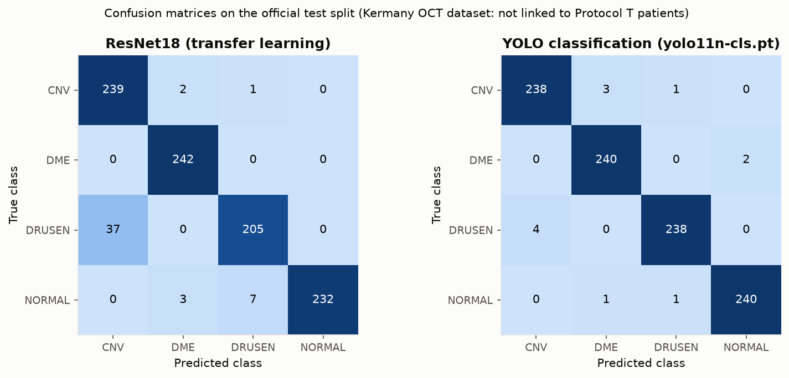

*Figure 18.2: Test-set confusion matrices for both models [`reports/figures/m10_confusion.png`].
How to read it: rows are true classes, columns predicted. Numbers off the diagonal are mistakes.
ResNet's main confusion is DRUSEN predicted as CNV (37 of 242 drusen scans); YOLO makes that mistake 4 times [figure counts]. Both are age-related macular changes that can
look alike.*

#### Concept card: Grad-CAM

**In plain words.** Grad-CAM produces a heatmap showing which parts of the image pushed the network
towards its answer. Red areas mattered most. It lets a doctor check whether the model looked at
the fluid in the retina or at an irrelevant corner.

**Technically.** For the target class $c$ and the feature maps $A^k$ of the last convolutional block
(`model.layer4[-1]`):

1. weights $\alpha_k^c = \frac{1}{Z}\sum_{i,j}\frac{\partial y^c}{\partial A^k_{ij}}$ (the
   gradients, averaged spatially);
2. heatmap $L^c = \text{ReLU}\left(\sum_k\alpha_k^c A^k\right)$, upsampled to the image size.

The project uses `pytorch_grad_cam.GradCAM` and `show_cam_on_image` (`resnet.py:gradcam_overlay`).

**In Equipoise.** Two examples per class (`vision.gradcam_examples: 2`).

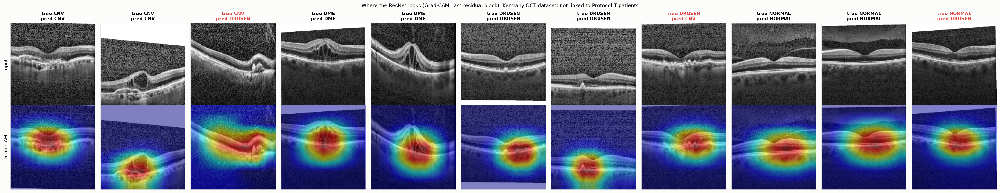

*Figure 18.3: Grad-CAM heatmaps for ResNet18 on test images (public Kermany dataset)
[`reports/figures/m10_gradcam.png`]. How to read it: warm colours mark the regions that most
increased the predicted class's score. For DME, the warm areas should cover the retinal
thickening and fluid.*

**Common confusions.** Grad-CAM shows *where* the network was sensitive, at low resolution (7 × 7
upsampled). It does not explain *why*.

### 18.4 Code walkthrough

`eq/vision/run.py:run`:

1. Refuse synthetic. Load the manifest, `assign_splits`, check patient overlap, `prepare` the
   preprocessed PNG folders.
2. `resnet.train`, then `resnet.predict_folder(test)`.
3. `yolo.train`, then `yolo.predict_folder(test)`.
4. Metrics rows, confusion plots, histories, Grad-CAM.
5. Save the models to `models/oct/`.

The **inference** side (`eq/vision/infer.py:OctScreener`) applies the same preprocessing to an
uploaded image and returns class probabilities from both models plus a Grad-CAM overlay. The
Gradio demo (`app/oct_gradio.py`, port 7861) and the Streamlit OCT page use it (§23).

**Config keys.**

| Key | Value |
|---|---|
| `vision.kaggle_dataset` | `paultimothymooney/kermany2018` |
| `vision.classes` | `[CNV, DME, DRUSEN, NORMAL]` |
| `vision.per_class_train` | 1000 |
| `vision.use_official_test` | true |
| `vision.val_fraction` | 0.2 |
| `vision.preprocess.*` | see §18.3 |
| `vision.resnet` | `{epochs: 5, batch_size: 32, lr: 1e-3, weight_decay: 1e-4, freeze_backbone_epochs: 1}` |
| `vision.yolo` | `{checkpoint: yolo11n-cls.pt, epochs: 5, batch_size: 32, patience: 5}` |
| `vision.gradcam_examples` | 2 |

### 18.5 Run it yourself

There is no synthetic version of the images. The tests use small generated images and untrained
networks, so they run without the download:

```bash
pytest tests/test_vision.py -q
```

Verified for this handbook: `5 passed`. They check preprocessing shape and contrast, the
patient-grouped split, a ResNet training step with prediction and Grad-CAM, the metrics, and
that `vision --synthetic` is refused. The tests skip if the `[cv]` extra is not installed.

The full stage needs `pip install -e ".[cv]"`, a Kaggle token (in `KAGGLE_API_TOKEN` or
`~/.kaggle/access_token`; never commit it), `python scripts/download_oct_subset.py`, then
`python -m equipoise vision`. Training runs on the CPU (5 + 5 epochs on about 4,000 images).

### 18.6 What we found

- **YOLO11n-cls beat ResNet18** on the official test set: accuracy 0.988 vs 0.948
  [`m10_comparison.csv`].
- **On patient-grouped validation the order flips:** ResNet's best was 0.887 and YOLO's 0.864
  [`m10_resnet_history.csv`, `m10_yolo_history.csv`]. Neither model is clearly better. The curated
  test set flatters both.
- **DME is the easiest class**: recall 1.0 (ResNet) and 0.992 (YOLO) [`m10_per_class.csv`].

### 18.7 Limitations and caveats

- **Different dataset.** The images are not from Protocol T. They come from different people,
  devices and countries, so nothing links the screening result to the treatment estimate.
- **Short training.** 5 epochs on 1,000 images per class, a small budget.
- **Easy test set.** The official test set is curated (README §9.2), so the test accuracies
  overstate real-world performance.
- **Licence.** YOLO is AGPL-3.0, which imposes conditions if the app is distributed.

### 18.8 Plan vs reality

- README §4 calls M10 "OCT screening (optional): OpenCV, Ultralytics YOLO classification vs CNN
  transfer learning, Grad-CAM". It is implemented as described. Grad-CAM is computed for the
  ResNet only, not for YOLO.

### 18.9 Check yourself

1. **Median of the window values 5, 7, 6, 200, 6, 5, 7, 6, 8?** Sorted: 5, 5, 6, 6, **6**, 7, 7,
   8, 200, so the median is 6.
2. **Softmax of scores (0, 0, 0, 0)?** 0.25 each: no preference.
3. **Why would mixing a patient's scans across train and validation inflate accuracy?** Scans of
   one patient share anatomy and device artefacts. The model can match the patient rather than
   learn the disease, and validation then measures memorization.

---

## 19. M11 Engineering and MLOps

### 19.1 The story

**What question does M11 answer?** "How do we make sure anyone can rebuild every number in this
report from scratch, track what changed between runs, catch bugs automatically, and serve the
model safely to an app?"

A model in a notebook is a science experiment. A model behind a tested API, built by a versioned
pipeline, tracked in an experiment log and packaged in a container, is a product. **MLOps** ("ML
operations") is the set of tools and habits that close that gap. Think of the difference between
cooking at home and running a restaurant kitchen: same recipes, but with written procedures,
labelled containers, hygiene checks and a pass to the dining room.

This chapter takes each tool in turn and answers the same four questions: what problem it
solves, how Equipoise uses it, the key files, and the commands to show in a demo.

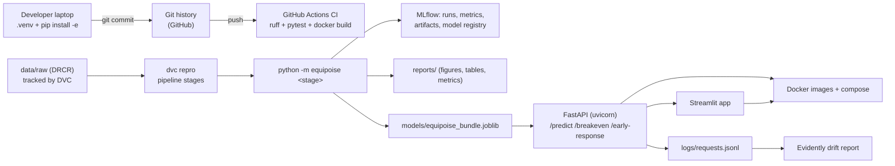

### 19.2 Version control: Git and GitHub

**Problem it solves.** Keeping track of every change to the code: who changed what, when and why.
Being able to go back. Letting a team work in parallel.

**Concept card: Git.**
- **In plain words.** Git takes snapshots ("commits") of the project folder, each with a message.
  The history is a chain of snapshots. A **branch** is a parallel line of work. **GitHub** hosts the
  repository online for sharing, review and CI.
- **Technically.**
  - Each commit is identified by a SHA hash and points to its parent.
  - `git add` stages changes; `git commit` records them; `git log` shows the history; `git diff`
    shows the changes.
  - `.gitignore` lists files never to track. `.gitattributes` controls line-ending
    normalization.
- **In Equipoise.** 19 commits over 9–10 October 2026 build the project phase by phase (§20).
  - **Conventional messages**: `feat(m6): counterfactual engine`, `docs(ui): …`, `chore(m11): …`.
  - `.gitignore` excludes `data/*` (except `data/synthetic/` and the `.dvc` pointer), `models/`,
    `mlruns/`, `mlflow.db`, `logs/`, `reports/synthetic/`, `reports/monitoring/`, `.env` and
    Kaggle credentials.
  - The tracking code stamps each MLflow run with the current commit (`eq/tracking.py:git_commit`,
    with a `-dirty` suffix if there are uncommitted changes).
- **Demo commands.**

  ```bash
  git log --oneline
  git show --stat 6aeed75
  git diff HEAD~1 -- config/default.yaml
  ```
- **Viva question.** *Why is `data/` not in git?* The DRCR terms forbid redistribution, and large
  binary data does not belong in git. DVC tracks it instead (§19.8).

### 19.3 Virtual environments and packaging

**Problem it solves.** Different projects need different library versions. A **virtual environment**
(`.venv`) is an isolated Python installation for this project only. **Packaging** makes the code
importable (`import equipoise`) and declares its dependencies.

**In Equipoise.**
- **Python.** 3.11, required by `pyproject.toml: requires-python = ">=3.11,<3.12"`. On Windows:
  `py -V:3.11 -m venv .venv` (CLAUDE.md).
- **`pyproject.toml`** declares the package `equipoise` (`src/` layout), the core dependencies and
  the **extras**:

  | Extra | Contents |
  |---|---|
  | `dev` | pytest, pytest-cov, ruff, httpx, dvc |
  | `app` | streamlit, altair, fpdf2, evidently, requests |
  | `ui-dev` | playwright |
  | `automl` | autogluon.tabular |
  | `cv` | opencv, torchvision, ultralytics, grad-cam, gradio, kaggle |

  The console script `equipoise = "equipoise.cli:app"` is defined there too.
- **Editable install.** `pip install -e ".[dev]"` links the installed package to the source folder,
  so edits take effect immediately.
- **Pinned files.** `requirements*.txt` are written by `scripts/freeze_requirements.py`, which
  walks the installed dependency tree and pins every package to its installed version. The
  Docker images install from these.

**Demo commands.**

```bash
python -m venv .venv
.venv\Scripts\activate
pip install -e ".[dev,app]"
pip show equipoise
```

The second line is for Windows; on Linux and macOS use `source .venv/bin/activate`.

**Viva question.** *Why both `pyproject.toml` and `requirements.txt`?* `pyproject.toml` states minimum
versions for the package (`>=`). The requirements files pin exact versions for reproducible
builds and Docker.

### 19.4 The command-line interface (Typer)

**Problem it solves.** One consistent way to run every pipeline stage, from a terminal, DVC or CI.

**Concept card: CLI.**
- **In plain words.** Instead of clicking through notebooks, you type one command per step:
  `python -m equipoise causal`. Flags change behaviour, for example `--synthetic`.
- **Technically.** `eq/cli.py` builds a Typer app (Typer turns Python functions with type hints into
  commands).
  - `run_stage(stage, synthetic)` seeds everything, routes synthetic outputs with
    `for_data_source`, and calls the stage's `run(cfg, synthetic)`.
  - Stages are imported lazily, which keeps `--help` fast.
  - `all` runs the ten pipeline stages in order: `preprocess`, `stats`, `represent`,
    `supervised`, `search`, `causal`, `longitudinal`, `decision`, `explain`, `report-assets`.
  - Extra commands: `split`, `validate`, `promote`, `monitor`, `vision`.
  - `src/equipoise/__main__.py` makes `python -m equipoise` work.
- **Demo commands.**

  ```bash
  python -m equipoise --help
  python -m equipoise stats --synthetic
  python -m equipoise all --synthetic
  ```

The full synthetic run took about 33 minutes on the handbook machine, most of it M4's search and
M6's AutoGluon [timed for this handbook].

### 19.5 YAML configuration

See the YAML concept card in §7.2. `eq/config.py`:

- `load_config()` returns a frozen `Config` with absolute paths. The repo root is found from
  `EQUIPOISE_ROOT` or by walking up to `config/default.yaml`.
- `load_prices()` returns real prices only if every price in `costs.yaml` is filled in.
  Otherwise it uses an explicit override, else the labelled DEMO set (`is_demo=True`).
- `for_data_source(cfg, synthetic)` reroutes figures, tables and metrics to `reports/synthetic/`
  and derived files to `data/derived/synthetic/`.

### 19.6 Environment variables

**Concept card: environment variable.**
- **In plain words.** A named setting supplied by the operating system or the container, read by
  the program at start-up. It changes behaviour without editing files. That is ideal for "which
  model file?" or "which API address?" in different deployments.
- **In Equipoise** (`config/default.yaml: serving`):

  | Variable | Effect |
  |---|---|
  | `EQUIPOISE_SYNTHETIC=1` | serve `models/synthetic/` (public demo) |
  | `EQUIPOISE_BUNDLE=<path>` | serve a specific bundle file |
  | `EQUIPOISE_REQUEST_LOG=off` or a path | request logging |
  | `API_URL` | the app calls the API instead of loading the bundle |
  | `EQUIPOISE_ROOT` | where the repo lives inside Docker |
  | `KAGGLE_API_TOKEN` | M10 download only; never commit it |

  See `eq/serving/service.py:resolve_bundle_path`, `resolve_log_path` and
  `eq/serving/client.py:make_client`.
- **Demo commands.** On Windows PowerShell:

  ```powershell
  $env:EQUIPOISE_SYNTHETIC = "1"
  streamlit run app/streamlit_app.py
  ```

  In bash, prefix the command instead: `EQUIPOISE_SYNTHETIC=1 streamlit run app/streamlit_app.py`.

### 19.7 Testing (pytest) and linting (ruff)

**Problem it solves.** Catching mistakes automatically, before they reach the report, and
guaranteeing that rules (no leakage, no technical jargon on clinician pages) stay true as the code
changes.

**Concept card: automated testing.**
- **In plain words.** A test is a small program that runs part of the project and checks the result.
  - A **unit test** checks one function: "Newton matches brentq".
  - An **integration or smoke test** runs a whole path: "the app's pages render with a
    synthetic model".
  - A **fixture** is shared set-up, such as "load the synthetic table".
- **Technically.** pytest discovers `tests/test_*.py` and runs each `test_*` function. Tools used:
  - `@pytest.fixture` (in `tests/conftest.py`: `cfg`, `synthetic`, `real_analysis`, and the
    session-scoped `light`/`bundle` that fit a light M6 once);
  - `pytest.mark.parametrize`, `pytest.approx`, `pytest.raises`;
  - `pytest.importorskip` (skip when an extra is not installed);
  - `monkeypatch`.

  Real-data tests **skip** when `data/protocolT_analysis.csv` is absent, so CI runs on synthetic
  data only.
- **In Equipoise.** 23 test files, containing 177 `def test_` functions (more test cases after
  parametrization) [`grep` count for this handbook]. The checks that matter most:
  - **Leakage:** `test_leakage.py`, `test_preprocess.py:test_imputer_fitted_on_train_only`.
  - **Scratch vs library:** OLS (`test_supervised.py`), IRLS, SVD-PCA, Lagrange,
    forward/Viterbi, Newton.
  - **Statistics:** `test_ipw_policy_value_is_unbiased` (Monte Carlo check of IPW),
    `test_replication_matches_readme` (real data).
  - **UI:** `test_copy.py` fails if any of about 30 banned technical terms (for example "counterfactual",
    "CATE", "SHAP", "fuzzy", "MCID", "baseline") appears on clinician pages; `test_presenters.py` asserts that "no clear winner never suggests the
    costlier drug" and "nothing is shown from DEMO prices".
  - **Serving:** `test_api.py` checks schema rejection of non-baseline fields, that the API
    matches `recommend()`, and that the request log holds baseline features only.

- **Result on the handbook machine.** `pytest -q` gave **295 passed** in 396.92 s (6 min 37 s),
  with no skips, because the real data is present [run for this handbook]. In CI, without the
  DRCR files, the real-data tests skip.

- **Ruff** is a fast Python linter (`[tool.ruff]` in `pyproject.toml`: line length 100; rule sets
  E, F, W, I, UP, B, NPY). `ruff check .` must be clean. The frozen M0 script is excluded.
- **Demo commands.**

  ```bash
  pytest -q
  pytest tests/test_leakage.py -v
  ruff check .
  ```

### 19.8 DVC: data and pipeline versioning

**Problem it solves.** Git cannot version a 27 MB folder of DRCR tables that may not be shared, and
it does not know that "change the config → rerun M6 → rebuild the report". DVC does both.

**Concept card: DVC.**
- **In plain words.** DVC keeps a small pointer file in git (a fingerprint of the data), and the data
  itself in a cache outside git. It also records the pipeline: which command produces which files
  from which inputs and settings. `dvc repro` reruns only the steps whose inputs changed, like a
  smart `make`.
- **Technically.**
  - `data/raw.dvc` holds the MD5 hash of `data/raw` (68 files, 27,035,396 bytes) [`data/raw.dvc`].
  - `dvc.yaml` defines the **stages**, each with:
    - `cmd`: the command to run;
    - `deps`: input files and code;
    - `params`: the keys of `config/default.yaml` it uses;
    - `outs`: the files it produces. Report files use `cache: false` so git tracks them.
    - `metrics`: the per-stage JSON in `reports/metrics/`.
  - `dvc.lock` records the exact hashes of the last run.
  - `dvc params diff` and `dvc metrics diff` compare versions.
- **In Equipoise.** The stages are:
  - `build_analysis`, `build_visits`, `build_cst_quality`;
  - `split` and `synthetic`;
  - the ten pipeline stages;
  - `vision`.

  The parameters are read straight from `config/default.yaml`, so there is no separate
  `params.yaml` (`dvc.yaml` header). `.dvc/config` sets `analytics = false`.
- **Demo commands.**

  ```bash
  dvc dag
  dvc status
  dvc repro causal
  dvc metrics show
  ```
- **Viva question.** *If I change `causal.bootstrap_reps`, what does `dvc repro` rerun?* The `causal`
  stage, because it lists that parameter, and every downstream stage that depends on its outputs
  (`decision`, `explain`, `report-assets`).

### 19.9 MLflow: experiment tracking and model registry

**Problem it solves.** After dozens of runs, "which settings gave which result, on which data and
code?" MLflow records every run with its parameters, metrics, files and provenance, and keeps a
registry of model versions.

**Concept card: experiment tracking.**
- **In plain words.** A lab notebook that writes itself. Each stage run is logged with the settings
  used, the results, the figures and tables, and labels saying which code version and which data
  version it used.
- **Technically** (`eq/tracking.py`):
  - The tracking store is a SQLite database (`mlflow.tracking_uri: sqlite:///mlflow.db`), with
    artifacts in `mlruns/`. The config comment notes that MLflow 3 refuses the plain-folder
    backend.
  - There is one **experiment** per stage: `equipoise-m1-preprocess`, …, `equipoise-m11-monitor`.
  - `start_run` adds the tags `stage`, `module`, `git_commit`, `data_source` (real/synthetic),
    `data_version` (short SHA-256 of the input table) and `seed`.
  - `child_run` nests one run per model (M5) or per algorithm × seed (M4).
  - `log_params` flattens the config into dotted keys. `log_figure` and `log_table` write the
    report files *and* log them as artifacts.
- **Registry.** M6 logs the real-data bundle as an MLflow **pyfunc** model and registers it as
  `equipoise-cate` (`causal/bundle.py:register_bundle`). `python -m equipoise promote` points the
  alias **`champion`** at a version (`eq/registry.py:promote_bundle`). MLflow 3 replaced the old
  Staging/Production stages with aliases.
- **State at the time of writing.** The registry holds versions 1–8 of `equipoise-cate`, with
  `champion` → version 8 [read from `mlflow.db` for this handbook]. The report's experiment table,
  `reports/tables/m11_experiments.csv`, is generated from the latest real-data runs
  (`eq/report/tables.py:experiments_table`). It is the ready-made "Experiment tracking" table for
  the report.
- **Demo commands.**

  ```bash
  mlflow ui --backend-store-uri sqlite:///mlflow.db
  python -m equipoise promote
  ```

  Browse to http://localhost:5000, filter with `tags.data_source = "real"` (`docs/experiments.md`),
  select two M5 runs, and click **Compare**. `promote` points `champion` at the newest version.

### 19.10 joblib model bundle

See the joblib concept card in §7.5 and the bundle walkthrough in §14.6. One file
(`models/equipoise_bundle.joblib`) holds everything needed to score a patient. Docker images never
contain it; it is mounted read-only at run time (`docker-compose.yml: ../models:/app/models:ro`).

### 19.11 REST API: FastAPI, JSON and Pydantic

**Problem it solves.** The model must be usable by other programs (the app, a hospital system,
tests) over the network, in a standard format, with inputs checked before they reach the model.

**Concept card: REST API and JSON.**
- **In plain words.** An API is a menu of requests a program accepts. In a **REST** API each request
  goes to a URL ("endpoint") with an HTTP method:
  - **GET** to read;
  - **POST** to send data for processing.

  Data travels as **JSON**, text that looks like Python dicts and lists. The server answers with
  JSON and a status code: 200 OK, 422 "invalid input", 503 "service unavailable".
- **Technically.** FastAPI maps Python functions to endpoints and validates request and response
  bodies with Pydantic models. It generates interactive documentation automatically at `/docs`
  (OpenAPI). Uvicorn is the ASGI web server that runs it (`api/main.py`).

**Endpoints** (`eq/serving/api.py:create_app`):

| Method | Path | Does | Errors |
|---|---|---|---|
| GET | `/health` | model name, synthetic flag, data hash, which capabilities exist, price label | n/a |
| GET | `/metadata` | arms, MCID, form defaults, feature schema, disclaimer, attribution | n/a |
| POST | `/predict` | `recommend()` + optional SHAP explanation + which features were imputed | 422 on invalid input |
| POST | `/breakeven` | break-even result + net-benefit curve over prices | 422 |
| POST | `/early-response` | week-52 forecast from weeks 4/8/12 vision | 503 if M7 model missing; 422 |

The service is loaded **once** at start-up (FastAPI `lifespan`), not per request.

**Concept card: Pydantic validation.**
- **In plain words.** Pydantic checks every incoming field against rules before the model sees it:
  the right type, the allowed range, the allowed category. Bad requests are rejected with a clear
  message instead of producing nonsense.
- **In Equipoise.** `eq/serving/schemas.py`:
  - **`PatientFeatures` is generated** field by field from the analysis schema's `X_` columns
    (`create_model`), with the same ranges and categories the table is validated against.
  - `extra="forbid"` rejects unknown fields, so identifiers, outcomes (`Y_`), bookkeeping (`M_`)
    and `treatment` can never be sent.
  - Only `X_va_letters` is required. Missing features are imputed and reported back.
  - A `model_validator` rejects an `X_va_below_69` that contradicts `X_va_letters`.
  - `PricesIn` requires all three arms' prices if any is given.
- **Request logging.** `append_request_log` writes one JSON line per request: timestamp, endpoint,
  baseline features only, no identifiers and no client address. The file is `logs/requests.jsonl`
  (git-ignored).
- **Demo commands.**

  ```bash
  uvicorn api.main:app --reload
  curl http://localhost:8000/health
  curl -X POST http://localhost:8000/predict -H "Content-Type: application/json" -d "{\"patient\": {\"X_va_letters\": 60}}"
  ```

  Then open http://localhost:8000/docs and use "Try it out".

### 19.12 Streamlit app

**Problem it solves.** Clinicians need a friendly screen, not JSON. Streamlit builds web apps in
pure Python: each script re-runs top to bottom on every interaction, with `st.session_state`
remembering values between runs.

**In Equipoise.** `app/streamlit_app.py` builds the navigation (`st.navigation` and `st.Page`):

- five main pages: Home, Get a suggestion, Price check, Progress check, About the trial;
- under "For reviewers": Behind the model, plus the OCT demo if available.

The structure is:

- **Wording** in `app/copy.py`.
- **View models** in `app/presenters.py`. These are pure functions: rounding, lines, Snellen,
  rupees, thresholds.
- **Model calls and caching** in `app/services.py`. The `FallbackClient` tries the API when
  `API_URL` is set, and quietly falls back to the local bundle otherwise. Predictions are cached
  per (patient, prices).
- **Theme** in `.streamlit/config.toml`. Usage statistics are switched off.

Chapter 23 walks through every screen.

**Demo commands.**

```bash
streamlit run app/streamlit_app.py
```

Then open http://localhost:8501.

### 19.13 Docker and docker compose

**Problem it solves.** "It works on my laptop" is not enough. A **container** packages the code, the
Python version and every library into one image that runs the same everywhere.

**Concept card: Docker.**
- **In plain words.**
  - A **Dockerfile** is a recipe for building an **image**, a frozen filesystem with everything
    installed.
  - A **container** is a running instance of an image.
  - A **volume mount** lets a container see a folder from the host, used here for the model
    files.
  - **docker compose** starts several containers together (API + app) and wires them up.
- **Technically** (`docker/`):
  - **`Dockerfile.api`.** Starts from `python:3.11-slim`. It installs CPU-only torch, then the
    pinned requirements, then the package (`--no-deps`). It copies `config/`, `api/` and
    `reports/metrics/`, and runs as a non-root user. It has a `HEALTHCHECK` that curls `/health`.
    The command is `uvicorn api.main:app --host 0.0.0.0 --port 8000`.
  - **`Dockerfile.app`.** Same base, plus the app requirements. It copies `app/`, `reports/` and
    `data/synthetic`, and runs `streamlit run …` on port 8501.
  - **`Dockerfile.space`.** A single container for a Hugging Face Space. It **bakes in the
    synthetic bundle** (`models/synthetic`) and sets `EQUIPOISE_SYNTHETIC=1` and request logging
    off.
  - **`docker-compose.yml`.**
    - The API mounts `../models` read-only, `../logs`, and `config/costs.yaml`.
    - The app gets `API_URL=http://api:8000` and waits until the API's health check passes
      (`depends_on: condition: service_healthy`).
    - `EQUIPOISE_SYNTHETIC` defaults to 0.
  - **`.dockerignore`** keeps `data/` (except synthetic) and the real models out of the build
    context.
- **Safety rule** (CLAUDE.md; `docs/deployment.md`): images never contain DRCR data or the
  DRCR-trained bundle. Public demos use the synthetic bundle. "Never deploy" without a team
  decision.
- **Demo commands.**

  ```bash
  docker compose -f docker/docker-compose.yml up --build
  docker compose -f docker/docker-compose.yml ps
  ```

  Then open http://localhost:8501 (app) and http://localhost:8000/docs (API).

### 19.14 GitHub Actions CI

**Problem it solves.** Running the checks automatically on every push, on a clean machine, so a
broken commit is caught immediately.

**In Equipoise** (`.github/workflows/ci.yml`), triggered on every push and pull request:

1. **Job `test`** on `ubuntu-latest`:
   - check out the code and set up Python 3.11 with a pip cache;
   - `pip install -e ".[dev,app]"` with CPU-only torch;
   - `ruff check .`;
   - `pytest`, on synthetic data only, including the API and app smoke tests.
2. **Job `docker`** (`needs: test`): build the API and app images (**never pushes**), then
   validate the compose file with `docker compose config --quiet`.

CI cannot access the DRCR data, so real-data tests skip there. The handbook's own helper scripts
pass `ruff check .`. The `[cv]` and `[automl]` extras are not installed in CI, so the vision tests
skip there.

**Demo.** Open the repository's **Actions** tab on GitHub and show a green run with its two jobs.

### 19.15 Evidently: data-drift monitoring

**Problem it solves.** After deployment, the patients sent to the model may stop resembling the
training patients: a different hospital, older patients, different OCT machines. Predictions then
become less trustworthy. **Drift monitoring** checks this statistically.

**Concept card: data drift.**
- **In plain words.** Compare the distribution of each input feature in recent requests with the
  training data. If many features have shifted, raise a flag.
- **Technically** (`eq/monitor.py:drift_report`). Evidently's `DataDriftPreset(drift_share=0.5)`
  runs one test per feature:
  - Kolmogorov–Smirnov for numeric features;
  - chi-square for categorical features;
  - a Z-test for binary features (the tests seen in the local report).

  A feature is "drifted" if $p < 0.05$. The **dataset** is drifted if at least 50% of features
  drift (`monitor.drift_share: 0.5`). The reference is the training split's baseline features. At
  least 30 logged requests are needed (`monitor.min_requests`).
- **Simulation.** `scripts/simulate_requests.py` writes 120 simulated requests from held-out
  patients, half of them shifted (age +8, HbA1c +1, vision −6) (`monitor.simulate`). They are
  labelled "simulated", not real usage.
- **Local result at the time of writing** (`reports/monitoring/`, git-ignored, depends on local
  traffic): **6 of 33 features drifted**: age, diabetes type, HbA1c, OCT machine, vision < 69 and
  vision letters. The share is 0.18, below 0.5, so **no dataset-level drift** is declared
  [`reports/monitoring/drift_by_feature.csv`, counted for this handbook]. Three of the six are the
  features the simulation deliberately shifts; vision < 69 follows from the vision shift.
- **Demo commands.**

  ```bash
  python scripts/simulate_requests.py --synthetic --log logs/demo_requests.jsonl
  EQUIPOISE_REQUEST_LOG=logs/demo_requests.jsonl python -m equipoise monitor --synthetic
  ```

  On Windows PowerShell, set `$env:EQUIPOISE_REQUEST_LOG = "logs/demo_requests.jsonl"` first.
  Verified for this handbook with a temporary log. It printed `appended 120 simulated requests
  (62 shifted)`, then `n_reference: 528`, `n_current: 120`, `share_drifted_features: 0.1818`,
  `dataset_drift: 0`. The HTML report for a synthetic run lands in
  `reports/synthetic/monitoring/drift_report.html`; open it in a browser. Without `--log`, the
  simulator appends to the real `logs/requests.jsonl`.

### 19.16 Report assets and Playwright screenshots

- `python -m equipoise report-assets` (`eq/report/run.py`) generates:
  - the flow diagram and the causal DAG (matplotlib/networkx);
  - the three template tables: feature description, experiments and tech stack;
  - `reports/REPORT_ASSETS.md`, which maps every figure and table to a report-template section.
  
  On synthetic data it reported 54 experiment rows and 32 libraries [synthetic run log].
- `scripts/ui_screenshots.py` uses **Playwright** to drive a real browser (Chromium) through every
  app page at desktop and phone width, saving `reports/figures/ui/*.png`. Install with
  `pip install -e ".[ui-dev]"` and `python -m playwright install chromium`.

### 19.17 Run it yourself (synthetic data)

```bash
python -m equipoise all --synthetic
pytest -q
python scripts/simulate_requests.py --synthetic --log logs/demo_requests.jsonl
EQUIPOISE_REQUEST_LOG=logs/demo_requests.jsonl python -m equipoise monitor --synthetic
```

The first command was verified for this handbook (exit code 0, about 33 minutes). The test result
is in §19.7. The synthetic monitor writes to `reports/synthetic/monitoring/`.

### 19.18 Limitations and caveats

- No real deployment was made, by design (`docs/deployment.md`). The Hugging Face Space recipe is
  documented but untested in this handbook.
- **Serving reads a file, not the registry.** The API serves the bundle *file* named by
  `EQUIPOISE_BUNDLE` or the default path. It does **not** load the model through the registry
  alias. `promote` is a bookkeeping step that records which version is the champion.
- MLflow holds both real and synthetic runs in the same experiments. Filter by the `data_source`
  tag.
- Drift monitoring is batch (run by hand), not continuous.

### 19.19 Plan vs reality

- **Deployment.** README §4 lists "Git/GitHub, MLflow, DVC, Docker, GitHub Actions CI, FastAPI,
  Streamlit, Evidently" for M11, and all are implemented. README's pipeline diagram also says
  "deploy". The project deliberately did **not** deploy, and `docs/deployment.md` gives the
  reasons.
- **Champion model.** The "champion" alias does not control what the API serves (§19.18).

### 19.20 Check yourself

1. **What does `extra="forbid"` on `PatientFeatures` protect against?** A client sending outcome,
   bookkeeping or identifier fields. They are rejected with a 422 error, so they can never reach
   the model.
2. **A teammate changes `seed` in config and runs `dvc repro`. What reruns?** `split`, which lists
   `seed`, and every stage that depends on it or lists `seed`. In effect, the whole pipeline.
3. **Why does the app container not contain the DRCR-trained model?** Redistributing a model trained
   on DRCR data needs the data owner's permission (`docs/deployment.md`). The model folder is
   mounted from the host at run time instead.

---

## 20. How the project was built

Part D explains how the system is built and how it runs. This chapter reconstructs the timeline
from `git log` and is the raw material for the report's **Version Control** section.

### 20.1 Before the repository

Two pieces of work came before the first commit:

- **The M0 build script and table.** `scripts/build_protocolT_table.py` and the 660 × 47
  `protocolT_analysis.csv` existed before the repository. A copy dated 7 October 2026 sits next to
  the repo folder, in the parent directory. CLAUDE.md marks the script as "done: do not rewrite
  it".
- **The self-learning notebook.** The `self learning/` notebook outside the repo is explicitly not
  part of the project (CLAUDE.md).

### 20.2 Timeline of commits

All 19 commits on `master` were made on 9–10 October 2026 (IST, +05:30) [`git log`]. The file and
line counts come from `git log --shortstat`.

| # | Commit | Time | Phase | What it added | Files / insertions |
|---|---|---|---|---|---|
| 1 | `a55d64d` | 9 Oct 14:53 | 0: scaffold | package skeleton, config, schema, leakage guard (`features.py`), seeds, MLflow helpers, CLI stubs, CI, synthetic data generator and data, first tests | 51 / 20,918 |
| 2 | `595471e` | 9 Oct 15:08 | 1: M0 | visit-table build, cross-check, fixed split (`splits.py`), DVC pipeline | 22 / 8,587 (−7,267: synthetic data regenerated) |
| 3 | `7fe3e34` | 9 Oct 15:47 | 2: M1 + M2 | preprocessing (imputation, harmonization, outliers, encoding), Table 1, replication, tests | 87 / 3,657 |
| 4 | `ea411bf` | 9 Oct 17:16 | 3: M3 + M5 | PCA/SVD, clustering, Apriori; supervised model zoo, scratch OLS/IRLS | 94 / 2,435 |
| 5 | `cde9911` | 9 Oct 17:39 | 4: M4 | feature-selection rankings, six search algorithms, objective | 31 / 1,300 |
| 6 | `6aeed75` | 9 Oct 23:20 | 5: M6 | CATE learners, TARNet, semi-synthetic benchmark, policy value, tuning, AutoGluon, bundle | 73 / 2,623 |
| 7 | `bc374e1` | 10 Oct 00:37 | 6: M7 | tensor, interpolation, finite differences, ARIMA, HMM, trajectory clusters, early response | 65 / 1,842 |
| 8 | `4488116` | 10 Oct 03:41 | 7: M8 + M9 | cost, break-even, fuzzy, expert system, agent; SHAP, subgroups | 51 / 2,003 |
| 9 | `6a56eae` | 10 Oct 04:30 | 8: serving | FastAPI service, first Streamlit app, Dockerfiles, compose | 30 / 1,854 |
| 10 | `ad7e2d9` | 10 Oct 04:53 | 9: MLOps | Evidently drift monitoring, registry promotion, CI image builds | 11 / 481 |
| 11 | `a8493f9` | 10 Oct 05:15 | 11: report | report assets (flow diagram, DAG, template tables, `REPORT_ASSETS.md`), `docs/concepts/` | 49 / 1,895 |
| 12 | `a896dbf` | 10 Oct 14:43 | 10: M10 (optional) | OCT subset download, OpenCV preprocessing, ResNet18, YOLO, Grad-CAM, Gradio | 47 / 1,449 |
| 13 | `e66e51e` | 10 Oct 20:21 | UI redesign | new information architecture, `app/copy.py`, presenters | 18 / 1,360 |
| 14 | `da22fe7` | 10 Oct 20:34 | UI redesign | wizard steps 1–2 | 15 / 1,577 |
| 15 | `8d23a2f` | 10 Oct 20:40 | UI redesign | wizard step 3, PDF summary | 12 / 513 |
| 16 | `6724a09` | 10 Oct 20:45 | UI redesign | Price check, Progress check, About the trial | 8 / 249 |
| 17 | `ab842cc` | 10 Oct 20:49 | UI redesign | Behind the model, OCT page | 4 / 362 |
| 18 | `34477b2` | 10 Oct 21:08 | UI redesign | visual polish, dark mode, Playwright screenshots | 25 / 186 |
| 19 | `81df4f0` | 10 Oct 21:10 | UI redesign | user guide, demo script, README quick start | 3 / 232 |

The handbook adds its own commits on the branch `docs/handbook`. They change no project code.

### 20.3 How the phases map to the plan

The CLI's `PLANNED_PHASE` dictionary records the intended order: preprocess and stats in phase 2,
represent and supervised in 3, search in 4, causal in 5, longitudinal in 6, decision and explain
in 7, monitor in 9, vision in 10, report-assets in 11 (`eq/cli.py`). The commits follow it.

Two departures:

- **Phase 10 (M10) was committed after phase 11** (commit 12 vs 11), because it is optional.
- **The UI redesign (commits 13–19) came after all phases.** It followed `docs/ui_audit.md`, which
  lists what a first-time user saw in the first app (six radio-button pages, 33 fields labelled
  with variable names, jargon) and proposed the wizard, plain-language copy and the "Behind the
  model" page.

CLAUDE.md describes the working process: one phase at a time; at the end of each, run `pytest`,
commit as `feat(mN): …`, summarize, then wait.

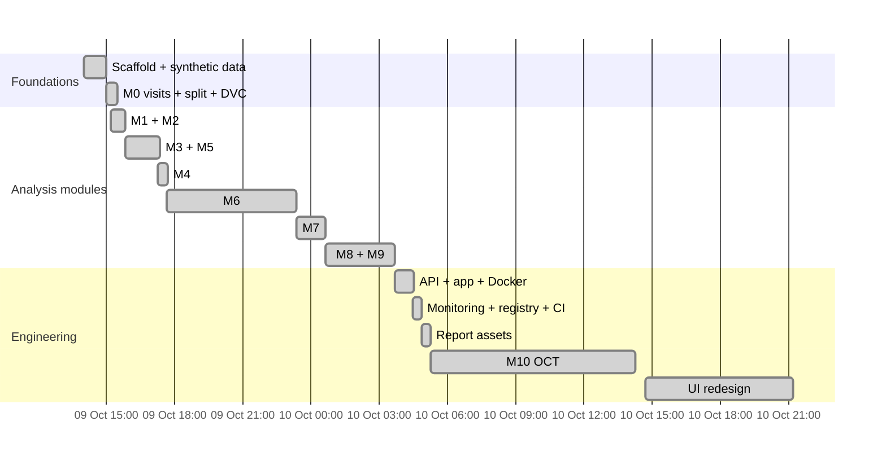

*The bar lengths are the gaps between consecutive commits, not measured work time.*

### 20.4 For the report's Version Control section (facts)

- Git repository, single branch `master` for the project (the handbook is on a separate branch).
- 19 commits, conventional-commit style messages (`feat(mN)`, `chore`, `docs`).
- `.gitignore` enforces the data-protection rules.
- DVC tracks the raw data and the pipeline (`data/raw.dvc`, `dvc.yaml`, `dvc.lock`).
- MLflow tags every run with the git commit.
- CI (GitHub Actions) runs on every push.
- No remote URL is configured in the local repository, and CLAUDE.md says "**Never** push to
  GitHub" without the team's decision. Whether a GitHub remote exists is **not recorded in the
  repo**.

---

## 21. Repository tour

Every folder and important file: what it is, who uses it, and whether it is **generated** (G) by
code or **hand-written** (H). "Committed" means tracked by git.

### 21.1 Top level

| Path | What | G/H | Committed |
|---|---|---|---|
| `README.md` | project specification and results summary | H | yes |
| `CLAUDE.md` | working rules for AI assistants (integrity, leakage, privacy, process) | H | yes |
| `pyproject.toml` | package metadata, dependencies, extras, ruff and pytest settings | H | yes |
| `requirements*.txt` | exact pinned versions (core, app, automl, cv, dev) | G (`scripts/freeze_requirements.py`) | yes |
| `dvc.yaml` / `dvc.lock` | pipeline definition / exact hashes of the last run | H / G | yes |
| `.gitignore`, `.gitattributes`, `.dockerignore`, `.dvcignore` | what to keep out of git, Docker and DVC; line endings | H | yes |
| `.github/workflows/ci.yml` | CI pipeline | H | yes |
| `.streamlit/config.toml` | app theme, usage stats off | H | yes |
| `.dvc/` | DVC configuration (analytics off) | H | yes (config) |
| `mlflow.db`, `mlruns/` | MLflow tracking database and artifacts | G | no |
| `.venv/` | the virtual environment | G | no |

### 21.2 Folders

| Folder | Contents | G/H | Committed |
|---|---|---|---|
| `config/` | `default.yaml` (all settings), `costs.yaml` (prices, null), `replication_targets.yaml` | H | yes |
| `data/raw/` | DRCR download: 31 tables, CRFs, protocol PDF, ReadMe | external | no (DVC pointer `data/raw.dvc` only) |
| `data/protocolT_*.csv`, `data/splits.json` | analysis, visit and CST-quality tables; the split | G (M0) | no |
| `data/synthetic/` | fake tables with the real schema, the truth file, the split, a README | G (`make_synthetic_data.py`) | **yes** |
| `data/derived/` | patient-level outputs: outlier flags, held-out effects, app examples, OCT folders | G | no |
| `data/external/kermany_oct/` | the OCT image subset | external | no |
| `src/equipoise/` | the Python package (below) | H | yes |
| `scripts/` | one-off build and utility scripts (below) | H | yes |
| `scripts/handbook/` | this handbook's helpers | H | yes |
| `api/` | `main.py`: the ASGI entry point (`uvicorn api.main:app`) | H | yes |
| `app/` | the Streamlit app (below) | H | yes |
| `models/` | trained bundle, early-response model, serving assets, OCT models, AutoGluon folders, `synthetic/` | G | no |
| `reports/figures/`, `reports/tables/`, `reports/metrics/` | all aggregate results (PNG; CSV + MD; JSON) | G | yes |
| `reports/figures/ui/` | app screenshots | G (Playwright) | yes |
| `reports/REPORT_ASSETS.md` | map from report sections to figures/tables | G (report-assets) | yes |
| `reports/synthetic/`, `reports/monitoring/` | synthetic-run outputs; drift reports | G | no |
| `docs/` | `USER_GUIDE.md`, `DEMO_SCRIPT.md`, `deployment.md`, `experiments.md`, `data_structures.md`, `ui_audit.md`, `concepts/` (27 method notes), `HANDBOOK.md`, `handbook/_inventory.md` | H | yes |
| `docker/` | `Dockerfile.api`, `Dockerfile.app`, `Dockerfile.space`, `docker-compose.yml` | H | yes |
| `notebooks/` | empty except `.gitkeep` | n/a | yes |
| `tests/` | 23 test files + `conftest.py` | H | yes |
| `logs/` | `requests.jsonl` (API request log) | G | no |

### 21.3 The package `src/equipoise/`

| Module | Files | Role | Chapter |
|---|---|---|---|
| top level | `cli.py`, `__main__.py`, `config.py`, `features.py`, `reproducibility.py`, `tracking.py`, `plotting.py`, `registry.py`, `monitor.py` | CLI, config, leakage gate, seeds, MLflow, figure style, registry, drift | §19 |
| `data/` | `schema.py`, `load.py`, `splits.py`, `crosscheck.py` | schema validation, loading, split, cross-check | §08 |
| `preprocess/` | `columns.py`, `encode.py`, `harmonize.py`, `missing.py`, `outliers.py`, `cst_quality.py`, `discretize.py`, `run.py` | M1 | §09 |
| `stats/` | `table1.py`, `replication.py`, `inference.py`, `run.py` | M2 | §10 |
| `represent/` | `pca.py`, `cluster.py`, `rules.py`, `run.py` | M3 | §11 |
| `search/` | `objective.py`, `algorithms.py`, `selection.py`, `run.py` | M4 | §12 |
| `supervised/` | `models.py`, `scratch.py`, `evaluate.py`, `run.py` | M5 | §13 |
| `causal/` | `data.py`, `learners.py`, `tarnet.py`, `semisynth.py`, `policy.py`, `tuning.py`, `automl.py`, `bundle.py`, `run.py` | M6 | §14 |
| `longitudinal/` | `tensor.py`, `derivatives.py`, `timeseries.py`, `hmm.py`, `clusters.py`, `early_response.py`, `run.py` | M7 | §15 |
| `decision/` | `cost.py`, `breakeven.py`, `fuzzy.py`, `expert.py`, `agent.py`, `recommend.py`, `run.py` | M8 | §16 |
| `explain/` | `shap_effects.py`, `fairness.py`, `run.py` | M9 | §17 |
| `vision/` | `data.py`, `preprocess.py`, `resnet.py`, `yolo.py`, `infer.py`, `run.py` | M10 | §18 |
| `serving/` | `schemas.py`, `service.py`, `api.py`, `client.py`, `assets.py`, `examples.py`, `figures.py` | API and app back end | §19, §22 |
| `report/` | `diagrams.py`, `tables.py`, `assets_index.py`, `run.py` | report assets | §19, §29 |

Every stage module has a `run(cfg, synthetic)` function that the CLI calls. Every module docstring
explains its method in a few plain sentences (CLAUDE.md requirement).

### 21.4 `app/` (Streamlit)

| File | Role |
|---|---|
| `streamlit_app.py` | navigation only (pages, sections, OCT page if available) |
| `views/home.py`, `suggest.py`, `price_check.py`, `progress.py`, `about.py` | the five clinician pages |
| `views/behind.py`, `views/oct.py` | reviewer pages |
| `copy.py` | every user-facing string on the main pages (no jargon; tested) |
| `presenters.py` | pure functions turning a prediction dict into view models (tested) |
| `services.py` | model client (API or local fallback), caching, session state, examples |
| `widgets.py` | shared page pieces ("Is the extra cost worth it?") |
| `charts.py` | Altair charts |
| `pdf.py` | one-page PDF summary (fpdf2) |
| `theme.py` | colours shared with the report figures |
| `oct_gradio.py` | stand-alone Gradio OCT demo |

### 21.5 `scripts/`

| Script | Purpose |
|---|---|
| `build_protocolT_table.py` | M0 analysis table (frozen) |
| `build_protocolT_visits.py` | visit table + cross-check |
| `build_cst_quality.py` | reading-centre quality flags |
| `make_synthetic_data.py` | synthetic tables with a planted effect |
| `pick_example_patients.py` | scores all held-out patients once; picks the app's three examples (written to `data/derived/`, never committed); writes `m8_heldout_no_clear_winner` |
| `simulate_requests.py` | simulated API traffic for drift monitoring |
| `ui_screenshots.py` | Playwright screenshots |
| `freeze_requirements.py` | pinned requirements files |
| `download_oct_subset.py` | partial download of the Kermany zip via HTTP range requests |
| `handbook/scan_code.py`, `scan_usage.py` | import and function scans for the inventory |
| `handbook/column_table.py` | §4.5 column table (aggregates) |
| `handbook/six_patients.py` | §14 meta-learner teaching example |
| `handbook/trace_typical_patient.py` | §16 and §22 traces |
| `handbook/build_handbook.py` | table of contents, link check, word counts |
| `handbook/check_coverage.py` | concept-coverage check (§33) |

---

## 22. Life of one prediction

This chapter follows one patient from the moment a clinician opens the app to the exact sentence
on the screen. It shows the intermediate value at every step.

**The patient.** The app's **default form patient**: training medians and modes
(`serving_assets.joblib: defaults`, written by M9 from `decision.run.typical_patient`). It is an
aggregate, not a real person. The only change the app makes is to move vision to the nearest
eye-chart line: **69 letters becomes 20/40 = 70 letters** (`app/services.py:default_patient`).

Every value below comes from `python scripts/handbook/trace_typical_patient.py` on the real bundle
[script output, real data]. Section 9 of the script reproduces the app path; sections 3–7 show the
internals (for vision 69, the M8 typical patient; the internals are identical in structure).

```mermaid
sequenceDiagram
    participant U as Clinician (browser)
    participant S as Streamlit page (app/views/suggest.py)
    participant SV as app/services.py
    participant C as FallbackClient -> LocalClient / ApiClient
    participant API as Service.predict (serving/service.py)
    participant R as recommend() (decision/recommend.py)
    participant B as ModelBundle.predict (causal/bundle.py)
    participant P as presenters + copy (app/)
    U->>S: fills form, clicks "Compare the medicines"
    S->>SV: patient() from st.session_state, clean_features()
    SV->>SV: cache lookup by canonical(patient, prices)
    SV->>C: call("predict", {patient, prices: None, explain: False})
    C->>API: PredictRequest.model_validate(payload)  (pydantic)
    API->>R: recommend(features, DEMO prices, bundle)
    R->>B: predict(one-row frame)
    B-->>R: effects, bootstrap intervals, letters, injections, laser
    R-->>API: Recommendation (costs, fuzzy, break-even, rule trace)
    API-->>C: Prediction (+ SHAP if explain) ; request logged
    C-->>SV: plain dict (JSON shape)
    SV-->>S: cached prediction
    S->>P: headline(), cards(), chart()
    P-->>U: "No clear winner for this patient. ..."
```

### Step 1: the form field and session state

- `app/views/suggest.py:step1` draws the inputs. Each input is bound to a key in
  `st.session_state` (`field()`, with keys prefixed `w_`). Going back never loses the values.
- The vision dropdown lists the 11 Snellen lines. The default is **20/40 (6/12)**.
- `services.clean_features()` turns the form values into model-ready types: binary fields become
  0/1, integer fields `int`, categories `str`, blanks `None`.
- `X_va_below_69` is **not** a form field. The model derives it from vision.

### Step 2: cache check and client

- `services.predict(features, explain=False)`. Step 2 of the wizard does not compute SHAP
  (`ui.explain_on_compare: false`); step 3 does.
- The cache key is `canonical({"patient": …, "prices": …})`, a JSON string with floats rounded.
  A repeat request returns instantly.
- `client()` is a `FallbackClient`. If `API_URL` is set, it POSTs JSON to the FastAPI service
  (`ApiClient`). Otherwise, or if the API is unreachable, it uses `LocalClient`, which calls the
  same `Service` in-process. Both return the same dict.
- `prices_payload()` returns `None` here: no session prices, no team prices. The service then uses
  `load_prices()`, which gives the DEMO set.

### Step 3: Pydantic validation

`PredictRequest.model_validate({"patient": {...}, "prices": None, "explain": False})`:

- every field is checked against the schema's type and range: age 18–100, CST 150–1200,
  categories from the allowed list;
- **unknown fields are rejected** (`extra="forbid"`);
- the `X_va_below_69` consistency check runs.

Result: valid, with 33 fields provided and nothing imputed (`imputed_features: []`) [trace §2, §9].

### Step 4: one-row frame and preprocessing

- `recommend()` calls `patient_frame(features)`: a one-row DataFrame with all 33 `X_` columns.
  Missing values are NaN, and `X_va_below_69` is derived.
- `bundle.preprocessor.transform(frame)` gives a **1 × 42** row [trace §3]. Some values (for
  vision 69):
  - standardized vision 0.326;
  - CST harmonized z-score −0.302 (430 µm on Spectralis, slightly thinner than the Spectralis
    training mean);
  - HbA1c (log, standardized) −0.125;
  - age 0.015.

### Step 5: the model bundle

`bundle.predict(frame)` [trace §4 for vision 69; §9 for 70]:

| Quantity | Vision 69 (internals) | Vision 70 (app) |
|---|---|---|
| Effect model | causal forest; 50 bootstrap refits | same |
| Eylea − Avastin effect | 2.163 (95% interval 0.604 to 3.753) | **2.110 (0.608 to 3.765)** |
| P(Eylea benefit > 5 letters) | 0.000 | 0.000 |
| Lucentis − Avastin effect | 1.665 (−0.545 to 2.923) | n/a (not printed) |
| Avastin letters (tuned GB outcome model) | 8.506 | n/a |
| Eylea / Lucentis letters (= Avastin + effect) | 10.669 / 10.171 | n/a |
| Injections year 1 (Avastin / Eylea / Lucentis; Poisson GLM) | 8.939 / 8.413 / 8.833 | n/a |
| P(laser) year 1 (logistic) | 0.603 / 0.380 / 0.502 | n/a |

### Step 6: the decision layer

Inside `recommend()` (vision 69 shown; §16 works through each step by hand):

1. **Expected cost** (DEMO): Avastin 10.146, Eylea 84.895, Lucentis 45.167 units.
2. **Fuzzy strength for Eylea.**
   - Inputs: benefit 2.163, certainty 0, extra cost 0.8805, burden −0.526.
   - Only "weak" fires (clip 1.0), so the centroid is **17.05**.
3. **Break-even** (DEMO WTP 200).
   - Eylea: break-even price 2.708 units (its DEMO price is 10); break-even benefit 16.97
     letters.
   - Lucentis: price 2.217; benefit 6.24 letters.
4. **Expert system** (8 rules fire): research-prototype → demo-prices → weak-signal →
   published-subgroup-better-vision → equipoise-Aflibercept → equipoise-Ranibizumab →
   **all-equipoise** (recommend bevacizumab) → mcid-sensitivity (also equipoise at 3).
5. **Return value.** `Recommendation(recommendation="Bevacizumab", equipoise=True, …)`, with
   warnings: the disclaimer, DEMO prices, weak signal.

### Step 7: explanation and logging

- With `explain=True` (step 3 of the wizard), `Service.explain` runs permutation SHAP on the
  Eylea − Avastin effect. The background is the 10 k-means centroids.
- For the app patient [trace §9]:
  - base 3.018 letters → prediction 2.110;
  - top contributions: vision 70 −0.558, CST 430 −0.366, log UACR 4.379 −0.165, female = 0
    −0.116, DBP 82.67 +0.098.
- `log_request("predict", features)` appends one JSON line (timestamp, endpoint, baseline
  features only) to `logs/requests.jsonl`, unless logging is off.
- The `Prediction` is returned as a plain dict.

### Step 8: presenters and copy turn numbers into sentences

`app/presenters.py` (pure functions) with wording from `app/copy.py` and thresholds from `ui:`
[trace §9]:

- **Headline (`headline()`).**
  - `equipoise=True`, so the kind is `no_clear_winner`.
  - The confidence level is $1 - P(\text{benefit} > \text{MCID}) = 1 - 0 = 1.0$, which is ≥ 0.8
    (`ui.confidence.fairly`), so it reads "We're fairly confident."
  - P = 0 < 0.5 (`ui.may_benefit_p`), so there is no "may give a small extra benefit" line.
- **Trial finding.** Vision 70 ≥ 69, so `TRIAL_FINDING_GOOD`.
- **Cards** (`cards()`):
  - letters are converted to lines (÷ 5) and rounded to 0.5 (`ui.lines_step`);
  - intervals are converted to "likely between … more lines";
  - injections are rounded;
  - **cost is hidden** (`cost=None`) because the prices are DEMO.

**The exact text on the screen:**

> **No clear winner for this patient. All three are likely to work about equally well, so the
> lower-cost option, Avastin (bevacizumab), is a reasonable choice. We're fairly confident.**
>
> In the original trial, people whose vision started at 20/40 or better did about equally well on
> all three.

| Card | Improvement | Range | Injections | Tag |
|---|---|---|---|---|
| Avastin (bevacizumab) | About 1.5 lines (≈ 9 letters) | The other two are compared with Avastin. | About 9 in the first year | **Suggested** |
| Lucentis (ranibizumab) | About 2 lines (≈ 10 letters) | Compared with Avastin: likely between 0 and 0.5 more lines | About 9 | none |
| Eylea (aflibercept) | About 2 lines (≈ 11 letters) | Compared with Avastin: likely between 0 and 1 more line | About 8 | none |

Chart summary: "Avastin: about 1.5 lines. Lucentis: about 2 lines. Eylea: about 2 lines. The shaded
bands show how much more Lucentis and Eylea are likely to help than Avastin. None of the medicines
is clearly ahead."

**Step 3 of the wizard** ("Why this result") then shows:

- "Better starting vision (20/40) made Eylea's advantage a little smaller."
- "Retinal thickness from OCT report (430 µm) made Eylea's advantage a little smaller."
- "A lower kidney-test result (78.8 mg/g) made Eylea's advantage slightly smaller." See §28: this
  value *is* the typical value, and "lower" is a rounding artefact.
- How we decided: "Eylea compared with Avastin: likely between 0 and 1 more line. That's not clearly
  more than 1 line." … "Even with a lower bar of about half a line, there's still no clear winner."
- Strength: "The case for paying more appears once current drug prices are added."

[trace §9]

**Note how the numbers survive.** Every number on the screen is the model's, only rounded and
converted (letters → lines). `tests/test_presenters.py` checks the safety rules: "no clear winner"
never tags a costlier drug, and nothing derived from DEMO prices is shown.

---

## 23. The app, screen by screen

The app (`app/streamlit_app.py`) has five clinician pages and two reviewer pages. The screenshots
were taken by `scripts/ui_screenshots.py` (Playwright) at desktop width with the default patient
[`reports/figures/ui/`; `docs/USER_GUIDE.md`]. Phone-width versions are in the same folder.

### 23.1 Home


| Element | Fed by |
|---|---|
| One-sentence purpose and three-step "how it works" | `app/copy.py` |
| Buttons: Get a suggestion / Try an example patient / About the trial | `st.page_link`, `services.go_to_wizard` |
| Prototype notice and DRCR attribution footer | `services.notice()`, `services.footer()` (every page) |

### 23.2 Get a suggestion, step 1: patient details

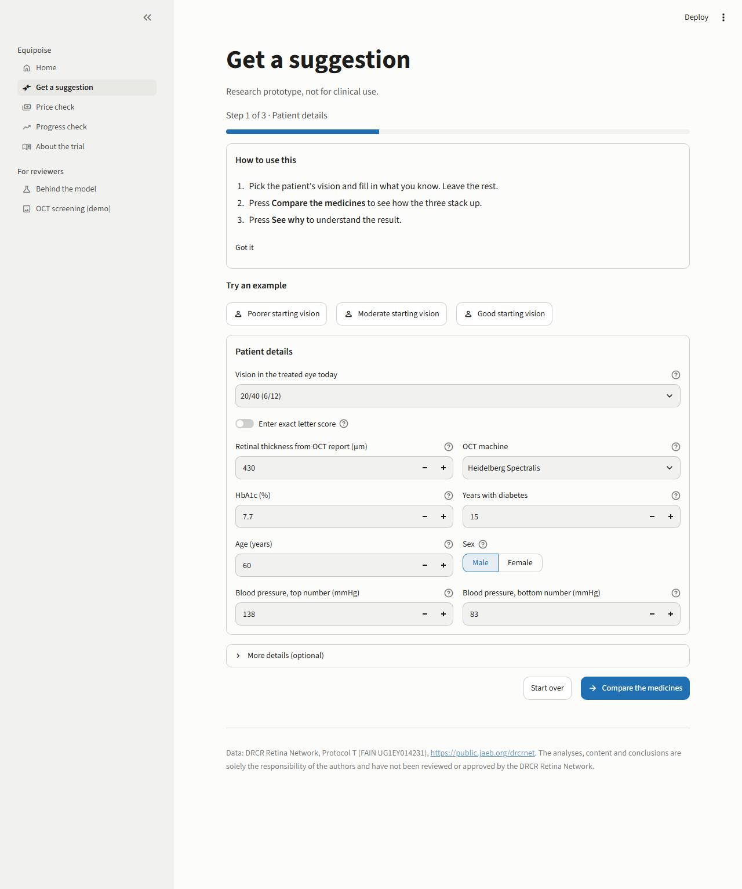

| Element | Fed by |
|---|---|
| "Try an example" buttons (poorer / moderate / good starting vision) | `services.examples()`. These are three real held-out patients, chosen by `scripts/pick_example_patients.py`, stored in `data/derived/app_examples.json` (never committed); fallback `examples.pick_by_features` |
| Vision dropdown (Snellen 20/x and 6/x) or "Enter exact letter score" | `ui.snellen`; `presenters.snellen_to_letters` |
| Essential fields (`ui.essential_features`: vision, CST, OCT machine, HbA1c, diabetes years, sex, age, SBP, DBP) with ⓘ tooltips | `meta()["features"]` (from `/metadata`) + `copy.FIELDS` |
| "More details (optional)", prefilled with typical values | `serving_assets` defaults |
| Plain validation messages | `presenters.validate` |

### 23.3 Step 2: the comparison

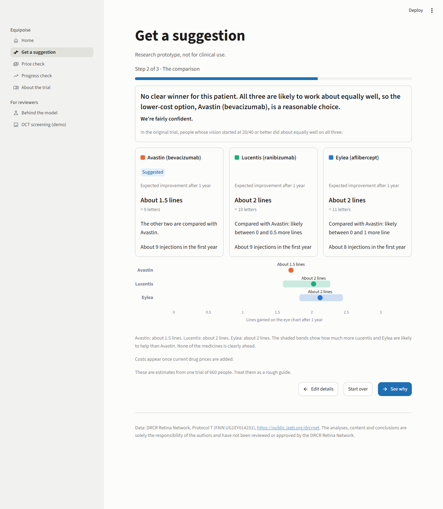

| Element | Fed by |
|---|---|
| Headline + confidence words | `presenters.headline` (recommendation, equipoise, P(benefit > MCID)) |
| Trial finding | baseline vision < or ≥ 69 → `copy.TRIAL_FINDING_*` |
| Three drug cards | `presenters.cards` (letters, bootstrap interval, injections; cost only with real prices) |
| Chart (dot = expected lines, band = Avastin + likely difference) | `presenters.chart` → `app/charts.py:improvement` (Altair) |
| Buttons: Edit details / Start over / See why | session state (`services.set_step`, `start_over`) |

### 23.4 Step 3: why this result

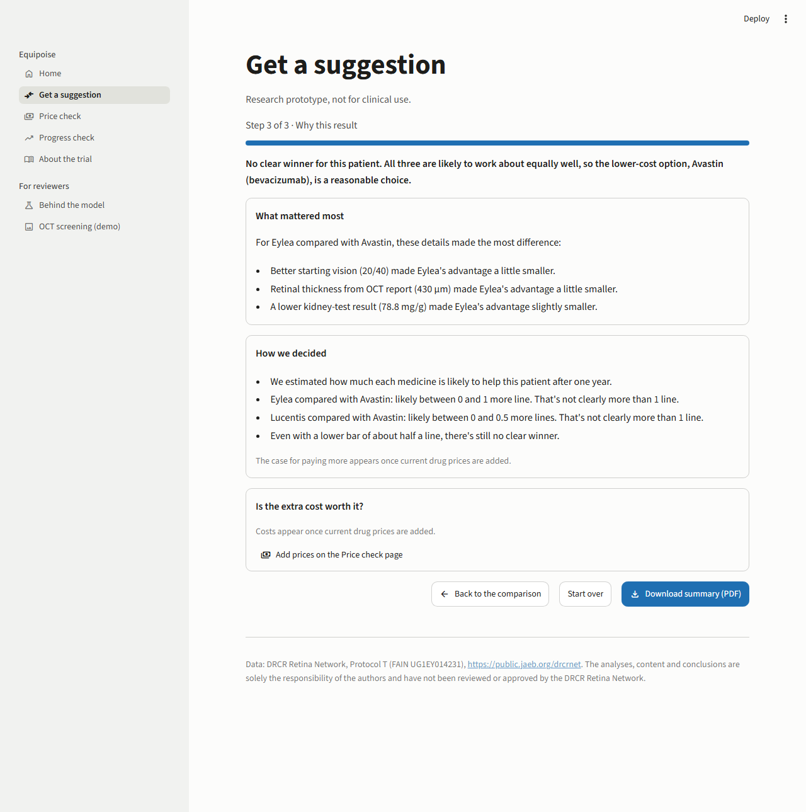

| Element | Fed by |
|---|---|
| "What mattered most" (top 3 SHAP contributions as sentences) | `predict(explain=True)` → `presenters.factors` |
| "How we decided" (2–4 sentences) | `presenters.decided` (intervals vs MCID, MCID-3 sensitivity) |
| Strength line ("Weak / Moderate / Strong case for paying more") | fuzzy strength, only with real prices (`presenters.strength_line`) |
| "Is the extra cost worth it?" (value of a line in ₹ + price slider) | `/breakeven` curve (`widgets.worth_it`, `presenters.break_even`) |
| Download summary (PDF): a one-page printable PDF summary | `app/pdf.py:summary_pdf` (fpdf2, DejaVu font for ₹); `tests/test_pdf.py` checks it is one page |

### 23.5 Price check

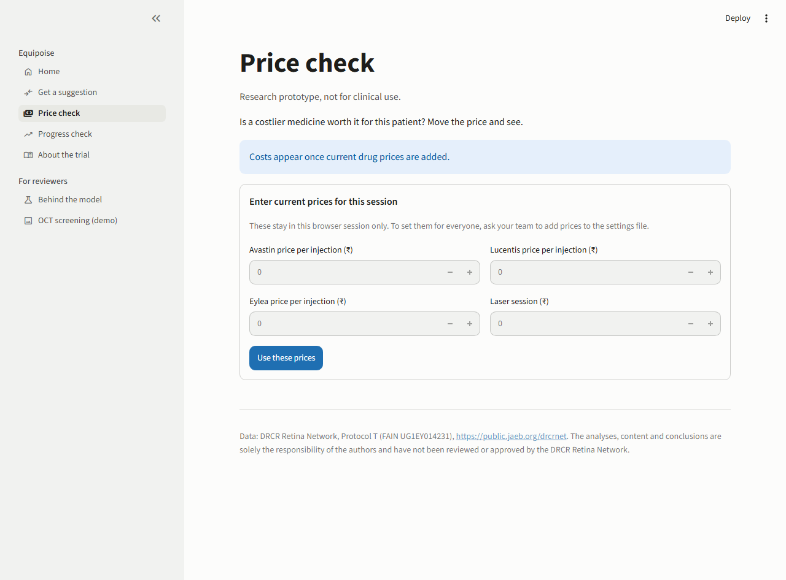

The "Is the extra cost worth it?" tool on its own. Until `config/costs.yaml` has prices, it offers
a form for **session-only prices** (`price_check.session_prices_form`). It never shows anything
computed from DEMO prices.

### 23.6 Progress check

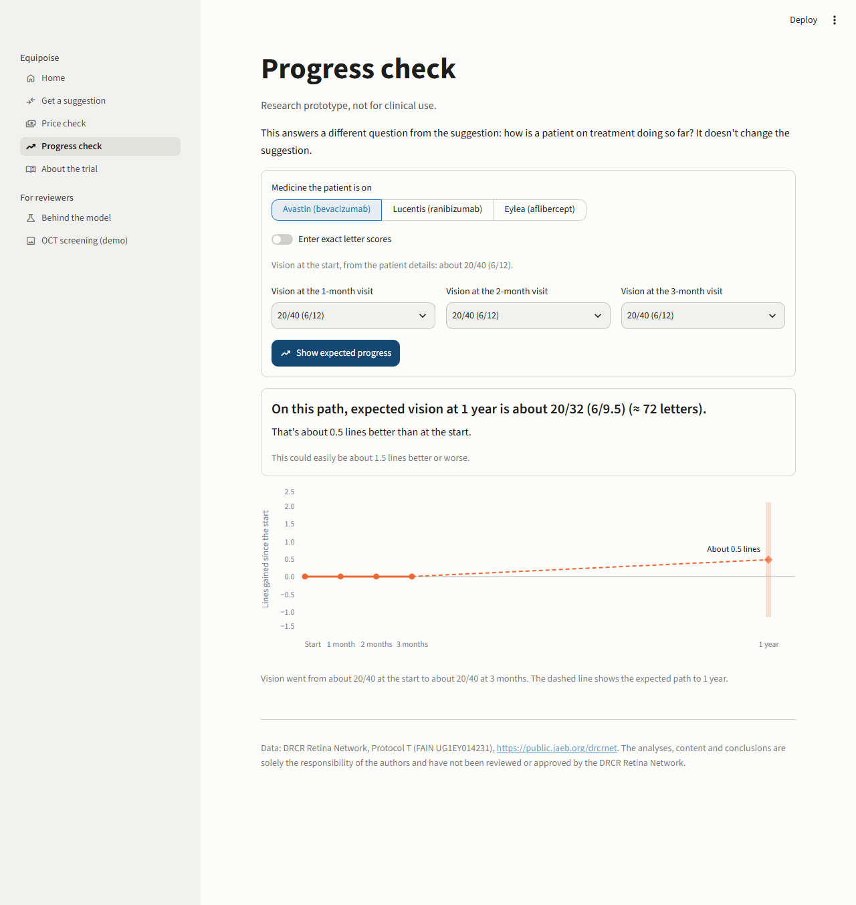

The early-response forecast (M7, §15). You pick the medicine and enter the readings at months 1, 2
and 3; the page calls `/early-response`. It shows "On this path, expected vision at 1 year is about
…" with the typical error (the M7 CV RMSE with early vision, 8.13 letters,
`m7_longitudinal.json: early_cv_rmse_with_early`), and a chart of the visits (solid) and the
forecast (dashed) (`presenters.progress`, `charts.progress`).

### 23.7 About the trial

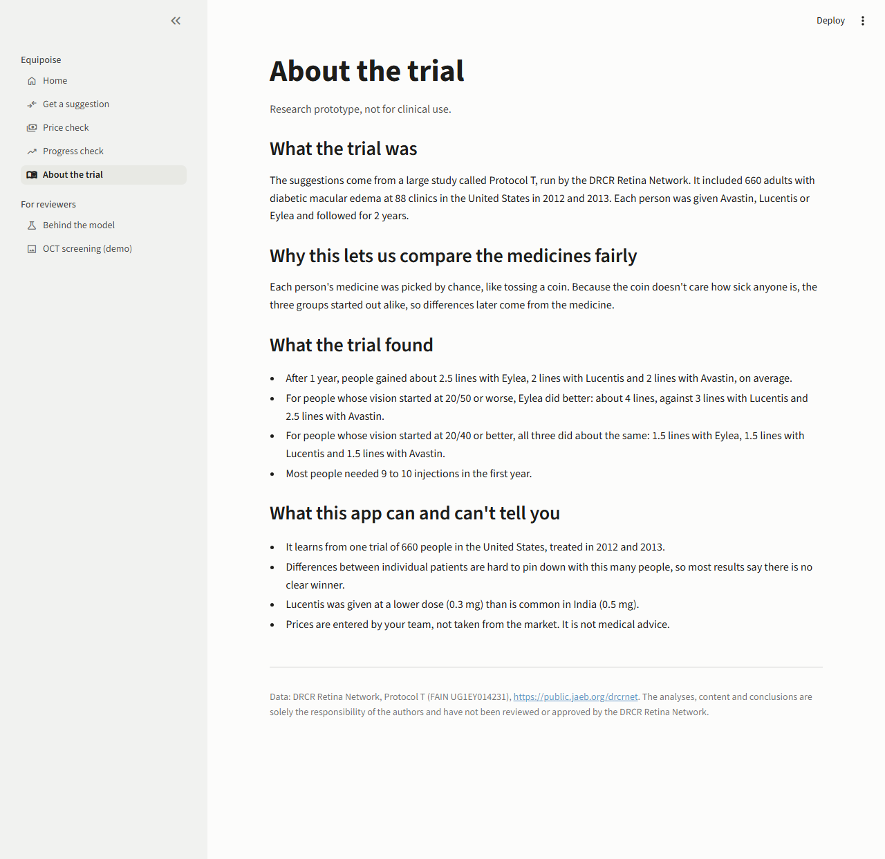

What Protocol T was, why randomization allows a fair comparison, the trial's results in eye-chart
lines **read from our replication table** (`presenters.about_findings`, using
`m2_replication_vs_published`, real results only), and what the app can and cannot tell you.

### 23.8 Behind the model (reviewers)

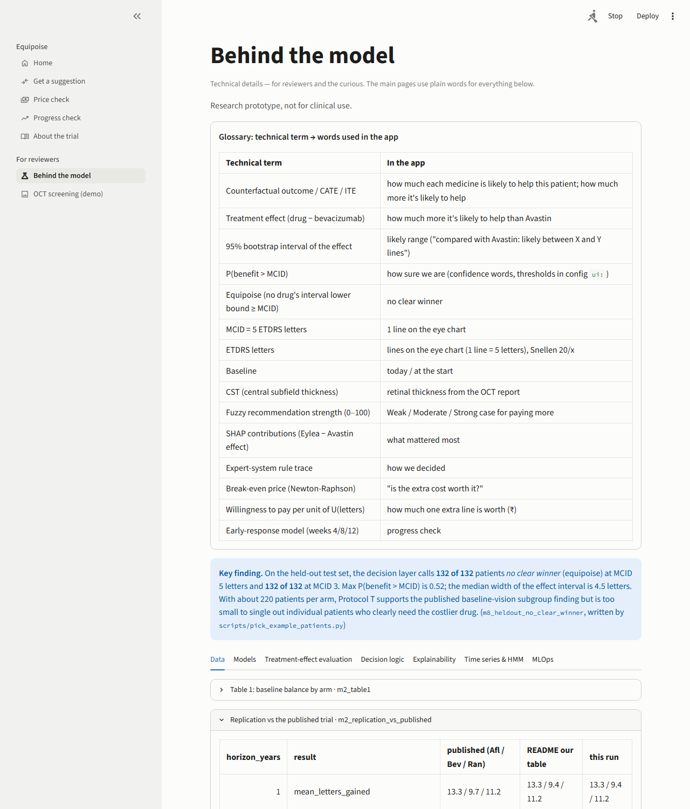

This page holds a glossary mapping technical terms to the app's words, the key held-out finding,
and tabs: Data, Models, Treatment-effect evaluation, Decision logic, Explainability, Time series &
HMM, MLOps.

It shows the **current patient's full technical output**:

- the estimates table;
- the point-range chart;
- the fuzzy strength gauge;
- the rule trace;
- the SHAP waterfall;
- the break-even curve;
- the early-response chart.

It also shows the pipeline's aggregate tables and figures from `reports/`.

**What moved here, and why** (`docs/ui_audit.md` §1, §3; commit `ab842cc`). The first app put
everything on the clinician's screen:

- 33 fields labelled with variable names;
- vision in ETDRS letters;
- four coloured warning boxes before the answer;
- jargon ("Counterfactual, MCID, 95% bootstrap interval, P(benefit > MCID), fuzzy recommendation
  strength, expert system, SHAP, Newton-Raphson, brentq");
- a raw 8-column table;
- a fuzzy gauge that "means nothing without the method";
- the disclaimer four times.

The redesign keeps all of it, but moves the technical detail to this reviewer page and shows
clinicians plain words. `tests/test_app_pages.py:test_behind_the_model_keeps_all_technical_content`
checks that nothing was lost. `tests/test_copy.py` keeps the jargon off the main pages.

### 23.9 OCT screening (demo)

Shown under "For reviewers" only if the `[cv]` extra is installed and M10 has been trained
(`streamlit_app.oct_available`). You upload an OCT image and get ResNet and YOLO class
probabilities plus a Grad-CAM overlay. The page states that the images are not linked to
Protocol T and never feed the suggestion (`app/views/oct.py`).

---

## 24. Running everything: a checklist from a fresh laptop

Follow these in order. Windows commands are given where they differ. These are the README's
quick-start steps plus the ones verified while writing this handbook.

### 24.1 Install

1. Install **Python 3.11**, from python.org. On Windows, tick "Add to PATH". The package requires
   `>=3.11,<3.12`.
2. Install **Git**. Optionally install **Docker Desktop**.
3. Get the code: clone or copy the `equipoise/` folder, then `cd equipoise`.
4. Create and activate a virtual environment:

   ```bash
   python -m venv .venv
   ```

   Activate it on Windows:

   ```powershell
   .venv\Scripts\activate
   ```

   Activate it on Linux or macOS:

   ```bash
   source .venv/bin/activate
   ```

   On Windows with several Pythons, use `py -V:3.11 -m venv .venv` to create it (CLAUDE.md).
5. Install the package with the extras you need:

   ```bash
   pip install -e ".[dev,app]"
   ```

   Optional extras:
   - `pip install -e ".[automl]"` for AutoGluon (pins pandas < 3);
   - `pip install -e ".[cv]"` for M10;
   - `pip install -e ".[ui-dev]"`, then `python -m playwright install chromium`, for screenshots.

### 24.2 Without the DRCR data (synthetic only)

```bash
python -m equipoise all --synthetic
```

This took about 33 minutes on the handbook machine. Then start the app with the synthetic model.
On Windows PowerShell:

```powershell
$env:EQUIPOISE_SYNTHETIC = "1"
streamlit run app/streamlit_app.py
```

In bash: `EQUIPOISE_SYNTHETIC=1 streamlit run app/streamlit_app.py`. Then open
http://localhost:8501.

### 24.3 With the DRCR data

1. Download Protocol T from https://public.jaeb.org/drcrnet and accept the terms.
2. Put `Data Tables - Text files/` under `data/raw/`.
3. Build everything:

   ```bash
   dvc repro
   ```

   The equivalent manual route:

   ```bash
   python scripts/build_protocolT_table.py "data/raw/Data Tables - Text files" data/protocolT_analysis.csv
   python scripts/build_protocolT_visits.py "data/raw/Data Tables - Text files" data/protocolT_visits.csv
   python scripts/build_cst_quality.py "data/raw/Data Tables - Text files" data/protocolT_cst_quality.csv
   python -m equipoise split
   python -m equipoise all
   ```
4. Optionally, `python scripts/pick_example_patients.py` (about 5 minutes) for the app's example
   buttons.
5. `python -m equipoise promote` to mark the champion model.

### 24.4 Look at the results

- Figures and tables are in `reports/`. The index is `reports/REPORT_ASSETS.md`.
- MLflow: `mlflow ui --backend-store-uri sqlite:///mlflow.db`, then open http://localhost:5000.
- The API:

  ```bash
  uvicorn api.main:app --reload
  ```

  Then open http://localhost:8000/docs.
- The app: `streamlit run app/streamlit_app.py`.
- Docker, both services together:

  ```bash
  docker compose -f docker/docker-compose.yml up --build
  ```

### 24.5 Check

```bash
pytest -q
ruff check .
```

On the handbook machine: 295 passed in about 6.6 minutes, and ruff "All checks passed!".

### 24.6 Common errors and fixes

| Symptom | Cause | Fix |
|---|---|---|
| `py` / `python` not found on Windows; Microsoft Store opens | Windows "app execution alias" for Python | Install Python from python.org; disable the alias in Settings → Apps → Advanced app settings → App execution aliases; or use the venv's `.venv\Scripts\python.exe` |
| `.venv\Scripts\activate` refused: "running scripts is disabled" | PowerShell execution policy | Run `Set-ExecutionPolicy -Scope CurrentUser RemoteSigned` once, or use `cmd` and `.venv\Scripts\activate.bat` |
| `FileNotFoundError: data/splits.json not found: run python -m equipoise split` | the split was never created | `python -m equipoise split` (add `--synthetic` for synthetic) |
| `... was made with different settings than config; re-run split` | the seed or test fraction changed | re-run `python -m equipoise split`; expect every result to change |
| `No model bundle at models/equipoise_bundle.joblib` | M6 not run | `python -m equipoise causal` (or `--synthetic` + `EQUIPOISE_SYNTHETIC=1`) |
| App shows "the model couldn't load" | no bundle, or `API_URL` set but the API is down with no local bundle | build the bundle, or unset `API_URL` |
| `UnicodeEncodeError` when printing in a Windows console | cp1252 console code page | `set PYTHONIOENCODING=utf-8`, or run in Windows Terminal |
| AutoGluon prints "Import fastai/catboost/xgboost failed … Skipping this model" | optional AutoGluon model families not installed | harmless (seen in the handbook's synthetic run) |
| `adfuller currently returns a plain tuple` / scikit-fuzzy `np.maximum` DeprecationWarnings | library deprecations | harmless; filtered in `pyproject.toml` for tests |
| `dvc repro` uses the wrong Python | venv not active (DVC calls `python`) | activate `.venv` first (`dvc.yaml` header) |
| MLflow UI is empty | wrong store | always pass `--backend-store-uri sqlite:///mlflow.db` from the repo root |
| `python -m equipoise vision --synthetic` fails | there is no synthetic OCT data | run without `--synthetic` after downloading the subset (§18) |
| pandas turns NaN into the string "nan" | `astype("str")` on pandas 2 | use `schema.numeric_casts` / `dtype_name` (CLAUDE.md) |

---

## 25. All results in one place

Part E collects the results and the honest caveats. Every number here is real-data output unless
labelled, with its source. Each block ends with a plain-language "what this means".

### 25.1 Data integration and replication (M0, M2)

| Result | Value | Source |
|---|---|---|
| Patients, arms | 660; 224 / 218 / 218 | `scripts/build_protocolT_table.py` asserts; `config/default.yaml` |
| Analysis table | 660 × 47 | `column_table.py` |
| Visit table | 14,149 rows, 660 patients | `data/protocolT_visits.csv` (counted) |
| Visit vs analysis cross-check | 0 mismatches on 8 outcomes | `m0_visits_crosscheck.csv` |
| Missing week-52 vision | 44 (6.67%) | `m1_missingness.csv` |
| Baseline balance | 0 of 33 features with p < 0.05 | `m2_stats.json` |
| 1-year mean letters (Afl / Bev / Ran) | ours 13.3 / 9.4 / 11.2; published 13.3 / 9.7 / 11.2 | `m2_replication_vs_published.csv` |
| … baseline < 69 | 19.1 / 11.8 / 14.2; published 18.9 / 11.8 / 14.2 | same |
| … baseline ≥ 69 | 7.8 / 7.0 / 8.3; published 8.0 / 7.5 / 8.3 | same |
| Median injections, year 1 | 9 / 10 / 10 (published 9 / 10 / 10) | same |
| Laser by year 1 | 37 / 56 / 47% (published 37 / 56 / 46%) | same |
| CST change, year 1 (µm) | −165 / −98 / −147 (published −169 / −101 / −147) | same |
| 2-year mean letters | 12.9 / 9.6 / 12.2 (published 12.8 / 10.0 / 12.3) | same; Wells 2016 |
| Afl − Bev at 1 year (Welch) | 3.95 letters (1.72 to 6.19), Holm p = 0.00164 | `m2_replication_tests.csv` |
| … in < 69 / ≥ 69 | 7.24 (3.92 to 10.6) / 0.84 (−1.7 to 3.38) | same |
| Treatment × baseline vision interaction | p = 0.000337 (continuous); p = 0.00513 (binary) | `m2_interaction_tests.csv` |

**What this means.** Our data reproduce the published trial almost exactly. Aflibercept's average
advantage over bevacizumab is about 4 letters, concentrated in eyes that start at 20/50 or worse.

### 25.2 Preprocessing (M1)

| Result | Value | Source |
|---|---|---|
| Afl − Bev under complete case / kNN / MICE | 3.95 / 4.01 / 3.83 | `m1_missing_strategies.csv` |
| Imputer nRMSE (MICE / kNN / median) | 0.849 / 0.965 / 1.01 | `m1_imputer_scores_mean.csv` |
| Outliers flagged (IQR / Isolation Forest / DBSCAN / all three / any) | 17 / 38 / 5 / 2 / 53 | `m1_outlier_overlap.csv` |
| Model-ready columns | 42 | `m1_preprocessor_features.csv` |

**What this means.** The missing outcomes do not change the trial answer. The data are clean
enough that few patients look unusual. The models use a 42-column standardized matrix.

### 25.3 Representation (M3)

| Result | Value | Source |
|---|---|---|
| PC1 share; components for 80% | 15.7%; 12 | `m3_pca_variance.csv`, `m3_represent.json` |
| SVD vs sklearn PCA | components identical; scores within 3.55 × 10⁻¹⁵ | `m3_svd_vs_sklearn.csv` |
| Best k-means k, silhouette | 3, 0.109 | `m3_represent.json` |
| Afl − Bev in the poor-vision cluster | 8.31 (2.86 to 13.8) | `m3_cluster_effects.csv` |

**What this means.** Patients do not fall into natural types. The poor-vision cluster again shows
the bigger aflibercept benefit.

### 25.4 Feature search (M4)

| Result | Value | Source |
|---|---|---|
| Best subset | 7 features: race, ERM, female, Hispanic, prior PRP, age, baseline vision | `m4_selected_features.csv` |
| Objective $J$: best / all features / arm only | 9.39 / 10.1 / 10.9 | `m4_selected_vs_all.csv` |
| Held-out RMSE: subset / all / arm only | 9.34 / 9.47 / 10.8 | same |
| Algorithms reaching 9.39 | hill climbing, beam, tabu, GA (2 of 3 seeds); PSO 9.43; random 9.54 | `m4_search_summary.csv`, `m4_search_runs.csv` |

**What this means.** A small subset predicts as well as all 33 features. Baseline vision and age
carry most of the signal.

### 25.5 Outcome models (M5)

| Task | Best (by CV) | Test result | Baseline | Source |
|---|---|---|---|---|
| Week-52 letters | Lasso | RMSE 9.43, R² 0.237 | RMSE 10.8 | `m5_regression_comparison.csv` |
| Gain ≥ 15 letters | logistic regression | AUC 0.811 | 0.614 | `m5_classification_gain15_full.csv` |
| Laser year 1 | logistic regression | AUC 0.578 | 0.565 | `m5_classification_laser_yr1_full.csv` |
| Injections year 1 | Poisson GLM | MAE 1.73 | 1.90 | `m5_count_comparison.csv` |
| Scratch vs library | OLS diff 4.62 × 10⁻¹⁴; IRLS diff 1.26 × 10⁻¹⁵ (7 iterations) | | | `m5_scratch_checks.csv` |

**What this means.** About a quarter of the variation in vision gain is predictable, mostly from
baseline vision and age. Laser need is barely predictable from baseline data.

### 25.6 Counterfactual engine (M6)

| Result | Value | Source |
|---|---|---|
| Chosen learner | causal forest (CausalForestDML) | `m6_chosen_model.csv` |
| Its PEHE (null / published-like / nonlinear); false heterogeneity | 1.80 / 2.80 / 2.44; 0% | `m6_semisynthetic_pehe.csv` |
| Constant-effect yardstick PEHE | 1.19 / 2.88 / 2.51 | same |
| Worst PEHE (DR-learner GB) | 9.08 / 9.36 / 9.33 | same |
| Semi-synthetic noise SD | 12.1 letters | `m6_semisynthetic_setup.csv` |
| Held-out mean estimated effect (Afl − Bev / Ran − Bev) | 3.17 / 1.24 | `m6_learner_effects_heldout.csv` |
| … by vision < 69 / ≥ 69 (Afl) | 3.76 / 2.59 | `m6_rediscovery.csv` |
| Top effect driver (surrogate RF) | CST (0.699), then vision (0.109) | `m6_effect_importance_aflibercept.csv` |
| Policy values, IPW (95% CI), n = 126 | all-Bev 11.7 (8.1–17.1); all-Afl 14.9 (9.65–20.7); all-Ran 11.2 (7.63–15.0); published rule 15.7 (10.8–21.7); model 14.9 (9.86–21.0) | `m6_policy_values.csv` |
| Bootstrap interval width, median (Afl) | 4.46 letters; 0% with P(> MCID) > 0.8 | `m6_uncertainty_summary.csv` |
| Calibration (Afl), low / mid / high tertile observed | −0.105 / 4.48 / 8.4 (all CIs include 0) | `m6_calibration_aflibercept.csv` |
| TARNet best validation loss (SGD / Adam / RMSprop) | 0.542 / 0.542 / 0.541 | `m6_tarnet_optimizers.csv` |
| Tuning best CV RMSE (default / grid / TPE / PSO) | 10.2 / 9.93 / 9.86 / 9.87 | `m6_tuning_summary.csv` |
| AutoGluon T-learner PEHE (1 replication) | 5.41 vs tuned-GB T-learner 4.77 | `m6_autogluon_comparison.csv` |

**What this means.** Of the methods tested, only a cautious causal forest estimates per-patient
effects without inventing patterns. Even so, it barely beats "give everyone the average". The data
support the published vision subgroup, not finer personalization.

### 25.7 Longitudinal (M7)

| Result | Value | Source |
|---|---|---|
| Aflibercept mean change at weeks 12 / 24 / 52 | 9.7 / 11.9 / 13.2 | `m7_mean_trajectories.csv` |
| Central-difference order | 1.96 | `m7_longitudinal.json` |
| 12-point Lagrange fitted range vs data range | 45 vs 13 letters | `m7_lagrange_check.csv` |
| ARIMA forecast RMSE vs naive (Afl / Bev / Ran) | 3.82 vs 0.344 / 1.23 vs 0.764 / 6.09 vs 0.878 | `m7_arima_forecast.csv` |
| HMM states (improving / active / stable share) | 14.8% / 44.9% / 40.4% | `m7_hmm_states.csv` |
| Forward / Viterbi vs hmmlearn | match within 10⁻¹²; 100% identical paths | `m7_hmm_checks.csv` |
| Response patterns (fast / slow / non) | 76 / 250 / 162; arm association p = 0.127 | `m7_trajectory_clusters*.csv` |
| Early response, test RMSE (baseline only → + weeks 4/8/12) | 9.47 → 8.21; R² 0.23 → 0.421 | `m7_early_response.csv` |

**What this means.** Vision improves fast in the first 12 weeks, then plateaus. Knowing a patient's
first three months sharply improves the one-year forecast.

### 25.8 Decision layer (M8)

| Result | Value | Source |
|---|---|---|
| Held-out recommendations | 100% bevacizumab; 100% equipoise at MCID 5 and 3 | `m8_population_summary.csv` |
| Held-out estimated Afl benefit (median, range) | 3.1 (0.719 to 6.21); median interval width 4.47; highest lower bound 2.41 | `m8_heldout_no_clear_winner.csv` |
| Max P(benefit > MCID); patients with P ≥ 0.5 | 0.52; 2 | same |
| Published rule would give aflibercept to | 50% | `m8_population_summary.csv` |
| Fuzzy strength, median | 17.05 / 100 | same |
| Newton vs brentq | max diff 2.56 × 10⁻¹³; median iterations 2 / 5 | `m8_newton_vs_brentq.csv` |
| Costs, break-even | DEMO units only. **Rupee values not computed** (no prices) | `config/costs.yaml` |

**What this means.** For every test patient the honest answer is "no clear winner, the cheapest is
reasonable". The cost tools work, but have no real prices yet.

### 25.9 Explainability and fairness (M9)

| Result | Value | Source |
|---|---|---|
| SHAP additivity | holds within 10⁻⁶ | `m9_shap_setup.csv` |
| Mean \|SHAP\|: CST / vision / log UACR | 0.642 / 0.427 / 0.205 letters | `m9_shap_importance_aflibercept.csv` |
| Letters RMSE range across subgroups | 6.65 (uncertain diabetes type, unreliable) to 12.7 (Black/African American) | `m9_subgroups.csv` |
| Predicted vs observed Afl effect, vision < 69 / ≥ 69 | 3.57 vs 7.24 / 2.51 vs 0.84 | same |

**What this means.** The model's explanations are exact and modest. It ranks the vision subgroups
correctly, but understates the difference, and it is less accurate for some groups.

### 25.10 OCT screening (M10; Kermany dataset, not Protocol T)

| Result | Value | Source |
|---|---|---|
| Test accuracy / macro F1 (ResNet18 / YOLO11n-cls), 968 images | 0.948 / 0.948; 0.988 / 0.988 | `m10_comparison.csv` |
| Patient-grouped validation, best | 0.887 / 0.864 | `m10_*_history.csv` |
| DME recall | 1.0 / 0.992 | `m10_per_class.csv` |

**What this means.** Both models recognise DME scans very well on the curated test set. The more
realistic validation numbers are lower.

### 25.11 Engineering (M11)

| Result | Value | Source |
|---|---|---|
| Tests | 295 passed (6 min 37 s, real data present) | run for this handbook |
| Lint | `ruff check .` clean | run for this handbook |
| Full synthetic pipeline | exit 0, about 33 minutes | run for this handbook |
| Registry | `equipoise-cate` v1–8, champion = 8 | `mlflow.db` |
| Drift (local, simulated traffic) | 6 of 33 features drifted, share 0.18 < 0.5, so no dataset drift | `reports/monitoring/` (git-ignored) |

---

## 26. Key findings, ranked

Each finding is given as one plain sentence, then a technical paragraph.

1. **The trial's published results are reproduced from the raw data.**
   M0's integration of the public DRCR tables yields 1-year mean gains of 13.3 / 9.4 / 11.2
   letters (published 13.3 / 9.7 / 11.2). The baseline-vision subgroup means are within 0.5
   letters, with identical median injections and laser rates within one point
   [`m2_replication_vs_published.csv`]. Randomization balance holds (0 of 33 baseline tests at
   α = 0.05), and the treatment × baseline-vision interaction is significant (p = 0.000337)
   [`m2_stats.json`, `m2_interaction_tests.csv`].

2. **On held-out patients, no costlier drug is clearly better for any individual patient.**
   With a strict rule (the whole 95% bootstrap interval ≥ 5 letters), all 132 held-out patients
   are in equipoise, at 5 and at 3 letters. The median estimated aflibercept benefit is 3.1
   letters, the median interval width 4.47, and the maximum lower bound 2.41
   [`m8_heldout_no_clear_winner.csv`].

3. **Flexible per-patient learners mostly fit noise in a trial of this size.**
   In a semi-synthetic benchmark with the real features and noise SD 12.1 letters, the T-, X- and
   DR-learners and TARNet "found" heterogeneity in 90–100% of null replications, with PEHE
   4.4–9.4 letters. The causal forest found none, with worst-case PEHE 2.80, barely better than
   the constant-effect yardstick (2.88) [`m6_semisynthetic_pehe.csv`, `m6_learner_selection.csv`].

4. **The model rediscovers the published subgroup, but cautiously.**
   The estimated aflibercept benefit is larger for baseline < 69 letters (3.76 vs 2.59 held-out)
   [`m6_rediscovery.csv`]. Observed differences are 7.24 vs 0.84 [`m9_subgroups.csv`], so the
   model shrinks the gap. The top driver is CST, so the "vision is the top driver" check fails.

5. **No treatment policy is distinguishable on 126 held-out patients.**
   The IPW values for all-aflibercept (14.9), the published rule (15.7), the model (14.9) and
   all-bevacizumab (11.7) have overlapping 95% intervals [`m6_policy_values.csv`].

6. **Early response is highly informative about one-year vision.**
   Adding vision at weeks 4/8/12 cuts the week-52 test RMSE from 9.47 to 8.21 letters and almost
   doubles R² (0.23 → 0.421) [`m7_early_response.csv`].

7. **Baseline features explain about a quarter of vision gain; laser is barely predictable.**
   The best regression has test R² 0.237. Laser AUC is 0.578 vs 0.565 for the arm-rate baseline
   [`m5_*`].

8. **The from-scratch implementations are verified against libraries.** These include OLS,
   IRLS logistic regression, SVD-PCA, Lagrange interpolation, finite differences, the HMM
   forward and Viterbi algorithms, and Newton–Raphson. All agree with their library reference to
   between 10⁻¹² and 10⁻¹⁶ (§25).

9. **The engineering is reproducible.** One config file, seeds everywhere, a saved split, a DVC
   pipeline, MLflow provenance tags, 295 passing tests, and a CI that builds Docker images (§19).

---

## 27. Limitations, ethics and safety

### 27.1 Scientific limitations

- **Sample size.** 660 patients; 490 training patients with a week-52 outcome; about 370 used
  for fitting inside the benchmark. Per-patient effects beyond the published subgroup are weakly
  identified (§14.5).
- **Population.**
  - US patients from 2012–2013 (README §7.1), 79.9% White [`column_table.py`].
  - Indian patients may differ in diabetes control, access and DR severity.
  - Generalization to India is **not tested**.
- **Dose.** Ranibizumab 0.3 mg (the US dose); India commonly uses 0.5 mg (README §11).
- **Missing data and imputation choices.**
  - Models use complete cases for outcomes and **median** imputation for features, although
    MICE scored best.
  - The missing-data comparison shows little impact on the arm differences (§9).
  - "Ungradable" OCT grades are coded as "absent" (§28).
- **Measurement.** CST is in machine units, harmonized by z-scoring. The published conversion
  offsets are unverified (§2.4).
- **Synthetic-only or demonstration components.**
  - The semi-synthetic benchmark relies on assumed effect shapes.
  - Drift monitoring uses simulated traffic.
  - Time-series models use arm means (14 points).
  - The AutoGluon comparison uses one replication.
- **Prices.** All prices are null. Every cost, ICER, break-even and cost-aware policy number is in
  DEMO units. Rupee results are **not computed**.

### 27.2 Ethics and safety

- **Not a clinical tool.** Every output carries "Research prototype … Not for clinical use"
  (`recommend.DISCLAIMER`; app banner). The rule base is "decision-support logic for this project,
  not clinical guidance" (`expert.py`).
- **Where it could mislead a doctor:**
  - a clinician might read "No clear winner" as "the drugs are identical";
  - CST and baseline vision measured differently in an Indian clinic (another OCT device, Snellen
    rounding) shift the inputs;
  - DEMO-price outputs could be misread as real, which is why the app hides them;
  - patients outside the trial's eligibility (vision outside 20/32–20/320, recent treatment) are
    out of distribution, yet the form accepts some such values within the schema ranges.
- **Safeguards built in:**
  - the published < 69-letter rule is always shown;
  - the MCID-3 sensitivity check is reported;
  - the "weak signal" warning is always shown;
  - the jargon-free copy is tested;
  - nothing derived from DEMO prices is shown;
  - imputed features are listed;
  - the API rejects non-baseline fields.
- **DRCR data terms.**
  - The data cannot be redistributed: `data/` is not committed, and images exclude it.
  - The attribution text is required (§4.11).
  - Publishing a model trained on DRCR data needs the data owner's confirmation
    (`docs/deployment.md`). Public demos use the synthetic model.
  - **Several committed figures plot individual patients as points** (§28). The team should check
    whether that is acceptable under the DRCR terms.
- **Privacy.**
  - Patient-level derived files are kept in `data/derived/` (not committed).
  - The request log holds baseline features without identifiers.
  - The serving assets hold only centroids and medians.
  - The app's example patients are real held-out patients, stored locally only.
- **Fairness.** Prediction error is higher for some subgroups (Black/African American patients
  RMSE 12.7, n 95). Subgroup sizes are too small for firm conclusions (§17).
- **Licences.** Ultralytics YOLO is AGPL-3.0, which matters if the app is distributed.

---

## 28. Appendix: issues found while reading the code

None of these were fixed (the brief: list, don't fix). Severity is the handbook author's
judgement.

| # | Where | Issue | Effect | Severity |
|---|---|---|---|---|
| 1 | `scripts/build_protocolT_table.py:yes` (frozen M0) | Maps everything except "Yes" to 0, so "Ungradable" and blank OCT grades become "absent". Raw baseline counts: ERM 7 blank + 5 Ungradable; subretinal fluid 6 blank + 4 Ungradable | `X_epiretinal_membrane` / `X_subretinal_fluid` are slightly misclassified for about 10–12 patients instead of being imputed | low–medium |
| 2 | `app/presenters.py:factor_subject` with `serving/service.py:_fmt` | The displayed value is rounded to 4 significant figures before comparison with the unrounded typical value, so a typical value can be described as "lower" or "higher" | The default patient's step-3 text says "A lower kidney-test result (78.8 mg/g)" although it *is* the typical value (§22) | low (wording) |
| 3 | `eq/causal/learners.py:CausalForest.fit` vs `causal/run.py` | The tuned GB parameters (Optuna) are not passed to the chosen causal forest's `model_y`; only the outcome models and meta-learners get them | Tuning does not affect the effect model that is served; inconsistent with README §4's framing | low (design) |
| 4 | `eq/causal/run.py` module docstring | Says "lowest mean over the three scenarios"; code uses worst-case PEHE with exclusion filters | Documentation mismatch (same learner chosen here) | low |
| 5 | `eq/causal/run.py` (policy metrics) | `policy_model_ipw` etc. read rows by position (`pv.iloc[4]`, `pv.iloc[3]`) | Fragile: reordering the policy dict would silently log the wrong metric | low |
| 6 | `causal/run.py:evaluate_policies` calls | The same causal-forest policy gets different bootstrap CIs in `m6_policy_values` (9.86–21.0) and `m6_policy_values_by_learner` (9.89–19.9), because the seed depends on list position | Confusing duplicate numbers in reports | low |
| 7 | `eq/reproducibility.py:seed_everything` | Sets `os.environ["PYTHONHASHSEED"]` inside the running process, which has no effect on that process's hash randomization | Only affects subprocesses; string-hash order could still vary (no observed impact) | low |
| 8 | `eq/supervised/scratch.py:IRLSLogisticRegression.predict` | Hard-codes a 0.5 threshold instead of `supervised.classification_threshold` | None today (evaluation thresholds probabilities itself) | low |
| 9 | `eq/report/tables.py:_PURPOSE` | No purpose text for PIL, cv2, gradio, pytorch_grad_cam, torchvision, ultralytics | Empty "Purpose" cells in `m11_tech_stack.md` | low (report) |
| 10 | `config/replication_targets.yaml` comment | References `tests/test_stats_replication.py`, which does not exist (the check is in `tests/test_stats.py`) | Misleading comment | low |
| 11 | `eq/stats/table1.py` docstring | "about 40 features"; 33 are tested | Documentation | trivial |
| 12 | `reports/figures/` (committed) | Several figures plot **individual trial patients**: `m2_baseline_va_vs_gain`, `m2_outcome_by_arm`, `m3_pca_map`, `m5_regression_pred_vs_obs`, `m7_early_response`, `m7_hmm` (one patient's sequence), `m7_interpolation` (one patient's visits), `m8_strength_vs_benefit`, `m9_shap_beeswarm` | Possible conflict with "aggregate results only in reports/" (CLAUDE.md) and the DRCR no-redistribution terms; worth a team decision | medium (governance) |
| 13 | `eq/registry.py` + serving | The `champion` alias does not determine which bundle the API serves; serving reads `models/equipoise_bundle.joblib` (or `EQUIPOISE_BUNDLE`) | "Promotion" is bookkeeping only; the served model could differ from the champion | low |
| 14 | README §4 | "~20 DRCR tables"; the build reads 16 of 31 | Documentation | trivial |

---

## 29. Report source pack

Part F is the report and viva pack. This chapter gives **facts and pointers, not prose**: for each
of the 15 sections of your mini-project report template, what belongs there, where it comes from,
and ready-made tables.

**Formatting reminders** (from your brief): IEEE referencing, Times New Roman 12 pt. Number
references [1], [2], … in order of first citation; the list is in §30.3.
`reports/REPORT_ASSETS.md` already maps every generated figure and table to sections 4–12; it is
regenerated by `python -m equipoise report-assets`.

### 29.1 Introduction

**Content**
- DME: swelling of the macula in diabetes; a leading cause of vision loss in working-age adults
  (README §1).
- Three anti-VEGF drugs: aflibercept (Eylea), ranibizumab (Lucentis), bevacizumab (Avastin,
  off-label, far cheaper).
- The question: which drug for *this* patient, at what cost?
- What Equipoise does (§01, §1.4): per-drug 1-year letters, injections, laser probability, cost,
  break-even, fuzzy strength, rule trace, SHAP explanation.

**Sources:** §01, §02; README §1, §3.

### 29.2 Motivation

**Content**
- **Cost gap.** US protocol prices: about $1,850 (aflibercept), $1,200 (ranibizumab 0.3 mg) and
  $50–100 (bevacizumab) per dose [protocol §1.1.7]. Indian prices are **not in the repo**.
- **Out-of-pocket payment** in India makes the choice consequential (§2.7).
- **Why randomized-trial data.** Hospital data confound drug choice with severity; randomization
  makes arm differences causal (§03).
- **The opportunity.** Protocol T showed an aflibercept advantage concentrated in eyes with
  vision 20/50 or worse [Wells 2015]. Can it be personalized further?

**Sources:** §02.7, §03, §04.1.

### 29.3 Literature Survey

Use the table in §30.1 (10 verified papers) and the "gap" paragraph in §30.2.

### 29.4 Dataset Used

**Facts**
- **Source.** DRCR Retina Network, Protocol T public dataset (https://public.jaeb.org/drcrnet).
  **Include the attribution text** (§4.11).
- **Trial design.**
  - 660 patients randomized: 224 aflibercept 2.0 mg, 218 bevacizumab 1.25 mg, 218 ranibizumab
    0.3 mg.
  - 2-year follow-up; primary outcome = change in ETDRS letters at 1 year.
- **Raw data.** 31 pipe-separated tables. M0 uses 16 of them to build a 660 × 47 analysis table:
  - 33 `X_` baseline features;
  - 8 `Y_` outcomes;
  - 3 `M_` bookkeeping columns;
  - 3 identifiers.

  It also builds a 14,149-row visit table.
- **Missing data.** 44 patients (6.67%) lack 1-year vision; BMI has the most missing values among
  the features (62).
- **Split.** Fixed 80/20 train/test, stratified by arm, seed 42: 528 / 132.
- **Synthetic data** with an identical schema is used for tests and CI.
- **Kermany OCT images** (M10 only): 3,097 train / 903 validation / 968 test images, not linked to
  Protocol T.

**Ready tables:**
- **Feature description table**: `reports/tables/m11_feature_description.md` (Feature | Data
  Type | Description | Role | Missing allowed), generated from the schema. Alternatively the
  richer §4.5 table (it adds missing counts and typical values).
- **Table 1**: `reports/tables/m2_table1.md`.
- **Missingness**: `reports/tables/m1_missingness.md`.

**Figures:** `m2_baseline_distributions.png`, `m2_correlation_heatmap.png`.

### 29.5 Flow Diagram

- `reports/figures/flow_diagram.png` (generated), or the Mermaid diagram in §1.3.
- The causal assumption: `reports/figures/m11_causal_dag.png` (§3.7).
- A data-flow figure for the serving path: the sequence diagram in §22.

### 29.6 Methods / Technology Stack

- **Ready table:** `reports/tables/m11_tech_stack.md` (Library | Purpose | Key functions |
  Files), generated from the actual imports. Note: some "Purpose" cells are empty (§28 issue 9);
  fill them from §7.
- **Versions:** §7 (from `pip list` in `.venv`).
- **Language and tools:** Python 3.11; Git; DVC; MLflow; pytest; ruff; GitHub Actions; Docker;
  FastAPI; Streamlit.

### 29.7 Model Development (7.1–7.6)

| Sub-section | Content (bullet facts) | Handbook | Report assets |
|---|---|---|---|
| **7.1** Preprocessing + statistics (M1, M2) | Imputation (median in models; complete case / kNN / MICE compared: 3.95 / 4.01 / 3.83 letters); CST z-score harmonization; IQR / Isolation Forest / DBSCAN flags (17 / 38 / 5); 42-column `ColumnTransformer`; Table 1 balanced (0/33); replication; ANOVA, Welch + Holm, Mann–Whitney, chi-square, Levene/Bartlett/F, partial and multiple correlation, interaction regression (p = 0.000337) | §09, §10 | REPORT_ASSETS §7.1 |
| **7.2** Representation + feature search (M3, M4) | PCA via SVD (PC1 15.7%; 12 PCs for 80%); k-means / Ward / DBSCAN (silhouette 0.109); Apriori; filter / embedded / wrapper rankings; six search algorithms, same 1,500-evaluation budget; best 7-feature subset, J = 9.39 | §11, §12 | REPORT_ASSETS §7.2 |
| **7.3** Outcome models (M5) | 9 regression models (Lasso best: CV RMSE 9.390, test 9.43, R² 0.237); classification (gain ≥ 15 AUC 0.811; laser 0.578); Poisson GLM (MAE 1.73); scratch OLS and IRLS verified | §13 | **Model comparison table:** `m5_regression_comparison.md` |
| **7.4** Counterfactual engine (M6) | S/T/X/DR-learners, causal forest, TARNet (SGD / Adam / RMSprop), AutoGluon T-learner; semi-synthetic PEHE; selection rule; IPW/AIPW policy values; bootstrap; calibration; rediscovery; tuning (grid vs TPE vs PSO) | §14 | `m6_learner_selection.md`, `m6_policy_values.md`, `m6_tarnet_optimizers.md`, `m6_tuning_summary.md` |
| **7.5** Longitudinal (M7) | weekly tensor (660 × 105 × 3); linear / spline / Lagrange; finite differences (central order 1.96); ADF + ARIMA (loses to naive); HMM with forward / Viterbi from scratch; trajectory clusters; early response (RMSE 9.47 → 8.21) | §15 | REPORT_ASSETS §7.5 |
| **7.6** Decision + explainability + OCT (M8, M9, M10) | cost model; Newton–Raphson break-even (vs brentq ≤ 2.6 × 10⁻¹³); fuzzy inference (typical patient 17.05); forward-chaining rules; PEAS agent; SHAP (CST, vision top); subgroups; OCT (YOLO 0.988 vs ResNet 0.948 test accuracy) | §16, §17, §18 | REPORT_ASSETS §7.6 |

### 29.8 Version Control

**Facts:** §20.4 and the commit table in §20.2. Git with 19 commits over 9–10 Oct 2026,
conventional messages, `.gitignore` data rules, DVC pointer for the raw data, MLflow runs tagged
with the commit, CI on every push.

**Screenshot to take:** `git log --oneline --graph`, or the GitHub commit page.

### 29.9 Experiment Tracking

**Facts:** §19.9.
- MLflow, SQLite store, one experiment per stage, nested runs per model and algorithm, tags
  (`git_commit`, `data_version`, `data_source`, `seed`).
- Model registry `equipoise-cate` (v1–8, champion = 8).

**Ready table:** `reports/tables/m11_experiments.md` (Exp | Module | Model | Parameters |
Metrics | Remarks), generated from MLflow.

**Screenshots:** the MLflow UI experiment list and a run comparison (`docs/experiments.md`
§Screenshots).

### 29.10 AutoML / MLOps

**AutoML.**
- AutoGluon T-learner (`presets="medium_quality"`, 120 s per arm).
- PEHE 5.41 vs tuned-GB T-learner 4.77 on one replication [`m6_autogluon_comparison.csv`].
- Optuna TPE as automated hyperparameter search: CV RMSE 10.2 → 9.86 [`m6_tuning_summary.csv`].

**MLOps.**
- DVC pipeline;
- MLflow tracking and registry with promotion;
- CI (ruff, pytest, Docker build);
- Evidently drift monitoring with simulated traffic (6 of 33 features drifted, no dataset drift);
- pinned requirements;
- seeds.

**Deployment components table (ready):**

| Component | Technology | File(s) | Role |
|---|---|---|---|
| Model artifact | joblib bundle | `models/equipoise_bundle.joblib` | preprocessor, causal forest, 50 bootstrap refits, outcome / injection / laser models |
| Serving API | FastAPI + Uvicorn + Pydantic | `src/equipoise/serving/api.py`, `api/main.py` | `/health`, `/metadata`, `/predict`, `/breakeven`, `/early-response` |
| Front end | Streamlit + Altair + fpdf2 | `app/` | wizard, price check, progress check, reviewer pages, PDF |
| Containers | Docker, docker compose | `docker/Dockerfile.api`, `Dockerfile.app`, `Dockerfile.space`, `docker-compose.yml` | reproducible images; models mounted; synthetic Space image |
| CI | GitHub Actions | `.github/workflows/ci.yml` | lint, tests, image builds (no push) |
| Monitoring | Evidently | `src/equipoise/monitor.py` | drift report on logged requests |
| Registry | MLflow model registry | `src/equipoise/registry.py` | versions and champion alias |
| OCT demo (optional) | Gradio / Streamlit page | `app/oct_gradio.py`, `app/views/oct.py` | image screening demo |

### 29.11 Deployment

**Facts:** §19.11–§19.13, `docs/deployment.md`.
- Local (uvicorn + streamlit) or docker compose.
- A Hugging Face Space recipe for the **synthetic** model.
- **No public deployment was made**, by design: DRCR terms; the team decides.

**Screenshots:** the app pages (`reports/figures/ui/`), the API docs page (`/docs`), and
`docker compose ps`.

### 29.12 Results and Discussions

- **Results:** §25 (all results with sources). Ranked findings: §26.
- **Key tables:** `m2_replication_vs_published`, `m5_regression_comparison`,
  `m6_semisynthetic_pehe`, `m6_policy_values`, `m6_rediscovery`, `m6_uncertainty_summary`,
  `m7_early_response`, `m8_population_summary`, `m9_subgroups`.
- **Discussion points:**
  - Replication success validates the data pipeline.
  - Flexible CATE learners invent heterogeneity on a trial of this size.
  - The conservative forest supports only the published subgroup.
  - "No clear winner" is a valid finding (§14.5).
  - Early response is highly informative.
  - Costs await real prices.

### 29.13 Future Scope

Facts and ideas, all **not implemented**:
- Fill `config/costs.yaml` with cited Indian prices and a justified willingness to pay; rerun M8.
- Add more trials (DRCR Protocols I, V, …) or Indian clinic registries. Observational data would
  need confounding adjustment (§03).
- Fill the published CST conversion equations (`preprocess.cst.equations`).
- Use MICE inside the model pipeline; handle "Ungradable" grades as missing (§28).
- Per-patient time-series models with more visits; dynamic treatment regimes.
- Prospective validation with clinicians; calibration of the fuzzy rules with experts.
- Ranibizumab 0.5 mg and biosimilars; Indian population characteristics.
- Real-time monitoring; registry-driven serving.

### 29.14 Conclusion (bullet facts to write from)

- Equipoise turns a randomized trial into a per-patient, cost-aware, explained comparison tool.
- It reproduces the published trial and the vision subgroup.
- On held-out patients the honest answer is "no clear winner" for everyone. Per-patient
  differences beyond the published subgroup are not detectable with 660 patients.
- The engineering is reproducible and tested (295 tests).
- It is a research prototype, not for clinical use.

### 29.15 References

Use §30.3, in IEEE format. Include the DRCR dataset citation with the required attribution
wording.

---

## 30. Literature survey and references

All papers below were **verified** (title, authors, year, venue) on PubMed or the publisher's or
proceedings' page during the writing of this handbook. Where a detail could not be confirmed, it
is marked.

### 30.1 Literature survey table

| Sr. No. | Author(s) | Year | Title / Method | Dataset | Technique Used | Major Findings | Limitation |
|---|---|---|---|---|---|---|---|
| 1 | J. A. Wells *et al.* (DRCR Network) | 2015 | Aflibercept, bevacizumab, or ranibizumab for diabetic macular edema (Protocol T, 1 year) | 660 adults, 89 US sites, RCT | randomized comparative-effectiveness trial; ANCOVA | Gains 13.3 / 9.7 / 11.2 letters; aflibercept advantage driven by eyes with worse baseline vision (interaction p < 0.001); no difference at 20/32–20/40 | US population; ranibizumab 0.3 mg; average and subgroup effects only |
| 2 | J. A. Wells *et al.* | 2016 | Aflibercept, bevacizumab, or ranibizumab for DME: two-year results | same trial, 2 years | RCT follow-up | 2-year gains 12.8 / 10.0 / 12.3; median injections 15 / 16 / 15; aflibercept advantage over ranibizumab no longer identified | same; subgroup-level only |
| 3 | S. R. Künzel, J. S. Sekhon, P. J. Bickel, B. Yu | 2019 | Metalearners for estimating heterogeneous treatment effects using machine learning (S/T/X-learners) | simulations; two field experiments | meta-learners with RF / BART base learners | Introduces the X-learner; none of the meta-learners is uniformly best | performance depends on the base learner and setting |
| 4 | S. Wager, S. Athey | 2018 | Estimation and inference of heterogeneous treatment effects using random forests (causal forest) | simulations | honest causal trees / forests | Pointwise consistent, asymptotically normal effect estimates with confidence intervals | needs large samples; asymptotic theory |
| 5 | S. Athey, J. Tibshirani, S. Wager | 2019 | Generalized random forests | simulations; applications | forest-weighted local moment equations | Extends forests to any locally identified quantity, with variance estimates | as above; tuning matters |
| 6 | V. Chernozhukov *et al.* | 2018 | Double/debiased machine learning for treatment and structural parameters | simulations; empirical examples | Neyman-orthogonal scores + cross-fitting | Root-n consistent, approximately unbiased estimates despite ML nuisance models | targets low-dimensional parameters |
| 7 | U. Shalit, F. D. Johansson, D. Sontag | 2017 | Estimating individual treatment effect: generalization bounds and algorithms (TARNet / CFR) | IHDP, Jobs benchmarks | shared representation + per-treatment heads; balancing penalty | Generalization bound for ITE; representation learning improves ITE estimation | neural networks need large data; designed for observational data |
| 8 | E. H. Kennedy | 2023 | Towards optimal doubly robust estimation of heterogeneous causal effects (DR-learner) | simulations | two-stage doubly robust pseudo-outcome regression | Model-free error bounds; oracle efficiency under weaker conditions | high variance of pseudo-outcomes in small samples (seen in §14) |
| 9 | D. S. Kermany *et al.* | 2018 | Identifying medical diagnoses and treatable diseases by image-based deep learning | OCT images (CNV, DME, drusen, normal); chest X-rays | transfer learning CNN; occlusion maps | Expert-level OCT classification | curated test set; not linked to treatment outcomes |
| 10 | S. B. Bressler *et al.* | 2014 | Reproducibility of spectral-domain OCT retinal thickness measurements and conversion to equivalent time-domain metrics in DME | DME and normative cohorts, replicate scans | Bland–Altman; conversion equations | SD-OCT CST convertible to Stratus-equivalent within 10% for most eyes | machine-specific; equations needed per device |

### 30.2 The gap this project addresses

- **What the trial gives.** Protocol T [1], [2] reports average and **subgroup** effects; it does
  not give a per-patient, cost-aware recommendation tool.
- **What the methods offer.** Causal-ML methods ([3]–[8]) can estimate patient-level effects, but
  are usually demonstrated on large or simulated datasets.
- **The open question.** Few studies test honestly whether such methods add anything on a single
  modest RCT, using a pre-specified, benchmark-based learner selection.
- **What Equipoise adds:**
  - it applies and compares these methods on the public Protocol T data;
  - it selects by semi-synthetic PEHE, not test-set fit;
  - it reports plainly that per-patient differences beyond the published subgroup are not
    detectable;
  - it wraps everything in an explained, cost-aware decision layer and reproducible software.
- **The OCT work** [9] is reproduced as a separate screening demo. The machine-harmonization
  literature [10] informs the CST preprocessing.

### 30.3 References (IEEE style)

*Papers*

[1] J. A. Wells *et al.* (Diabetic Retinopathy Clinical Research Network), "Aflibercept,
bevacizumab, or ranibizumab for diabetic macular edema," *N. Engl. J. Med.*, vol. 372, no. 13,
pp. 1193–1203, 2015, doi: 10.1056/NEJMoa1414264.

[2] J. A. Wells *et al.*, "Aflibercept, bevacizumab, or ranibizumab for diabetic macular edema:
Two-year results from a comparative effectiveness randomized clinical trial," *Ophthalmology*,
vol. 123, no. 6, pp. 1351–1359, 2016, doi: 10.1016/j.ophtha.2016.02.022.

[3] S. R. Künzel, J. S. Sekhon, P. J. Bickel, and B. Yu, "Metalearners for estimating heterogeneous
treatment effects using machine learning," *Proc. Natl. Acad. Sci. USA*, vol. 116, no. 10,
pp. 4156–4165, 2019, doi: 10.1073/pnas.1804597116.

[4] S. Wager and S. Athey, "Estimation and inference of heterogeneous treatment effects using
random forests," *J. Amer. Statist. Assoc.*, vol. 113, no. 523, pp. 1228–1242, 2018,
doi: 10.1080/01621459.2017.1319839.

[5] S. Athey, J. Tibshirani, and S. Wager, "Generalized random forests," *Ann. Statist.*, vol. 47,
no. 2, pp. 1148–1178, 2019, doi: 10.1214/18-AOS1709.

[6] V. Chernozhukov, D. Chetverikov, M. Demirer, E. Duflo, C. Hansen, W. Newey, and J. Robins,
"Double/debiased machine learning for treatment and structural parameters," *Econometrics J.*,
vol. 21, no. 1, pp. C1–C68, 2018.

[7] U. Shalit, F. D. Johansson, and D. Sontag, "Estimating individual treatment effect:
generalization bounds and algorithms," in *Proc. 34th Int. Conf. Mach. Learn. (ICML)*, PMLR,
vol. 70, 2017, pp. 3076–3085.

[8] E. H. Kennedy, "Towards optimal doubly robust estimation of heterogeneous causal effects,"
*Electron. J. Statist.*, vol. 17, no. 2, pp. 3008–3049, 2023, doi: 10.1214/23-EJS2157.

[9] D. S. Kermany *et al.*, "Identifying medical diagnoses and treatable diseases by image-based
deep learning," *Cell*, vol. 172, no. 5, pp. 1122–1131.e9, 2018,
doi: 10.1016/j.cell.2018.02.010.

[10] S. B. Bressler *et al.*, "Reproducibility of spectral-domain optical coherence tomography
retinal thickness measurements and conversion to equivalent time-domain metrics in diabetic
macular edema," *JAMA Ophthalmol.*, vol. 132, no. 9, pp. 1113–1122, 2014,
doi: 10.1001/jamaophthalmol.2014.1698.

[11] S. M. Lundberg and S.-I. Lee, "A unified approach to interpreting model predictions," in
*Advances in Neural Information Processing Systems 30 (NIPS 2017)*, 2017. (Page numbers not
verified.)

[12] R. R. Selvaraju, M. Cogswell, A. Das, R. Vedantam, D. Parikh, and D. Batra, "Grad-CAM: Visual
explanations from deep networks via gradient-based localization," in *Proc. IEEE Int. Conf.
Comput. Vis. (ICCV)*, 2017, pp. 618–626. (Pages from a secondary source.)

[13] K. He, X. Zhang, S. Ren, and J. Sun, "Deep residual learning for image recognition," in *Proc.
IEEE Conf. Comput. Vis. Pattern Recognit. (CVPR)*, 2016, pp. 770–778,
doi: 10.1109/CVPR.2016.90.

[14] D. P. Kingma and J. Ba, "Adam: A method for stochastic optimization," in *Proc. 3rd Int.
Conf. Learn. Represent. (ICLR)*, San Diego, CA, USA, 2015, arXiv:1412.6980.

[15] S. van Buuren and K. Groothuis-Oudshoorn, "mice: Multivariate imputation by chained
equations in R," *J. Statist. Softw.*, vol. 45, no. 3, pp. 1–67, 2011,
doi: 10.18637/jss.v045.i03.

[16] S. Holm, "A simple sequentially rejective multiple test procedure," *Scand. J. Statist.*,
vol. 6, no. 2, pp. 65–70, 1979.

[17] L. R. Rabiner, "A tutorial on hidden Markov models and selected applications in speech
recognition," *Proc. IEEE*, vol. 77, no. 2, pp. 257–286, 1989.

[18] L. A. Zadeh, "Fuzzy sets," *Inf. Control*, vol. 8, no. 3, pp. 338–353, 1965,
doi: 10.1016/S0019-9958(65)90241-X.

[19] E. H. Mamdani and S. Assilian, "An experiment in linguistic synthesis with a fuzzy logic
controller," *Int. J. Man-Mach. Stud.*, vol. 7, no. 1, pp. 1–13, 1975. (Page range given as 1–12
by one source.)

*Dataset*

[20] DRCR Retina Network (FAIN UG1EY014231), "Protocol T: A Comparative Effectiveness Study of
Intravitreal Aflibercept, Bevacizumab and Ranibizumab for Diabetic Macular Edema" [Data file].
[Online]. Available: https://public.jaeb.org/drcrnet. *The analyses content and conclusions
presented herein are solely the responsibility of the authors and have not been reviewed or
approved by the DRCR Retina Network.*

[21] D. Kermany, K. Zhang, and M. Goldbaum (data); P. Mooney (Kaggle upload), "Retinal OCT images
(kermany2018)" [Data set], Kaggle. [Online]. Available:
https://www.kaggle.com/datasets/paultimothymooney/kermany2018. (**UNVERIFIED** dataset page
metadata: this credit line follows the Kaggle slug in `config/default.yaml`; the paper is [9].)

*Software (libraries used; versions as installed in `.venv`)*

[22] F. Pedregosa *et al.*, "Scikit-learn: Machine learning in Python," *J. Mach. Learn. Res.*,
vol. 12, pp. 2825–2830, 2011. (v1.9.1)

[23] C. R. Harris *et al.*, "Array programming with NumPy," *Nature*, vol. 585, no. 7825,
pp. 357–362, 2020, doi: 10.1038/s41586-020-2649-2. (v2.4.6)

[24] P. Virtanen *et al.*, "SciPy 1.0: Fundamental algorithms for scientific computing in Python,"
*Nat. Methods*, vol. 17, no. 3, pp. 261–272, 2020, doi: 10.1038/s41592-019-0686-2. (v1.17.1)

[25] A. Paszke *et al.*, "PyTorch: An imperative style, high-performance deep learning library,"
in *Advances in Neural Information Processing Systems 32 (NeurIPS 2019)*, 2019. (Page numbers not
verified.) (v2.14.1)

[26] T. Akiba, S. Sano, T. Yanase, T. Ohta, and M. Koyama, "Optuna: A next-generation
hyperparameter optimization framework," in *Proc. 25th ACM SIGKDD Int. Conf. Knowl. Discov. Data
Min. (KDD)*, 2019. (Page numbers not verified.) (v5.0.0)

[27] K. Battocchi, E. Dillon, M. Hei, G. Lewis, P. Oka, M. Oprescu, and V. Syrgkanis, "EconML: A
Python package for ML-based heterogeneous treatment effects estimation," 2019. [Online].
Available: https://github.com/py-why/EconML (v0.17.0)

Online documentation of the other libraries used. The URLs come from each installed package's
metadata; the versions are those installed in `.venv`. Access date: October 2026.

[28] pandas 2.3.3, https://pandas.pydata.org/docs/

[29] statsmodels 0.15.0, https://www.statsmodels.org/stable/index.html

[30] mlxtend 0.25.0, https://rasbt.github.io/mlxtend

[31] AutoGluon 1.6.3, https://auto.gluon.ai

[32] hmmlearn 0.3.3, https://github.com/hmmlearn/hmmlearn (**UNVERIFIED** URL: the package
metadata lists no URL)

[33] scikit-fuzzy 0.5.0, https://pypi.python.org/pypi/scikit-fuzzy

[34] SHAP 0.51.0, https://shap.readthedocs.io/en/latest/index.html

[35] networkx 3.6.1, https://networkx.org/documentation/stable/

[36] matplotlib 3.11.2, https://matplotlib.org

[37] Typer 0.27.3, https://typer.tiangolo.com

[38] Pydantic 2.14.0, https://pydantic.dev/docs/validation/latest/get-started/

[39] joblib 1.6.0, https://joblib.readthedocs.io

[40] MLflow 3.17.0, https://mlflow.org/docs/latest

[41] FastAPI 0.143.0, https://fastapi.tiangolo.com/

[42] Uvicorn 0.54.0, https://uvicorn.dev/

[43] Streamlit 1.65.0, https://docs.streamlit.io/

[44] Altair 6.3.0, https://altair-viz.github.io

[45] fpdf2 2.8.9, https://py-pdf.github.io/fpdf2/

[46] Evidently 0.7.23, https://github.com/evidentlyai/evidently

[47] OpenCV (opencv-python-headless 5.0.0.93), https://github.com/opencv/opencv-python

[48] torchvision 0.29.1, https://github.com/pytorch/vision

[49] Ultralytics 8.4.175, https://docs.ultralytics.com

[50] pytorch-grad-cam 1.5.7, https://github.com/jacobgil/pytorch-grad-cam

[51] Gradio 6.30.0, https://github.com/gradio-app/gradio

[52] DVC 3.67.1, https://dvc.org/doc

[53] pytest 9.1.1, https://docs.pytest.org/en/latest/

[54] Ruff 0.16.10, https://docs.astral.sh/ruff/

[55] PyYAML 6.0.3, https://pyyaml.org/wiki/PyYAMLDocumentation

[56] Requests 2.34.2, https://requests.readthedocs.io

[57] Playwright for Python 1.63.0, https://github.com/Microsoft/playwright-python

[58] tabulate 0.10.0, https://github.com/astanin/python-tabulate

[59] Kaggle API 2.2.4, https://github.com/Kaggle/kaggle-cli

**UNVERIFIED items in this list:**
- [21]: the dataset credit line;
- [32]: the hmmlearn URL.

Page numbers are unconfirmed for [11], [25] and [26]. [12]'s pages come from one secondary source,
and [19]'s page range differs between sources (1–12 vs 1–13).

---

## 31. Viva question bank

55 questions, ordered from easy to hard and grouped by topic. Each model answer is 2–5 sentences.
Numbers come from §25. Practise saying them aloud. **Bold** marks the six "tough" questions from
the brief.

### 31.1 The big picture (easy)

1. **What is Equipoise in one sentence?**
   A research prototype that estimates, for one patient with diabetic macular edema, how much
   vision each of three anti-VEGF drugs is likely to give after one year, with injections, laser
   risk and cost. It then says plainly whether a costlier drug is clearly better or whether the
   patient is in equipoise.

2. **What is DME and how is it treated?**
   Swelling of the macula caused by fluid leaking from damaged retinal vessels in diabetes. It
   blurs central vision. It is treated with repeated intravitreal injections of anti-VEGF drugs,
   with focal/grid laser as rescue.

3. **Why three drugs, and why does price matter?**
   Aflibercept and ranibizumab are made for the eye and priced accordingly. Bevacizumab is a
   cancer drug used off-label at a fraction of the price: the protocol quotes about $1,850 and
   $1,200 versus $50–100 per dose in the US. In India most families pay out of pocket, so the
   choice can decide whether treatment is completed.

4. **What is the data?**
   The DRCR Retina Network's Protocol T public dataset: 660 patients randomized to aflibercept
   (224), bevacizumab (218) and ranibizumab (218), followed for 2 years. We built a 660 × 47
   analysis table and a 14,149-row visit table from 31 raw tables.

5. **What is an ETDRS letter score, and what is a "line"?**
   The number of letters read correctly on a standardized chart, from 0 to 100 (about 85 ≈ 20/20).
   One chart line has 5 letters. The app converts Snellen readings with
   letters ≈ 85 + 50·log₁₀(20/d).

6. **What does "equipoise" mean?**
   Genuine uncertainty about which treatment is better. In the app: no costlier drug has a benefit
   whose whole 95% interval lies at or above 5 letters (one line), so the cheapest drug is a
   reasonable choice.

7. **What is the MCID and why 5 letters?**
   The minimal clinically important difference: the smallest change patients notice. It is one
   chart line, 5 letters, by convention. We also report 3 letters as a sensitivity check, and the
   conclusion is unchanged.

8. **What did you find, in one sentence?**
   We reproduced the published trial results. With 660 patients, the per-patient differences
   between drugs beyond the published "worse vision → aflibercept helps more" subgroup are too
   uncertain to call a clear winner for any held-out patient.

### 31.2 Causation and design

9. **Why use a randomized trial instead of hospital records?**
   In hospital records, doctors choose drugs based on how sick the eye is, so outcomes mix the
   drug's effect with the patient's severity (confounding). Randomization makes the drug
   independent of all patient characteristics, so arm differences are causal.

10. **What is a counterfactual here?**
    For a patient who received Avastin, the vision change they *would* have had on Eylea. It is
    never observed. That is the fundamental problem of causal inference.

11. **ATE vs CATE: what is the difference?**
    ATE is the average effect over everyone, about 3.95 letters for aflibercept versus
    bevacizumab. CATE is the average effect among patients with given features $x$. It is what the
    learners estimate per patient.

12. **What are propensity scores in your project, and why are they not estimated?**
    The probability of receiving each drug, which is known from randomization: about 0.339, 0.330
    and 0.330. Estimating them with a model would add noise and could fit chance imbalances, so we
    pass the known constants (`KnownPropensity`).

13. **What is data leakage and how did you prevent it?**
    Using information at training time that would not be available at prediction time. We allow
    only `X_` baseline columns as inputs, through a gate function and tests. We ban
    post-randomization tables, fit all preprocessing inside sklearn pipelines on training folds,
    and never tune on the test set.

14. **Why a fixed 80/20 split plus cross-validation?**
    The 132 test patients are touched only for final reporting, which gives an honest estimate.
    All choices use 5-fold stratified CV inside the 528 training patients.

### 31.3 Data and preprocessing

15. **How did you build one row per patient?**
    Start from the randomized-patient spine, then left-join baseline sources on `PtID`, picking
    the study-eye column of each OD/OS pair. Filter visit-level tables to the baseline visit.
    Outcomes are computed from the week-52/104 visits and the treatment tables. The script asserts
    660 patients and the arm sizes.

16. **How do you know the integration is correct?**
    Schema validation; a visit table rebuilt independently that agrees on 8 outcomes with zero
    mismatches; and a replication of the published means (13.3 / 9.4 / 11.2 vs 13.3 / 9.7 / 11.2).

17. **How did you handle the 44 missing 1-year outcomes?**
    For the trial-level comparison we compared complete case, kNN and MICE with Rubin's rules. The
    aflibercept − bevacizumab difference was 3.95 / 4.01 / 3.83, so the method barely matters.
    Models use complete cases for outcomes.

18. **Why harmonize CST across OCT machines?**
    Spectral-domain machines read thicker than time-domain Stratus (raw means 433 / 453 / 467 µm).
    We z-score CST within each machine using training statistics, so "thick for its machine"
    means the same everywhere.

19. **Why log-transform HbA1c and BMI?**
    Both are right-skewed on the training split (skew about 1.0 and 1.14). The log makes them more
    symmetric and reduces the pull of extreme values on linear models.

20. **Why not delete outliers?**
    They are real patients. Deleting them would bias the trial comparison, and the app must still
    work for unusual patients. Three methods flag them (17 / 38 / 5), and none are removed.

### 31.4 Classical ML and statistics

21. **Which statistical tests did you use and why?**
    ANOVA for three means; Welch's t for pairs (unequal variances) with Holm correction;
    Mann–Whitney for skewed injection counts; chi-square for laser rates and categorical balance;
    Levene/Bartlett/F for variances. Interaction regression tests effect modification
    (p = 0.000337 for baseline vision).

22. **Why Holm and not Bonferroni?**
    Both control the family-wise error rate. Holm is a step-down version that is never less
    powerful.

23. **What does PCA show about your patients?**
    No low-dimensional structure. PC1 explains only 15.7% of the variance, and 12 components are
    needed for 80%. Patients form a continuum, not distinct types.

24. **Which outcome model was best and how good is it?**
    Lasso, by CV: test RMSE 9.43 letters versus 10.8 for the arm-mean baseline, with R² 0.237.
    About a quarter of the variation is predictable, mostly from baseline vision and age.

25. **Explain IRLS logistic regression.**
    Newton–Raphson on the log-likelihood: $\beta \leftarrow \beta + (X^\top W X)^{-1}X^\top(y - p)$,
    with $W = \text{diag}(p(1-p))$. Each step is a weighted least-squares fit. Ours converged in 7
    iterations and matched statsmodels to $10^{-15}$.

26. **Why did the feature-search algorithms mostly agree?**
    The landscape has one dominant basin. Hill climbing, beam, tabu and the GA all reached the same
    7-feature subset ($J$ = 9.39); only PSO and random search stopped higher. The hill-climbing
    restarts found just 2 distinct local optima.

### 31.5 The counterfactual engine (medium–hard)

27. **Explain the S-, T-, X- and DR-learners briefly.**
    - S: one model with the treatment as an input; the effect is the difference when the treatment
      input is switched.
    - T: one model per arm; the effect is the difference of their predictions.
    - X: imputes individual effects using the other arm's model, then regresses them.
    - DR: regresses doubly robust pseudo-outcomes (model prediction plus an inverse-propensity-
      weighted residual) on the features.

28. **What is a causal forest?**
    A random forest whose trees split to separate patients with different *treatment effects*. It
    uses honest splitting (one half chooses the splits, the other estimates) and DML
    residualization, and it gives confidence intervals. It was our chosen learner.

29. **What is TARNet?**
    A neural network with a shared representation (2 × 64) and one output head per drug (32 → 1).
    Each patient trains only the head of the drug they received. The effect is the difference
    between two heads.

30. **Compare SGD, momentum, RMSprop and Adam.**
    - SGD steps against the gradient.
    - Momentum accumulates past gradients to accelerate and smooth.
    - RMSprop scales each weight's step by a running RMS of its gradients.
    - Adam combines both, with bias correction.

    For TARNet, all three reached the same best validation loss (0.541–0.542) within 1–7 epochs.

31. **What is early stopping, and what did it reveal?**
    Training stops when validation loss has not improved for 25 epochs, and the best weights are
    kept. The best epochs were 1–7: the network found almost no generalizable signal beyond the
    mean.

32. **What is cross-fitting?**
    Nuisance models (outcome, propensity) predict each fold using models trained on the other
    folds. A patient's own noise therefore never enters their nuisance estimate. DML and the
    DR-learner rely on it.

33. **How do you evaluate counterfactual predictions you can't observe? (tough)**
    Three ways:
    1. A semi-synthetic benchmark: the real features and noise level, with planted effects, scored
       by PEHE. One scenario has *no* heterogeneity, to catch learners that invent it.
    2. Policy value on held-out patients by inverse probability weighting. This needs only observed
       outcomes and the known randomization probabilities.
    3. Rediscovery of the published vision subgroup, and calibration by predicted-effect tertile.

    None is perfect alone. Together they constrain the method.

34. **What is PEHE?**
    The root mean squared error between estimated and true individual effects:
    $\sqrt{\frac1n\sum(\hat\tau - \tau)^2}$. It can only be computed where the truth is known, so we
    use semi-synthetic data.

35. **How was the final learner chosen?**
    A rule fixed in advance, using no test data:
    1. drop learners whose effects cannot vary by patient;
    2. drop those with average-effect bias > 1 letter in any scenario;
    3. pick the lowest worst-case PEHE.

    That gave the causal forest, with worst case 2.80.

36. **Why did the flexible learners do badly?**
    Individual letter changes have a residual SD of about 12 letters, and each arm has about 160
    fitting patients. The T-, X- and DR-learners and TARNet turn that noise into fake
    heterogeneity: they "found" it in 90–100% of null replications, with PEHE 4.4–9.4.

37. **Explain IPW policy value with an example.**
    For "everyone gets aflibercept", average $\mathbb{1}[T = \text{Afl}]\,Y / 0.339$ over held-out
    patients. Each aflibercept patient counts about three times, standing in for the others. On 126
    patients it gave 14.9 letters (9.65–20.7).

38. **Why does the model always say "no clear winner"? (tough)**
    Because, for every held-out patient, the 95% interval of the estimated extra benefit includes
    values below 5 letters. The median estimate is 3.1 letters, the median interval width 4.47, and
    the highest lower bound 2.41. With 660 patients and noisy outcomes, the trial supports a
    subgroup difference, not confident per-patient differences. Even on synthetic data with a
    planted 7-letter effect, the rule still says "no clear winner", which shows the strictness of
    the design.

39. **Isn't this just prediction? (tough)**
    No. Prediction estimates the outcome on the drug received (M5, R² 0.24). Equipoise estimates
    the *difference* between potential outcomes under two drugs, which is never observed and
    cannot be validated with accuracy metrics. A model can predict well (driven by baseline vision,
    which affects all drugs) and still say nothing about which drug to choose.

40. **Did the model rediscover the published finding?**
    Partly. Its estimated aflibercept benefit is larger below 69 letters (3.76 vs 2.59, held-out).
    But its top driver is CST, not vision, so that check fails. It also understates the gap (the
    trial observed 7.24 vs 0.84).

### 31.6 Longitudinal, decision and explanation

41. **Why use central differences?**
    The errors from the two sides cancel, so the error is $O(h^2)$ instead of $O(h)$. We verified
    the observed orders 1.96 (central) versus about 0.98 (forward/backward).

42. **What did the HMM find?**
    Three hidden visit states: improving (big CST drops), active and stable. The state is strongly
    linked to injection decisions: 90.6% of "improving" visits were injected versus 48% of
    "stable" ones. Our forward and Viterbi code matched hmmlearn exactly.

43. **Why did ARIMA lose to a naive forecast?**
    It was fitted on the rising first-year mean curve (14 points) and extrapolated that trend. In
    reality vision plateaued in year 2, so "stay at the last value" was much better.

44. **Explain Newton–Raphson for the break-even price.**
    The net-benefit difference is linear in price: $g(p) = 22.786 - 8.413p$ for the typical patient
    with DEMO prices. One Newton step from $p_0 = 10$ lands exactly on 2.708. For the non-linear
    break-even benefit, it converged in 6 iterations, checked against brentq to $10^{-13}$.

45. **Why fuzzy logic here? (tough)**
    The decision mixes graded, verbal considerations: how big the benefit is, how certain, how much
    extra it costs, and the injection burden. Fuzzy rules state these the way clinicians speak
    ("IF benefit is negligible THEN weak") and combine them smoothly, so small input changes give
    small output changes. Each rule is readable and auditable, unlike a black-box score.

46. **Walk through the fuzzy example for the typical patient.**
    1. Inputs: benefit 2.16 (negligible 0.946), certainty 0 (low 1.0), extra cost 0.88 (high 1.0),
       burden −0.53.
    2. Rules 1–3 fire "weak" at 1.0; nothing else fires.
    3. The merged output is the "weak" trapezoid, whose centroid is 554.17/32.5 = 17.05.

47. **What does the expert system add?**
    A deterministic, readable trace of how the recommendation follows from explicit rules:
    warnings, the published subgroup rule, an equipoise or clear-benefit verdict per drug, and the
    final choice. Conflict resolution is by salience, then specificity.

48. **What is SHAP and what did it show?**
    Shapley-value contributions that add up exactly to a patient's predicted effect minus the
    average. Globally, CST (0.642) and baseline vision (0.427 letters mean |SHAP|) lead. All the
    contributions are small compared with the 5-letter MCID.

49. **Is the model fair across groups?**
    Accuracy varies: RMSE 12.7 for Black/African American patients versus 9.25 for White patients.
    These subgroups are small, with wide intervals. We report it rather than claim fairness.

### 31.7 Engineering

50. **How is the project reproducible?**
    One YAML config; seeds for every library; a saved split; pinned requirements; a DVC pipeline
    with locked hashes; MLflow runs tagged with the git commit and a data hash; and 295 automated
    tests run in CI.

51. **What does the API validate?**
    Pydantic models generated from the data schema: types, ranges and categories. Unknown fields,
    such as outcomes or IDs, are rejected with 422. Only baseline vision is required, and missing
    fields are imputed and reported.

52. **Why do the Docker images not contain the real model?**
    It was trained on DRCR data, and redistribution needs the data owner's confirmation. The model
    is mounted at run time. A public demo would use the synthetic model.

### 31.8 Hard and reflective

53. **What would you change with more data? (tough)**
    With more patients (other trials, registries), intervals would narrow and flexible learners
    could be trusted. We would re-run the semi-synthetic selection, which might then choose a
    meta-learner or TARNet. We would add Indian patients and the 0.5 mg ranibizumab dose, fill real
    prices, and validate prospectively with clinicians.

54. **Where could this mislead a doctor? (tough)**
    - Reading "no clear winner" as "the drugs are identical": it means "not distinguishable for
      this patient with this data".
    - Patients unlike the trial population (Indian patients, other OCT devices, eligibility
      outside 20/32–20/320) are out of distribution.
    - DEMO-price outputs could be mistaken for real (the app hides them).
    - SHAP explains the model, not the biology.

    Hence the banners, the published rule shown alongside, and "not for clinical use".

55. **If you had to defend one design choice, which and why?**
    Choosing the learner by a pre-registered rule on semi-synthetic PEHE, not by test-set
    performance. On the test set, the DR-learner (GB), the *worst* by PEHE, had the highest IPW
    policy value (17.2). Choosing on that would have rewarded noise and overstated what the data
    can tell us.

---

## 32. Glossary

Every key term, A–Z: a plain meaning, a technical meaning, and the chapter where it is explained in full. Terms that only appear in one module are in the concept index (§33).

| Term | Plain meaning | Technical meaning | Chapter |
|---|---|---|---|
| **Activation function** | The bend applied after each neuron's weighted sum. | Non-linear map σ(z); TARNet uses ELU. | [§14](#14-m6-counterfactual-engine-the-core) |
| **Adam** | An optimizer that adapts each weight's step size and uses momentum. | Moment estimates m, s with bias correction; θ ← θ − η m̂/(√ŝ+ε). | [§14](#14-m6-counterfactual-engine-the-core) |
| **AdamW** | Adam with weight decay applied separately. | Decoupled L2 decay; used for the OCT ResNet. | [§18](#18-m10-oct-screening-optional-module) |
| **AIC** | A model score that rewards fit and penalizes complexity. | 2k − 2 log L̂; lower is better; picks ARIMA orders. | [§06](#06-the-maths-you-need) |
| **AIPW** | Policy value that combines a model's guess with a weighted correction. | Augmented IPW (doubly robust) estimator of V(π). | [§14](#14-m6-counterfactual-engine-the-core) |
| **Anti-VEGF** | Eye injections that block the 'leak' signal in DME. | Proteins binding VEGF: aflibercept, bevacizumab, ranibizumab. | [§02](#02-the-medical-story) |
| **Apriori** | Finds items that often occur together. | Frequent-itemset mining using downward closure. | [§11](#11-m3-patient-representation) |
| **ARIMA** | A time-series model using past values and past errors on a differenced series. | ARIMA(p,d,q). | [§15](#15-m7-longitudinal-analysis) |
| **Arm** | One treatment group in a trial. | Level of the randomized treatment T. | [§04](#04-the-data) |
| **Association rule** | An IF–THEN pattern in baskets. | A ⇒ B with support, confidence, lift. | [§11](#11-m3-patient-representation) |
| **ATE** | Average benefit of a drug across everyone. | E[Y(1) − Y(0)]. | [§03](#03-the-central-idea-causation-and-counterfactuals) |
| **AUC (ROC-AUC)** | How well a score ranks positives above negatives. | P(score₊ > score₋); area under ROC curve. | [§13](#13-m5-outcome-models) |
| **Backpropagation** | Working out how each weight affects the loss. | Reverse-mode chain rule. | [§14](#14-m6-counterfactual-engine-the-core) |
| **Bagging** | Averaging models trained on resamples. | Bootstrap aggregating; basis of random forests. | [§13](#13-m5-outcome-models) |
| **Baseline** | Measured at or before randomization. | `X_` columns; the only model inputs. | [§04](#04-the-data) |
| **Batch (mini-batch)** | A small group of patients used for one weight update. | Subset B for stochastic gradient; 64 in TARNet. | [§14](#14-m6-counterfactual-engine-the-core) |
| **Bayes' rule** | Turns P(evidence | cause) into P(cause | evidence). | P(A|B) = P(B|A)P(A)/P(B). | [§06](#06-the-maths-you-need) |
| **Beam search** | Grow candidates step by step, keeping only the best few. | Width-limited best-first search with a heap. | [§12](#12-m4-feature-search) |
| **Bevacizumab (Avastin)** | The cheapest anti-VEGF drug, used off-label. | Reference arm (code 0). | [§02](#02-the-medical-story) |
| **Bias–variance trade-off** | Too simple misses patterns; too flexible chases noise. | MSE = bias² + variance + noise. | [§05](#05-machine-learning-from-zero) |
| **Bootstrap** | Resample patients many times to see how much a result wobbles. | Resampling with replacement; percentile intervals. | [§14](#14-m6-counterfactual-engine-the-core) |
| **Break-even price** | The price at which the dearer drug stops being worth it. | Root of the net-benefit difference in price. | [§16](#16-m8-decision-layer) |
| **Brent's method (brentq)** | A guaranteed root finder inside an interval. | Bracketing root finding (scipy). | [§16](#16-m8-decision-layer) |
| **CATE** | Average benefit for patients like this one. | τ(x) = E[Y(1) − Y(0) | X = x]. | [§03](#03-the-central-idea-causation-and-counterfactuals) |
| **Causal forest** | A forest that splits patients by different drug effects. | Honest generalized random forest + DML (CausalForestDML). | [§14](#14-m6-counterfactual-engine-the-core) |
| **Central difference** | Slope from the points on both sides. | (f(t+h) − f(t−h))/2h, error O(h²). | [§15](#15-m7-longitudinal-analysis) |
| **Centroid defuzzification** | Turn a fuzzy shape into its balance point. | y* = ∫yμ / ∫μ. | [§16](#16-m8-decision-layer) |
| **Chi-square test** | Checks whether two categories are linked. | Σ(O−E)²/E. | [§10](#10-m2-eda-and-statistical-inference) |
| **CI (confidence interval)** | A 'give or take' range for an estimate. | Interval covering the true value in 95% of repetitions. | [§06](#06-the-maths-you-need) |
| **CLAHE** | Local contrast boost for images. | Contrast-limited adaptive histogram equalization. | [§18](#18-m10-oct-screening-optional-module) |
| **Clustering** | Grouping similar patients. | Unsupervised partitioning (k-means, Ward, DBSCAN). | [§11](#11-m3-patient-representation) |
| **CNN** | A network that scans images with small filters. | Convolutional neural network. | [§18](#18-m10-oct-screening-optional-module) |
| **Complete-case analysis** | Use only patients with no missing values. | Listwise deletion. | [§09](#09-m1-preprocessing) |
| **Confounder** | Something that affects both treatment choice and outcome. | Common cause of T and Y. | [§03](#03-the-central-idea-causation-and-counterfactuals) |
| **Confusion matrix** | Counts of right and wrong predictions by class. | TP, FP, TN, FN table. | [§13](#13-m5-outcome-models) |
| **Counterfactual** | What would have happened under the other drug. | Unobserved potential outcome. | [§03](#03-the-central-idea-causation-and-counterfactuals) |
| **Cross-fitting** | Predict each fold with models trained on other folds. | Sample splitting for nuisance estimates. | [§14](#14-m6-counterfactual-engine-the-core) |
| **Cross-validation** | Rotate which part of the data is used for checking. | k-fold CV; 5 stratified folds here. | [§05](#05-machine-learning-from-zero) |
| **CST** | Thickness of the centre of the retina from OCT. | Central subfield thickness, µm (machine units). | [§02](#02-the-medical-story) |
| **Data drift** | New patients no longer look like training patients. | Distribution shift; Evidently tests. | [§19](#19-m11-engineering-and-mlops) |
| **Data leakage** | Information sneaking into training that would not exist at prediction time. | Target leakage or train–test contamination. | [§05](#05-machine-learning-from-zero) |
| **DBSCAN** | Clusters by density; isolated points are noise. | eps / min_samples; core points. | [§09](#09-m1-preprocessing) |
| **Decision tree** | A flowchart of yes/no questions. | Recursive binary partitioning. | [§13](#13-m5-outcome-models) |
| **Determinant** | One number telling whether a matrix can be inverted. | det A; 0 means singular. | [§06](#06-the-maths-you-need) |
| **DME** | Swelling of the macula in diabetes. | Diabetic macular edema; centre-involved in Protocol T. | [§02](#02-the-medical-story) |
| **Docker** | Packages code and libraries into a portable container. | Images, containers, compose. | [§19](#19-m11-engineering-and-mlops) |
| **DR-learner** | Regresses doubly robust pseudo-outcomes on features. | Kennedy (2023) style meta-learner. | [§14](#14-m6-counterfactual-engine-the-core) |
| **DRCR Retina Network** | The research network that ran Protocol T. | Formerly the Diabetic Retinopathy Clinical Research Network. | [§04](#04-the-data) |
| **Dropout** | Randomly switch off neurons during training. | Regularization; p = 0.1. | [§14](#14-m6-counterfactual-engine-the-core) |
| **DVC** | Versions data and pipelines alongside git. | dvc.yaml stages, dvc.lock, dvc repro. | [§19](#19-m11-engineering-and-mlops) |
| **Early stopping** | Stop training when validation stops improving. | Patience 25; keep best weights. | [§14](#14-m6-counterfactual-engine-the-core) |
| **Effect modifier** | A feature that changes how much a drug helps. | Interaction with treatment. | [§03](#03-the-central-idea-causation-and-counterfactuals) |
| **Eigenvector / eigenvalue** | Directions a matrix only stretches, and by how much. | Av = λv. | [§06](#06-the-maths-you-need) |
| **ELU** | A smooth activation: linear above 0, exponential below. | z if z>0 else eᶻ−1. | [§14](#14-m6-counterfactual-engine-the-core) |
| **Embedded selection** | Features chosen while a model is fitted. | Lasso path, RF importance. | [§12](#12-m4-feature-search) |
| **Environment variable** | A setting supplied by the system at start-up. | e.g. EQUIPOISE_SYNTHETIC, API_URL. | [§19](#19-m11-engineering-and-mlops) |
| **Epoch** | One pass over all training data. | Iteration over the full training set. | [§14](#14-m6-counterfactual-engine-the-core) |
| **Equipoise** | No option is clearly better. | Whole 95% interval of benefit not ≥ MCID. | [§03](#03-the-central-idea-causation-and-counterfactuals) |
| **ETDRS letters** | Number of letters read on the trial eye chart. | 0–100; 5 letters = 1 line. | [§02](#02-the-medical-story) |
| **Experiment tracking** | An automatic lab notebook of runs. | MLflow runs, params, metrics, artifacts. | [§19](#19-m11-engineering-and-mlops) |
| **Expert system** | Rules applied to facts to reach a decision. | Forward-chaining production system. | [§16](#16-m8-decision-layer) |
| **F1 score** | Balance of precision and recall. | 2PR/(P+R). | [§13](#13-m5-outcome-models) |
| **FastAPI** | A Python web framework for APIs. | ASGI, Pydantic validation, OpenAPI docs. | [§19](#19-m11-engineering-and-mlops) |
| **Feature** | An input column. | Component of x; `X_` columns. | [§05](#05-machine-learning-from-zero) |
| **Filter selection** | Score each feature alone. | Mutual information, |r|, chi-square. | [§12](#12-m4-feature-search) |
| **Finite difference** | Estimate a slope from nearby values. | Forward, backward, central schemes. | [§15](#15-m7-longitudinal-analysis) |
| **Forward algorithm** | Probability of a whole sequence under an HMM. | α-recursion, O(TK²). | [§15](#15-m7-longitudinal-analysis) |
| **Forward chaining** | Keep firing rules from facts until nothing new. | Data-driven inference. | [§16](#16-m8-decision-layer) |
| **Fundamental problem of causal inference** | We never see both outcomes for one person. | Only Y(T_i) observed. | [§03](#03-the-central-idea-causation-and-counterfactuals) |
| **Fuzzy set** | A set with degrees of membership between 0 and 1. | μ: U → [0,1] (Zadeh 1965). | [§16](#16-m8-decision-layer) |
| **Genetic algorithm** | Breed better solutions with crossover and mutation. | Evolutionary search with selection and elitism. | [§12](#12-m4-feature-search) |
| **Grad-CAM** | Heatmap of image regions a CNN used. | Gradient-weighted class activation map. | [§18](#18-m10-oct-screening-optional-module) |
| **Gradient** | Direction of steepest increase. | Vector of partial derivatives. | [§06](#06-the-maths-you-need) |
| **Gradient boosting** | Trees added one at a time to fix earlier errors. | Stagewise additive modelling. | [§13](#13-m5-outcome-models) |
| **HbA1c** | Average blood sugar over 2–3 months. | % glycated haemoglobin. | [§02](#02-the-medical-story) |
| **Held-out test set** | Patients kept aside for final reporting only. | 132 patients, 20%, stratified. | [§05](#05-machine-learning-from-zero) |
| **Heterogeneity** | The effect differs between patients. | τ(x) varies with x. | [§03](#03-the-central-idea-causation-and-counterfactuals) |
| **Hidden Markov model** | Hidden states that switch over time and produce observations. | π, A, emission distributions. | [§15](#15-m7-longitudinal-analysis) |
| **Hill climbing** | Keep stepping to the best neighbour. | Steepest-descent local search with restarts. | [§12](#12-m4-feature-search) |
| **Holm correction** | Stricter p-values when testing several things. | Step-down family-wise error control. | [§06](#06-the-maths-you-need) |
| **Hyperparameter** | A setting chosen before training. | Not learned from data; tuned by CV. | [§05](#05-machine-learning-from-zero) |
| **ICER** | Extra cost per extra unit of benefit. | ΔC/ΔL vs bevacizumab. | [§16](#16-m8-decision-layer) |
| **Imputation** | Filling in missing values. | Median, kNN, MICE. | [§09](#09-m1-preprocessing) |
| **Interaction regression** | Tests whether a drug's effect depends on a feature. | y ~ T × M + covariates; nested F-test. | [§10](#10-m2-eda-and-statistical-inference) |
| **Interpolation** | Estimate values between measured points. | Linear, spline, Lagrange. | [§15](#15-m7-longitudinal-analysis) |
| **IPW** | Re-weight patients who followed a policy by 1/probability. | Inverse probability weighting. | [§14](#14-m6-counterfactual-engine-the-core) |
| **IQR** | Range of the middle half of the data. | Q3 − Q1. | [§06](#06-the-maths-you-need) |
| **IRLS** | Logistic regression fitted by Newton's method. | Iteratively reweighted least squares. | [§13](#13-m5-outcome-models) |
| **Isolation Forest** | Outliers get isolated by few random cuts. | Ensemble of isolation trees. | [§09](#09-m1-preprocessing) |
| **ITE** | One person's own drug effect (never observed). | Y_i(1) − Y_i(0). | [§03](#03-the-central-idea-causation-and-counterfactuals) |
| **joblib** | Saves trained Python objects to a file. | Serialization (pickle-based). | [§07](#07-the-python-toolbox) |
| **k-means** | Group points around k centres. | Lloyd's algorithm minimizing inertia. | [§11](#11-m3-patient-representation) |
| **kNN** | Predict from the k most similar patients. | k-nearest neighbours. | [§13](#13-m5-outcome-models) |
| **Lagrange interpolation** | One polynomial through all points. | Σ y_i Π (t−x_j)/(x_i−x_j). | [§15](#15-m7-longitudinal-analysis) |
| **Lasso** | Linear model that can switch features off. | L1-penalized regression. | [§13](#13-m5-outcome-models) |
| **Learning rate** | How big each training step is. | η in θ ← θ − η∇L. | [§05](#05-machine-learning-from-zero) |
| **Likelihood** | How well parameters explain observed data. | L(θ) = Π p(y_i | x_i, θ). | [§06](#06-the-maths-you-need) |
| **Linear regression (OLS)** | Best straight-line fit. | Minimize squared error; normal equations. | [§13](#13-m5-outcome-models) |
| **Log transform** | Squeeze large values to reduce skew. | x → log x (or log(1+x)). | [§09](#09-m1-preprocessing) |
| **Logistic regression** | Predicts a probability via an S-curve. | σ(β₀ + βᵀx), maximum likelihood. | [§13](#13-m5-outcome-models) |
| **Loss function** | Number measuring how wrong predictions are. | e.g. MSE, log-loss. | [§05](#05-machine-learning-from-zero) |
| **Macula** | Centre of the retina used for detailed vision. | Contains the fovea. | [§02](#02-the-medical-story) |
| **MAE** | Average size of errors. | (1/n)Σ|y − ŷ|. | [§13](#13-m5-outcome-models) |
| **MAR / MCAR / MNAR** | Why data are missing. | Missing (completely) at random / not at random. | [§09](#09-m1-preprocessing) |
| **MCID** | Smallest change a patient would notice. | 5 letters (one line) here. | [§03](#03-the-central-idea-causation-and-counterfactuals) |
| **Membership function** | Degree to which a value belongs to a fuzzy set. | Triangular / trapezoidal μ. | [§16](#16-m8-decision-layer) |
| **Meta-learner** | A recipe that turns ordinary ML models into effect estimators. | S/T/X/DR-learners. | [§14](#14-m6-counterfactual-engine-the-core) |
| **MICE** | Fill gaps several times with plausible guesses, then pool. | Multiple imputation by chained equations. | [§09](#09-m1-preprocessing) |
| **MLflow** | Tracks experiments and registers models. | Runs, params, metrics, artifacts, registry. | [§19](#19-m11-engineering-and-mlops) |
| **Momentum** | Keep some of the previous step's direction. | v ← βv + g. | [§14](#14-m6-counterfactual-engine-the-core) |
| **Mutual information** | How much knowing one variable tells about another. | I(X;Y) ≥ 0. | [§12](#12-m4-feature-search) |
| **Naive Bayes** | Bayes' rule assuming independent features. | Gaussian / Bernoulli NB. | [§13](#13-m5-outcome-models) |
| **Net benefit** | Value of the vision gained minus cost. | W·U(L) − C. | [§16](#16-m8-decision-layer) |
| **Newton–Raphson** | Root finding by following tangents. | x ← x − g(x)/g'(x). | [§16](#16-m8-decision-layer) |
| **Normal equations** | Equations solved by least squares. | XᵀXβ = Xᵀy. | [§13](#13-m5-outcome-models) |
| **OCT** | Light-based scan of the retina's layers. | Optical coherence tomography. | [§02](#02-the-medical-story) |
| **Off-label** | Use of a drug outside its official approval. | Bevacizumab in the eye. | [§02](#02-the-medical-story) |
| **One-hot encoding** | One 0/1 column per category. | Dummy variables. | [§09](#09-m1-preprocessing) |
| **Optuna (TPE)** | Smart hyperparameter search. | Tree-structured Parzen Estimator. | [§14](#14-m6-counterfactual-engine-the-core) |
| **Ordinal encoding** | Ordered categories to 0,1,2… | Rank coding. | [§09](#09-m1-preprocessing) |
| **Overfitting** | Memorizing noise; good on training, poor on new data. | High variance. | [§05](#05-machine-learning-from-zero) |
| **p-value** | Chance of a result this extreme if there were no effect. | P(|T| ≥ |t_obs| | H₀). | [§06](#06-the-maths-you-need) |
| **PCA** | Main directions of spread in the data. | Eigenvectors of covariance; via SVD. | [§11](#11-m3-patient-representation) |
| **PEAS** | Checklist describing an agent. | Performance, Environment, Actuators, Sensors. | [§16](#16-m8-decision-layer) |
| **PEHE** | Error in estimated individual effects. | √mean((τ̂−τ)²). | [§14](#14-m6-counterfactual-engine-the-core) |
| **Pipeline (sklearn)** | Chains preprocessing and model into one object. | Fit/transform each step on the same data. | [§07](#07-the-python-toolbox) |
| **Poisson regression** | Model for counts. | GLM with log link. | [§13](#13-m5-outcome-models) |
| **Policy value** | Average outcome if everyone followed a rule. | V(π) = E[Y(π(X))]. | [§14](#14-m6-counterfactual-engine-the-core) |
| **Potential outcome** | Outcome a patient would have under a given drug. | Y(a). | [§03](#03-the-central-idea-causation-and-counterfactuals) |
| **Precision** | Of predicted positives, how many are right. | TP/(TP+FP). | [§13](#13-m5-outcome-models) |
| **Propensity score** | Probability of receiving a treatment. | e(x) = P(T = a | X = x); known here. | [§03](#03-the-central-idea-causation-and-counterfactuals) |
| **Protocol T** | The DRCR trial comparing three anti-VEGF drugs. | 660-patient RCT, 2012–2013 enrollment. | [§04](#04-the-data) |
| **PSO** | A swarm of particles searching together. | Particle swarm optimisation (binary / continuous). | [§12](#12-m4-feature-search) |
| **Pydantic** | Validates data using Python type hints. | BaseModel, Field, create_model. | [§19](#19-m11-engineering-and-mlops) |
| **Random forest** | Many trees averaged. | Bagged trees with random feature subsets. | [§13](#13-m5-outcome-models) |
| **Random seed** | Number that makes 'random' results repeatable. | PRNG initial state; 42 here. | [§05](#05-machine-learning-from-zero) |
| **Randomization** | A lottery assigns the treatment. | T independent of potential outcomes. | [§03](#03-the-central-idea-causation-and-counterfactuals) |
| **Recall (sensitivity)** | Of real positives, how many were found. | TP/(TP+FN). | [§13](#13-m5-outcome-models) |
| **Regularization** | Penalty that keeps a model simple. | L1/L2 penalties, dropout, weight decay. | [§13](#13-m5-outcome-models) |
| **Residual block** | A layer block that learns a correction to its input. | y = F(x) + x (ResNet). | [§18](#18-m10-oct-screening-optional-module) |
| **REST API** | Programs request results over HTTP. | Endpoints, GET/POST, JSON. | [§19](#19-m11-engineering-and-mlops) |
| **Retina** | Light-sensitive layer at the back of the eye. | Neural tissue imaged by OCT. | [§02](#02-the-medical-story) |
| **Ridge** | Linear model with shrunken weights. | L2-penalized regression. | [§13](#13-m5-outcome-models) |
| **RMSE** | Typical error size, punishing big errors. | √mean((y−ŷ)²). | [§13](#13-m5-outcome-models) |
| **RMSprop** | Optimizer that scales steps by recent gradient size. | Running mean of g². | [§14](#14-m6-counterfactual-engine-the-core) |
| **Rubin's rules** | Combine results from multiple imputations. | T = W + (1+1/m)B. | [§09](#09-m1-preprocessing) |
| **R²** | Share of variation explained. | 1 − SS_res/SS_tot. | [§13](#13-m5-outcome-models) |
| **S-learner** | One model with treatment as an input. | τ(x) = μ(x,1) − μ(x,0). | [§14](#14-m6-counterfactual-engine-the-core) |
| **Semi-synthetic benchmark** | Real features, simulated outcomes with a known effect. | Used to compute PEHE. | [§14](#14-m6-counterfactual-engine-the-core) |
| **SHAP** | Splits a prediction into feature contributions. | Shapley additive explanations. | [§17](#17-m9-explainability-and-fairness) |
| **Sigmoid** | S-shaped squashing to (0,1). | 1/(1+e^{−z}). | [§13](#13-m5-outcome-models) |
| **Silhouette** | How well each point fits its cluster. | (b−a)/max(a,b). | [§11](#11-m3-patient-representation) |
| **Snellen** | The familiar 20/x eye-chart notation. | Visual acuity fraction; letters ≈ 85+50 log₁₀(20/d). | [§02](#02-the-medical-story) |
| **Softmax** | Turns scores into class probabilities. | e^{z_c}/Σe^{z_k}. | [§18](#18-m10-oct-screening-optional-module) |
| **Spline (cubic)** | Smooth curve through points made of cubic pieces. | C² piecewise cubic. | [§15](#15-m7-longitudinal-analysis) |
| **Standard error** | How much an estimate would vary between samples. | s/√n for a mean. | [§06](#06-the-maths-you-need) |
| **Standard scaling** | Put features on a common scale. | z = (x − μ)/σ. | [§09](#09-m1-preprocessing) |
| **Stationarity** | A series whose behaviour does not drift. | Constant mean/variance; ADF test. | [§15](#15-m7-longitudinal-analysis) |
| **Stratification** | Keep group proportions the same in each split. | Stratified split / k-fold by arm. | [§05](#05-machine-learning-from-zero) |
| **Study eye** | The randomized, treated eye. | RandEye OD/OS; pick_eye. | [§04](#04-the-data) |
| **Supervised learning** | Learning from examples with known answers. | Fit f: x → y. | [§05](#05-machine-learning-from-zero) |
| **SVD** | Factorizes any matrix into rotation × stretch × rotation. | X = USVᵀ. | [§06](#06-the-maths-you-need) |
| **T-learner** | One model per arm. | τ(x) = μ₁(x) − μ₀(x). | [§14](#14-m6-counterfactual-engine-the-core) |
| **Tabu search** | Always move, but forbid undoing recent moves. | Tabu list + aspiration. | [§12](#12-m4-feature-search) |
| **TARNet** | Neural net with a shared trunk and one head per drug. | Treatment-agnostic representation network. | [§14](#14-m6-counterfactual-engine-the-core) |
| **Tensor** | Multi-dimensional array. | patients × weeks × measures here. | [§06](#06-the-maths-you-need) |
| **Test (statistical hypothesis)** | Checks whether data are surprising under 'no effect'. | H₀ vs H₁, p-value, α. | [§06](#06-the-maths-you-need) |
| **Transfer learning** | Start from a model trained on other images. | ImageNet-pretrained ResNet fine-tuned. | [§18](#18-m10-oct-screening-optional-module) |
| **Type I / Type II error** | False alarm / missed effect. | α / β. | [§06](#06-the-maths-you-need) |
| **Underfitting** | Too simple to capture the pattern. | High bias. | [§05](#05-machine-learning-from-zero) |
| **Unsupervised learning** | Finding structure without answers. | Clustering, PCA, rules. | [§11](#11-m3-patient-representation) |
| **VEGF** | Signal that tells vessels to grow and leak. | Vascular endothelial growth factor. | [§02](#02-the-medical-story) |
| **Viterbi algorithm** | Most likely sequence of hidden states. | Dynamic programming with back-pointers. | [§15](#15-m7-longitudinal-analysis) |
| **Weight decay** | Shrinks weights a little each step. | L2 penalty. | [§14](#14-m6-counterfactual-engine-the-core) |
| **Welch's t-test** | Compare two means without assuming equal spread. | Welch–Satterthwaite df. | [§10](#10-m2-eda-and-statistical-inference) |
| **Willingness to pay** | How much a unit of benefit is worth in money. | W per unit of U(L); a value judgement. | [§16](#16-m8-decision-layer) |
| **Wrapper selection** | Choose features by repeatedly refitting a model. | RFE; the search arena. | [§12](#12-m4-feature-search) |
| **X-learner** | Imputes individual effects from the other arm's model. | Künzel et al. (2019). | [§14](#14-m6-counterfactual-engine-the-core) |
| **YAML** | Human-friendly config file format. | Mappings, lists, scalars; safe_load. | [§07](#07-the-python-toolbox) |
| **YOLO (classification)** | A fast image classifier from Ultralytics. | yolo11n-cls fine-tuned. | [§18](#18-m10-oct-screening-optional-module) |

---

## 33. Concept index

Generated by `python scripts/handbook/concept_index.py` from the concept inventory (`docs/handbook/_inventory.md`): every concept found in the code scan, the chapter(s) that explain it, and where it is used (`eq/` = `src/equipoise/`).

| Concept | Chapter(s) | Where used |
|---|---|---|
| "20/50 or worse" subgroup, `X_va_below_69` | [§02](#02-the-medical-story), [§04](#04-the-data), [§14](#14-m6-counterfactual-engine-the-core) | `eq/decision/expert.py:default_rules` (published-subgroup); `X_va_below_69` |
| "Gained ≥ 15 letters" item | [§09](#09-m1-preprocessing), [§11](#11-m3-patient-representation), [§13](#13-m5-outcome-models) | `eq/preprocess/discretize.py:gain_item`; `config preprocess.gain_threshold_letters` |
| "No clear winner" for every held-out patient | [§14](#14-m6-counterfactual-engine-the-core), [§16](#16-m8-decision-layer), [§26](#26-key-findings-ranked) | `reports/tables/m8_heldout_no_clear_winner.csv`; `eq/serving/examples.py:heldout_summary` |
| "One row per form" raw tables; reshaping to one row per patient | [§04](#04-the-data), [§08](#08-m0-data-integration) | `scripts/build_protocolT_table.py:main` |
| `.gitignore`, `.gitattributes`, `.dockerignore`, `.dvcignore` | [§19](#19-m11-engineering-and-mlops), [§21](#21-repository-tour) | repo root |
| 3-D tensor (patients × weeks × measures) | [§06](#06-the-maths-you-need), [§15](#15-m7-longitudinal-analysis) | `eq/longitudinal/tensor.py:TrajectoryTensor` |
| About the trial | [§23](#23-the-app-screen-by-screen) | `app/views/about.py` |
| Activation function (ELU) | [§14](#14-m6-counterfactual-engine-the-core) | `eq/causal/tarnet.py:TARNet.__init__` |
| AGPL licence of Ultralytics; analytics switched off | [§18](#18-m10-oct-screening-optional-module), [§27](#27-limitations-ethics-and-safety) | `eq/vision/yolo.py:_quiet_settings` |
| AIC | [§06](#06-the-maths-you-need), [§15](#15-m7-longitudinal-analysis) | `fit_arima_by_aic`; `reports/tables/m7_arima_aic_grid.csv` |
| AIPW / doubly robust policy value | [§14](#14-m6-counterfactual-engine-the-core) | `eq/causal/policy.py:aipw_value` |
| Altair charts | [§23](#23-the-app-screen-by-screen) | `app/charts.py` |
| Apriori, itemset, support, confidence, lift, baskets | [§11](#11-m3-patient-representation) | `eq/represent/rules.py:baskets`, `mine_rules`; `config represent.apriori` |
| AR, MA, ARMA, ARIMA(p,d,q); order selection by AIC; forecasting | [§15](#15-m7-longitudinal-analysis) | `eq/longitudinal/timeseries.py:fit_arima_by_aic` |
| ASGI server Uvicorn | [§19](#19-m11-engineering-and-mlops) | `api/main.py` |
| ATE bias, "found heterogeneity in null" (tertile gap > MCID) | [§14](#14-m6-counterfactual-engine-the-core) | `eq/causal/semisynth.py:tertile_gap`; `config causal.selection.max_abs_ate_bias` |
| AutoGluon (`TabularPredictor`) | [§07](#07-the-python-toolbox), [§14](#14-m6-counterfactual-engine-the-core) | `eq/causal/automl.py` |
| AutoGluon T-learner | [§14](#14-m6-counterfactual-engine-the-core), [§19](#19-m11-engineering-and-mlops) | `eq/causal/automl.py:AutoGluonTLearner` |
| AutoML, AutoGluon presets, stacking, leaderboard | [§14](#14-m6-counterfactual-engine-the-core), [§19](#19-m11-engineering-and-mlops) | `eq/causal/automl.py:AutoGluonTLearner`; `reports/tables/m6_autogluon_*.csv` |
| Average treatment effect (ATE) | [§03](#03-the-central-idea-causation-and-counterfactuals), [§14](#14-m6-counterfactual-engine-the-core) | `eq/causal/learners.py:ConstantEffect` |
| Baseline model (arm mean, arm rate, DummyClassifier) | [§13](#13-m5-outcome-models) | `eq/supervised/scratch.py:ArmMeanRegressor`, `ArmRateClassifier` |
| Beam search; heap / priority queue (`heapq`) | [§12](#12-m4-feature-search) | `eq/search/algorithms.py:beam_search` |
| Behind the model (for reviewers) | [§23](#23-the-app-screen-by-screen) | `app/views/behind.py` |
| Binary PSO (sigmoid transfer), inertia, c1/c2, v_max | [§12](#12-m4-feature-search) | `eq/search/algorithms.py:binary_pso`; `config search.pso` |
| Bio-inspired optimization | [§12](#12-m4-feature-search) | GA, PSO |
| Blood pressure (SBP/DBP), BMI, hypertension, MI, CAD, stroke, renal disease, UACR | [§04](#04-the-data) | `X_sbp`… `X_log_uacr` |
| Bootstrap within arm, per-patient intervals, P(benefit > MCID) | [§14](#14-m6-counterfactual-engine-the-core) | `eq/causal/run.py:_bootstrap`; `eq/causal/bundle.py:ModelBundle.predict` |
| `bootstrap.n_reps` | [§14](#14-m6-counterfactual-engine-the-core) | `eq/causal/policy.py:bootstrap_ci` |
| Break-even price, break-even benefit, break-even curve | [§16](#16-m8-decision-layer) | `eq/decision/breakeven.py:break_even`; `eq/serving/service.py:Service.breakeven` |
| Brent's method (brentq), bracketing | [§16](#16-m8-decision-layer) | `eq/decision/breakeven.py:brent_root` |
| Calibration by predicted-effect tertile | [§14](#14-m6-counterfactual-engine-the-core) | `eq/causal/run.py:_calibration`, `_tertile_plot` |
| CATE / ITE (conditional / individual treatment effect) | [§03](#03-the-central-idea-causation-and-counterfactuals), [§14](#14-m6-counterfactual-engine-the-core) | `eq/causal/learners.py:CATEModel` |
| Causal DAG (directed acyclic graph) | [§03](#03-the-central-idea-causation-and-counterfactuals), [§19](#19-m11-engineering-and-mlops) | `eq/report/diagrams.py:causal_dag` (networkx.DiGraph); `reports/figures/m11_causal_dag.png` |
| Causal forest / honest forest / DML (CausalForestDML) | [§14](#14-m6-counterfactual-engine-the-core) | `eq/causal/learners.py:CausalForest.fit`, `effect_interval`, `feature_importances` |
| `causal.*` (cv_folds, base_learners, causal_forest, tarnet, semi_synthetic, heterogeneity_rule, selection, tuning, bootstrap_reps, bundle_bootstrap_models, policy, automl) | [§14](#14-m6-counterfactual-engine-the-core) | M6 modules |
| Central subfield thickness (CST, µm) | [§02](#02-the-medical-story), [§04](#04-the-data) | `X_cst_um`; `Y_cst_change_wk52` |
| Chi-square filter on min-max scaled features | [§12](#12-m4-feature-search) | `eq/search/selection.py:rank_features` (chi2) |
| Chi-square test of independence (contingency table) | [§10](#10-m2-eda-and-statistical-inference), [§15](#15-m7-longitudinal-analysis) | `eq/stats/table1.py:table1`; `eq/stats/replication.py:hypothesis_tests`; `eq/longitudinal/clusters.py:cluster_trajectories` |
| Class imbalance, `class_weight="balanced"` | [§13](#13-m5-outcome-models) | `eq/supervised/models.py:class_weight_variants` |
| Classification threshold 0.5 | [§13](#13-m5-outcome-models) | `config supervised.classification_threshold` |
| CLI with Typer (`python -m equipoise <stage> [--synthetic]`) | [§19](#19-m11-engineering-and-mlops) | `eq/cli.py:app`, `run_stage`, `run_all`, `split`, `validate`, `promote` |
| Clinical equipoise | [§03](#03-the-central-idea-causation-and-counterfactuals), [§16](#16-m8-decision-layer) | `eq/decision/expert.py:default_rules` (equipoise-*, all-equipoise) |
| `clone`, `check_is_fitted`, BaseEstimator/Mixins | [§07](#07-the-python-toolbox) | `eq/supervised/scratch.py`; `evaluate.py:evaluate` |
| Closed-form Ridge (centred, unpenalized intercept) | [§12](#12-m4-feature-search) | `eq/search/objective.py:ridge_fit_predict` |
| CNN, convolution, pooling, ResNet18, residual block | [§18](#18-m10-oct-screening-optional-module) | `eq/vision/resnet.py:build_model` |
| CNV, drusen (Kermany classes) | [§18](#18-m10-oct-screening-optional-module) | `config vision.classes` |
| Column roles: id / `X_` / `Y_` / `M_` / `E_` | [§04](#04-the-data) | `eq/data/schema.py:ColumnSpec`; `eq/features.py` |
| `ColumnTransformer` and `Pipeline` | [§07](#07-the-python-toolbox), [§09](#09-m1-preprocessing) | `eq/preprocess/encode.py:build_preprocessor`; `eq/supervised/models.py:_pipe` |
| Confounding, confounder | [§03](#03-the-central-idea-causation-and-counterfactuals) | `eq/report/diagrams.py:causal_dag` |
| Confusion matrix, accuracy, precision, recall/sensitivity, specificity, F1 | [§13](#13-m5-outcome-models) | `eq/supervised/evaluate.py:classification_metrics` |
| Constant-effect model (difference in means yardstick) | [§14](#14-m6-counterfactual-engine-the-core) | `eq/causal/learners.py:ConstantEffect` |
| Continuous PSO (used for M6 tuning) | [§12](#12-m4-feature-search), [§14](#14-m6-counterfactual-engine-the-core) | `eq/search/algorithms.py:continuous_pso` |
| Convergence curve (best-so-far) | [§12](#12-m4-feature-search) | `eq/search/run.py:_convergence_plot` |
| Correlation vs causation | [§03](#03-the-central-idea-causation-and-counterfactuals) | README §2 |
| Cost of treatment in India; rupees, lakh, crore | [§02](#02-the-medical-story), [§16](#16-m8-decision-layer) | `app/presenters.py:format_inr`; `config/costs.yaml` |
| Cost per extra letter (ICER) | [§16](#16-m8-decision-layer) | `eq/decision/cost.py:cost_per_letter` |
| Cost-penalized policy (λ letters per cost unit) | [§14](#14-m6-counterfactual-engine-the-core) | `config causal.policy.lambda_letters_per_cost_unit`; `eq/causal/run.py:run` |
| `costs.yaml`: `price_per_injection_inr`, `laser_session_inr`, `willingness_to_pay_inr_per_utility`, `sources`, `demo.*` | [§16](#16-m8-decision-layer), [§27](#27-limitations-ethics-and-safety) | `eq/config.py:load_prices` |
| Cross-check visit table vs analysis table | [§08](#08-m0-data-integration) | `eq/data/crosscheck.py:cross_check`; `reports/tables/m0_visits_crosscheck.csv` |
| Cross-fitting | [§14](#14-m6-counterfactual-engine-the-core), [§17](#17-m9-explainability-and-fairness) | `config causal.cv_folds`; `eq/explain/fairness.py:out_of_sample_predictions` |
| CST change sensitivity analysis | [§10](#10-m2-eda-and-statistical-inference) | `reports/tables/m2_cst_change_sensitivity.csv` |
| CST harmonization: z-score within machine / published offset / equations | [§09](#09-m1-preprocessing) | `eq/preprocess/harmonize.py:CSTHarmonizer`, `harmonizer_from_config`; `config preprocess.cst.method` |
| CST quality policy (keep vs missing; sensitivity analysis) | [§09](#09-m1-preprocessing) | `eq/preprocess/cst_quality.py:apply_cst_quality`; `config preprocess.cst.quality_policy` |
| Cubic spline | [§15](#15-m7-longitudinal-analysis) | `eq/longitudinal/tensor.py:interpolate` (CubicSpline) |
| Custom sklearn transformer (fit/transform, TransformerMixin) | [§07](#07-the-python-toolbox), [§09](#09-m1-preprocessing) | `eq/preprocess/harmonize.py:CSTHarmonizer` |
| `cv.n_folds` | [§05](#05-machine-learning-from-zero), [§13](#13-m5-outcome-models) | `eq/data/splits.py:cv_folds` |
| Data augmentation (random horizontal flip), normalization | [§18](#18-m10-oct-screening-optional-module) | `eq/vision/resnet.py:transforms` |
| Data drift, Evidently DataDriftPreset, KS / Wasserstein / chi-square per feature, drift share 0.5 | [§19](#19-m11-engineering-and-mlops) | `eq/monitor.py:drift_report`, `run`; `scripts/simulate_requests.py` |
| Data hash (SHA-256) as data version | [§19](#19-m11-engineering-and-mlops) | `eq/tracking.py:file_hash` |
| Days from randomization (relative dates) | [§04](#04-the-data), [§08](#08-m0-data-integration) | `scripts/build_protocolT_visits.py:visits_with_va` |
| DBSCAN; eps from k-distance curve (95th percentile) | [§09](#09-m1-preprocessing), [§11](#11-m3-patient-representation) | `eq/preprocess/outliers.py:detect_outliers`; `eq/represent/cluster.py:dbscan_labels` |
| Decision tree (max_depth, min_samples_leaf) | [§13](#13-m5-outcome-models) | `eq/supervised/models.py:regression_models`, `classification_models` |
| `decision.*` (value_of_vision_k, newton, fuzzy universes, rules.net_benefit_margin, example_patient) | [§16](#16-m8-decision-layer) | M8 modules |
| DEMO prices (relative units 1/5/10), null prices, price override | [§16](#16-m8-decision-layer), [§27](#27-limitations-ethics-and-safety) | `eq/config.py:load_prices`, `Prices`; `config/costs.yaml` |
| Derivative by central finite difference inside Newton | [§16](#16-m8-decision-layer) | `eq/decision/breakeven.py:newton` (`fd_step`) |
| Diabetes mellitus, type 1 / type 2 | [§02](#02-the-medical-story) | `X_diabetes_type`; `eq/data/schema.py:DIABETES_TYPES` |
| Diabetic macular edema (DME) | [§02](#02-the-medical-story) | whole project; M10 class `DME` |
| Diabetic retinopathy (DR) and its severity scale | [§02](#02-the-medical-story), [§04](#04-the-data) | `X_dr_severity_clinical`, `X_dr_severity_rc`; `eq/preprocess/columns.py:ORDINAL` |
| Digital image, pixel, grayscale, uint8 | [§18](#18-m10-oct-screening-optional-module) | `eq/vision/preprocess.py:read_gray`, `to_gray` |
| Discretization / binning (HbA1c, VA, age bands; right-open intervals) | [§09](#09-m1-preprocessing) | `eq/preprocess/discretize.py:discretize`; `config preprocess.bands` |
| Docker, image, container, Dockerfile, volume mount, docker compose, healthcheck | [§19](#19-m11-engineering-and-mlops) | `docker/*` |
| Double machine learning (DML), residualization | [§14](#14-m6-counterfactual-engine-the-core) | `eq/causal/learners.py:CausalForest` |
| DR-learner (doubly robust) | [§14](#14-m6-counterfactual-engine-the-core) | `eq/causal/learners.py:EconMLMeta._make` (econml DRLearner) |
| DRCR data attribution text | [§04](#04-the-data), [§27](#27-limitations-ethics-and-safety), §30 | README §13; `eq/serving/service.py:ATTRIBUTION` |
| DRCR Retina Network, Protocol T design (arms 224/218/218, 2 years, retreatment rules) | [§04](#04-the-data) | `config trial`; `Protocol_T/*.pdf` |
| Dropout, weight decay (L2) | [§14](#14-m6-counterfactual-engine-the-core) | `config causal.tarnet.dropout`, `weight_decay` |
| Drug cards, improvement chart, "what mattered most" factors, "how we decided" | [§23](#23-the-app-screen-by-screen) | `app/presenters.py:cards`, `chart`, `factors`, `decided` |
| DVC stages `build_analysis`, `build_visits`, `build_cst_quality`, `split`, `synthetic`, the 10 pipeline stages, `vision` | [§19](#19-m11-engineering-and-mlops), [§24](#24-running-everything-a-checklist-from-a-fresh-laptop) | `dvc.yaml` |
| DVC: pipeline stages, deps/outs/params, `dvc.lock`, `dvc repro`, `data/raw.dvc` | [§19](#19-m11-engineering-and-mlops) | `dvc.yaml`, `dvc.lock` |
| Early stopping (patience 25), validation split, best-epoch weights | [§14](#14-m6-counterfactual-engine-the-core) | `eq/causal/tarnet.py:train_tarnet` |
| Early-response model (`E_` features: weeks 4/8/12 + slope) | [§15](#15-m7-longitudinal-analysis) | `eq/longitudinal/early_response.py:early_features`, `make_model`, `compare` |
| econml (`SLearner`, `TLearner`, `XLearner`, `DRLearner`, `CausalForestDML`) | [§07](#07-the-python-toolbox), [§14](#14-m6-counterfactual-engine-the-core) | `eq/causal/learners.py` |
| Effects by cluster | [§11](#11-m3-patient-representation) | `eq/represent/cluster.py:effects_by_cluster` |
| `effects.mcid_letters`, `effects.mcid_sensitivity_letters` | [§03](#03-the-central-idea-causation-and-counterfactuals), [§16](#16-m8-decision-layer) | `eq/decision/recommend.py:recommend` |
| Eigenvalues / eigenvectors | [§06](#06-the-maths-you-need), [§11](#11-m3-patient-representation) | PCA theory (`eq/represent/pca.py`) |
| EM / Baum–Welch training | [§15](#15-m7-longitudinal-analysis) | `fit_hmm` (hmmlearn) |
| Environment variables (`EQUIPOISE_SYNTHETIC`, `EQUIPOISE_BUNDLE`, `EQUIPOISE_REQUEST_LOG`, `API_URL`) | [§19](#19-m11-engineering-and-mlops), [§22](#22-life-of-one-prediction) | `eq/serving/service.py:resolve_bundle_path`, `resolve_log_path`; `eq/serving/client.py:make_client` |
| Epoch, batch, mini-batch (64; manual seeded batching in TARNet, `DataLoader` in M10) | [§14](#14-m6-counterfactual-engine-the-core), [§18](#18-m10-oct-screening-optional-module) | `eq/causal/tarnet.py:train_tarnet`; `eq/vision/resnet.py:_loader`; `config causal.tarnet.batch_size` |
| Equipoise rule: claim a clear benefit only if the whole 95% interval ≥ MCID | [§14](#14-m6-counterfactual-engine-the-core), [§16](#16-m8-decision-layer) | `eq/decision/expert.py:default_rules` (`clear-benefit-*`, `equipoise-*`) |
| Evaluation budget, memoisation | [§12](#12-m4-feature-search) | `eq/search/objective.py:Evaluator`, `BudgetExhausted`; `config search.budget` |
| Every column of `protocolT_analysis.csv` (47 columns) | [§04](#04-the-data) | `eq/data/schema.py:ANALYSIS_COLUMNS`; `reports/tables/m11_feature_description.csv` |
| Evidently | [§07](#07-the-python-toolbox), [§19](#19-m11-engineering-and-mlops) | `eq/monitor.py` |
| Expected cost = injections × price + P(laser) × laser price | [§16](#16-m8-decision-layer) | `eq/decision/cost.py:expected_cost` |
| Expert system: working memory, facts, rules, forward chaining, agenda, conflict resolution (salience, specificity), refraction | [§16](#16-m8-decision-layer) | `eq/decision/expert.py:Engine.run`, `Rule`, `default_rules` |
| `explain.*` (shap_background, subgroup_min_n, subgroups) | [§17](#17-m9-explainability-and-fairness) | M9 modules |
| Factual vs counterfactual loss | [§14](#14-m6-counterfactual-engine-the-core) | `eq/causal/tarnet.py:train_tarnet` |
| Fairness, subgroup performance (sex, race, diabetes type, VA < 69), min n = 40 | [§17](#17-m9-explainability-and-fairness), [§27](#27-limitations-ethics-and-safety) | `eq/explain/fairness.py:subgroup_report`; `config explain.subgroups` |
| FastAPI endpoints `/health`, `/predict`, `/breakeven`, `/early-response`, `/metadata`; lifespan; OpenAPI docs | [§19](#19-m11-engineering-and-mlops), [§22](#22-life-of-one-prediction) | `eq/serving/api.py:create_app`; `api/main.py` |
| FastAPI, Uvicorn, httpx (TestClient) | [§07](#07-the-python-toolbox), [§19](#19-m11-engineering-and-mlops) | `eq/serving/api.py`; `tests/test_api.py` |
| Feature groups (nominal / ordinal / binary / log / continuous / CST) | [§09](#09-m1-preprocessing) | `eq/preprocess/columns.py:feature_groups` |
| Feature selection: filter / embedded / wrapper | [§12](#12-m4-feature-search) | `eq/search/selection.py:rank_features` |
| Fellow eye, study eye, OD / OS | [§04](#04-the-data), [§08](#08-m0-data-integration) | `scripts/build_protocolT_table.py:pick_eye`; `X_fellow_va_letters` |
| Finite differences: forward, backward, central; error order (h vs h²) | [§06](#06-the-maths-you-need), [§15](#15-m7-longitudinal-analysis) | `eq/longitudinal/derivatives.py:*` |
| Fit on training folds only | [§05](#05-machine-learning-from-zero), [§09](#09-m1-preprocessing) | `tests/test_preprocess.py:test_imputer_fitted_on_train_only` |
| Focal/grid laser, panretinal photocoagulation (PRP), rescue laser | [§02](#02-the-medical-story), [§04](#04-the-data) | `X_prior_focal_laser`, `X_prior_prp`, `Y_laser_yr1` |
| Forward algorithm (log space, logsumexp) | [§15](#15-m7-longitudinal-analysis) | `eq/longitudinal/hmm.py:forward_loglik` |
| Forward pass | [§14](#14-m6-counterfactual-engine-the-core) | `eq/causal/tarnet.py:TARNet.forward` |
| Fundamental problem of causal inference | [§03](#03-the-central-idea-causation-and-counterfactuals), [§14](#14-m6-counterfactual-engine-the-core) | `eq/causal/semisynth.py` (docstring) |
| Fuzzification, rule firing (AND = min, OR = max, NOT = 1 − μ), clipping, aggregation (max), centroid defuzzification | [§16](#16-m8-decision-layer) | `eq/decision/fuzzy.py:build`, `strength`, `aggregated_output` |
| Fuzzy set, membership function (triangular, trapezoidal), linguistic variable, universe | [§16](#16-m8-decision-layer) | `eq/decision/fuzzy.py:build` |
| Genetic algorithm: roulette selection, 1/2-point crossover, bit-flip mutation, elitism | [§12](#12-m4-feature-search) | `eq/search/algorithms.py:genetic_algorithm`; `config search.ga` |
| Get a suggestion: step 1 patient details, step 2 comparison, step 3 why | [§22](#22-life-of-one-prediction), [§23](#23-the-app-screen-by-screen) | `app/views/suggest.py:step1`, `step2`, `step3` |
| Git, commit, branch, conventional commit messages, GitHub | [§19](#19-m11-engineering-and-mlops), [§20](#20-how-the-project-was-built) | `git log` (19 commits) |
| GitHub Actions CI (test job + docker build job) | [§19](#19-m11-engineering-and-mlops) | `.github/workflows/ci.yml` |
| Grad-CAM | [§18](#18-m10-oct-screening-optional-module) | `eq/vision/resnet.py:gradcam_overlay` |
| Gradient boosting (learning rate, subsample); HistGradientBoosting (Poisson loss) | [§13](#13-m5-outcome-models) | `eq/supervised/models.py:regression_models`, `count_models` |
| Gradient descent, SGD, momentum (0.9) | [§14](#14-m6-counterfactual-engine-the-core) | `eq/causal/tarnet.py:_make_optimizer`; `config causal.tarnet.momentum` |
| Gradient, chain rule, backpropagation | [§06](#06-the-maths-you-need), [§14](#14-m6-counterfactual-engine-the-core) | `train_tarnet` (`loss.backward()`) |
| Gradio demo | [§18](#18-m10-oct-screening-optional-module), [§19](#19-m11-engineering-and-mlops) | `app/oct_gradio.py` |
| Grid search | [§14](#14-m6-counterfactual-engine-the-core) | `eq/causal/tuning.py:grid_points`, `compare_tuners` |
| HbA1c | [§02](#02-the-medical-story), [§04](#04-the-data) | `X_hba1c`; `config preprocess.log_features`, `bands` |
| Headline + confidence words ("fairly / somewhat confident", "close call") | [§22](#22-life-of-one-prediction), [§23](#23-the-app-screen-by-screen) | `app/presenters.py:headline`, `confidence_word` |
| Held-out test set used once | [§05](#05-machine-learning-from-zero), [§13](#13-m5-outcome-models) | `eq/supervised/evaluate.py:evaluate` |
| Helper scripts: `make_synthetic_data`, `pick_example_patients`, `simulate_requests`, `ui_screenshots`, `freeze_requirements`, `download_oct_subset`, `build_*` | [§21](#21-repository-tour), [§24](#24-running-everything-a-checklist-from-a-fresh-laptop) | `scripts/*.py` |
| Hidden Markov model: states, transition matrix, Gaussian emissions, initial distribution | [§15](#15-m7-longitudinal-analysis) | `eq/longitudinal/hmm.py:fit_hmm` (hmmlearn GaussianHMM) |
| Hierarchical clustering, Ward linkage, dendrogram | [§11](#11-m3-patient-representation) | `eq/represent/cluster.py:ward_labels`; `eq/represent/run.py:_dendrogram_plot` |
| Hill climbing (steepest descent) with random restarts | [§12](#12-m4-feature-search) | `eq/search/algorithms.py:hill_climbing`; `eq/search/run.py:_hill_climb_diagnostic` |
| Histogram equalization, CLAHE | [§18](#18-m10-oct-screening-optional-module) | `eq/vision/preprocess.py:clahe` |
| hmmlearn (`GaussianHMM`) | [§07](#07-the-python-toolbox), [§15](#15-m7-longitudinal-analysis) | `eq/longitudinal/hmm.py` |
| Holm multiple-testing correction | [§06](#06-the-maths-you-need), [§10](#10-m2-eda-and-statistical-inference) | `eq/stats/replication.py:hypothesis_tests` (multipletests) |
| Home | [§23](#23-the-app-screen-by-screen) | `app/views/home.py` |
| HTTP range requests / reading a zip's central directory | [§18](#18-m10-oct-screening-optional-module) | `scripts/download_oct_subset.py:RangeFile`, `fetch_member` |
| Hugging Face Spaces image (synthetic demo) | [§19](#19-m11-engineering-and-mlops) | `docker/Dockerfile.space`; `docs/deployment.md` |
| Hyperparameters vs parameters | [§05](#05-machine-learning-from-zero) | `config causal.base_learners`, `supervised.*` |
| Hypothesis test, null/alternative, p-value, α = 0.05, one- vs two-tailed | [§06](#06-the-maths-you-need), [§10](#10-m2-eda-and-statistical-inference) | `config stats.alpha` |
| Imputer scoring by masking observed values (normalized RMSE) | [§09](#09-m1-preprocessing) | `eq/preprocess/missing.py:score_feature_imputers` |
| Intelligent agent, PEAS, perceive–decide–act | [§16](#16-m8-decision-layer) | `eq/decision/agent.py:EquipoiseAgent` |
| Intention-to-treat, complete-case analysis | [§09](#09-m1-preprocessing), [§10](#10-m2-eda-and-statistical-inference) | `eq/preprocess/missing.py:compare_strategies` |
| Interaction regression `y ~ C(treatment) * modifier`, nested-model F-test | [§10](#10-m2-eda-and-statistical-inference) | `eq/stats/inference.py:interaction_regression` (statsmodels ols, anova_lm) |
| Intravitreal injection, injection burden | [§02](#02-the-medical-story), [§16](#16-m8-decision-layer) | `Y_n_inj_yr1`, `Y_n_inj_total`; `eq/decision/cost.py:expected_cost` |
| IPW (inverse probability weighting) policy value | [§14](#14-m6-counterfactual-engine-the-core) | `eq/causal/policy.py:ipw_value` |
| IRLS / Newton–Raphson logistic regression | [§13](#13-m5-outcome-models) | `eq/supervised/scratch.py:IRLSLogisticRegression`; `evaluate.py:irls_check` |
| Isolation Forest (contamination 0.05) | [§09](#09-m1-preprocessing) | `eq/preprocess/outliers.py:detect_outliers` |
| joblib | [§07](#07-the-python-toolbox), [§19](#19-m11-engineering-and-mlops) | `eq/causal/bundle.py`; `eq/serving/assets.py` |
| k-fold cross-validation (5 folds, stratified by arm) | [§05](#05-machine-learning-from-zero), [§13](#13-m5-outcome-models) | `eq/data/splits.py:cv_folds`; `eq/supervised/evaluate.py:evaluate` |
| k-means centroids as SHAP background (no patient rows served) | [§17](#17-m9-explainability-and-fairness), [§22](#22-life-of-one-prediction) | `eq/serving/assets.py:build_serving_assets`; `config serving.shap_background_clusters` |
| k-means, inertia / elbow | [§11](#11-m3-patient-representation) | `eq/represent/cluster.py:kmeans_scan` |
| k-nearest neighbours (regressor / classifier); KD-tree, ball tree, brute force | [§13](#13-m5-outcome-models) | `eq/supervised/models.py`; `evaluate.py:knn_algorithm_timing` |
| Kermany OCT dataset (Kaggle `kermany2018`), balanced subset, official test split | [§04](#04-the-data), [§18](#18-m10-oct-screening-optional-module) | `scripts/download_oct_subset.py:choose`; `config vision.*` |
| kNN imputation (KNNImputer) | [§09](#09-m1-preprocessing) | `eq/preprocess/encode.py:make_imputer`; `eq/preprocess/missing.py:compare_strategies` |
| Kruskal–Wallis test | [§10](#10-m2-eda-and-statistical-inference) | `eq/stats/table1.py:table1` |
| Lagrange polynomial interpolation; Runge's phenomenon | [§15](#15-m7-longitudinal-analysis) | `eq/longitudinal/tensor.py:lagrange_coefficients`, `lagrange_eval`; `config longitudinal.lagrange` |
| Lasso path | [§12](#12-m4-feature-search) | `eq/search/selection.py:lasso_path_entry` |
| Learner selection rule (constant-effect exclusion → bias filter → worst-case PEHE) | [§14](#14-m6-counterfactual-engine-the-core) | `eq/causal/run.py:select_learner`; `config causal.selection` |
| Learning curves (train/val loss) | [§14](#14-m6-counterfactual-engine-the-core) | `eq/causal/run.py:_tarnet_curves`; `reports/figures/m6_tarnet_optimizers.png` |
| Learning rate | [§05](#05-machine-learning-from-zero), [§14](#14-m6-counterfactual-engine-the-core) | `config causal.tarnet.learning_rates` |
| Least-squares slope | [§15](#15-m7-longitudinal-analysis) | `eq/longitudinal/early_response.py:early_features` |
| Levene's test, Bartlett's test, F-test for variances | [§10](#10-m2-eda-and-statistical-inference) | `eq/stats/inference.py:variance_tests` |
| Linear interpolation (np.interp), no extrapolation | [§15](#15-m7-longitudinal-analysis) | `eq/longitudinal/tensor.py:interpolate` |
| Linear regression / OLS; normal equations | [§06](#06-the-maths-you-need), [§13](#13-m5-outcome-models) | `eq/supervised/scratch.py:normal_equations`, `NormalEquationsRegressor`; `evaluate.py:normal_equations_check` |
| Log transform for skewed features (HbA1c, BMI); `log(1+UACR)` | [§09](#09-m1-preprocessing) | `eq/preprocess/encode.py:build_preprocessor` (FunctionTransformer np.log); `config preprocess.log_features` |
| Logging warnings (`warnings`) | [§19](#19-m11-engineering-and-mlops) | various |
| Logistic regression, sigmoid, log-odds | [§13](#13-m5-outcome-models) | `eq/supervised/models.py:classification_models` |
| `longitudinal.*` (grid, ts_step, arima_orders, ma_window, lagrange, hmm, early_weeks, early_ridge_alpha, trajectory_k) | [§15](#15-m7-longitudinal-analysis) | M7 modules |
| Loss function: MSE; cross-entropy (M10) | [§14](#14-m6-counterfactual-engine-the-core), [§18](#18-m10-oct-screening-optional-module) | `eq/causal/tarnet.py:train_tarnet`; `eq/vision/resnet.py:train` |
| LRU cache | [§22](#22-life-of-one-prediction) | `eq/decision/recommend.py:_cached_bundle`, `_cached_fuzzy` |
| M4 subset tested in M6 | [§12](#12-m4-feature-search), [§14](#14-m6-counterfactual-engine-the-core) | `reports/tables/m6_m4_subset_effect.csv`; `eq/causal/data.py:prepare(features=…)` |
| Mann–Whitney U test | [§10](#10-m2-eda-and-statistical-inference) | `eq/stats/replication.py:hypothesis_tests` |
| matplotlib | [§07](#07-the-python-toolbox) | every `run.py`; `eq/plotting.py` |
| matplotlib shared style, colour-vision-safe palette | [§07](#07-the-python-toolbox) | `eq/plotting.py:apply_style`, `ARM_COLORS` |
| Matrix inverse vs `solve`; condition number; rank / full-rank design | [§06](#06-the-maths-you-need), [§13](#13-m5-outcome-models) | `eq/supervised/scratch.py:normal_equations`; `encode.py:build_preprocessor(full_rank)` |
| Maximum likelihood, likelihood | [§06](#06-the-maths-you-need), [§13](#13-m5-outcome-models) | IRLS, statsmodels Logit |
| MCID (minimal clinically important difference) = 5 letters; sensitivity 3 | [§03](#03-the-central-idea-causation-and-counterfactuals), [§16](#16-m8-decision-layer) | `config effects.mcid_letters`, `mcid_sensitivity_letters` |
| Mean Poisson deviance | [§13](#13-m5-outcome-models) | `eq/supervised/evaluate.py:count_metrics` |
| Mean trajectories per arm with bands | [§15](#15-m7-longitudinal-analysis) | `eq/longitudinal/run.py:_trajectory_plot` |
| Mean, median, variance, SD, IQR | [§06](#06-the-maths-you-need) | `eq/stats/table1.py:table1`; `eq/stats/replication.py:burden_table` |
| Median / mode imputation (SimpleImputer) | [§09](#09-m1-preprocessing) | `eq/preprocess/encode.py:make_imputer`, `build_preprocessor` |
| Metrics JSON per stage | [§19](#19-m11-engineering-and-mlops) | `eq/tracking.py:write_metrics`; `reports/metrics/*.json` |
| MICE / IterativeImputer, multiple imputation (m = 20) | [§09](#09-m1-preprocessing) | `eq/preprocess/missing.py:compare_strategies`; `config preprocess.mice_imputations` |
| Min-max scaling | [§12](#12-m4-feature-search) | `eq/search/selection.py:rank_features` |
| Missing data: MCAR / MAR / MNAR | [§09](#09-m1-preprocessing) | `eq/preprocess/missing.py` (docstring) |
| Missing week-52 vision (44 patients), `M_has_wk52` | [§04](#04-the-data), [§09](#09-m1-preprocessing) | `config trial.n_missing_wk52` |
| Missingness table | [§09](#09-m1-preprocessing) | `eq/preprocess/missing.py:missingness_table` |
| MLflow | [§07](#07-the-python-toolbox), [§19](#19-m11-engineering-and-mlops) | `eq/tracking.py`; `eq/registry.py` |
| MLflow model registry, pyfunc model, alias `champion` | [§19](#19-m11-engineering-and-mlops) | `eq/causal/bundle.py:register_bundle`; `eq/registry.py:promote_bundle` |
| `mlflow.*` | [§19](#19-m11-engineering-and-mlops) | `eq/tracking.py:tracking_uri` |
| MLflow: tracking URI (SQLite), experiments, runs, nested runs, params, metrics, artifacts, tags | [§19](#19-m11-engineering-and-mlops) | `eq/tracking.py:start_run`, `child_run`, `log_params`, `log_table`, `log_figure` |
| mlxtend (`apriori`, `association_rules`) | [§07](#07-the-python-toolbox), [§11](#11-m3-patient-representation) | `eq/represent/rules.py:mine_rules` |
| Model bundle; joblib serialization | [§14](#14-m6-counterfactual-engine-the-core), [§19](#19-m11-engineering-and-mlops) | `eq/causal/bundle.py:ModelBundle`, `save_bundle`, `load_bundle` |
| `monitor.*` (drift_share, min_requests, simulate.*) | [§19](#19-m11-engineering-and-mlops) | `eq/monitor.py`; `scripts/simulate_requests.py` |
| Moving average (window 3) | [§15](#15-m7-longitudinal-analysis) | `eq/longitudinal/timeseries.py:moving_average` |
| Multiple correlation R, R², adjusted R², overall F | [§10](#10-m2-eda-and-statistical-inference) | `eq/stats/inference.py:multiple_correlation` |
| Mutual information | [§12](#12-m4-feature-search) | `eq/search/selection.py:rank_features` (mutual_info_regression) |
| Naive Bayes (Gaussian, Bernoulli), Bayes' rule | [§06](#06-the-maths-you-need), [§13](#13-m5-outcome-models) | `eq/supervised/models.py:classification_models` |
| networkx | [§07](#07-the-python-toolbox) | `eq/report/diagrams.py:causal_dag` |
| Neuron, weights, bias, layer, fully connected (Linear) | [§14](#14-m6-counterfactual-engine-the-core) | `eq/causal/tarnet.py:TARNet.__init__` |
| Normal, t, chi-square, F distributions | [§06](#06-the-maths-you-need) | `scipy.stats.t`, `f` in `eq/stats/*` |
| numpy | [§07](#07-the-python-toolbox) | everywhere (`linalg.solve`, `linalg.svd`, `interp`, `polyfit`, `random.default_rng`…) |
| Objective J(mask) = CV RMSE + penalty × #features | [§12](#12-m4-feature-search) | `eq/search/objective.py:Evaluator`, `make_evaluator`; `config search.feature_penalty` |
| OCT machines: Stratus (time-domain) vs Cirrus / Spectralis (spectral-domain) | [§02](#02-the-medical-story), [§09](#09-m1-preprocessing) | `eq/preprocess/harmonize.py:CSTHarmonizer`; `config preprocess.cst.offset_um` |
| OCT screening demo page; Gradio app | [§18](#18-m10-oct-screening-optional-module), [§23](#23-the-app-screen-by-screen) | `app/views/oct.py`; `app/oct_gradio.py` |
| Off-label use, biosimilars, brand vs generic | [§02](#02-the-medical-story) | README §1 table |
| One-hot encoding, `drop="first"`, rare-category pooling (`min_frequency`) | [§09](#09-m1-preprocessing) | `eq/preprocess/encode.py:build_preprocessor`; `config supervised.one_hot_min_frequency` |
| One-way ANOVA | [§10](#10-m2-eda-and-statistical-inference) | `eq/stats/replication.py:hypothesis_tests`; `eq/stats/table1.py:table1` |
| OpenCV (`cv2`), torchvision, Ultralytics, pytorch-grad-cam, Pillow, Gradio, kaggle | [§07](#07-the-python-toolbox), [§18](#18-m10-oct-screening-optional-module) | `eq/vision/*`; `app/oct_gradio.py`; `scripts/download_oct_subset.py` |
| Optical coherence tomography (OCT), B-scan | [§02](#02-the-medical-story), [§18](#18-m10-oct-screening-optional-module) | `X_oct_machine`; M10 images |
| Optuna | [§07](#07-the-python-toolbox), [§14](#14-m6-counterfactual-engine-the-core) | `eq/causal/tuning.py:compare_tuners` |
| Optuna, TPE (Tree-structured Parzen Estimator) sampler | [§14](#14-m6-counterfactual-engine-the-core) | `eq/causal/tuning.py:compare_tuners` |
| Ordinal encoding (DR severity) | [§09](#09-m1-preprocessing) | `eq/preprocess/encode.py:build_preprocessor`; `eq/preprocess/columns.py:ORDINAL` |
| Out-of-fold (out-of-sample) predictions | [§17](#17-m9-explainability-and-fairness) | `eq/explain/fairness.py:out_of_sample_predictions` |
| Outcome standardization (mean, SD) | [§14](#14-m6-counterfactual-engine-the-core) | `eq/causal/tarnet.py:train_tarnet` |
| Outlier detection: IQR rule (k = 1.5, ≥ 2 features) | [§09](#09-m1-preprocessing) | `eq/preprocess/outliers.py:iqr_flags` |
| Outlier overlap table (flag, never drop) | [§09](#09-m1-preprocessing) | `eq/preprocess/outliers.py:overlap_table` |
| packaging | [§07](#07-the-python-toolbox) | `scripts/freeze_requirements.py` |
| Packaging: `pyproject.toml`, extras (`dev`, `app`, `ui-dev`, `automl`, `cv`), editable install | [§19](#19-m11-engineering-and-mlops) | `pyproject.toml` |
| pandas | [§07](#07-the-python-toolbox) | everywhere (`read_csv`, `merge`, `groupby`, `cut`, `crosstab`, `get_dummies`) |
| Partial correlation (residual method) | [§10](#10-m2-eda-and-statistical-inference) | `eq/stats/inference.py:partial_correlation` |
| `paths.*` | [§19](#19-m11-engineering-and-mlops), [§21](#21-repository-tour) | `eq/config.py:Paths` |
| Patient overlap / leakage between image splits | [§18](#18-m10-oct-screening-optional-module) | `eq/vision/data.py:patient_overlap`; `reports/tables/m10_patient_overlap.csv` |
| Patient-grouped split (GroupShuffleSplit) | [§18](#18-m10-oct-screening-optional-module) | `eq/vision/data.py:assign_splits` |
| PCA, principal components, loadings, scores, explained variance, scree plot | [§11](#11-m3-patient-representation) | `eq/represent/pca.py:svd_pca`, `compare_with_sklearn`; `eq/represent/run.py:_scree` |
| PDF summary (fpdf2) | [§23](#23-the-app-screen-by-screen) | `app/pdf.py:summary_pdf` |
| Pearson correlation, correlation matrix / heatmap | [§06](#06-the-maths-you-need), [§10](#10-m2-eda-and-statistical-inference) | `eq/stats/run.py:_corr_heatmap`; `reports/tables/m2_correlation_matrix.csv` |
| PEHE (precision in estimating heterogeneous effects) | [§14](#14-m6-counterfactual-engine-the-core) | `eq/causal/semisynth.py:run_benchmark` |
| Per-class precision/recall/F1, confusion matrix | [§18](#18-m10-oct-screening-optional-module) | `eq/vision/run.py:metrics_rows`, `_confusion_plot` |
| Permutation explainer, Independent masker, background data | [§17](#17-m9-explainability-and-fairness) | `eq/explain/shap_effects.py:explain_effect`; `config explain.shap_background` |
| Pinned requirements files | [§19](#19-m11-engineering-and-mlops) | `scripts/freeze_requirements.py:main`; `requirements*.txt` |
| Playwright | [§07](#07-the-python-toolbox), [§19](#19-m11-engineering-and-mlops) | `scripts/ui_screenshots.py` |
| Playwright screenshots | [§19](#19-m11-engineering-and-mlops), [§23](#23-the-app-screen-by-screen) | `scripts/ui_screenshots.py` |
| Poisson regression (GLM), overdispersion check | [§13](#13-m5-outcome-models) | `eq/supervised/models.py:count_models`; `reports/tables/m5_count_dispersion.csv` |
| Policy, treatment policy, "treat all with X", published < 69 rule | [§14](#14-m6-counterfactual-engine-the-core) | `eq/causal/policy.py:evaluate_policies` |
| Post-randomization tables banned as features | [§04](#04-the-data), [§05](#05-machine-learning-from-zero), [§08](#08-m0-data-integration) | `eq/features.py:POST_RANDOMIZATION_TABLES`; `tests/test_leakage.py` |
| Potential outcomes Y(a), counterfactual | [§03](#03-the-central-idea-causation-and-counterfactuals) | `scripts/make_synthetic_data.py:potential_outcomes`; `eq/causal/tarnet.py:TARNetLearner.potential_outcomes` |
| `preprocess.*` (imputer, knn_neighbors, mice_*, log_features, cst.*, outliers.*, bands, gain_threshold_letters) | [§09](#09-m1-preprocessing) | M1 modules |
| Presenter / view-model pattern; copy file; banned-jargon test | [§23](#23-the-app-screen-by-screen) | `app/presenters.py`; `app/copy.py`; `tests/test_copy.py` |
| Price check ("is the extra cost worth it?") | [§23](#23-the-app-screen-by-screen) | `app/views/price_check.py`; `app/widgets.py:worth_it` |
| Printable PDF summary | [§23](#23-the-app-screen-by-screen) | `app/pdf.py:summary_pdf` |
| Progress check (early-response forecast) | [§23](#23-the-app-screen-by-screen) | `app/views/progress.py` |
| Propensity score; known propensities (≈0.34/0.33/0.33) | [§03](#03-the-central-idea-causation-and-counterfactuals), [§14](#14-m6-counterfactual-engine-the-core) | `eq/causal/data.py:KnownPropensity`, `known_propensities` |
| Pseudophakia, epiretinal membrane, subretinal fluid, intraocular pressure | [§04](#04-the-data) | `X_pseudophakic`, `X_epiretinal_membrane`, `X_subretinal_fluid`, `X_iop` |
| PSO as a tuner | [§14](#14-m6-counterfactual-engine-the-core) | `eq/causal/tuning.py:compare_tuners` → `continuous_pso` |
| Published Protocol T results (Wells 2015 NEJM, Wells 2016 Ophthalmology) | [§04](#04-the-data), [§10](#10-m2-eda-and-statistical-inference), §30 | `config/replication_targets.yaml` |
| Pydantic | [§07](#07-the-python-toolbox), [§19](#19-m11-engineering-and-mlops) | `eq/serving/schemas.py`; `eq/decision/recommend.py` |
| Pydantic models, validation, `extra="forbid"`, `create_model`, `model_validator` | [§19](#19-m11-engineering-and-mlops), [§22](#22-life-of-one-prediction) | `eq/serving/schemas.py:PatientFeatures`, `PricesIn`, etc. |
| pytest, fixtures, parametrize, `importorskip`, `approx`, monkeypatch | [§19](#19-m11-engineering-and-mlops) | `tests/*` |
| pytest, pytest-cov, ruff, DVC | [§07](#07-the-python-toolbox), [§19](#19-m11-engineering-and-mlops) | `tests/`, CI, `dvc.yaml` |
| `python -m equipoise all` | [§19](#19-m11-engineering-and-mlops), [§24](#24-running-everything-a-checklist-from-a-fresh-laptop) | `eq/cli.py:run_all` |
| `python -m equipoise causal` | [§14](#14-m6-counterfactual-engine-the-core) | `eq/causal/run.py:run` |
| `python -m equipoise decision` | [§16](#16-m8-decision-layer) | `eq/decision/run.py:run` |
| `python -m equipoise explain` | [§17](#17-m9-explainability-and-fairness) | `eq/explain/run.py:run` |
| `python -m equipoise longitudinal` | [§15](#15-m7-longitudinal-analysis) | `eq/longitudinal/run.py:run` |
| `python -m equipoise monitor` | [§19](#19-m11-engineering-and-mlops) | `eq/monitor.py:run` |
| `python -m equipoise preprocess` | [§09](#09-m1-preprocessing) | `eq/preprocess/run.py:run` |
| `python -m equipoise promote` | [§19](#19-m11-engineering-and-mlops) | `eq/cli.py:promote` → `eq/registry.py:promote_bundle` |
| `python -m equipoise report-assets` | [§19](#19-m11-engineering-and-mlops) | `eq/report/run.py:run` |
| `python -m equipoise represent` | [§11](#11-m3-patient-representation) | `eq/represent/run.py:run` |
| `python -m equipoise search` | [§12](#12-m4-feature-search) | `eq/search/run.py:run` |
| `python -m equipoise split` | [§08](#08-m0-data-integration), [§19](#19-m11-engineering-and-mlops) | `eq/cli.py:split` |
| `python -m equipoise stats` | [§10](#10-m2-eda-and-statistical-inference) | `eq/stats/run.py:run` |
| `python -m equipoise supervised` | [§13](#13-m5-outcome-models) | `eq/supervised/run.py:run` |
| `python -m equipoise validate` | [§08](#08-m0-data-integration), [§19](#19-m11-engineering-and-mlops) | `eq/cli.py:validate` |
| `python -m equipoise vision` (not in `all`) | [§18](#18-m10-oct-screening-optional-module) | `eq/vision/run.py:run` |
| PyTorch (`nn`, `optim`, `DataLoader`) | [§07](#07-the-python-toolbox), [§14](#14-m6-counterfactual-engine-the-core) | `eq/causal/tarnet.py`; `eq/vision/resnet.py` |
| PyYAML (`safe_load`) | [§07](#07-the-python-toolbox) | `eq/config.py:_read_yaml` |
| Random forest importance; RFE (recursive feature elimination) | [§12](#12-m4-feature-search) | `eq/search/selection.py:rank_features` |
| Random forest, bagging | [§13](#13-m5-outcome-models) | `eq/supervised/models.py:regression_models` |
| Random search (yardstick) | [§12](#12-m4-feature-search) | `eq/search/algorithms.py:random_search` |
| Random seed, `seed_everything`, deterministic torch | [§05](#05-machine-learning-from-zero), [§19](#19-m11-engineering-and-mlops) | `eq/reproducibility.py:seed_everything`, `rng` |
| Randomization, randomized controlled trial (RCT) | [§03](#03-the-central-idea-causation-and-counterfactuals) | `eq/causal/data.py:known_propensities` |
| Ranibizumab 0.3 mg (US) vs 0.5 mg (India) dose | [§02](#02-the-medical-story), [§04](#04-the-data), [§27](#27-limitations-ethics-and-safety) | README §11 |
| Reading centre, "Unacceptable" CST grade, machine switch | [§04](#04-the-data), [§09](#09-m1-preprocessing) | `scripts/build_cst_quality.py:main`; `eq/preprocess/cst_quality.py:apply_cst_quality` |
| `recommend()` (the one function the API and app call) | [§16](#16-m8-decision-layer), [§22](#22-life-of-one-prediction) | `eq/decision/recommend.py:recommend`, `patient_frame` |
| Rediscovery check (effect larger when VA < 69; top SHAP driver) | [§14](#14-m6-counterfactual-engine-the-core) | `eq/causal/run.py:run`; `reports/tables/m6_rediscovery.csv` |
| Reference arm (bevacizumab), comparison arms | [§03](#03-the-central-idea-causation-and-counterfactuals), [§14](#14-m6-counterfactual-engine-the-core) | `config trial.reference_arm`; `eq/causal/data.py:arm_codes` |
| Regression vs classification vs count outcomes | [§05](#05-machine-learning-from-zero), [§13](#13-m5-outcome-models) | `eq/supervised/models.py:*_models` |
| Regularization: Ridge (L2), Lasso (L1), α grid (RidgeCV, LassoCV) | [§13](#13-m5-outcome-models) | `eq/supervised/models.py:regression_models`; `config supervised.ridge_alphas` |
| Relational tables, primary key, join / merge on `PtID` | [§08](#08-m0-data-integration) | `scripts/build_protocolT_table.py:main` |
| Replication vs published targets (tolerance 0.2 letters) | [§10](#10-m2-eda-and-statistical-inference) | `eq/stats/replication.py:versus_targets`; `config stats.replication_tolerance_letters` |
| `replication_targets.yaml` (published vs our_table) | [§10](#10-m2-eda-and-statistical-inference) | `eq/stats/replication.py:load_targets` |
| Report assets generation (flow diagram, tech stack, feature description, experiments table) | [§19](#19-m11-engineering-and-mlops), §29 | `eq/report/*`; `reports/REPORT_ASSETS.md` |
| `represent.*` (n_components_plot, variance_target, k_range, dendrogram_truncate, apriori.*) | [§11](#11-m3-patient-representation) | M3 modules |
| Request log (JSON Lines), baseline features only | [§19](#19-m11-engineering-and-mlops), [§27](#27-limitations-ethics-and-safety) | `eq/serving/service.py:append_request_log` |
| requests | [§07](#07-the-python-toolbox) | `eq/serving/client.py:ApiClient`; `scripts/download_oct_subset.py` |
| Resizing (INTER_AREA, 224 × 224) | [§18](#18-m10-oct-screening-optional-module) | `eq/vision/preprocess.py:preprocess` |
| REST API, HTTP methods (GET/POST), JSON, status codes (HTTPException) | [§19](#19-m11-engineering-and-mlops), [§22](#22-life-of-one-prediction) | `eq/serving/api.py:create_app` |
| Retina, macula, fovea | [§02](#02-the-medical-story) | background for CST / OCT |
| RMSE, MAE, R² | [§13](#13-m5-outcome-models) | `eq/supervised/evaluate.py:regression_metrics` |
| RMSprop, Adam, AdamW | [§14](#14-m6-counterfactual-engine-the-core), [§18](#18-m10-oct-screening-optional-module) | `eq/causal/tarnet.py:_make_optimizer`; `eq/vision/resnet.py:train` |
| ROC curve, ROC-AUC, precision–recall curve, average precision | [§13](#13-m5-outcome-models) | `eq/supervised/run.py:_curves`; `evaluate.py:classification_metrics` |
| Root finding; Newton–Raphson (from scratch) | [§06](#06-the-maths-you-need), [§16](#16-m8-decision-layer) | `eq/decision/breakeven.py:newton`; `config decision.newton` |
| Rubin's rules (within/between variance, fraction of missing info) | [§09](#09-m1-preprocessing) | `eq/preprocess/missing.py:rubin_pool` |
| Ruff linter | [§19](#19-m11-engineering-and-mlops) | `pyproject.toml [tool.ruff]`; CI |
| S-learner | [§14](#14-m6-counterfactual-engine-the-core) | `eq/causal/learners.py:EconMLMeta._make` (econml SLearner) |
| Same budget comparison (30 trials) | [§14](#14-m6-counterfactual-engine-the-core) | `config causal.tuning.trials` |
| Schema validation, data types (dtype), nullability, allowed ranges | [§08](#08-m0-data-integration) | `eq/data/schema.py:validate_analysis`, `validate_visits`, `numeric_casts`, `dtype_name` |
| scikit-fuzzy (`trimf`, `trapmf`, `control`) | [§07](#07-the-python-toolbox), [§16](#16-m8-decision-layer) | `eq/decision/fuzzy.py` |
| scikit-learn | [§07](#07-the-python-toolbox) | M1–M7, M9, M10 |
| scipy (`stats`, `optimize.brentq`, `interpolate`, `cluster.hierarchy`, `sparse`, `special.logsumexp`) | [§07](#07-the-python-toolbox) | M1, M2, M3, M7, M8 |
| Search box / unit-free encoding, log scale | [§14](#14-m6-counterfactual-engine-the-core) | `eq/causal/tuning.py:decode`, `box` |
| Search space (2ⁿ binary masks), neighbourhood, local optimum, plateau | [§12](#12-m4-feature-search) | `eq/search/algorithms.py` |
| `search.*` (ridge_alpha, feature_penalty, budget, seed_offsets, beam, tabu, ga, pso, filter_top_k, rfe_n_features, lasso_path_alphas) | [§12](#12-m4-feature-search) | M4 modules |
| `seed` | [§05](#05-machine-learning-from-zero), [§19](#19-m11-engineering-and-mlops) | `eq/reproducibility.py:seed_everything` |
| Self-study: data structures (heap, deque, CSR, tensor, KD/ball tree, DiGraph) | [§06](#06-the-maths-you-need), [§12](#12-m4-feature-search), [§13](#13-m5-outcome-models), [§15](#15-m7-longitudinal-analysis) | `docs/data_structures.md` |
| Semi-synthetic benchmark (null / published-like / nonlinear scenarios) | [§14](#14-m6-counterfactual-engine-the-core) | `eq/causal/semisynth.py:fit_simulator`, `scenario_effects`, `simulate`, `run_benchmark`, `summarize` |
| Service layer, API client vs local client, fallback | [§22](#22-life-of-one-prediction) | `eq/serving/service.py:Service`; `eq/serving/client.py`; `app/services.py:FallbackClient` |
| `serving.*` (env var names, request_timeout_s, shap_background_clusters, shap_top_features, breakeven_curve_*) | [§19](#19-m11-engineering-and-mlops), [§22](#22-life-of-one-prediction) | `eq/serving/*` |
| SHAP | [§07](#07-the-python-toolbox), [§17](#17-m9-explainability-and-fairness) | `eq/explain/*` |
| Shapley values, SHAP, additivity, base value | [§17](#17-m9-explainability-and-fairness) | `eq/explain/shap_effects.py:explain_effect` |
| Sign ambiguity of components | [§11](#11-m3-patient-representation) | `eq/represent/pca.py:svd_pca` |
| Silhouette score | [§11](#11-m3-patient-representation) | `eq/represent/cluster.py:kmeans_scan`; `eq/longitudinal/clusters.py` |
| Skewness | [§06](#06-the-maths-you-need), [§10](#10-m2-eda-and-statistical-inference) | `config stats.skew_threshold`; `eq/stats/table1.py:table1` |
| Snellen ↔ letters formula: letters ≈ 85 + 50·log10(20/denominator) | [§02](#02-the-medical-story) | `app/presenters.py:snellen_to_letters` |
| Softmax, class probabilities | [§18](#18-m10-oct-screening-optional-module) | `eq/vision/infer.py:OctScreener.predict` |
| Sparse matrix (CSR) | [§09](#09-m1-preprocessing) | `eq/preprocess/encode.py:one_hot_sparse`; `docs/data_structures.md` |
| Speckle noise; median filter; non-local means | [§18](#18-m10-oct-screening-optional-module) | `eq/vision/preprocess.py:denoise` |
| `split.test_fraction`, `split.stratify_by` | [§08](#08-m0-data-integration) | `eq/data/splits.py:create_split` |
| Standard error, confidence interval (t-based) | [§06](#06-the-maths-you-need), [§10](#10-m2-eda-and-statistical-inference) | `eq/stats/replication.py:mean_ci` |
| Standard library used: `pathlib`, `json`, `dataclasses`, `functools.lru_cache`, `itertools`, `collections` (`deque`, `Counter`, `defaultdict`), `heapq`, `hashlib`, `subprocess`, `threading`, `argparse`, `ast`, `zipfile`, `zlib`, `struct`, `concurrent.futures`, `contextlib`, `warnings`, `random`, `math`, `csv`, `datetime`, `importlib` | [§07](#07-the-python-toolbox) | various |
| Standard scaling (z-score, StandardScaler) | [§09](#09-m1-preprocessing) | `eq/preprocess/encode.py:build_preprocessor` |
| State labelling (improving / active / stable) | [§15](#15-m7-longitudinal-analysis) | `eq/longitudinal/hmm.py:label_states` |
| Stationarity, ADF test, differencing | [§15](#15-m7-longitudinal-analysis) | `eq/longitudinal/timeseries.py:adf_table` |
| `stats.*` (ci_level, alpha, skew_threshold, regression_covariates, multiple_correlation_features, replication_tolerance_letters) | [§10](#10-m2-eda-and-statistical-inference) | M2 modules |
| statsmodels (`ols`, `anova_lm`, `OLS`, `Logit`, `multipletests`, `ARIMA`, `adfuller`) | [§07](#07-the-python-toolbox) | M1, M2, M5, M7 |
| Stratification | [§05](#05-machine-learning-from-zero) | `eq/data/splits.py:make_split`, `cv_folds` |
| Streamlit, Altair, fpdf2 | [§07](#07-the-python-toolbox), [§23](#23-the-app-screen-by-screen) | `app/*` |
| Streamlit: pages/navigation, session state, forms, caching (`cache_data`, `cache_resource`), theme | [§19](#19-m11-engineering-and-mlops), [§23](#23-the-app-screen-by-screen) | `app/streamlit_app.py`; `app/services.py` |
| Study-eye selection (`RandEye`, `pick_eye`) | [§04](#04-the-data), [§08](#08-m0-data-integration) | `scripts/build_protocolT_table.py:pick_eye` |
| Summing one-hot SHAP to raw features | [§17](#17-m9-explainability-and-fairness) | `eq/explain/shap_effects.py:raw_feature_shap` |
| `supervised.*` (knn, tree, random_forest, gradient_boosting, ridge_alphas, lasso_n_alphas, logistic_C, irls, classification_threshold, poisson_alpha, hist_gb_poisson, one_hot_min_frequency) | [§13](#13-m5-outcome-models) | M5 modules |
| Surrogate random forest for effect importance | [§14](#14-m6-counterfactual-engine-the-core) | `eq/causal/run.py:_importance_rank` |
| SVD (X = U S Vᵀ) | [§06](#06-the-maths-you-need), [§11](#11-m3-patient-representation) | `eq/represent/pca.py:svd_pca` (np.linalg.svd) |
| Synthetic data (planted effect 7.0 / 0.5 / 2.0, noise SD 9.0, dropout) | [§04](#04-the-data) | `scripts/make_synthetic_data.py:*`; `config synthetic.*` |
| Synthetic ground truth `protocolT_truth.csv` | [§04](#04-the-data), [§14](#14-m6-counterfactual-engine-the-core) | `scripts/make_synthetic_data.py:potential_outcomes` |
| `synthetic.*` | [§04](#04-the-data) | `scripts/make_synthetic_data.py` |
| T-learner | [§14](#14-m6-counterfactual-engine-the-core) | `eq/causal/learners.py:EconMLMeta._make` (econml TLearner) |
| Table 1 (baseline characteristics by arm) | [§10](#10-m2-eda-and-statistical-inference) | `eq/stats/table1.py:table1`, `n_significant` |
| Tabu search, tabu tenure, aspiration; deque | [§12](#12-m4-feature-search) | `eq/search/algorithms.py:tabu_search` |
| tabulate (DataFrame → Markdown tables) | [§07](#07-the-python-toolbox) | `eq/tracking.py:log_table` |
| TARNet (shared representation + per-arm heads) | [§14](#14-m6-counterfactual-engine-the-core) | `eq/causal/tarnet.py:TARNet`, `train_tarnet`, `TARNetLearner` |
| Tensor (PyTorch) | [§06](#06-the-maths-you-need), [§14](#14-m6-counterfactual-engine-the-core) | `eq/causal/tarnet.py` |
| `test_api.py`, `test_monitor.py`, `test_report.py`, `test_config_and_tracking.py` | [§19](#19-m11-engineering-and-mlops) | M11 |
| `test_app_pages.py`, `test_presenters.py`, `test_copy.py`, `test_pdf.py`, `test_examples.py` | [§23](#23-the-app-screen-by-screen) | UI |
| `test_causal.py` (IPW unbiasedness, selection rule) | [§14](#14-m6-counterfactual-engine-the-core) | M6 |
| `test_decision.py` (Newton vs brentq, fuzzy monotone, rule engine) | [§16](#16-m8-decision-layer) | M8 |
| `test_leakage.py` (only X_ reaches models; no post-randomization tables) | [§05](#05-machine-learning-from-zero), [§19](#19-m11-engineering-and-mlops) | `tests/test_leakage.py` |
| `test_longitudinal.py` (forward/Viterbi match hmmlearn) | [§15](#15-m7-longitudinal-analysis) | M7 |
| `test_pipeline_light.py`, `conftest.py` (light synthetic end-to-end) | [§19](#19-m11-engineering-and-mlops) | M6–M9 |
| `test_preprocess.py` | [§09](#09-m1-preprocessing) | M1 |
| `test_represent.py` | [§11](#11-m3-patient-representation) | M3 |
| `test_schema.py`, `test_visits.py`, `test_splits.py` | [§08](#08-m0-data-integration), [§19](#19-m11-engineering-and-mlops) | data layer |
| `test_search.py` (algorithms find known optimum on toy problem) | [§12](#12-m4-feature-search) | M4 |
| `test_stats.py` (incl. real-data replication targets) | [§10](#10-m2-eda-and-statistical-inference) | M2 |
| `test_supervised.py` (scratch vs library) | [§13](#13-m5-outcome-models) | M5 |
| `test_vision.py` | [§18](#18-m10-oct-screening-optional-module) | M10 |
| The 10 fuzzy rules | [§16](#16-m8-decision-layer) | `eq/decision/fuzzy.py:RULE_TEXT` |
| Thread lock | [§22](#22-life-of-one-prediction) | `eq/serving/service.py` (threading.Lock) |
| Train/test split (80/20, stratified by arm, seed 42, `data/splits.json`) | [§05](#05-machine-learning-from-zero), [§08](#08-m0-data-integration) | `eq/data/splits.py:make_split`, `create_split`, `get_split` |
| Trajectory clustering (fast / slow / non-responders) | [§15](#15-m7-longitudinal-analysis) | `eq/longitudinal/clusters.py:cluster_trajectories` |
| Trajectory, irregular visits, weekly grid | [§15](#15-m7-longitudinal-analysis) | `eq/longitudinal/tensor.py:build_tensor` |
| Transfer learning, ImageNet pretraining, freezing the backbone, fine-tuning | [§18](#18-m10-oct-screening-optional-module) | `eq/vision/resnet.py:train`; `config vision.resnet.freeze_backbone_epochs` |
| Treatment effect heterogeneity, effect modifier | [§03](#03-the-central-idea-causation-and-counterfactuals), [§10](#10-m2-eda-and-statistical-inference), [§14](#14-m6-counterfactual-engine-the-core) | `eq/stats/inference.py:interaction_regression`; `config causal.heterogeneity_rule` |
| Trial eligibility range 24–78 letters (20/320–20/32) | [§04](#04-the-data) | `config trial.va_eligibility_letters` |
| `trial.*` (arms, sizes, reference arm, primary outcome, eligibility) | [§04](#04-the-data) | `eq/data/schema.py`; `eq/causal/data.py` |
| Try-an-example patients (poorer / moderate / good) | [§23](#23-the-app-screen-by-screen), [§27](#27-limitations-ethics-and-safety) | `eq/serving/examples.py`; `scripts/pick_example_patients.py` |
| Type I / Type II error, power | [§06](#06-the-maths-you-need) | `eq/stats/table1.py` (docstring on chance findings) |
| Typer | [§07](#07-the-python-toolbox), [§19](#19-m11-engineering-and-mlops) | `eq/cli.py` |
| Typical patient (training medians / modes) | [§16](#16-m8-decision-layer), [§22](#22-life-of-one-prediction) | `eq/decision/run.py:typical_patient` |
| `ui.*` (letters_per_line, lines_step, confidence, may_benefit_p, strength, factor_size_letters, snellen, essential_features, examples, explain_on_compare) | [§23](#23-the-app-screen-by-screen) | `app/presenters.py` |
| Unit / integration / smoke tests; test on synthetic data | [§19](#19-m11-engineering-and-mlops) | `tests/test_pipeline_light.py`, `tests/test_app_pages.py` |
| Unsupervised learning | [§05](#05-machine-learning-from-zero), [§11](#11-m3-patient-representation) | M3 |
| Value of vision U(L) = 1 − exp(−kL), concave utility, k = 0.05 | [§16](#16-m8-decision-layer) | `eq/decision/breakeven.py:value_of_vision`; `config decision.value_of_vision_k` |
| Vectors, matrices, transpose, matrix multiply | [§06](#06-the-maths-you-need) | throughout; `eq/supervised/scratch.py:normal_equations` |
| VEGF and anti-VEGF drugs (aflibercept / Eylea, bevacizumab / Avastin, ranibizumab / Lucentis) | [§02](#02-the-medical-story) | `config trial.arms`; `app/presenters.py:brand` |
| Virtual environment (`.venv`), pip, Python 3.11 | [§19](#19-m11-engineering-and-mlops), [§24](#24-running-everything-a-checklist-from-a-fresh-laptop) | README §6.1 |
| `vision.*` (dataset, classes, per_class_train, val_fraction, preprocess.*, resnet.*, yolo.*) | [§18](#18-m10-oct-screening-optional-module) | M10 modules |
| Visit key `ParentLoginVisitID`; OCT and treatment windows | [§08](#08-m0-data-integration) | `scripts/build_protocolT_visits.py:attach_oct`, `attach_treatments`; `config visits.*` |
| Visit table (patient × visit, long format) | [§04](#04-the-data), [§08](#08-m0-data-integration), [§15](#15-m7-longitudinal-analysis) | `scripts/build_protocolT_visits.py`; `eq/data/schema.py:VISITS_COLUMNS` |
| `visits.*` (OCT / treatment windows, cross-check tolerance) | [§08](#08-m0-data-integration) | `scripts/build_protocolT_visits.py`; `eq/data/crosscheck.py` |
| Visual acuity (VA), ETDRS letters, Snellen 20/x and 6/x, "lines" | [§02](#02-the-medical-story) | `X_va_letters`; `app/presenters.py:snellen_to_letters`, `letters_to_lines`; `config ui.snellen` |
| Viterbi decoding (dynamic programming, backtracking) | [§15](#15-m7-longitudinal-analysis) | `eq/longitudinal/hmm.py:viterbi` |
| Welch's t-test, Welch–Satterthwaite CI | [§10](#10-m2-eda-and-statistical-inference) | `eq/stats/replication.py:welch_ci` |
| Wide vs long data format | [§04](#04-the-data), [§08](#08-m0-data-integration) | analysis vs visit table |
| Willingness to pay (WTP), net benefit | [§16](#16-m8-decision-layer) | `eq/decision/breakeven.py:break_even` |
| X-learner | [§14](#14-m6-counterfactual-engine-the-core) | `eq/causal/learners.py:EconMLMeta._make` (econml XLearner) |
| YAML config, frozen dataclass `Config`, absolute paths, `EQUIPOISE_ROOT` | [§07](#07-the-python-toolbox), [§19](#19-m11-engineering-and-mlops) | `eq/config.py:load_config`, `Config`, `project_root` |
| Yes/No → 0/1 mapping | [§08](#08-m0-data-integration) | `scripts/build_protocolT_table.py:yes` |
| YOLO classification (yolo11n-cls) | [§18](#18-m10-oct-screening-optional-module) | `eq/vision/yolo.py:train` |

---

*End of the Equipoise Handbook. Research prototype, not for clinical use. Data: DRCR Retina Network, Protocol T (attribution in §4.11).*
