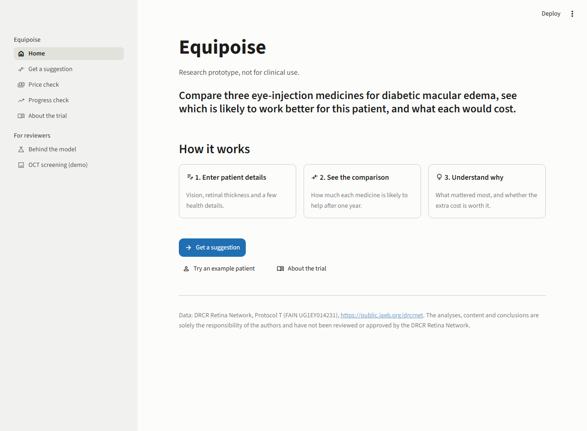
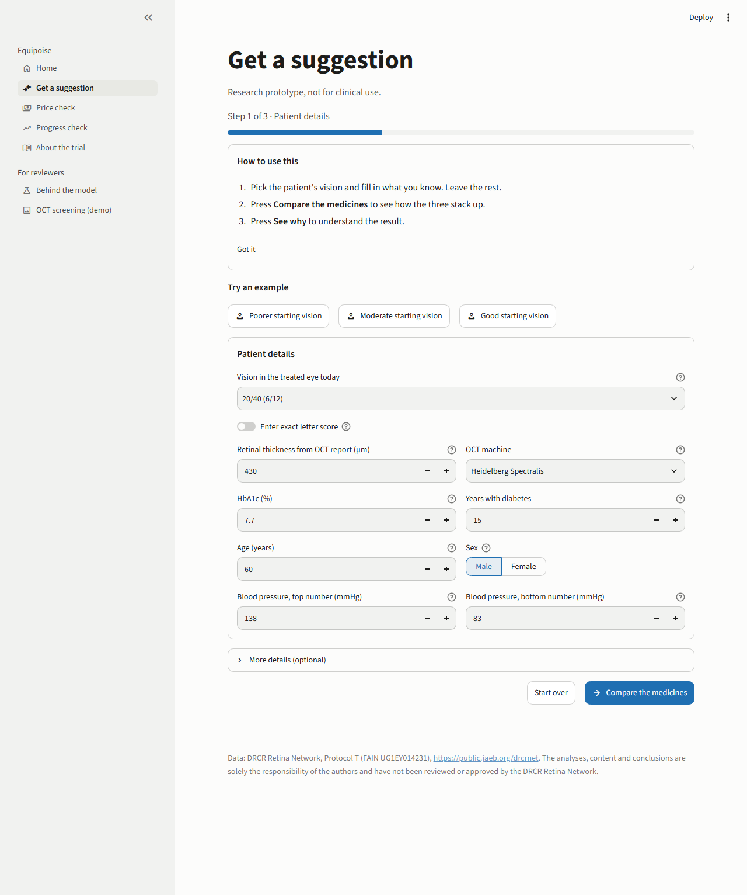
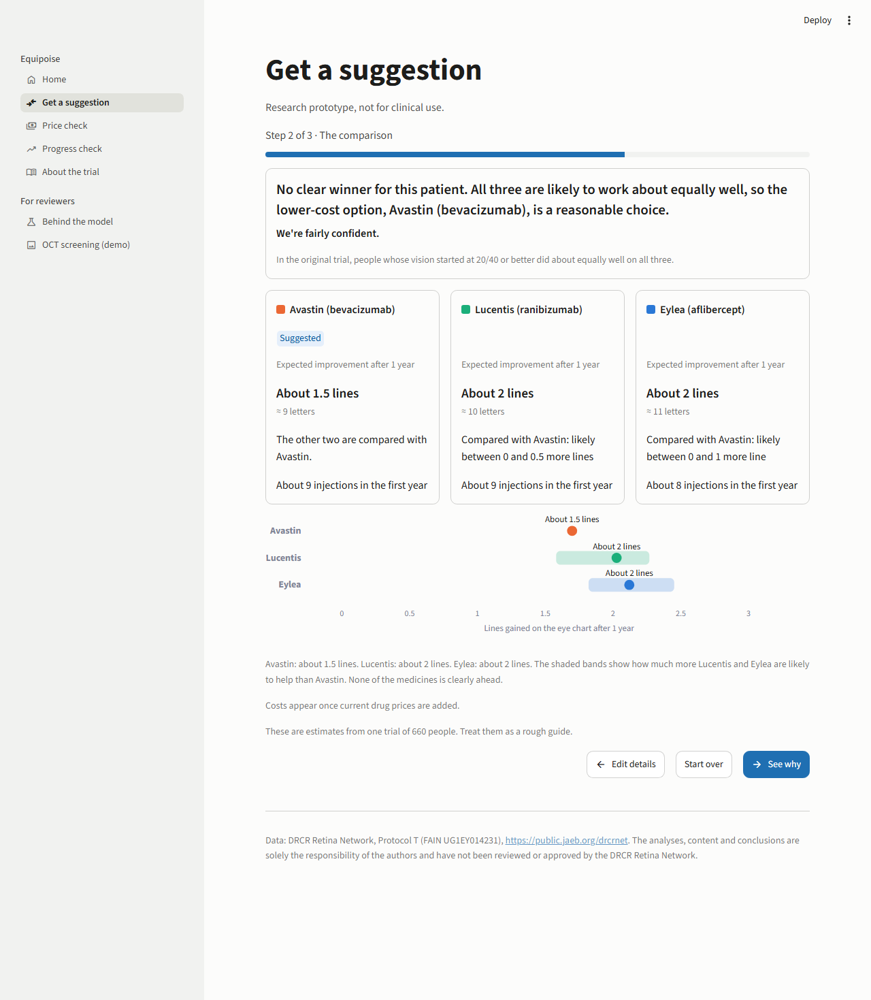
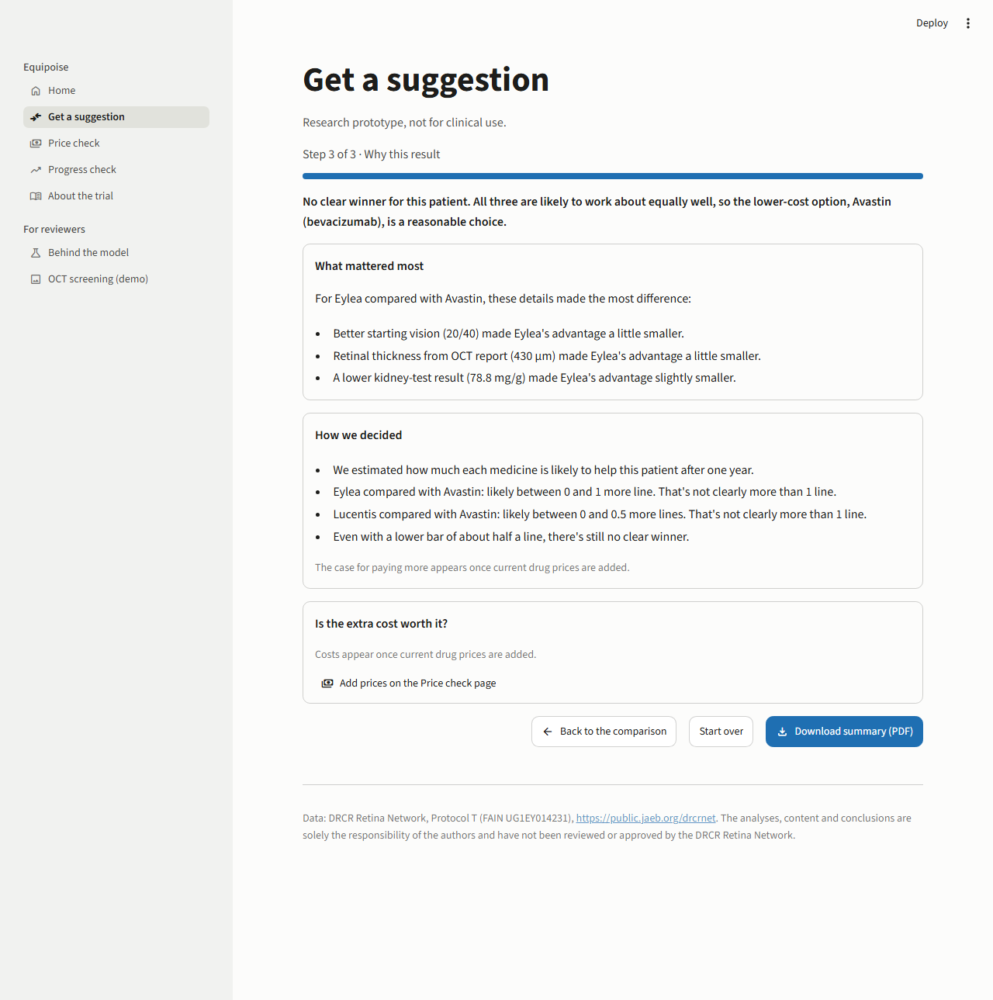
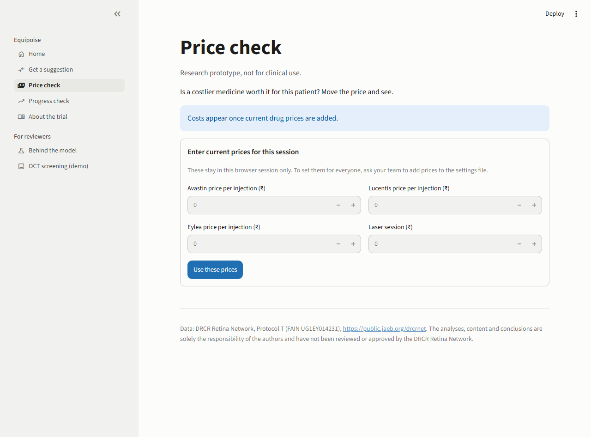
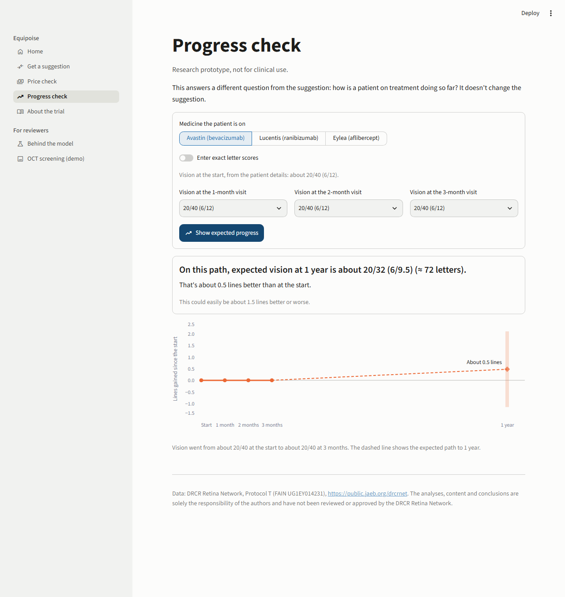
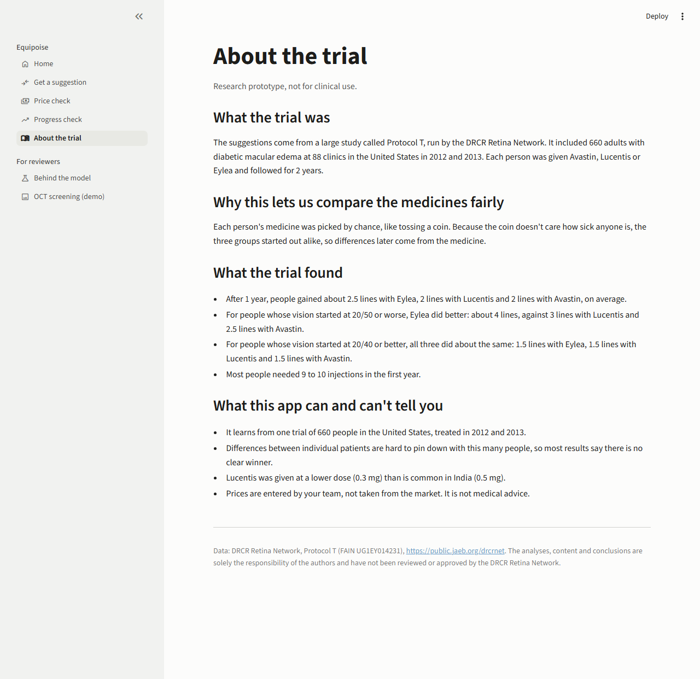
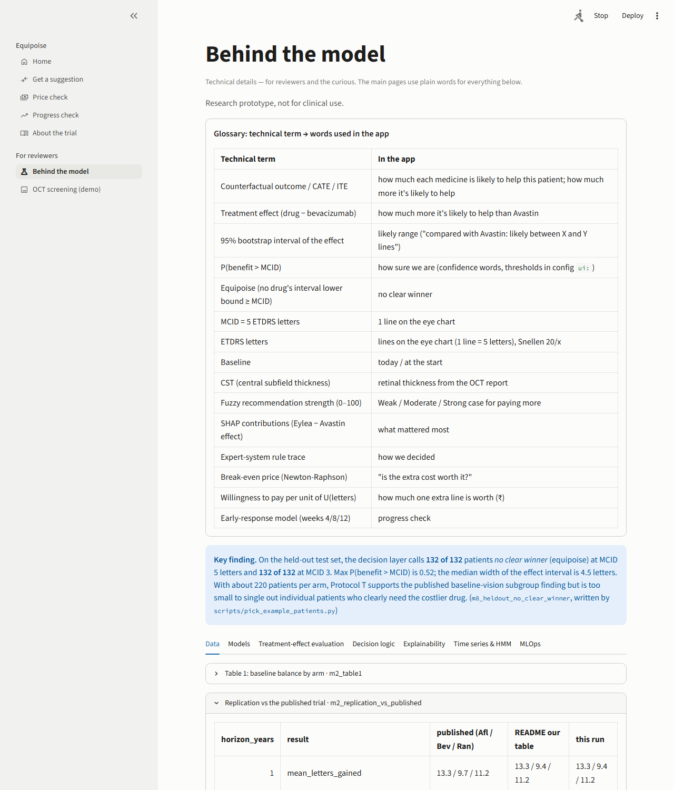

# Equipoise user guide

Equipoise compares three eye-injection medicines for diabetic macular edema (DME):

| Brand | Generic | Price |
|---|---|---|
| Avastin | bevacizumab | lowest |
| Lucentis | ranibizumab | middle |
| Eylea | aflibercept | highest |

For one patient, it shows how much each medicine is likely to help after a year, how sure
it is, and (once your team adds prices) whether the extra cost is worth it.

> **Research prototype, not for clinical use.** It learns from one US trial of 660 people
> (DRCR Protocol T). Use it to support a conversation, not to make the decision.

Screenshots were taken at desktop width (1280 px) with the default "typical patient", using
`scripts/ui_screenshots.py`. Phone-width versions (390 px) are next to them in
`reports/figures/ui/` (`*_phone.png`).

## How to read the numbers

- **Lines on the eye chart.** One line is 5 letters. "About 2 lines (≈ 10 letters)" means
  the patient is expected to read about two more lines after one year.
- **Likely range.** For Lucentis and Eylea, the card says how much *more* than Avastin they
  are likely to help: "Compared with Avastin: likely between 0 and 1 more line". Avastin has
  no range of its own, because the other two are measured against it.
- **No clear winner.** The app only names a costlier medicine as the suggestion when its
  extra benefit is clearly more than 1 line, across the whole likely range. Otherwise it says
  "No clear winner" and that Avastin, the lower-cost option, is a reasonable choice.
- **How sure we are.**

  | Phrase | Meaning |
  |---|---|
  | "We're fairly confident." | The headline holds in at least 8 out of 10 of the model's re-runs. |
  | "We're somewhat confident." | 6 to 8 out of 10. |
  | "This is a close call." | Fewer than 6 out of 10. |

  The thresholds are in `config/default.yaml` (`ui.confidence`).
- **Costs.** Until your team fills `config/costs.yaml` with current prices, the app shows no
  cost figures at all: "Costs appear once current drug prices are added." Injection counts
  are always shown.

## 1. Home

The home page says in one sentence what the app does and how it works, in three steps.
- **Get a suggestion** opens the form.
- **Try an example patient** opens the same form, where the example buttons are.
- **About the trial** explains where the data comes from.

## 2. Get a suggestion, step 1: patient details

- **Try an example.** Three real patients from the trial's test group, who were not used
  for training: *Poorer*, *Moderate* and *Good starting vision*. Clicking one fills the form.
  You can change any detail.
- **Vision in the treated eye today.** Pick the Snellen reading (20/32 to 20/320, with the
  6 m equivalent). If your clinic records a letter score, switch on **Enter exact letter
  score**.
- **The other essential details:** retinal thickness from the OCT report and which OCT
  machine was used, HbA1c, years with diabetes, age, sex and blood pressure. Every field has
  a ⓘ tooltip.
- **More details (optional).** Everything else, already filled with typical values: "We've
  used typical values for anything you leave blank." Set a field to *Not known* if you
  don't have it.
- **Compare the medicines.** Takes about 2 seconds, and is instant for the examples. If a
  number is out of range, a plain message says which one and what range is allowed.

## 3. Step 2: the comparison

Read it from the top:
1. **The headline.** One sentence that answers the question, then how sure we are. When
   the trial data hints that Eylea may help a little more, but not clearly, an extra line says
   so: "worth discussing if cost is not a concern". Avastin stays the stated reasonable
   choice.
2. **The trial finding.** What Protocol T found on average for people with similar starting
   vision.
3. **Three cards.** Expected improvement in lines, the likely range compared with Avastin,
   injections in the first year, and the cost (once prices are set). The **Suggested** tag
   marks the suggested medicine.
4. **The chart.** The dot is the expected lines gained. The soft band is the likely range
   of the difference from Avastin. The sentence under the chart says the same thing in words.

Buttons: **Edit details** (back to step 1, nothing lost), **Start over** (clears the
patient), **See why**.

## 4. Step 3: why this result

- **What mattered most.** The three details that moved the Eylea-vs-Avastin estimate the
  most for this patient, e.g. "A thicker retina (768 µm) made Eylea's advantage noticeably
  larger." This explains the model, not the biology.
- **How we decided.** The decision rules in 2 to 4 short sentences, including a check with a
  lower bar of about half a line. Once prices are set, a line also says "Weak / Moderate /
  Strong case for paying more".
- **Is the extra cost worth it?** Needs prices. Enter how much one extra line of vision is
  worth to the patient (₹), then move the price slider. One sentence gives the price above
  which the costlier medicine stops being worth it.
- **Download summary (PDF).** One printable page with the headline, the three cards, what
  mattered most and the disclaimer.

## 5. Price check

This is the "Is the extra cost worth it?" tool on its own, for the patient you already
entered. Until prices are in `config/costs.yaml`, you can type current prices for this
browser session only (Avastin, Lucentis, Eylea per injection, and a laser session).

## 6. Progress check

This answers a different question: how is a patient on treatment doing so far? It doesn't
change the suggestion.
1. Pick the medicine the patient is on.
2. Enter the eye-chart readings at the 1-, 2- and 3-month visits.
3. Press **Show expected progress**.

The result reads "On this path, expected vision at 1 year is about …", plus how much this
could vary. The small chart shows the visits (solid line) and the expected path (dashed).

## 7. About the trial

This page covers:
- what Protocol T was;
- why picking the medicine by chance allows a fair comparison;
- the trial's main results in eye-chart lines, read from our replication table;
- what the app can and can't tell you.

## 8. For reviewers: Behind the model

All the technical detail lives here: a glossary mapping each technical term to the words
used in the app, the key held-out finding, and tabs for:
- Data
- Models
- Treatment-effect evaluation
- Decision logic
- Explainability
- Time series & HMM
- MLOps

The current patient's full output appears in the relevant tabs: the estimates table, the
rule trace, the SHAP waterfall and the break-even curve. Clinicians don't need this page.

**OCT screening (demo)** is a separate image-classification demo on a different dataset. It
is not connected to the suggestion.

## Common questions

- **Why does it almost always say "No clear winner"?** On the 132 test patients, the model
  never found a costlier medicine clearly more than 1 line better. That is a real result:
  one trial of 660 people is too small to pick out individual patients who clearly need the
  costlier drug (`reports/tables/m8_heldout_no_clear_winner.md`).
- **Why no costs?** Prices haven't been added yet. The app doesn't show made-up numbers.
- **It says the model couldn't load.** Ask your team to run the Quick start in the README.
